# WareTrack — Requirements & System Architecture v1.2

> Tài liệu hợp nhất: audit BRD, đặc tả chức năng chi tiết và thiết kế kiến trúc hệ thống (Bước 2).
> Ngôn ngữ: tiếng Việt; thuật ngữ kỹ thuật, entity, API, code giữ tiếng Anh.

---

## 1. Document Control

| Thuộc tính | Giá trị |
|---|---|
| Tên tài liệu | WareTrack — Requirements & System Architecture |
| Phiên bản | 1.2 (Baseline đã phê duyệt + chốt nơi chạy API demo) |
| Ngày lập | 10/10/2026 (cập nhật quyết định: 10/10/2026) |
| Tài liệu nguồn | `WareTrack_BRD_v1.0_2026-10-10` (bản `.md` chuyển đổi đầy đủ từ `.docx` gốc; file `.docx` không còn trong thư mục `docs/` tại thời điểm lập tài liệu), `WareTrack_Stack_v1.0.md`, video demo UI tham chiếu (72 giây, 5 site WH-01…WH-05) |
| Trạng thái | **Đã phê duyệt** bởi chủ dự án ngày 10/10/2026: toàn bộ 50 đề xuất được chốt (`DEC-01…DEC-50`) và 7 thông tin bổ sung được ghi nhận (`DEC-51…DEC-57`); nơi chạy API demo chốt là **Render** (`DEC-58`, đóng Q-21) — mục 28 Decision Log. Dự án ở giai đoạn **demo**. Còn 3 câu hỏi mở (mục 26.2), không câu nào chặn triển khai demo. |
| Phạm vi | Một doanh nghiệp, nhiều site; WMS + YMS + Vehicle Storage + Shipment + Equipment + 3D Monitoring |
| Đối tượng đọc | Product Owner, BA, Tech Lead, Backend/Frontend developer, QA, DevOps |

### 1.1. Quy ước nhãn trạng thái yêu cầu

| Nhãn | Ý nghĩa |
|---|---|
| `[BRD]` | Đã được BRD v1.0 xác nhận (baseline nghiệp vụ). |
| `[INF]` | Suy ra hợp lý, cần thiết để triển khai đúng một yêu cầu `[BRD]`; không thay đổi phạm vi. |
| `[APR]` | Đề xuất bổ sung **đã được phê duyệt** ngày 10/10/2026 (trước đó là `[PRO]`/`[TBD]`); chi tiết và giá trị mặc định ở mục 28 (Decision Log). Có hiệu lực như yêu cầu chính thức. |
| `[PRO]` | Đề xuất mới, **cần phê duyệt** trước khi coi là yêu cầu chính thức. (Hiện không còn mục nào.) |
| `[TBD]` | Chưa đủ thông tin để quyết định; xem mục 26 (Open Questions). (Hiện không còn mục nào; các mục thông tin chờ cung cấp ở mục 26.2.) |

### 1.2. Quy ước mã

| Tiền tố | Ý nghĩa |
|---|---|
| `D-xx` | Quyết định nghiệp vụ đã chốt (BRD mục 1). |
| `BR-xx` | Business rule (BR-01…BR-10 từ BRD; BR-11 trở đi là bổ sung). |
| `FR-xx` / `FR-xx.yy` | Functional requirement (FR-01…FR-21 từ BRD; `.yy` là chi tiết hóa). |
| `UC-xx` | Use case. |
| `AC-xx` | Acceptance criteria cấp sản phẩm (BRD). `UC-xx-ACn` là AC cấp use case. |
| `NFR-xx` | Non-functional requirement. |
| `GAP-xx` | Mục trong gap analysis. |
| `Q-xx` | Câu hỏi mở / quyết định chờ xác nhận (trạng thái ở mục 26). |
| `DEC-xx` | Quyết định đã phê duyệt (mục 28 — Decision Log). |

> **Lưu ý về đánh số:** Task brief gọi 5 quyết định nghiệp vụ là "BR-01…BR-05", trong khi BRD dùng `D-01…D-05` cho quyết định và `BR-01…BR-10` cho business rule. Để tránh trùng mã, tài liệu này giữ **`D-01…D-05`** cho quyết định (ánh xạ 1-1 với BR-01…BR-05 của brief) và `BR-xx` cho business rule.

### 1.3. Lịch sử thay đổi

| Phiên bản | Ngày | Nội dung |
|---|---|---|
| 1.0 | 10/10/2026 | Bản đầu: audit BRD, use case, process, state machine, RBAC, KPI, kiến trúc, DB, API, realtime, 3D, security, NFR, roadmap, testing. |
| 1.1 | 10/10/2026 | Chủ dự án phê duyệt toàn bộ 50 đề xuất. Nhãn `[PRO]`/`[TBD]` → `[APR]`; thêm mục 28 Decision Log; cập nhật nội dung theo quyết định (DEC-10 pallet 1 SKU + 1 lô, DEC-12 KPI on-time dispatch, DEC-14 ngưỡng duyệt điều chỉnh, DEC-15 dung sai nhận thừa 0%, DEC-18 tắt partial dispatch, DEC-20 checklist mặc định, DEC-24 NO_SHOW 60 phút, DEC-28 TTL dock 30 phút, DEC-33 tắt self-assign, DEC-34 không bắt buộc duyệt kép khi gán Admin, DEC-37 bỏ lịch sử mật khẩu, DEC-40 retention, DEC-44 Yard occupancy vào Must, DEC-47 i18n); tách mục 26 thành "đã chốt" và "còn mở". Ghi nhận thông tin bổ sung DEC-51…DEC-57: giai đoạn demo dùng seed data, web deploy Vercel (thêm mục 12.7), không IdP, không thiết bị hiện trường, không cảm biến (FR-20.01/20.03 → Later), tự thiết kế 3D, dùng checklist mặc định. Tên file giữ nguyên để không gãy liên kết. |
| 1.2 | 10/10/2026 | Chốt nơi chạy API demo: **Render** (DEC-58, đóng Q-21) — cập nhật 12.7 (Render Docker + PostgreSQL, biến môi trường, CI/CD, hạn chế gói free), mục 22/23, 26. Thêm 28.8 ghi chú triển khai (IMP-01…IMP-06). |

---

## 2. Executive Summary

WareTrack là hệ thống quản lý vận hành logistics cho **một doanh nghiệp có nhiều site** (kho, bãi, cross-dock, kho lạnh). Hệ thống quản lý đồng thời: tồn kho hàng hóa/pallet, **xe ô tô lưu bãi** (định danh VIN, là *hàng hóa/tài sản*), **xe tải vận chuyển** (là *phương tiện* đến/rời site), gate, dock, parking slot, staging, xe nâng, tác vụ vận hành và shipment. Giao diện chính là dashboard 3D isometric (theo video tham chiếu) **phản ánh** trạng thái nghiệp vụ từ backend; giao diện 2D luôn đủ chức năng khi 3D không khả dụng.

**Kết luận audit BRD:** BRD v1.0 có phạm vi rõ, quyết định nghiệp vụ nhất quán và các nguyên tắc dữ liệu đúng hướng (ledger, idempotency, bằng chứng vị trí, state machine độc lập). Tuy nhiên BRD ở mức baseline nên còn thiếu để developer triển khai trực tiếp: (1) danh sách trạng thái giữa mục 4 và mục 8 **không khớp** cho Truck Visit và Stored Vehicle; (2) "Reserved" bị liệt kê như trạng thái tồn kho trong khi BR-02 coi là phần trừ (allocation); (3) thiếu state machine cho Forklift/Equipment; (4) chưa định nghĩa công thức KPI; (5) chưa có ma trận RBAC chi tiết; (6) thời điểm ghi giảm tồn khi xuất còn mở; (7) AC-07 còn nhắc SignalR (stack đã chốt Socket.IO); (8) shipment inbound chưa được mô hình hóa nhưng video có "Unloading". Tổng cộng **34 gap** được ghi nhận ở mục 4, mỗi gap có đề xuất xử lý và nhãn trạng thái.

**Kiến trúc đề xuất:** Modular Monolith NestJS (Node.js 24) + PostgreSQL/Prisma; REST + OpenAPI; Socket.IO gateway phát event **sau commit** qua **transactional outbox**; frontend React 19 + Vite + R3F với tách bạch 3 lớp state: *Business State* (TanStack Query, nguồn duy nhất từ backend), *Visualization State* (Zustand: selection, camera, site đang xem), *Animation State* (cục bộ trong R3F frame loop, không bao giờ ghi ngược về nghiệp vụ). Toàn vẹn dữ liệu dựa trên ràng buộc PostgreSQL (partial unique index, check constraint, row lock) chứ không chỉ kiểm tra ở tầng ứng dụng.

**Quy mô đặc tả:** 112 functional requirements chi tiết (21 FR gốc), 37 business rules, 24 use cases, 9 quy trình, 8 state machine, 59 entity, 201 REST endpoint, 18 realtime event theo site (+ 3 event phòng user), 10 KPI, 33 sơ đồ Mermaid.

**Mức sẵn sàng (v1.1):** Toàn bộ quyết định nghiệp vụ và kỹ thuật đã được chốt (mục 28). Có thể triển khai tuần tự Phase 0 → Phase 7 mà không còn điểm chặn. Dự án ở giai đoạn demo (DEC-51): dữ liệu là seed data, 3D dùng layout tự thiết kế (DEC-56), web deploy lên Vercel (DEC-52), API + PostgreSQL deploy lên Render (DEC-58). Câu hỏi còn mở (mục 26.2) không chặn bản demo.

---

## 3. Approved Business Decisions

Các quyết định dưới đây là **chính thức, không thay đổi** trong tài liệu này. Cột "Hệ quả thiết kế" là cách kiến trúc tuân thủ quyết định (`[INF]`).

| Mã | Brief | Quyết định | Hệ quả thiết kế bắt buộc |
|---|---|---|---|
| D-01 | BR-01 | **Phạm vi kinh doanh:** quản lý đồng thời hàng hóa/pallet/tồn kho, xe ô tô lưu bãi, xe tải vận chuyển, dock/gate/parking slot/staging, xe nâng & thiết bị, shipment. | Hai aggregate tách biệt: `StoredVehicle` + `VehicleStay` (xe ô tô là *đối tượng lưu bãi*, định danh VIN) và `Truck` + `TruckVisit` (xe tải là *phương tiện vận chuyển*, định danh biển số/mã nội bộ). Không dùng chung bảng, không dùng chung state machine. |
| D-02 | BR-02 | **Xác nhận vị trí thực tế:** kết hợp QR/nhập liệu của nhân viên với GPS/RFID/camera/cảm biến khi được tích hợp. Animation 3D **không** là vị trí thực tế. | Mọi vị trí lưu kèm `positionSource` (`CONFIRMED_MANUAL`, `CONFIRMED_SCAN`, `SENSOR_OBSERVED`, `INFERRED`) và `confirmedAt`. Dữ liệu cảm biến vào bảng `LocationObservation` (raw) và chỉ thành vị trí xác nhận qua quy tắc phân xử (BR-08, BR-09). Frontend nội suy animation ở lớp Animation State, không gửi về backend. |
| D-03 | BR-03 | **Quản lý hàng nhiều cấp:** SKU, quantity, pallet, lot/batch, serial, VIN. | `Sku` (cờ `lotTracked`, `serialTracked`), `Lot`, `SerialUnit`, `HandlingUnit` (pallet), `InventoryBalance` theo khóa (site, location, sku, lot, handlingUnit, stockStatus), `InventoryTransaction` ledger. VIN thuộc `StoredVehicle`. |
| D-04 | BR-04 | **Multi-site:** một doanh nghiệp quản lý nhiều kho/bãi. Thiết kế theo `siteId`, RBAC, phân vùng dữ liệu phù hợp. **Không** mở rộng thành multi-tenant SaaS. | Mọi bảng nghiệp vụ có `siteId NOT NULL` (trừ master data cấp doanh nghiệp: `User`, `Role`, `Sku`, `Carrier`, `StoredVehicle` master). Quyền gán theo `UserSiteRole`. Không có `tenantId`, không có cơ chế cô lập tenant. |
| D-05 | BR-05 | **Vận hành độc lập** giai đoạn đầu, không phụ thuộc ERP/TMS; kiến trúc có khả năng tích hợp sau. | Đơn nhập/xuất, shipment, lịch hẹn được tạo trong WareTrack (UI hoặc import CSV `[APR]`). API REST có versioning `/api/v1`, outbox event có thể được chuyển tiếp ra ngoài sau này. Không có dependency runtime vào hệ thống bên ngoài. |

> **Đối chiếu brief ↔ BRD:** Brief mở rộng D-01 bằng cách liệt kê rõ dock/gate/xe nâng/shipment. Nội dung này nhất quán với BRD mục 2 (danh sách phân hệ trong phạm vi), nên được coi là `[BRD]`, không phải đề xuất mới. Câu "không tự mở rộng thành multi-tenant SaaS" ở D-04 là ràng buộc bổ sung của brief, được áp dụng.

---

## 4. BRD Gap Analysis

### 4.1. Phương pháp

BRD v1.0 được đọc toàn bộ (13 mục). Mỗi nhóm chức năng được kiểm tra theo 5 tiêu chí: (a) có định nghĩa đối tượng; (b) có quy trình và ngoại lệ; (c) có trạng thái nhất quán; (d) có quy tắc dữ liệu/toàn vẹn; (e) có tiêu chí nghiệm thu. Video demo được dùng để đối chiếu yêu cầu dashboard/3D (BRD mục 9 tham chiếu "video tham chiếu").

### 4.2. Mâu thuẫn và điểm không nhất quán trong BRD

| # | Vị trí | Mô tả mâu thuẫn | Hướng xử lý đề xuất | Nhãn |
|---|---|---|---|---|
| C-01 | Mục 4.1 vs mục 8 | Truck Visit: mục 4.1 có `Verified`, `Assigned Dock`, `Ready To Leave`; mục 8 có `AtGate, Waiting, Docked, Handling, ReadyExit, Exited, Cancelled`, thiếu `Verified`, thiếu trạng thái từ chối/không đến. | Hợp nhất thành 11 trạng thái ở mục 9.1: `SCHEDULED, AT_GATE, WAITING, DOCK_ASSIGNED, AT_DOCK, HANDLING, READY_TO_LEAVE, EXITED, REJECTED, NO_SHOW, CANCELLED`. "Verified" là *transition* `AT_GATE → WAITING` có điều kiện xác minh. | `[INF]` (REJECTED, NO_SHOW là `[APR]`) |
| C-02 | Mục 4.4 vs mục 8 | Stored Vehicle: mục 4.4 có `Inspected`, `Allocated Slot`; mục 8 không có. Mục 4.4 đồng thời yêu cầu tách trạng thái điều kiện xe khỏi trạng thái vị trí. | Lifecycle (`VehicleStay.status`) giữ đủ chuỗi mục 4.4; tình trạng xe là trường riêng `conditionStatus`; vị trí là `LocationOccupancy`. | `[INF]` |
| C-03 | Mục 8 vs BR-02 | Stock liệt kê `Reserved` như trạng thái, nhưng BR-02 định nghĩa `available = on-hand − allocated − held`, tức reserved là *phần phân bổ*, không phải trạng thái vật lý. | `StockStatus` = `AVAILABLE, QC_HOLD, QUARANTINE, DAMAGED` (trạng thái chất lượng/khả dụng). Reservation là bản ghi riêng (`Reservation`) và cột `qtyReserved` trong balance. | `[INF]` |
| C-04 | Mục 12 vs mục 4.3 | Thời điểm ghi giảm tồn khi outbound còn mở nhưng mục 4.3 yêu cầu "chính sách thống nhất, tránh giảm hai lần". | Đề xuất ghi giảm on-hand tại **Dispatch Confirmation**; pick chỉ chuyển vị trí sang staging; loading chỉ gắn HU vào shipment. Đã chốt (DEC-08). | `[APR]` |
| C-05 | AC-07 | Nhắc "Mất SignalR" trong khi stack chốt Socket.IO. | Đọc là "mất kết nối realtime (Socket.IO)". | `[INF]` |
| C-06 | Mục 8 | Không có trạng thái cho Forklift/Equipment, dù mục 4.6 và video có trạng thái xe nâng (Loading truck, Unloading truck, idle, charger, battery). | Bổ sung state machine Forklift (mục 9.7). | `[INF]` |
| C-07 | Mục 8 Shipment | Chỉ có chiều outbound. Video hiển thị shipment inbound với bước `Unloading 2/6`. | Shipment có `direction` (`INBOUND`/`OUTBOUND`) và hai chuỗi trạng thái (mục 9.5). | `[APR]` |
| C-08 | Mục 7 vs mục 4.1 | Mục 4.1 liệt kê "tài xế" là người thực hiện nhưng mục 7 không có vai trò Driver. | MVP: tài xế **không** có tài khoản; thông tin tài xế là dữ liệu (`Driver`) do Gate Security nhập. Driver self-service là `Later`. | `[APR]` |
| C-09 | FR-20 (P1/P2) vs D-02 | D-02 yêu cầu kết hợp cảm biến, nhưng adapter cảm biến cụ thể ở P1/P2. | MVP xây **mô hình dữ liệu và API ingestion chung** cho observation (`POST /observations`), xác nhận QR/manual là nguồn chính; adapter thiết bị cụ thể ở phase sau. Không mâu thuẫn với D-02 vì D-02 nói "khi được tích hợp". | `[INF]` |
| C-10 | Video vs BRD mục 9 | Video: KPI "Stock on hand 1,412 pallets" ở thanh KPI, nhưng inspector site liệt kê inventory theo **units** ("LED Panel 1,787 units"), và "78% full" không nói rõ là % của gì. | KPI phải ghi rõ đơn vị (mục 11). "Site fill %" phải chọn một mẫu số (pallet positions) và hiển thị đơn vị. | `[INF]` |
| C-11 | Video vs BRD D-01 | Video không có xe ô tô lưu bãi; chỉ có xe tải, xe nâng, pallet. | Bổ sung loại đối tượng 3D `STORED_VEHICLE`, layer vehicle storage, inspector VIN. | `[INF]` |

### 4.3. Requirement Gap Analysis

Cột **Status**: `[BRD]` đã xác nhận, `[INF]` suy ra cần thiết, `[APR]` đề xuất đã phê duyệt ngày 10/10/2026 (xem mục 28).

| Requirement ID | Existing BRD | Missing/Incomplete | Proposed Resolution | Priority | Status |
|---|---|---|---|---|---|
| GAP-01 | FR-02: quản lý site, zone, dock, slot, location | Không có thuộc tính bắt buộc của location (capacity, max weight, loại, kích thước), không có mã định danh in QR | Location có `type`, `capacityUnits`, `maxWeightKg`, `code` duy nhất trong site, `qrValue` duy nhất toàn hệ thống (mục 15) | P0 | `[INF]` |
| GAP-02 | FR-02 | Không có quy tắc khi vô hiệu hóa/sửa location đang có hàng/xe | Không cho deactivate location có occupancy/balance > 0; chỉ cho `block` (BR-21) | P0 | `[INF]` |
| GAP-03 | Mục 9 "mỗi site có layout riêng" | Không có mô hình layout 3D, versioning layout, hệ tọa độ | `LayoutVersion` + `LayoutObject`, hệ tọa độ mét site-local (mục 18) | P0 | `[INF]` |
| GAP-04 | FR-04, mục 4.1 | Không quy định visit không có lịch hẹn | Cho phép tạo visit `unscheduled=true` tại gate, cần quyền `yard.visit.create_walkin` | P0 | `[INF]` |
| GAP-05 | Mục 4.1 ngoại lệ "trùng lượt đến" | Không định nghĩa thế nào là trùng | Một `Truck` chỉ có tối đa 1 visit active (partial unique index) toàn doanh nghiệp | P0 | `[INF]` |
| GAP-06 | Mục 4.1 | Không có thời hạn cho visit SCHEDULED không đến | Job đánh dấu `NO_SHOW` sau `appointmentEnd + noShowGraceMinutes` (cấu hình site, mặc định **60 phút**) | P1 | `[APR]` (DEC-24) |
| GAP-07 | FR-05 | Không có thuật toán gợi ý dock/slot | MVP: dispatcher chọn thủ công, hệ thống lọc dock phù hợp (direction, available). Auto-suggest là `Should` | P0 | `[APR]` |
| GAP-08 | Mục 4.4 | Không có checklist kiểm tra xe khi nhận | `VehicleInspection` với checklist cấu hình được + ảnh (MinIO) + `conditionStatus` | P0 | `[INF]` |
| GAP-09 | Mục 4.4 | Không quy định điều kiện chặn release xe | Release bị chặn nếu: `holdFlag`, thiếu giấy tờ bắt buộc, chưa được duyệt release request (AC-09) | P0 | `[INF]` |
| GAP-10 | FR-03 | Không quy định VIN validation | VIN 17 ký tự, không chứa I/O/Q; check digit vị trí 9 chỉ cảnh báo (xe ngoài Bắc Mỹ có thể không áp dụng) | P0 | `[INF]` |
| GAP-11 | D-03, FR-06 | Không rõ pallet có được trộn SKU/lô | Mặc định **1 pallet = 1 SKU + 1 lô**; site có thể bật pallet trộn (`SiteSetting.mixedPalletAllowed`, mặc định `false`) | P0 | `[APR]` (DEC-10) |
| GAP-12 | Mục 4.2 | Không có quy trình xử lý sai lệch thực nhận (thừa/thiếu/hỏng) | `ReceiptDiscrepancy` + `ExceptionCase`; nhận thừa cần phê duyệt Warehouse Supervisor | P0 | `[INF]` |
| GAP-13 | Mục 4.2 QC | Không có kết quả QC chuẩn | QC result: `PASS` → AVAILABLE, `FAIL` → QUARANTINE/DAMAGED, `PARTIAL` tách số lượng | P0 | `[INF]` |
| GAP-14 | Mục 4.3, mục 12 | Thời điểm giảm tồn | Ghi giảm on-hand duy nhất tại Dispatch Confirmation (C-04, BR-22) | P0 | `[APR]` (DEC-08) |
| GAP-15 | Mục 12 | FIFO/FEFO chưa chốt | Reservation strategy cấu hình theo SKU: `FIFO` (mặc định), `FEFO` cho SKU có `expiryTracked` | P0 | `[APR]` (DEC-09) |
| GAP-16 | Mục 4.3 | Không có quy định short-pick | Short pick tạo `ExceptionCase`, giải phóng phần reservation không lấy được, dòng order chuyển `PARTIALLY_PICKED` | P0 | `[INF]` |
| GAP-17 | FR-10 | Shipment chưa có cấu trúc (dòng, HU, VIN) | `Shipment` + `ShipmentItem` (HU hoặc VehicleStay) + `ShipmentMilestone` | P0 | `[INF]` |
| GAP-18 | FR-10 | "Delivered" xảy ra ngoài site; không có nguồn xác nhận khi không có TMS | Delivered được xác nhận thủ công (có POD file tùy chọn); KPI on-time chỉ tính shipment có `deliveredAt` | P1 | `[APR]` |
| GAP-19 | Mục 4.6, FR-15 | Không có trạng thái xe nâng, pin, sạc | State machine Forklift (mục 9.7); battery là telemetry `SENSOR_OBSERVED` hoặc nhập tay | P1 | `[INF]` |
| GAP-20 | Mục 4.6 "không nhận xung đột tác vụ" | Không định nghĩa xung đột | Một forklift và một operator chỉ có tối đa 1 task `IN_PROGRESS` (partial unique index) | P1 | `[INF]` |
| GAP-21 | FR-16, mục 4.5 | Ngưỡng phê duyệt chênh lệch kiểm kê chưa có | Ngưỡng cấu hình theo site; mặc định: \|chênh\| ≤ 5 đơn vị cơ sở **và** ≤ 2% → Warehouse Supervisor duyệt; vượt → Site Manager | P1 | `[APR]` (DEC-14) |
| GAP-22 | Mục 4.5 | Kiểm kê có đóng băng location không | Blind count + `countFreeze` tùy chọn theo đợt; location bị freeze không nhận put-away/pick | P1 | `[APR]` |
| GAP-23 | FR-12 | Không có quy định object không có tọa độ | Object không có `LayoutObject` vẫn hiển thị trong bảng 2D, trong 3D hiển thị ở "unplaced tray" của zone | P0 | `[APR]` |
| GAP-24 | FR-13 | Không có cơ chế thứ tự event, phát hiện mất event | `siteSeq` tăng dần theo site + snapshot `asOfSeq` (mục 17) | P0 | `[INF]` |
| GAP-25 | FR-14, BR-08 | Không có quy tắc phân xử observation | Rule: observation chỉ tự xác nhận nếu `confidence ≥ threshold` **và** không mâu thuẫn xác nhận thủ công trong `manualPrecedenceWindow`; ngược lại tạo `ExceptionCase` | P1 | `[APR]` |
| GAP-26 | FR-01 | Không quy định cơ chế đăng nhập (local hay IdP) | MVP: local account + JWT; OIDC (IdP doanh nghiệp) là adapter cấu hình được, làm sau (IdP cụ thể: Q-22) | P0 | `[APR]` (DEC-36) |
| GAP-27 | Mục 7 | Không có ma trận quyền chi tiết | Ma trận module × action × role (mục 10) | P0 | `[INF]` |
| GAP-28 | BR-10 "hành động nhạy cảm cần phê duyệt" | Không liệt kê hành động nhạy cảm | Danh sách: stock adjustment, hủy giao dịch, release xe có hold, override capacity, gán quyền Admin (mục 10.3) | P0 | `[INF]` |
| GAP-29 | FR-19 | Không có danh sách báo cáo | MVP: export CSV các bảng vận hành, lịch sử movement, ledger, audit. Báo cáo định kỳ là `Should` | P1 | `[APR]` |
| GAP-30 | FR-18 | Không có danh sách cảnh báo | Danh sách cảnh báo nghiệp vụ (mục 5, FR-18.x): low stock, dock overdue, visit quá giờ, observation conflict, slot capacity, forklift battery thấp | P1 | `[APR]` |
| GAP-31 | NFR mục 10 | RPO/RTO chưa có; workload cho p95 chưa định nghĩa | Mục tiêu đã chốt: RPO ≤ 15 phút, RTO ≤ 4 giờ, khả dụng 99,5% giờ vận hành; giai đoạn demo không có số liệu thật nên dùng workload chuẩn ở mục 20 + seed data (DEC-51) | P1 | `[APR]` (DEC-39) |
| GAP-32 | Mục 9 KPI | Công thức KPI chưa có | Định nghĩa đầy đủ ở mục 11 | P0 | `[INF]` |
| GAP-33 | Không có | Quy trình incident/sự cố (va chạm, hư hỏng, tai nạn) chỉ được nhắc ở FR-17 | `ExceptionCase` với category `INCIDENT`, quy trình ở mục 8.9 | P1 | `[INF]` |
| GAP-34 | Không có | Offline/mất mạng tại hiện trường (mục 12 nhắc "phương án mất mạng") | MVP: client hiển thị stale, **không** cho ghi offline. Offline queue cho máy quét là `Later` | P1 | `[APR]` (DEC-42) |

### 4.4. Tổng hợp theo nhóm

| Nhóm | Mức đầy đủ BRD | Gap chính | Đánh giá khả năng triển khai |
|---|---|---|---|
| Site/Zone/Location | Trung bình | GAP-01..03 | Triển khai được sau khi bổ sung thuộc tính và layout model |
| Yard Management | Khá | C-01, GAP-04..07 | Triển khai được; cần chốt NO_SHOW |
| Vehicle Storage | Khá | C-02, GAP-08..10 | Triển khai được |
| Inventory | Trung bình | C-03, GAP-11, GAP-15 | Triển khai được (DEC-09, DEC-10 đã chốt) |
| Inbound/Outbound | Trung bình | C-04, GAP-12..16 | Triển khai được (DEC-08 đã chốt) |
| Shipment | Yếu | C-07, GAP-17..18 | Cần duyệt mô hình 2 chiều |
| Forklift/Equipment | Yếu | C-06, GAP-19..20 | Triển khai được với đề xuất |
| Gate Operations | Khá | GAP-04..05 | Triển khai được |
| Realtime Monitoring | Khá | GAP-24 | Triển khai được |
| 3D Visualization | Khá (nguyên tắc tốt) | GAP-03, GAP-23, C-10, C-11 | Triển khai được |
| AuthN/AuthZ | Trung bình | GAP-26..28 | Triển khai được: local auth trước (DEC-36); OIDC sau khi biết IdP (Q-22) |
| Reporting/Audit | Trung bình | GAP-29 | Audit rõ; báo cáo cần danh sách |
| Security/Performance | Trung bình | GAP-31 | Cần workload thực tế |

---

## 5. Functional Requirements

Mỗi FR gốc của BRD được chi tiết hóa. Ưu tiên giữ nguyên theo BRD (P0/P1/P2); nhãn trạng thái theo mục 1.1. Cột **MVP**: `M` Must, `S` Should, `L` Later.

### 5.1. FR-01 — Authentication & Authorization (P0)

| ID | Yêu cầu | Nhãn | MVP |
|---|---|---|---|
| FR-01.01 | Đăng nhập bằng username/email + mật khẩu; trả access token (JWT, 15 phút) và refresh token (httpOnly cookie, xoay vòng). | `[INF]` | M |
| FR-01.02 | Đăng xuất thu hồi refresh token hiện tại; "đăng xuất mọi thiết bị" thu hồi toàn bộ. | `[INF]` | M |
| FR-01.03 | Phân quyền theo **action** (permission) và **site** (`UserSiteRole`); một user có thể có vai trò khác nhau ở các site khác nhau. | `[BRD]` | M |
| FR-01.04 | Mọi API và mọi subscribe realtime đều kiểm tra quyền phía server. | `[BRD]` | M |
| FR-01.05 | Khóa tài khoản sau N lần đăng nhập sai liên tiếp (mặc định 5, khóa 15 phút). | `[APR]` | M |
| FR-01.06 | Đăng nhập OIDC qua IdP doanh nghiệp (Authorization Code + PKCE), ánh xạ group → role. | `[APR]` | L |
| FR-01.07 | Admin quản lý user, gán/thu hồi role theo site; thay đổi quyền có hiệu lực ở request kế tiếp và ngắt socket room không còn quyền. | `[INF]` | M |

### 5.2. FR-02 — Sites, Zones, Locations, Docks (P0)

| ID | Yêu cầu | Nhãn | MVP |
|---|---|---|---|
| FR-02.01 | CRUD Site: mã (`WH-01`), tên, loại (`DISTRIBUTION_CENTER`, `CROSS_DOCK`, `COLD_STORE`, `AUTOMATED_DC`, `VEHICLE_YARD`, `MIXED`), địa chỉ, múi giờ, trạng thái vận hành. | `[INF]` | M |
| FR-02.02 | CRUD Zone thuộc site: loại `YARD, WAREHOUSE, STAGING, QUARANTINE, VEHICLE_STORAGE, GATE_AREA, CHARGING`. | `[BRD]` | M |
| FR-02.03 | CRUD Location thuộc zone: loại `STORAGE, PARKING_SLOT, DOCK, GATE_LANE, STAGING, QUARANTINE, YARD_SLOT, CHARGER`; capacity (đơn vị theo loại), max weight, kích thước, `code` duy nhất trong site, `qrValue` duy nhất toàn hệ thống. | `[INF]` | M |
| FR-02.04 | Dock có thuộc tính hướng (`INBOUND`, `OUTBOUND`, `BOTH`), số cửa, loại xe phù hợp. | `[INF]` | M |
| FR-02.05 | Block/unblock location (bảo trì, sự cố) có lý do; location đang chiếm dụng chỉ được block sau khi giải phóng hoặc với quyền override. | `[BRD]` | M |
| FR-02.06 | In nhãn QR cho location (PDF/PNG). | `[APR]` | S |
| FR-02.07 | Quản lý layout 3D theo version: upload GLB, ánh xạ location/zone ↔ object 3D (tọa độ, rotation, kích thước). Chỉ một version `PUBLISHED` mỗi site. | `[INF]` | M |
| FR-02.08 | Import location hàng loạt bằng CSV. | `[APR]` | S |

### 5.3. FR-03 — Stored Vehicle Records & VIN History (P0)

| ID | Yêu cầu | Nhãn | MVP |
|---|---|---|---|
| FR-03.01 | Hồ sơ xe master theo VIN (duy nhất toàn doanh nghiệp): hãng, model, năm, màu, biển số (nếu có), chủ sở hữu/khách hàng. | `[BRD]` | M |
| FR-03.02 | Mỗi lần xe vào lưu bãi tạo một `VehicleStay` (lượt lưu); một VIN chỉ có tối đa 1 stay active. | `[INF]` | M |
| FR-03.03 | Lưu ảnh, giấy tờ (MinIO), mức nhiên liệu/pin, số km, tình trạng (`conditionStatus`). | `[BRD]` | M |
| FR-03.04 | Lịch sử đầy đủ theo VIN: các stay, vị trí, di chuyển, kiểm tra, sự cố, người thực hiện, nguồn bằng chứng. | `[BRD]` | M |
| FR-03.05 | Hold flag (pháp lý, giấy tờ, hư hỏng) chặn release; chỉ Site Manager gỡ hold. | `[INF]` | M |
| FR-03.06 | Validate VIN (17 ký tự, không I/O/Q); cảnh báo check digit sai nhưng cho phép lưu với lý do. | `[INF]` | M |

### 5.4. FR-04 — Gate-in/Gate-out, Visits, Appointments (P0)

| ID | Yêu cầu | Nhãn | MVP |
|---|---|---|---|
| FR-04.01 | Tạo lịch hẹn (appointment) cho truck: site, thời gian dự kiến, carrier, truck, tài xế, shipment liên quan, hướng (inbound/outbound). | `[BRD]` | M |
| FR-04.02 | Gate-in: tra cứu theo biển số/mã visit/QR; ghi thời gian, giấy tờ, biển số thực tế; xác minh khớp lịch. | `[BRD]` | M |
| FR-04.03 | Gate-in không có lịch (walk-in) với quyền riêng. | `[INF]` | M |
| FR-04.04 | Từ chối gate-in có lý do (`REJECTED`). | `[INF]` | M |
| FR-04.05 | Gate-out: kiểm tra điều kiện chặn (handling chưa xong, chứng từ chưa ký, seal chưa ghi) trước khi cho ra. | `[BRD]` | M |
| FR-04.06 | Đánh dấu `NO_SHOW` tự động sau thời gian ân hạn. | `[APR]` | S |
| FR-04.07 | Ghi nhận gate-in/out của xe ô tô lưu bãi (VehicleStay) qua cùng màn hình gate nhưng là luồng riêng. | `[INF]` | M |

### 5.5. FR-05 — Dock/Slot Assignment & Occupancy Control (P0)

| ID | Yêu cầu | Nhãn | MVP |
|---|---|---|---|
| FR-05.01 | Gán dock cho visit: chỉ dock `AVAILABLE`, đúng hướng, đúng site. | `[BRD]` | M |
| FR-05.02 | Gán parking slot cho xe lưu bãi; một slot đơn chỉ một đối tượng active (BR-01). | `[BRD]` | M |
| FR-05.03 | Đổi dock/slot (reassign) giải phóng chỗ cũ và giữ chỗ mới trong cùng transaction. | `[INF]` | M |
| FR-05.04 | Reservation hết hạn: dock reservation hết hạn sau `dockReservationTtlMinutes` (mặc định **30 phút** kể từ giờ hẹn — DEC-28) nếu xe không cập dock. | `[APR]` | S |
| FR-05.05 | Gợi ý dock/slot (gần nhất, phù hợp loại xe). | `[APR]` | S |
| FR-05.06 | Bảng chiếm dụng 2D theo zone, lọc theo trạng thái. | `[INF]` | M |

### 5.6. FR-06 — SKU, Lot, Serial, Pallet, Inventory Ledger (P0)

| ID | Yêu cầu | Nhãn | MVP |
|---|---|---|---|
| FR-06.01 | Master SKU: mã, tên, đơn vị cơ sở, cờ `lotTracked`, `serialTracked`, `expiryTracked`, kích thước/khối lượng, ngưỡng low stock theo site. | `[BRD]` | M |
| FR-06.02 | Lot: số lô, NSX, HSD; duy nhất theo (sku, lotNumber). | `[BRD]` | M |
| FR-06.03 | Serial: duy nhất theo (sku, serialNumber); trạng thái & vị trí hiện tại. | `[BRD]` | M |
| FR-06.04 | Handling Unit (pallet): mã `PAL-xxxx` (SSCC tùy chọn), vị trí hiện tại, trạng thái lifecycle, nội dung. | `[BRD]` | M |
| FR-06.05 | Inventory ledger bất biến: mọi thay đổi tồn qua `InventoryTransaction` (append-only), có `idempotencyKey`. | `[BRD]` | M |
| FR-06.06 | Balance là projection của ledger, cập nhật trong cùng transaction; có job đối soát ledger ↔ balance hằng đêm. | `[INF]` | M |
| FR-06.07 | Tra cứu tồn theo site/zone/location/SKU/lot/HU/stock status; available = on-hand − reserved (chỉ với `AVAILABLE`). | `[BRD]` | M |
| FR-06.08 | Đảo giao dịch (reversal) tạo giao dịch bù, không xóa/sửa giao dịch gốc. | `[BRD]` | M |

### 5.7. FR-07 — Inbound, QC, Put-away (P0)

| ID | Yêu cầu | Nhãn | MVP |
|---|---|---|---|
| FR-07.01 | Tạo inbound order (nhà cung cấp, dòng SKU/qty/lot dự kiến, ngày dự kiến). | `[BRD]` | M |
| FR-07.02 | Nhận hàng tại dock: quét HU/SKU/lot/serial, đếm số lượng; ghi receipt line theo từng lần quét. | `[BRD]` | M |
| FR-07.03 | Hàng vừa nhận ở trạng thái `QC_HOLD` (nếu SKU yêu cầu QC) hoặc `AVAILABLE`; tại location dock/staging. | `[BRD]` | M |
| FR-07.04 | Ghi sai lệch (thiếu, thừa, hỏng, sai SKU); nhận thừa cần phê duyệt. | `[BRD]` | M |
| FR-07.05 | QC: PASS/FAIL/PARTIAL; FAIL chuyển `QUARANTINE` hoặc `DAMAGED` và location quarantine. | `[BRD]` | M |
| FR-07.06 | Sinh put-away task (gợi ý location theo capacity, zone phù hợp); xác nhận đích bằng quét QR location. | `[BRD]` | M |
| FR-07.07 | Hoàn tất receipt khi mọi dòng đã nhận/đóng sai lệch. | `[BRD]` | M |

### 5.8. FR-08 — Outbound, Picking, Staging, Loading (P0)

| ID | Yêu cầu | Nhãn | MVP |
|---|---|---|---|
| FR-08.01 | Tạo outbound order (khách hàng, dòng SKU/qty, ngày giao yêu cầu). | `[BRD]` | M |
| FR-08.02 | Reserve tồn khả dụng theo chiến lược FIFO/FEFO; không vượt available (BR-02). | `[BRD]` | M |
| FR-08.03 | Sinh pick task theo reservation; xác nhận bằng quét HU/SKU/lot/serial + location nguồn. | `[BRD]` | M |
| FR-08.04 | Short-pick tạo exception, giải phóng reservation phần thiếu. | `[INF]` | M |
| FR-08.05 | Staging: HU đã pick chuyển về location staging của shipment. | `[BRD]` | M |
| FR-08.06 | Loading: quét HU lên truck của visit tại dock; tiến độ `loaded/total` (video: "Loading 2/6"). | `[BRD]` | M |
| FR-08.07 | Dispatch confirmation: xác nhận xuất, ghi giảm tồn tại đây (DEC-08), cập nhật shipment `DISPATCHED`, visit `READY_TO_LEAVE`. | `[BRD]`+`[APR]` | M |
| FR-08.08 | Hủy order/shipment trước dispatch giải phóng reservation và trả HU về storage qua task. | `[INF]` | M |

### 5.9. FR-09 — Movement Orders (P0)

| ID | Yêu cầu | Nhãn | MVP |
|---|---|---|---|
| FR-09.01 | Lệnh điều chuyển pallet/HU giữa location trong site. | `[BRD]` | M |
| FR-09.02 | Lệnh di chuyển xe lưu bãi giữa slot. | `[BRD]` | M |
| FR-09.03 | Quy trình: xác nhận nguồn → giữ chỗ đích → thực hiện → xác nhận đích → cập nhật vị trí nguyên tử + lịch sử (BR-04). | `[BRD]` | M |
| FR-09.04 | Điều chuyển giữa site (inter-site transfer) qua shipment outbound + inbound liên kết. | `[APR]` | L |

### 5.10. FR-10 — Shipments (P0)

| ID | Yêu cầu | Nhãn | MVP |
|---|---|---|---|
| FR-10.01 | Shipment 2 chiều (`INBOUND`/`OUTBOUND`), số hiệu `SHP-xxxxx`, gắn order, visit, carrier. | `[APR]` | M |
| FR-10.02 | Item: HU hoặc VehicleStay (xuất xe ô tô lưu bãi) với số lượng dự kiến và thực tế. | `[INF]` | M |
| FR-10.03 | Milestone có timestamp (Order Confirmed, Picked, Loading x/y, Dispatched/In Transit, Delivered; inbound: Expected, Arrived, Unloading x/y, Received). | `[INF]` | M |
| FR-10.04 | Shipment stepper trên dashboard đọc từ milestone thực, không suy từ animation. | `[BRD]` | M |
| FR-10.05 | Xác nhận Delivered thủ công + POD file tùy chọn. | `[APR]` | S |

### 5.11. FR-11 — Dashboard KPI & 2D Operations Tables (P0)

| ID | Yêu cầu | Nhãn | MVP |
|---|---|---|---|
| FR-11.01 | Thanh KPI theo site: Stock on hand, Trucks on site, On-time delivery (theo video), mở rộng Dock utilization, Yard occupancy, Inbound/Outbound today, Put-away completed, Forklift availability (mục 11). | `[BRD]` | M |
| FR-11.02 | Mỗi KPI hiển thị đơn vị, phạm vi thời gian, delta và thời điểm tính (`asOf`). | `[BRD]` | M |
| FR-11.03 | Bảng vận hành 2D có tab Docks / Forklifts / Trucks (theo video) + Vehicles (xe lưu bãi) + Tasks; click dòng mở inspector. | `[BRD]` | M |
| FR-11.04 | Dashboard hoạt động đầy đủ không cần 3D (AC-10). | `[BRD]` | M |
| FR-11.05 | Tìm kiếm toàn cục: site, truck, forklift, pallet, shipment, VIN (theo video "Search sites, trucks, forklifts, pallets, shipments…"). | `[INF]` | M |

### 5.12. FR-12 — 3D Scene (P0)

| ID | Yêu cầu | Nhãn | MVP |
|---|---|---|---|
| FR-12.01 | Scene isometric theo layout published của site; render building, dock, slot, pallet, truck, forklift, xe lưu bãi. | `[BRD]` | M |
| FR-12.02 | Click object → mở inspector cùng loại với click bảng 2D (AC-05). | `[BRD]` | M |
| FR-12.03 | Camera controls: zoom +/−, rotate, reset, home; fly-to khi chọn object; selection bracket. | `[BRD]` | M |
| FR-12.04 | Site switcher chuyển đồng thời API context, socket room và scene. | `[BRD]` | M |
| FR-12.05 | Label nổi (`FL-01 Loading truck`, `PAL-1026 Safety Helmet`) theo mức zoom; marker pin cho object đang chú ý. | `[INF]` | M |
| FR-12.06 | Hiển thị độ tin cậy/độ tươi vị trí (confirmed/observed/estimated, cập nhật lúc nào). | `[BRD]` | M |
| FR-12.07 | Fallback: WebGL không khả dụng hoặc FPS thấp kéo dài → gợi ý chuyển chế độ 2D. | `[INF]` | M |

### 5.13. FR-13 — Realtime (P0)

| ID | Yêu cầu | Nhãn | MVP |
|---|---|---|---|
| FR-13.01 | Event realtime theo site qua Socket.IO, phát sau commit. | `[BRD]` | M |
| FR-13.02 | Chỉ báo "Live" / "Reconnecting" / "Stale since hh:mm" (video: "Live 09:40"). | `[BRD]` | M |
| FR-13.03 | Sau reconnect: nếu có gap `siteSeq` → tải snapshot; nếu không → áp dụng event bù. | `[BRD]` | M |
| FR-13.04 | Event idempotent phía client (bỏ qua `eventId` đã xử lý, bỏ qua version cũ hơn). | `[INF]` | M |

### 5.14. FR-14 — Audit & Location Evidence (P0)

| ID | Yêu cầu | Nhãn | MVP |
|---|---|---|---|
| FR-14.01 | Audit log append-only cho mọi lệnh ghi: actor, site, action, entity, before/after (diff), lý do, correlationId, IP, thời điểm. | `[BRD]` | M |
| FR-14.02 | Mọi vị trí hiện tại có nguồn bằng chứng và thời điểm xác nhận. | `[BRD]` | M |
| FR-14.03 | Tra cứu lịch sử theo entity (pallet, VIN, truck, location). | `[BRD]` | M |
| FR-14.04 | Audit log không sửa/xóa được qua ứng dụng; quyền DB của app user chỉ `INSERT, SELECT` trên bảng audit. | `[INF]` | M |

### 5.15. FR-15 — Forklifts, Operators, Tasks (P1)

| ID | Yêu cầu | Nhãn | MVP |
|---|---|---|---|
| FR-15.01 | Master equipment: mã (`FL-01`), loại, model (`Toyota 8FBE18`), site, charger mặc định. | `[BRD]` | M |
| FR-15.02 | Trạng thái forklift, pin, tốc độ (nếu có telemetry), số move hôm nay. | `[INF]` | M |
| FR-15.03 | Giao task cho operator + forklift; không xung đột task đang chạy. | `[BRD]` | M |
| FR-15.04 | Operator nhận/bắt đầu/hoàn tất task từ thiết bị cầm tay (web responsive). | `[INF]` | M |
| FR-15.05 | Auto-dispatch task theo khoảng cách/ưu tiên. | `[APR]` | L |

### 5.16. FR-16 — Stocktaking & Adjustments (P1)

| ID | Yêu cầu | Nhãn | MVP |
|---|---|---|---|
| FR-16.01 | Tạo đợt kiểm kê theo zone/location/SKU; blind count. | `[BRD]` | S |
| FR-16.02 | Đối chiếu, tính chênh lệch; trình phê duyệt theo ngưỡng. | `[BRD]` | S |
| FR-16.03 | Điều chỉnh tồn qua `StockAdjustment` có phê duyệt (maker-checker). | `[BRD]` | M |
| FR-16.04 | Freeze location trong đợt kiểm kê. | `[APR]` | S |

### 5.17. FR-17 — Maintenance, Incidents, Vehicle Inspection (P1)

| ID | Yêu cầu | Nhãn | MVP |
|---|---|---|---|
| FR-17.01 | Ghi sự cố (`ExceptionCase` category `INCIDENT`): đối tượng liên quan, mức độ, ảnh, người báo. | `[BRD]` | S |
| FR-17.02 | Kiểm tra định kỳ xe lưu bãi (pin/ắc quy, lốp, ngoại thất) theo lịch cấu hình. | `[BRD]` | S |
| FR-17.03 | Bảo dưỡng equipment: forklift chuyển `MAINTENANCE`, không nhận task. | `[BRD]` | S |

### 5.18. FR-18 — Notifications & Alerts (P1)

| ID | Yêu cầu | Nhãn | MVP |
|---|---|---|---|
| FR-18.01 | In-app notification (chuông, theo video) theo site và role. | `[BRD]` | S |
| FR-18.02 | Cảnh báo: low stock (theo ngưỡng SKU/site), visit quá giờ tại dock, appointment trễ, observation conflict, forklift pin < 20%, location vượt capacity, exception chưa xử lý quá SLA. | `[APR]` | S |
| FR-18.03 | Email/SMS. | `[APR]` | L |

### 5.19. FR-19 — Reports & Export (P1)

| ID | Yêu cầu | Nhãn | MVP |
|---|---|---|---|
| FR-19.01 | Export CSV: tồn kho, ledger, movement history, visit, shipment, audit (theo filter, giới hạn 100.000 dòng/lần; lớn hơn chạy job nền). | `[APR]` | S |
| FR-19.02 | Báo cáo KPI theo ngày/tuần. | `[APR]` | L |

### 5.20. FR-20 — Sensor Adapters (P1/P2)

| ID | Yêu cầu | Nhãn | MVP |
|---|---|---|---|
| FR-20.01 | API ingestion chung `POST /observations` (device token) cho GPS/RFID/camera/sensor. Chưa có hạ tầng cảm biến (DEC-55) nên chuyển **Later**; mô hình dữ liệu `positionSource`/`LocationObservation` vẫn giữ để không phải đổi schema khi tích hợp. | `[INF]` | L |
| FR-20.02 | Adapter cụ thể (RFID reader, GPS tracker, ANPR camera). | `[BRD]` | L |
| FR-20.03 | Device registry: thiết bị, site, loại, khóa API, trạng thái. Later cùng FR-20.01 (DEC-55). | `[INF]` | L |

### 5.21. FR-21 — ERP/TMS Integration (P2)

| ID | Yêu cầu | Nhãn | MVP |
|---|---|---|---|
| FR-21.01 | Webhook/outbound event cho hệ thống ngoài (dựa trên outbox). | `[BRD]` | L |
| FR-21.02 | Import order từ ERP. | `[BRD]` | L |

### 5.22. Bổ sung ngoài danh sách FR gốc

| ID | Yêu cầu | Nhãn | MVP |
|---|---|---|---|
| FR-22.01 | Quản lý exception case chung (sai lệch, conflict, short-pick, incident) với trạng thái `OPEN → IN_REVIEW → RESOLVED/REJECTED`. | `[INF]` | M |
| FR-22.02 | Upload file (ảnh, giấy tờ, POD, GLB) lên MinIO qua presigned URL. | `[INF]` | M |
| FR-22.03 | Cấu hình tham số site (ngưỡng, TTL, grace time). | `[INF]` | M |
| FR-22.04 | Master data Carrier, Truck, Driver, Customer/Supplier (Partner). | `[INF]` | M |

---

## 6. Business Rules

### 6.1. Quy tắc gốc từ BRD (giữ nguyên, bổ sung cách thực thi)

| ID | Quy tắc | Cơ chế thực thi | Nhãn |
|---|---|---|---|
| BR-01 | Một ô đơn sức chứa chỉ có một đối tượng chiếm hoặc giữ chỗ hợp lệ tại một thời điểm. | Partial unique index `location_occupancy(location_id) WHERE released_at IS NULL AND single_occupancy` + row lock location. | `[BRD]` |
| BR-02 | Không xuất vượt tồn khả dụng; `available = on-hand − allocated − held`. | Check constraint `qty_reserved <= qty_on_hand`, `qty_on_hand >= 0`; reserve dùng `SELECT … FOR UPDATE` trên balance. Held = các balance có `stock_status <> 'AVAILABLE'`. | `[BRD]` |
| BR-03 | VIN, serial, lot, SKU quản lý phân biệt; chống trùng theo phạm vi phù hợp. | Unique: `vin` toàn doanh nghiệp; `(sku_id, serial_number)`; `(sku_id, lot_number)`; `sku.code` toàn doanh nghiệp. | `[BRD]` |
| BR-04 | Di chuyển nội bộ ghi nguồn, đích, chủ thể, thời điểm, lý do, bằng chứng. | `MovementRecord` NOT NULL cho các cột này; chỉ tạo qua service của module chủ sở hữu. | `[BRD]` |
| BR-05 | Mọi lệnh nghiệp vụ hỗ trợ idempotency, transaction, concurrency protection. | Header `Idempotency-Key` bắt buộc cho POST lệnh; bảng `IdempotencyRecord`; optimistic `version`. | `[BRD]` |
| BR-06 | Shipment, dock, visit, xe lưu bãi, task là state machine độc lập. | Mỗi aggregate có enum riêng; transition table trong code domain (mục 9). | `[BRD]` |
| BR-07 | Không xóa cứng lịch sử giao dịch; hủy/đảo theo quy trình. | Ledger, movement, audit, milestone append-only; reversal transaction. | `[BRD]` |
| BR-08 | Dữ liệu cảm biến lưu raw observation và phân xử trước khi thành trạng thái xác nhận. | `LocationObservation` (raw) → `PositionArbiter` → `MovementRecord` với source `SENSOR_OBSERVED`. | `[BRD]` |
| BR-09 | Cảm biến mâu thuẫn xác nhận thủ công → cảnh báo/chờ đối soát, không tự ghi đè. | Arbiter tạo `ExceptionCase(type=POSITION_CONFLICT)` và giữ vị trí thủ công. | `[BRD]` |
| BR-10 | Chỉ thao tác site được cấp quyền; hành động nhạy cảm cần phê duyệt. | `SiteScopeGuard`, `PermissionGuard`; maker-checker cho danh sách mục 10.3. | `[BRD]` |

### 6.2. Quy tắc bổ sung

| ID | Quy tắc | Nhãn |
|---|---|---|
| BR-11 | Xe ô tô lưu bãi (`StoredVehicle`) và xe tải (`Truck`) là hai loại đối tượng khác nhau; không có API/màn hình chuyển đổi giữa hai loại. Một xe tải chở xe ô tô (car carrier) là `Truck`; các xe ô tô trên đó là `ShipmentItem` loại VehicleStay. | `[INF]` |
| BR-12 | Một đối tượng vật lý (HU, VehicleStay, Truck) chỉ có **một** vị trí xác nhận hiện tại: unique `(occupant_type, occupant_id) WHERE released_at IS NULL`. | `[INF]` |
| BR-13 | Một `Truck` có tối đa một `TruckVisit` active (không ở `EXITED, REJECTED, NO_SHOW, CANCELLED`). | `[INF]` |
| BR-14 | Một `StoredVehicle` có tối đa một `VehicleStay` active (không ở `EXITED, CANCELLED`). | `[INF]` |
| BR-15 | Truck chỉ được `AT_DOCK` tại dock đã được gán cho chính visit đó. | `[INF]` |
| BR-16 | Dock `OUT_OF_SERVICE` không nhận gán mới; visit đang gán phải được reassign trước khi block. | `[BRD]` |
| BR-17 | Gate-out truck bị chặn nếu: còn task LOAD/UNLOAD chưa đóng, shipment outbound chưa `DISPATCHED`, shipment inbound chưa `RECEIVED` hoặc chưa đóng sai lệch, hoặc dock chưa giải phóng. | `[INF]` |
| BR-18 | Hàng `QC_HOLD`, `QUARANTINE`, `DAMAGED` không được reserve/pick. | `[BRD]` |
| BR-19 | Put-away/move vào location phải thỏa capacity (`capacityUnits`) và tải trọng (`maxWeightKg`); vượt cần quyền `inventory.capacity.override` và ghi lý do. | `[INF]` |
| BR-20 | Mỗi `InventoryTransaction` có `idempotencyKey` duy nhất; retry cùng key trả lại kết quả cũ, không tạo giao dịch mới. | `[BRD]` |
| BR-21 | Không deactivate location có balance > 0 hoặc occupancy active; không xóa cứng master data đã được tham chiếu (soft-delete `deletedAt`). | `[INF]` |
| BR-22 | Ghi giảm on-hand khi outbound xảy ra **một lần duy nhất** tại Dispatch Confirmation (giao dịch `ISSUE`). | `[APR]` (DEC-08) |
| BR-23 | Pick tạo giao dịch `MOVE` (location nguồn → staging) và chuyển reservation sang `PICKED`; không giảm on-hand. | `[APR]` (DEC-08) |
| BR-24 | Serial-tracked SKU: mọi giao dịch phải chỉ định serial; quantity của dòng = số serial. | `[INF]` |
| BR-25 | Lot-tracked SKU: mọi giao dịch phải chỉ định lot. `expiryTracked`: không nhận hàng đã hết hạn; không reserve lot hết hạn. | `[INF]` |
| BR-26 | Stock adjustment phải có lý do (danh mục), người đề nghị ≠ người duyệt (maker-checker). | `[BRD]` |
| BR-27 | Một forklift và một operator mỗi thứ có tối đa 1 task `IN_PROGRESS`. Forklift `MAINTENANCE`/`OFFLINE`/`CHARGING` không nhận task mới. | `[BRD]` |
| BR-28 | Release xe lưu bãi yêu cầu `ReleaseRequest` đã duyệt, không có hold, đủ giấy tờ bắt buộc theo cấu hình site. | `[INF]` |
| BR-29 | Event realtime chỉ được phát sau khi transaction commit (transactional outbox). | `[BRD]` |
| BR-30 | Animation, nội suy hoặc vị trí ước lượng trên frontend không bao giờ tạo/thay đổi dữ liệu nghiệp vụ. | `[BRD]` |
| BR-31 | KPI không cộng gộp đơn vị khác nhau (pallet, unit, xe, slot, diện tích). | `[BRD]` |
| BR-32 | Truck đếm trong "Trucks on site" là visit ở trạng thái từ `AT_GATE` đến `READY_TO_LEAVE`; truck `SCHEDULED` (en route) không tính là on site. | `[INF]` |
| BR-33 | Dữ liệu chỉ truy cập trong site được cấp; truy vấn danh sách luôn lọc `siteId ∈ allowedSites`; truy cập trực tiếp ID ngoài site trả `404` (không lộ sự tồn tại). | `[INF]` |
| BR-34 | Thời gian lưu trong DB là UTC (`timestamptz`); hiển thị theo múi giờ site. "Hôm nay" trong KPI là theo múi giờ site. | `[INF]` |
| BR-35 | Không nhận observation có `observedAt` lệch > 5 phút về tương lai so với server; observation cũ hơn vị trí xác nhận hiện tại chỉ lưu làm lịch sử. | `[APR]` |
| BR-36 | Nhận thừa (over-receipt) vượt `overReceiptTolerancePct` cần phê duyệt Warehouse Supervisor. Mặc định `overReceiptTolerancePct = 0` → **mọi** lần nhận thừa đều cần duyệt; site có thể nới (DEC-15). | `[APR]` |
| BR-37 | Layout 3D chỉ có một version `PUBLISHED`/site; publish version mới không làm thay đổi dữ liệu nghiệp vụ, chỉ thay đổi ánh xạ hiển thị. | `[INF]` |


---

## 7. Detailed Use Cases

### 7.0. Quy ước chung cho mọi use case

- **Site scope:** mọi use case chạy trong một `siteId` hiện hành; actor phải có permission tại site đó (BR-10, BR-33).
- **Idempotency:** mọi lệnh ghi (POST lệnh nghiệp vụ) gửi `Idempotency-Key`; retry cùng key trả cùng kết quả (BR-05).
- **Concurrency:** lệnh thay đổi aggregate gửi `expectedVersion`; lệch version trả `409 CONCURRENT_MODIFICATION`.
- **Event:** mọi thay đổi trạng thái ghi `OutboxEvent` trong cùng transaction; realtime phát sau commit (BR-29).
- **Audit:** mọi lệnh ghi tạo `AuditLog` trong cùng transaction (FR-14.01). Cột "Audit events" liệt kê `action` của audit log.
- **Acceptance criteria** viết dạng Given/When/Then; developer dùng trực tiếp làm test case.

| UC | Tên | Actor chính | Module | Ưu tiên |
|---|---|---|---|---|
| UC-01 | Gate-in (Truck) | Gate Security | Yard | P0 |
| UC-02 | Gate-out (Truck) | Gate Security | Yard | P0 |
| UC-03 | Dock Assignment | Yard Dispatcher | Yard | P0 |
| UC-04 | Vehicle Check-in (xe lưu bãi) | Gate Security, Yard Dispatcher | Vehicle Storage | P0 |
| UC-05 | Vehicle Check-out (xe lưu bãi) | Site Manager, Gate Security | Vehicle Storage | P0 |
| UC-06 | Parking Slot Assignment | Yard Dispatcher | Vehicle Storage / Yard | P0 |
| UC-07 | Internal Vehicle Movement | Yard Dispatcher, Warehouse Operator | Vehicle Storage / Operations | P0 |
| UC-08 | Inbound Receiving | Warehouse Operator | Inbound | P0 |
| UC-09 | Quality Inspection | Warehouse Supervisor | Inbound | P0 |
| UC-10 | Put-away | Forklift Operator, Warehouse Operator | Inbound / Operations | P0 |
| UC-11 | Stock Reservation | Warehouse Supervisor (hoặc hệ thống) | Outbound / Inventory | P0 |
| UC-12 | Picking | Warehouse Operator, Forklift Operator | Outbound / Operations | P0 |
| UC-13 | Loading | Warehouse Operator | Outbound | P0 |
| UC-14 | Outbound Confirmation (Dispatch) | Warehouse Supervisor | Outbound | P0 |
| UC-15 | Inventory Transfer | Warehouse Operator | Inventory / Operations | P0 |
| UC-16 | Stocktaking | Inventory Controller | Inventory | P1 |
| UC-17 | Stock Adjustment | Inventory Controller, Site Manager | Inventory | P1 |
| UC-18 | Forklift Task Assignment | Warehouse Supervisor, Forklift Operator | Operations / Equipment | P1 |
| UC-19 | Shipment Tracking | Mọi role có `shipment.read` | Shipments | P0 |
| UC-20 | 3D Object Selection | Mọi role có `dashboard.read` | Frontend / Dashboard | P0 |
| UC-21 | Site Switching | Mọi user | Frontend / Identity | P0 |
| UC-22 | User/Role Management | Admin | Identity | P0 |
| UC-23 | Exception & Incident Handling | Mọi role vận hành, Site Manager | Operations | P1 |
| UC-24 | Sensor Observation Ingestion & Arbitration | Device (hệ thống), Site Manager | Operations | P1 |

---

### UC-01 — Gate-in (Truck)

**Actor:** Gate Security (chính), Yard Dispatcher (phụ).
**Mục tiêu:** Ghi nhận xe tải đến cổng, xác minh và cho vào khu chờ của site.
**Trigger:** Xe tải đến cổng site.
**Preconditions:** Actor có `yard.visit.gate_in` tại site; site `OPERATIONAL`; gate lane hoạt động.

**Main Flow:**
1. Security tra cứu theo biển số, mã visit hoặc quét QR trên lệnh vận chuyển.
2. Hệ thống tìm `TruckVisit` `SCHEDULED` của truck tại site trong cửa sổ lịch hẹn (± `appointmentToleranceMinutes`).
3. Security đối chiếu biển số thực tế, tài xế, giấy tờ (checklist cấu hình theo site; mặc định DEC-20: biển số khớp, giấy tờ tài xế, lệnh vận chuyển), số seal (nếu có), ảnh (tùy chọn).
4. Security xác nhận `arrive` → visit `SCHEDULED → AT_GATE`, ghi `GateEvent(type=IN_ARRIVAL)`.
5. Security xác nhận `verify` → visit `AT_GATE → WAITING`, ghi `verifiedAt`, `verifiedBy`.
6. Hệ thống phát `truck.arrived`; dispatcher thấy visit trong hàng chờ phân dock.

**Alternative Flow:**
- A1 — Không có lịch (walk-in): Security có `yard.visit.create_walkin` tạo visit mới `unscheduled=true` ở trạng thái `AT_GATE` rồi tiếp tục bước 5.
- A2 — Đến sớm/trễ ngoài cửa sổ: hệ thống cảnh báo; Security vẫn có thể cho vào kèm lý do (`lateArrival=true`).
- A3 — Truck chưa có trong master: Security tạo `Truck` mới (biển số, carrier) trong cùng thao tác.
- A4 — Dock đã được gán trước (pre-assigned): bước 5 chuyển thẳng `AT_GATE → DOCK_ASSIGNED` nếu dock vẫn `RESERVED` cho visit.

**Exception Flow:**
- E1 — Biển số không khớp lịch: hệ thống chặn verify; Security chọn (a) cập nhật biển số kèm lý do (cần Yard Dispatcher duyệt) hoặc (b) `reject`.
- E2 — Truck đã có visit active khác (BR-13): trả `409 VISIT_ALREADY_ACTIVE`, hiển thị visit hiện tại.
- E3 — Thiếu giấy tờ bắt buộc: không cho verify; visit giữ `AT_GATE` hoặc `reject` → `REJECTED` (bắt buộc lý do).
- E4 — Retry do mạng: cùng `Idempotency-Key` trả kết quả cũ, không tạo `GateEvent` thứ hai.

**Postconditions:** Visit ở `WAITING` (hoặc `DOCK_ASSIGNED`/`REJECTED`); có `GateEvent`; truck được tính vào "Trucks on site" (BR-32).
**Business Rules:** BR-05, BR-13, BR-32, BR-33.
**Data changes:** `TruckVisit` (status, arrivedAt, verifiedAt, actualPlate, sealNumber, version+1); `GateEvent` (insert); `Truck` (insert nếu A3); `FileObject` (ảnh); `OutboxEvent`; `AuditLog`.
**Audit events:** `VISIT_ARRIVED`, `VISIT_VERIFIED`, `VISIT_REJECTED`, `VISIT_WALKIN_CREATED`, `TRUCK_CREATED`.

**Acceptance Criteria:**
- UC-01-AC1: Given visit `SCHEDULED` của TRK-2051 tại WH-01, When Security gate-in với biển số khớp, Then visit = `WAITING`, có 1 `GateEvent IN_ARRIVAL`, KPI Trucks on site tăng 1.
- UC-01-AC2: Given TRK-2051 đang có visit `AT_DOCK` ở WH-02, When tạo visit walk-in cho TRK-2051 ở WH-01, Then trả `409 VISIT_ALREADY_ACTIVE`.
- UC-01-AC3: Given request gate-in thành công, When client gửi lại cùng `Idempotency-Key`, Then nhận cùng response, DB không có `GateEvent` mới.
- UC-01-AC4: Given user chỉ có quyền ở WH-02, When gate-in visit thuộc WH-01, Then trả `404`.

---

### UC-02 — Gate-out (Truck)

**Actor:** Gate Security.
**Mục tiêu:** Cho xe tải rời site khi mọi điều kiện chặn đã được giải quyết.
**Trigger:** Xe tải đến cổng ra.
**Preconditions:** Visit ở `READY_TO_LEAVE`; actor có `yard.visit.gate_out`.

**Main Flow:**
1. Security tra cứu visit theo biển số/mã visit.
2. Hệ thống kiểm tra điều kiện chặn (BR-17): không còn task LOAD/UNLOAD mở; shipment outbound đã `DISPATCHED`; shipment inbound `RECEIVED`; dock đã giải phóng; seal out (nếu cấu hình bắt buộc).
3. Security ghi seal out, ảnh (tùy chọn), xác nhận.
4. Hệ thống: visit `READY_TO_LEAVE → EXITED`, ghi `GateEvent(OUT)`, giải phóng occupancy yard slot/gate lane (nếu có).
5. Phát `truck.departed`, `site.kpi_updated`.

**Alternative Flow:**
- A1 — Visit bị từ chối hoặc hủy khi xe vẫn trong site (ví dụ hàng không đạt): visit `WAITING → READY_TO_LEAVE` với `exitReason=ABORTED` bởi Yard Dispatcher, sau đó gate-out bình thường.

**Exception Flow:**
- E1 — Còn điều kiện chặn: trả `422 GATE_OUT_BLOCKED` kèm danh sách `blockers[]` (mã + mô tả); AC-09.
- E2 — Visit không ở `READY_TO_LEAVE`: `409 INVALID_STATE_TRANSITION`.
- E3 — Security cần cho xe ra khẩn cấp (sự cố an toàn): chỉ Site Manager có `yard.visit.force_exit`, bắt buộc lý do, tạo `ExceptionCase(EMERGENCY_EXIT)`.

**Postconditions:** Visit `EXITED`; dock và slot liên quan không còn occupancy của visit.
**Business Rules:** BR-17, BR-05, BR-07.
**Data changes:** `TruckVisit` (status, exitedAt, sealOut); `GateEvent`; `LocationOccupancy` (released_at); `OutboxEvent`; `AuditLog`.
**Audit events:** `VISIT_EXITED`, `VISIT_FORCE_EXITED`.

**Acceptance Criteria:**
- UC-02-AC1: Given visit có shipment outbound `LOADING`, When gate-out, Then `422 GATE_OUT_BLOCKED` với blocker `SHIPMENT_NOT_DISPATCHED`.
- UC-02-AC2: Given visit `READY_TO_LEAVE` không còn blocker, When gate-out, Then visit `EXITED`, KPI Trucks on site giảm 1, event `truck.departed` phát đúng 1 lần.
- UC-02-AC3: Given gate-out đã thành công, When retry cùng key, Then response giống hệt, không có `GateEvent` thứ hai.

---

### UC-03 — Dock Assignment

**Actor:** Yard Dispatcher.
**Mục tiêu:** Gán dock phù hợp cho visit đang chờ và điều phối xe vào dock.
**Trigger:** Visit vào `WAITING`, hoặc dispatcher chủ động gán trước cho visit `SCHEDULED`.
**Preconditions:** Actor có `yard.dock.assign`; dock thuộc cùng site; dock `AVAILABLE`.

**Main Flow:**
1. Dispatcher mở hàng chờ; hệ thống hiển thị dock khả dụng lọc theo hướng (`INBOUND`/`OUTBOUND`/`BOTH`) và loại xe.
2. Dispatcher chọn dock, xác nhận.
3. Hệ thống trong một transaction: lock row `Location(dock)` → kiểm tra không có occupancy active → tạo `LocationOccupancy(kind=RESERVED, occupant=TruckVisit)` → visit `WAITING → DOCK_ASSIGNED`, gán `dockLocationId`.
4. Phát `truck.dock_assigned`, `dock.status_changed (RESERVED)`.
5. Khi xe cập dock, Warehouse Operator/Dispatcher xác nhận `arrive-at-dock` (quét QR dock hoặc thao tác) → occupancy `RESERVED → OCCUPIED`, visit `DOCK_ASSIGNED → AT_DOCK`, phát `truck.docked`, `dock.status_changed (OCCUPIED)`.

**Alternative Flow:**
- A1 — Reassign: dispatcher đổi dock; transaction giải phóng occupancy cũ và tạo mới (lock cả hai location theo thứ tự `id` tăng dần để tránh deadlock).
- A2 — Pre-assign cho visit `SCHEDULED`: tạo occupancy `RESERVED` với `expiresAt = appointmentStart + dockReservationTtlMinutes` `[APR]`.
- A3 — Gợi ý dock (FR-05.05, `[APR]`): hệ thống đề xuất dock gần staging của shipment.

**Exception Flow:**
- E1 — Hai dispatcher cùng gán một dock: một bên thành công, bên kia nhận `409 LOCATION_OCCUPIED` (partial unique index là chốt chặn cuối).
- E2 — Dock `OUT_OF_SERVICE`: `422 LOCATION_BLOCKED`.
- E3 — Xe cập sai dock (quét QR dock khác): `422 DOCK_MISMATCH`; dispatcher reassign hoặc yêu cầu xe di chuyển.
- E4 — Reservation hết hạn: job giải phóng, visit quay `WAITING`, phát event, thông báo dispatcher.

**Postconditions:** Dock có đúng một occupancy active cho visit; visit `DOCK_ASSIGNED` hoặc `AT_DOCK`.
**Business Rules:** BR-01, BR-12, BR-15, BR-16.
**Data changes:** `LocationOccupancy`; `TruckVisit`; `OutboxEvent`; `AuditLog`.
**Audit events:** `DOCK_ASSIGNED`, `DOCK_REASSIGNED`, `DOCK_ARRIVAL_CONFIRMED`, `DOCK_RESERVATION_EXPIRED`.

**Acceptance Criteria:**
- UC-03-AC1: Given Bay 2 `AVAILABLE`, When hai request gán Bay 2 cho hai visit khác nhau gửi đồng thời, Then đúng 1 request thành công, request kia `409 LOCATION_OCCUPIED`, DB có đúng 1 occupancy active ở Bay 2.
- UC-03-AC2: Given visit `DOCK_ASSIGNED` tại Bay 1, When quét QR Bay 3, Then `422 DOCK_MISMATCH`, trạng thái không đổi.
- UC-03-AC3: Given reassign Bay 1 → Bay 2, When thành công, Then Bay 1 `AVAILABLE`, Bay 2 `RESERVED` trong cùng transaction (không có thời điểm visit giữ cả hai).

---

### UC-04 — Vehicle Check-in (xe ô tô lưu bãi)

**Actor:** Gate Security (tiếp nhận tại cổng), Yard Dispatcher (kiểm tra & phân slot).
**Mục tiêu:** Tiếp nhận xe ô tô vào lưu bãi, kiểm tra tình trạng, lập hồ sơ lượt lưu.
**Trigger:** Xe ô tô được giao đến site (tự lái hoặc trên car carrier).
**Preconditions:** Actor có `vehicle.receive`; site có zone `VEHICLE_STORAGE`.

**Main Flow:**
1. Hệ thống có `VehicleStay` `EXPECTED` (tạo trước theo kế hoạch hoặc qua shipment inbound có item VIN), hoặc actor tạo mới.
2. Actor quét/nhập VIN; hệ thống validate VIN (FR-03.06), tìm `StoredVehicle` theo VIN (tạo mới nếu chưa có).
3. Actor xác nhận nhận xe: stay `EXPECTED → RECEIVED`, ghi `receivedAt`, odometer, fuel/battery level, biển số (nếu có), ảnh.
4. Yard Dispatcher (có `vehicle.inspect`) thực hiện `VehicleInspection` theo checklist: ngoại thất, nội thất, giấy tờ, chìa khóa; đặt `conditionStatus`.
5. Stay `RECEIVED → INSPECTED`.
6. Tiếp tục UC-06 để phân slot.
7. Phát `vehicle.status_changed`.

**Alternative Flow:**
- A1 — Xe đến không có kế hoạch: tạo stay mới trực tiếp ở `RECEIVED` (cần `vehicle.receive` + lý do).
- A2 — Xe có hư hỏng: `conditionStatus=MAJOR_DAMAGE`, tự động tạo `ExceptionCase(VEHICLE_DAMAGE)`, có thể đặt `holdFlag`.
- A3 — Nhận nhiều xe từ một car carrier: thao tác hàng loạt theo shipment inbound, mỗi VIN một stay.

**Exception Flow:**
- E1 — VIN đã có stay active (BR-14): `409 VEHICLE_ALREADY_IN_STORAGE` (kèm site, slot hiện tại).
- E2 — VIN sai định dạng: `400 VALIDATION_ERROR`; check digit sai: cảnh báo, yêu cầu xác nhận lý do.
- E3 — VIN không khớp danh sách dự kiến của shipment: tạo `ExceptionCase(RECEIPT_DISCREPANCY)`, xe vẫn có thể nhận với lý do.

**Postconditions:** `VehicleStay` `INSPECTED` (hoặc `RECEIVED`), có inspection record và ảnh.
**Business Rules:** BR-03, BR-11, BR-14.
**Data changes:** `StoredVehicle` (insert/update); `VehicleStay`; `VehicleInspection`; `FileObject`; `ExceptionCase` (A2/E3); `OutboxEvent`; `AuditLog`.
**Audit events:** `VEHICLE_STAY_CREATED`, `VEHICLE_RECEIVED`, `VEHICLE_INSPECTED`, `VEHICLE_HOLD_SET`.

**Acceptance Criteria:**
- UC-04-AC1: Given VIN `1HGCM82633A004352` đang có stay `STORED` tại WH-03, When check-in VIN này ở WH-05, Then `409 VEHICLE_ALREADY_IN_STORAGE`.
- UC-04-AC2: Given check-in với VIN 16 ký tự, Then `400 VALIDATION_ERROR` field `vin`.
- UC-04-AC3: Given inspection `MAJOR_DAMAGE`, When lưu, Then có `ExceptionCase` mở loại `VEHICLE_DAMAGE` liên kết stay.

---

### UC-05 — Vehicle Check-out (xe ô tô lưu bãi)

**Actor:** Requester (Yard Dispatcher/Site Manager), Approver (Site Manager), Gate Security.
**Mục tiêu:** Giải phóng xe khỏi lưu bãi và cho xe ra khỏi site.
**Trigger:** Có yêu cầu xuất xe (khách hàng, điều chuyển, giao lên car carrier).
**Preconditions:** Stay `STORED`; actor có `vehicle.release.request`.

**Main Flow:**
1. Requester tạo `ReleaseRequest` (lý do, người nhận, thời gian dự kiến) → stay `STORED → RELEASE_REQUESTED`.
2. Approver (có `vehicle.release.approve`, khác requester) kiểm tra điều kiện BR-28 và duyệt.
3. Hệ thống tạo task `MOVE_VEHICLE` từ slot hiện tại đến location release staging (UC-07).
4. Khi xe tới staging và được bàn giao (ký nhận, ảnh): stay `RELEASE_REQUESTED → RELEASED`; occupancy slot đã được giải phóng ở bước move.
5. Gate Security xác nhận xe ra cổng: stay `RELEASED → EXITED`, ghi `GateEvent(VEHICLE_OUT)`.
6. Phát `vehicle.status_changed`, `vehicle.location_changed`.

**Alternative Flow:**
- A1 — Xe xuất lên car carrier: xe là item của shipment outbound; bước 5 thay bằng loading lên truck (UC-13); stay `EXITED` khi truck visit gate-out.
- A2 — Hủy yêu cầu: `RELEASE_REQUESTED → STORED`, hủy task move nếu chưa bắt đầu.

**Exception Flow:**
- E1 — Có `holdFlag` hoặc thiếu giấy tờ: duyệt bị từ chối `422 RELEASE_BLOCKED` kèm blockers (AC-09).
- E2 — Requester tự duyệt: `403 MAKER_CHECKER_VIOLATION`.
- E3 — Gate-out khi stay chưa `RELEASED`: `409 INVALID_STATE_TRANSITION`.

**Postconditions:** Stay `EXITED`; không còn occupancy active; lịch sử VIN đầy đủ.
**Business Rules:** BR-04, BR-12, BR-26 (maker-checker áp dụng tương tự), BR-28.
**Data changes:** `ReleaseRequest`; `VehicleStay`; `OperationTask`; `MovementRecord`; `LocationOccupancy`; `GateEvent`; `OutboxEvent`; `AuditLog`.
**Audit events:** `VEHICLE_RELEASE_REQUESTED`, `VEHICLE_RELEASE_APPROVED`, `VEHICLE_RELEASE_REJECTED`, `VEHICLE_RELEASED`, `VEHICLE_EXITED`.

**Acceptance Criteria:**
- UC-05-AC1: Given stay có `holdFlag=true`, When approve release, Then `422 RELEASE_BLOCKED` blocker `VEHICLE_ON_HOLD`.
- UC-05-AC2: Given user A tạo request, When user A approve, Then `403 MAKER_CHECKER_VIOLATION`.
- UC-05-AC3: Given stay `EXITED`, Then lịch sử VIN hiển thị đủ chuỗi received → inspected → stored → moves → released → exited với actor và nguồn bằng chứng.

---

### UC-06 — Parking Slot Assignment

**Actor:** Yard Dispatcher.
**Mục tiêu:** Giữ chỗ và xác nhận xe ô tô vào một parking slot cụ thể.
**Trigger:** Stay `INSPECTED`, hoặc cần đổi slot.
**Preconditions:** Actor có `vehicle.slot.assign`; slot thuộc zone `VEHICLE_STORAGE` cùng site; slot không bị block.

**Main Flow:**
1. Dispatcher chọn slot (bảng 2D hoặc click slot trong 3D); hệ thống chỉ cho chọn slot `AVAILABLE` phù hợp kích thước xe.
2. Transaction: lock `Location(slot)` → kiểm tra không có occupancy active → tạo `LocationOccupancy(RESERVED, occupant=VehicleStay)` → stay `INSPECTED → ALLOCATED`.
3. Hệ thống tạo task `MOVE_VEHICLE` (nguồn: khu tiếp nhận, đích: slot).
4. Người lái xe đỗ vào slot và quét QR slot (hoặc dispatcher xác nhận thủ công) → occupancy `RESERVED → OCCUPIED`, stay `ALLOCATED → STORED`, `MovementRecord(source=CONFIRMED_SCAN|CONFIRMED_MANUAL)`.
5. Phát `slot.status_changed`, `vehicle.location_changed`.

**Alternative Flow:**
- A1 — Xe đỗ sai slot (quét QR slot khác): nếu slot thực tế `AVAILABLE`, hệ thống đề nghị "xác nhận tại slot thực tế" (giải phóng reservation cũ, tạo occupancy mới) với quyền `vehicle.slot.assign`; ghi lý do.
- A2 — Gợi ý slot tự động (`[APR]`).

**Exception Flow:**
- E1 — Slot đã bị giữ/chiếm bởi xe khác (race): `409 LOCATION_OCCUPIED`.
- E2 — Slot bị block: `422 LOCATION_BLOCKED`.
- E3 — Xe đỗ vào slot đang có xe khác (quét thấy occupied): `409 LOCATION_OCCUPIED` + tạo `ExceptionCase(SLOT_CONFLICT)`.

**Postconditions:** Stay `STORED` với đúng một occupancy `OCCUPIED`.
**Business Rules:** BR-01, BR-12, BR-04.
**Data changes:** `LocationOccupancy`; `VehicleStay`; `OperationTask`; `MovementRecord`; `OutboxEvent`; `AuditLog`.
**Audit events:** `SLOT_RESERVED`, `SLOT_OCCUPIED`, `SLOT_RELEASED`, `VEHICLE_STORED`.

**Acceptance Criteria:**
- UC-06-AC1 (AC-02 BRD): Given slot P-A-012 `AVAILABLE`, When hai dispatcher đồng thời gán P-A-012 cho hai VIN khác nhau, Then đúng một thành công; DB chỉ có 1 occupancy active ở P-A-012.
- UC-06-AC2: Given stay đã có occupancy active ở slot A, When gán thêm slot B mà không qua move, Then `409 OCCUPANT_ALREADY_PLACED` (BR-12).
- UC-06-AC3: Given xác nhận đỗ bằng QR, Then `MovementRecord.positionSource = CONFIRMED_SCAN`.

---

### UC-07 — Internal Vehicle Movement

**Actor:** Yard Dispatcher (tạo lệnh), Warehouse Operator/driver nội bộ (thực hiện).
**Mục tiêu:** Di chuyển xe lưu bãi giữa các slot/khu vực trong site với lịch sử đầy đủ.
**Trigger:** Tối ưu bãi, chuẩn bị release, bảo dưỡng, sự cố.
**Preconditions:** Stay `STORED` hoặc `RELEASE_REQUESTED`; actor có `vehicle.move`.

**Main Flow:**
1. Dispatcher tạo lệnh move (stay, slot đích, lý do) → hệ thống giữ chỗ đích (`RESERVED`) và tạo `OperationTask(MOVE_VEHICLE)` `PENDING`.
2. Operator nhận task (`ASSIGNED → IN_PROGRESS`), quét QR xe/VIN tại slot nguồn (xác nhận nguồn).
3. Operator lái xe đến đích, quét QR slot đích.
4. Transaction nguyên tử: occupancy nguồn `released_at=now()`; occupancy đích `RESERVED → OCCUPIED`; tạo `MovementRecord(from, to, actor, reason, source)`; task `COMPLETED`.
5. Phát `vehicle.location_changed`, `slot.status_changed` (×2), `task.status_changed`.

**Alternative Flow:**
- A1 — Move không qua task (dispatcher xác nhận thủ công khi đã thực hiện): cần `vehicle.move` + lý do, `positionSource=CONFIRMED_MANUAL`.

**Exception Flow:**
- E1 — Quét nguồn không khớp vị trí hệ thống: task `BLOCKED`, tạo `ExceptionCase(POSITION_MISMATCH)`; dispatcher đối soát.
- E2 — Đích bị chiếm trước khi tới (không thể xảy ra nếu reservation hợp lệ; nếu xảy ra do vật lý): task `BLOCKED`, chọn đích khác.
- E3 — Hủy task: giải phóng reservation đích, xe vẫn ở nguồn.

**Postconditions:** Xe có đúng một vị trí xác nhận mới; nguồn trống.
**Business Rules:** BR-01, BR-04, BR-12.
**Data changes:** `OperationTask`; `LocationOccupancy` (2 dòng); `MovementRecord`; `OutboxEvent`; `AuditLog`.
**Audit events:** `VEHICLE_MOVE_CREATED`, `VEHICLE_MOVED`, `TASK_BLOCKED`, `TASK_CANCELLED`.

**Acceptance Criteria:**
- UC-07-AC1: Given move hoàn tất, Then không có thời điểm nào DB ghi nhận xe ở 2 slot active (kiểm tra bằng unique index BR-12 trong test).
- UC-07-AC2: Given task bị hủy, Then slot đích trở về `AVAILABLE`.
- UC-07-AC3 (AC-08 BRD): lịch sử move hiển thị thời điểm, actor, nguồn bằng chứng, lý do.

---

### UC-08 — Inbound Receiving

**Actor:** Warehouse Operator (chính), Warehouse Supervisor (duyệt sai lệch).
**Mục tiêu:** Ghi nhận hàng thực nhận tại dock theo từng lần quét, phát hiện sai lệch.
**Trigger:** Truck visit `AT_DOCK` với shipment inbound; bắt đầu dỡ hàng.
**Preconditions:** Inbound order `CONFIRMED`; shipment inbound `ARRIVED`; actor có `inbound.receive`.

**Main Flow:**
1. Operator bắt đầu receipt cho shipment → visit `AT_DOCK → HANDLING`, shipment `ARRIVED → UNLOADING`, `Receipt` `IN_PROGRESS`.
2. Với mỗi pallet: quét nhãn HU (hoặc tạo HU mới, in nhãn), quét SKU, nhập/quét lot, HSD, serial (nếu tracked), số lượng.
3. Hệ thống validate với dòng order (SKU có trong order, lot/serial hợp lệ), ghi `ReceiptLine` + giao dịch `RECEIPT` vào ledger tại location dock với stock status `QC_HOLD` (nếu SKU yêu cầu QC) hoặc `AVAILABLE`.
4. Tiến độ cập nhật (`received pallets / expected pallets`), phát `shipment.progress_updated`, `inventory.updated`.
5. Khi đủ hoặc operator kết thúc: hệ thống tính sai lệch theo dòng; nếu không sai lệch → receipt `COMPLETED`, shipment `RECEIVED`.
6. Sinh put-away task (UC-10) cho HU `AVAILABLE`; QC task (UC-09) cho HU `QC_HOLD`.

**Alternative Flow:**
- A1 — Nhận thiếu (AC-03 BRD): order 6 pallet, mới quét 3 → chỉ 3 HU tồn tại trong ledger; receipt có thể `PARTIALLY_RECEIVED` và đóng với lý do thiếu (cần Supervisor) hoặc chờ đợt sau.
- A2 — Nhận thừa trong ngưỡng `overReceiptTolerancePct`: chấp nhận tự động, ghi chú. Mặc định ngưỡng = 0% nên luồng này chỉ xảy ra khi site đã nới ngưỡng (DEC-15).
- A3 — Hàng hỏng nhìn thấy khi dỡ: nhận với stock status `DAMAGED`, location quarantine.

**Exception Flow:**
- E1 — Quét SKU không có trong order: `422 SKU_NOT_IN_ORDER`; operator có thể ghi `ReceiptDiscrepancy(UNEXPECTED_SKU)` (hàng tạm giữ quarantine).
- E2 — Serial đã tồn tại (`409 SERIAL_DUPLICATE`): tạo exception, không nhận serial đó.
- E3 — Nhận thừa vượt ngưỡng: dòng ở trạng thái `PENDING_APPROVAL`; Supervisor duyệt/từ chối (BR-36).
- E4 — Retry quét: cùng `Idempotency-Key` (client sinh theo scan event) không tạo ReceiptLine trùng (BR-20).
- E5 — Chứng từ và quét bất nhất (AC-04): tạo `ExceptionCase`, không âm thầm điều chỉnh.

**Postconditions:** Ledger chỉ chứa hàng đã quét thực tế; sai lệch được ghi thành exception.
**Business Rules:** BR-03, BR-18, BR-20, BR-24, BR-25, BR-36.
**Data changes:** `Receipt`, `ReceiptLine`, `HandlingUnit`, `Lot`, `SerialUnit`, `InventoryTransaction`, `InventoryBalance`, `ReceiptDiscrepancy`, `ExceptionCase`, `Shipment`, `ShipmentMilestone`, `TruckVisit`, `OutboxEvent`, `AuditLog`.
**Audit events:** `RECEIPT_STARTED`, `RECEIPT_LINE_SCANNED`, `RECEIPT_DISCREPANCY_RAISED`, `RECEIPT_COMPLETED`, `OVER_RECEIPT_APPROVED`.

**Acceptance Criteria:**
- UC-08-AC1 (AC-03): Given order 6 pallet, When quét 3 pallet và dừng, Then ledger có đúng 3 HU `RECEIPT`; shipment progress `3/6`; receipt `PARTIALLY_RECEIVED`.
- UC-08-AC2: Given cùng scan gửi 2 lần cùng key, Then chỉ 1 `ReceiptLine`, 1 giao dịch.
- UC-08-AC3 (AC-04): Given chứng từ ghi lot L1 nhưng quét được L2, Then có `ExceptionCase(RECEIPT_DISCREPANCY)` mở, không có điều chỉnh tự động.
- UC-08-AC4: Given SKU yêu cầu QC, When nhận, Then stock status = `QC_HOLD`, available của SKU không tăng.

---

### UC-09 — Quality Inspection

**Actor:** Warehouse Supervisor (không có vai trò QC Inspector riêng — DEC-29).
**Mục tiêu:** Quyết định chất lượng hàng `QC_HOLD`.
**Trigger:** QC task được sinh từ UC-08.
**Preconditions:** HU/balance ở `QC_HOLD`; actor có `inbound.qc`.

**Main Flow:**
1. Inspector mở QC task, kiểm tra theo tiêu chí SKU, ghi kết quả từng HU: `PASS`, `FAIL`, `PARTIAL` (số lượng pass/fail), ảnh, ghi chú.
2. PASS: giao dịch `STATUS_CHANGE QC_HOLD → AVAILABLE`, sinh put-away task.
3. FAIL: `STATUS_CHANGE QC_HOLD → QUARANTINE` (hoặc `DAMAGED`), sinh task move tới location quarantine.
4. PARTIAL: tách balance — phần pass `AVAILABLE`, phần fail `QUARANTINE`; nếu cần tách pallet, tạo HU mới (giao dịch `SPLIT`).
5. Phát `inventory.updated`.

**Alternative Flow:** A1 — Lấy mẫu (sampling): kết quả mẫu áp dụng cho cả lô theo cấu hình SKU — **Later** (DEC-17); MVP kiểm tra từng HU.
**Exception Flow:** E1 — Balance đã bị thay đổi bởi lệnh khác (version lệch): `409 CONCURRENT_MODIFICATION`, tải lại. E2 — Serial-tracked: PARTIAL phải chỉ định serial nào fail.
**Postconditions:** Không còn `QC_HOLD` cho HU đã kiểm tra.
**Business Rules:** BR-18, BR-24.
**Data changes:** `QcInspection`, `InventoryTransaction`, `InventoryBalance`, `HandlingUnit`, `OperationTask`, `OutboxEvent`, `AuditLog`.
**Audit events:** `QC_PASSED`, `QC_FAILED`, `QC_PARTIAL`.

**Acceptance Criteria:**
- UC-09-AC1: Given 100 unit `QC_HOLD`, When PARTIAL pass 90 fail 10, Then available tăng 90, quarantine 10, tổng on-hand không đổi.
- UC-09-AC2: Given HU `QUARANTINE`, When cố reserve, Then không được tính vào available (BR-18).

---

### UC-10 — Put-away

**Actor:** Forklift Operator / Warehouse Operator.
**Mục tiêu:** Đưa HU từ dock/staging vào location lưu trữ và xác nhận đích.
**Trigger:** Put-away task sinh từ UC-08/UC-09.
**Preconditions:** HU `AVAILABLE` tại location dock/staging; task `ASSIGNED` cho actor; actor có `task.execute`.

**Main Flow:**
1. Hệ thống gợi ý location đích (zone phù hợp, còn capacity, cùng SKU/lot ưu tiên) và giữ chỗ capacity (`LocationOccupancy RESERVED`, đa sức chứa).
2. Operator bắt đầu task (`IN_PROGRESS`), quét HU tại nguồn.
3. Operator đặt pallet, quét QR location đích.
4. Transaction: giao dịch `MOVE` (dock → đích) trên ledger; cập nhật `HandlingUnit.locationId`; occupancy chuyển `OCCUPIED`; `MovementRecord`; task `COMPLETED`; tăng `putawayCompleted` của site/ngày.
5. Phát `pallet.moved`, `inventory.updated`, `forklift.task_updated`.

**Alternative Flow:** A1 — Operator đặt vào location khác gợi ý: được nếu location hợp lệ và còn capacity; reservation cũ được giải phóng.
**Exception Flow:** E1 — Location đích đầy/khóa: `422 LOCATION_CAPACITY_EXCEEDED` / `LOCATION_BLOCKED`; override cần `inventory.capacity.override` (BR-19). E2 — Quét HU khác HU của task: `422 HU_MISMATCH`. E3 — Location bị freeze kiểm kê: `422 LOCATION_FROZEN`.
**Postconditions:** HU ở location lưu trữ với nguồn `CONFIRMED_SCAN`.
**Business Rules:** BR-04, BR-12, BR-19.
**Data changes:** `OperationTask`, `InventoryTransaction`, `InventoryBalance`, `HandlingUnit`, `LocationOccupancy`, `MovementRecord`, `OutboxEvent`, `AuditLog`.
**Audit events:** `PUTAWAY_STARTED`, `PUTAWAY_COMPLETED`, `CAPACITY_OVERRIDDEN`.

**Acceptance Criteria:**
- UC-10-AC1: Given location capacity 2 pallet đang có 2, When put-away vào đó, Then `422 LOCATION_CAPACITY_EXCEEDED`.
- UC-10-AC2: Given put-away hoàn tất, Then tổng on-hand site không đổi, balance chuyển location, KPI Put-away completed tăng 1.

---

### UC-11 — Stock Reservation

**Actor:** Warehouse Supervisor (hoặc hệ thống khi xác nhận order).
**Mục tiêu:** Phân bổ tồn khả dụng cho dòng outbound order mà không vượt available.
**Trigger:** Outbound order `CONFIRMED` hoặc supervisor bấm "Allocate".
**Preconditions:** Actor có `outbound.reserve`; order thuộc site.

**Main Flow:**
1. Hệ thống với mỗi dòng order: chọn balance ứng viên theo chiến lược (FIFO theo `receivedAt`, FEFO theo `expiryDate`) chỉ trong `stockStatus=AVAILABLE`, location không freeze.
2. Transaction: `SELECT … FOR UPDATE` các balance ứng viên theo thứ tự `id` tăng dần → tính `available = qtyOnHand − qtyReserved` → tạo `Reservation` (orderLine, balance, qty) → tăng `qtyReserved`.
3. Dòng order `ALLOCATED` (đủ) hoặc `PARTIALLY_ALLOCATED`.
4. Phát `inventory.updated`.

**Alternative Flow:** A1 — Reserve thủ công chỉ định lot/HU. A2 — Hủy reservation (order hủy/sửa): giảm `qtyReserved`, reservation `RELEASED`.
**Exception Flow:** E1 — Không đủ available: dòng `PARTIALLY_ALLOCATED` hoặc `422 INSUFFICIENT_AVAILABLE_STOCK` nếu yêu cầu `allOrNothing=true`. E2 — Hai order cùng reserve phần tồn cuối: row lock đảm bảo tổng reserved ≤ on-hand; check constraint là chốt cuối.
**Postconditions:** Tổng `qtyReserved` của mọi balance ≤ `qtyOnHand`.
**Business Rules:** BR-02, BR-18, BR-25.
**Data changes:** `Reservation`, `InventoryBalance`, `OutboundOrderLine`, `OutboxEvent`, `AuditLog`.
**Audit events:** `STOCK_RESERVED`, `RESERVATION_RELEASED`.

**Acceptance Criteria:**
- UC-11-AC1: Given available 10, When hai request đồng thời reserve 8 mỗi request, Then tổng reserved = 8 (một thành công, một nhận 2 nếu partial hoặc lỗi nếu allOrNothing); không bao giờ > 10.
- UC-11-AC2: Given lot hết hạn, Then không được chọn (BR-25).

---

### UC-12 — Picking

**Actor:** Warehouse Operator / Forklift Operator.
**Mục tiêu:** Lấy hàng đã reserve và đưa về staging.
**Trigger:** Pick task sinh từ reservation.
**Preconditions:** Reservation `ACTIVE`; task được giao; actor có `outbound.pick`.

**Main Flow:**
1. Operator mở pick task: location nguồn, HU/SKU/lot, số lượng.
2. Operator quét location nguồn, quét HU (full pallet) hoặc SKU/lot/serial + số lượng (lẻ).
3. Hệ thống validate khớp reservation; full pallet: HU chuyển; pick lẻ: tạo HU đích (pallet xuất) và giao dịch `MOVE` một phần.
4. Operator đưa hàng đến staging của shipment, quét QR staging.
5. Transaction: giao dịch `MOVE` (nguồn → staging), reservation `ACTIVE → PICKED` (chưa giảm on-hand — DEC-08), HU lifecycle `PICKED → STAGED`, task `COMPLETED`.
6. Khi mọi dòng picked: shipment `PICKING → STAGED` (milestone "Picked"). Phát `shipment.progress_updated`, `pallet.moved`.

**Alternative Flow:** A1 — Pick thay thế lot khác cùng SKU: cho phép nếu chiến lược cho phép và available; reservation được chuyển (swap) trong transaction.
**Exception Flow:** E1 — Short pick: operator báo thiếu → reservation phần thiếu `RELEASED`, `ExceptionCase(SHORT_PICK)`, dòng `PARTIALLY_PICKED`; có thể re-allocate. E2 — Quét sai HU/lot: `422 PICK_MISMATCH`. E3 — Serial không thuộc balance: `422 SERIAL_NOT_AT_LOCATION`.
**Postconditions:** Hàng ở staging, vẫn tính on-hand và reserved cho order.
**Business Rules:** BR-02, BR-23, BR-24.
**Data changes:** `OperationTask`, `Reservation`, `InventoryTransaction`, `InventoryBalance`, `HandlingUnit`, `MovementRecord`, `Shipment`, `ShipmentMilestone`, `ExceptionCase`, `OutboxEvent`, `AuditLog`.
**Audit events:** `PICK_STARTED`, `PICK_CONFIRMED`, `SHORT_PICK_REPORTED`.

**Acceptance Criteria:**
- UC-12-AC1: Given pick hoàn tất, Then on-hand site không đổi, balance nằm ở staging, reservation `PICKED`.
- UC-12-AC2: Given short pick 2/5, Then reserved giảm 3, có exception `SHORT_PICK`.

---

### UC-13 — Loading

**Actor:** Warehouse Operator / Forklift Operator.
**Mục tiêu:** Xếp HU đã staged lên truck tại dock, theo dõi tiến độ.
**Trigger:** Shipment `STAGED` và visit `AT_DOCK`.
**Preconditions:** Visit gán shipment; dock của visit `OCCUPIED`; actor có `outbound.load`.

**Main Flow:**
1. Operator bắt đầu loading → shipment `STAGED → LOADING`, visit `AT_DOCK → HANDLING`.
2. Với mỗi HU: quét HU, quét QR dock (xác nhận đúng truck/dock).
3. Hệ thống: `ShipmentItem.loadedAt`, HU lifecycle `STAGED → LOADED`, `HandlingUnit.locationId = dock location` (giao dịch `MOVE` staging → dock), tiến độ `loaded/total` (video "Loading 2/6").
4. Phát `shipment.progress_updated`, `pallet.moved`.
5. Khi đủ: shipment sẵn sàng dispatch (UC-14).

**Alternative Flow:** A1 — Unload lại HU (xếp nhầm): giao dịch `MOVE` dock → staging, HU `LOADED → STAGED`, cần lý do.
**Exception Flow:** E1 — HU không thuộc shipment: `422 HU_NOT_IN_SHIPMENT`. E2 — Quét QR dock khác dock của visit: `422 DOCK_MISMATCH`. E3 — HU đã loaded: idempotent, trả trạng thái hiện tại (không đếm hai lần).
**Postconditions:** Mọi HU của shipment `LOADED`.
**Business Rules:** BR-15, BR-20.
**Data changes:** `ShipmentItem`, `HandlingUnit`, `InventoryTransaction`, `InventoryBalance`, `Shipment`, `ShipmentMilestone`, `TruckVisit`, `OutboxEvent`, `AuditLog`.
**Audit events:** `LOADING_STARTED`, `HU_LOADED`, `HU_UNLOADED`.

**Acceptance Criteria:**
- UC-13-AC1: Given 6 HU, When quét HU thứ 2, Then progress `2/6` hiển thị đồng nhất ở stepper, inspector truck và bảng Docks (AC-06).
- UC-13-AC2: Given HU đã loaded, When quét lại, Then progress vẫn `2/6`.

---

### UC-14 — Outbound Confirmation (Dispatch)

**Actor:** Warehouse Supervisor.
**Mục tiêu:** Xác nhận xuất kho chính thức, ghi giảm tồn đúng một lần.
**Trigger:** Loading đủ.
**Preconditions:** Shipment `LOADING`, mọi item `LOADED`; actor có `outbound.dispatch`.

**Main Flow:**
1. Supervisor xem tóm tắt (HU, số lượng theo SKU/lot/serial, seal), nhập seal number, xác nhận.
2. Transaction: với mỗi reservation `PICKED` → giao dịch `ISSUE` (giảm `qtyOnHand` và `qtyReserved` tương ứng) → reservation `CONSUMED`; HU `DISPATCHED`; serial `SHIPPED`; shipment `LOADING → DISPATCHED` (milestone "In Transit"); order `SHIPPED`/`PARTIALLY_SHIPPED`; visit `HANDLING → READY_TO_LEAVE`; occupancy dock giải phóng.
3. Phát `inventory.updated`, `shipment.progress_updated`, `dock.status_changed`, `truck.status_changed`, `site.kpi_updated`.

**Alternative Flow:** A1 — Dispatch một phần (chỉ khi site bật `allowPartialDispatch`, mặc định **tắt** — DEC-18): HU chưa loaded trả về staging và reservation giữ lại cho shipment sau.
**Exception Flow:** E1 — Còn HU chưa loaded và không cho phép partial: `422 SHIPMENT_NOT_FULLY_LOADED`. E2 — Retry: idempotent, không `ISSUE` hai lần (BR-20, BR-22). E3 — Đảo dispatch (sai sót, xe chưa ra cổng): chỉ Site Manager, tạo giao dịch `ISSUE_REVERSAL`, shipment `LOADING`.
**Postconditions:** On-hand giảm đúng lượng xuất; không còn reserved cho shipment.
**Business Rules:** BR-02, BR-07, BR-20, BR-22.
**Data changes:** `InventoryTransaction`, `InventoryBalance`, `Reservation`, `HandlingUnit`, `SerialUnit`, `Shipment`, `ShipmentMilestone`, `OutboundOrder`, `TruckVisit`, `LocationOccupancy`, `OutboxEvent`, `AuditLog`.
**Audit events:** `SHIPMENT_DISPATCHED`, `DISPATCH_REVERSED`.

**Acceptance Criteria:**
- UC-14-AC1: Given 6 HU 120 unit, When dispatch, Then on-hand giảm 120 đúng một lần dù request được gửi 3 lần với cùng key.
- UC-14-AC2: Given dispatch thành công, Then Bay `AVAILABLE`, visit `READY_TO_LEAVE`, gate-out không còn blocker shipment.

---

### UC-15 — Inventory Transfer (pallet/HU trong site)

**Actor:** Warehouse Operator (thực hiện), Warehouse Supervisor (tạo lệnh).
**Mục tiêu:** Điều chuyển HU/hàng lẻ giữa location trong cùng site.
**Trigger:** Tối ưu vị trí, replenishment, chuyển quarantine.
**Preconditions:** Actor có `inventory.move`; HU không reserved bởi shipment đang loading (cho phép nếu reserved nhưng chưa picked — reservation đi theo balance).

**Main Flow:**
1. Tạo lệnh move (HU hoặc SKU/lot/qty, nguồn, đích, lý do) → giữ capacity đích, sinh task `MOVE_PALLET`.
2. Operator quét nguồn, quét HU, quét đích.
3. Transaction: giao dịch `MOVE`; reservation (nếu có) được chuyển sang balance mới; `MovementRecord`; occupancy cập nhật.
4. Phát `pallet.moved`, `inventory.updated`.

**Alternative Flow:** A1 — Move sang location quarantine kèm đổi stock status (`STATUS_CHANGE` + `MOVE` trong cùng transaction). A2 — Inter-site transfer: `Later` (FR-09.04).
**Exception Flow:** E1 — Capacity/weight vượt: BR-19. E2 — Nguồn không khớp (HU không ở location hệ thống ghi): task `BLOCKED`, `ExceptionCase(POSITION_MISMATCH)`.
**Postconditions:** Tổng on-hand site không đổi.
**Business Rules:** BR-04, BR-12, BR-19.
**Data changes:** `OperationTask`, `InventoryTransaction`, `InventoryBalance`, `Reservation`, `HandlingUnit`, `LocationOccupancy`, `MovementRecord`, `OutboxEvent`, `AuditLog`.
**Audit events:** `INVENTORY_MOVED`.

**Acceptance Criteria:**
- UC-15-AC1: Given move 1 HU, Then ledger có 1 giao dịch `MOVE` với `fromLocationId`, `toLocationId`; tổng on-hand site không đổi.
- UC-15-AC2: Given HU reserved 40/40, When move, Then reservation trỏ balance mới, available site không đổi.

---

### UC-16 — Stocktaking

**Actor:** Inventory Controller (tổ chức), Warehouse Operator (đếm), Site Manager (duyệt chênh lệch vượt ngưỡng).
**Mục tiêu:** Đếm thực tế, đối chiếu với hệ thống, xử lý chênh lệch có kiểm soát.
**Trigger:** Lịch kiểm kê định kỳ hoặc yêu cầu đột xuất.
**Preconditions:** Actor có `inventory.count.manage`.

**Main Flow:**
1. Controller tạo `StockCount` (phạm vi zone/location/SKU, blind=true, freeze tùy chọn) → `PLANNED`.
2. Bắt đầu: snapshot `systemQty` cho mỗi `StockCountLine` → `IN_PROGRESS`; nếu freeze, location bị khóa put-away/pick.
3. Operator (có `inventory.count.execute`) quét location, đếm, nhập `countedQty` (blind: không thấy systemQty).
4. Controller đóng đếm → `RECONCILING`: tính `variance = countedQty − systemQty` (điều chỉnh theo giao dịch phát sinh sau snapshot nếu không freeze).
5. Dòng có variance: recount tùy chọn; sau đó tạo `StockAdjustment` (UC-17) cho các dòng chênh.
6. Khi mọi adjustment xử lý: `COMPLETED`; unfreeze.

**Alternative Flow:** A1 — Cycle count một location khi phát hiện bất thường.
**Exception Flow:** E1 — Đếm trùng location bởi hai operator: lần đếm sau ghi `recount`, giữ cả hai lịch sử. E2 — Hủy đợt: `CANCELLED`, unfreeze, không tạo adjustment.
**Postconditions:** Chênh lệch đã được duyệt và ghi ledger, hoặc từ chối có lý do.
**Business Rules:** BR-07, BR-26.
**Data changes:** `StockCount`, `StockCountLine`, `StockAdjustment`, `Location` (freeze flag qua Sites service), `AuditLog`, `OutboxEvent`.
**Audit events:** `COUNT_CREATED`, `COUNT_STARTED`, `COUNT_LINE_RECORDED`, `COUNT_RECONCILED`, `COUNT_COMPLETED`.

**Acceptance Criteria:**
- UC-16-AC1: Given blind count, Then API trả count line cho operator **không** có `systemQty`.
- UC-16-AC2: Given location freeze, When put-away vào location đó, Then `422 LOCATION_FROZEN`.

---

### UC-17 — Stock Adjustment

**Actor:** Requester (Inventory Controller), Approver (Site Manager hoặc Warehouse Supervisor theo ngưỡng).
**Mục tiêu:** Điều chỉnh tồn có lý do và phê duyệt (maker-checker).
**Trigger:** Chênh lệch kiểm kê, hàng hỏng phát hiện, sai sót.
**Preconditions:** Actor có `inventory.adjust.request`.

**Main Flow:**
1. Requester tạo `StockAdjustment` (balance/HU, qty delta ±, reason code, bằng chứng) → `PENDING_APPROVAL`.
2. Hệ thống xác định approver theo ngưỡng (DEC-14): \|qtyDelta\| ≤ 5 đơn vị cơ sở **và** ≤ 2% so với on-hand của balance → Warehouse Supervisor; vượt một trong hai → Site Manager. Ngưỡng cấu hình theo site (`adjustApprovalThreshold`).
3. Approver (có `inventory.adjust.approve`, ≠ requester) duyệt.
4. Transaction: giao dịch `ADJUSTMENT_IN`/`ADJUSTMENT_OUT`; balance cập nhật; adjustment `APPLIED`.
5. Phát `inventory.updated`.

**Alternative Flow:** A1 — Từ chối: `REJECTED` với lý do, không giao dịch.
**Exception Flow:** E1 — Adjustment âm làm `qtyOnHand < qtyReserved`: `422 ADJUSTMENT_CONFLICTS_RESERVATION` — phải giải phóng reservation trước. E2 — Tự duyệt: `403 MAKER_CHECKER_VIOLATION`. E3 — Balance thay đổi giữa lúc đề nghị và duyệt: delta vẫn áp dụng (delta-based), nhưng nếu kết quả âm thì `422 NEGATIVE_STOCK`.
**Postconditions:** Ledger có giao dịch điều chỉnh tham chiếu adjustment.
**Business Rules:** BR-02, BR-07, BR-10, BR-26.
**Data changes:** `StockAdjustment`, `InventoryTransaction`, `InventoryBalance`, `OutboxEvent`, `AuditLog`.
**Audit events:** `ADJUSTMENT_REQUESTED`, `ADJUSTMENT_APPROVED`, `ADJUSTMENT_REJECTED`.

**Acceptance Criteria:**
- UC-17-AC1: Given on-hand 10 reserved 8, When duyệt adjustment −5, Then `422 ADJUSTMENT_CONFLICTS_RESERVATION`.
- UC-17-AC2: Given adjustment được duyệt, Then ledger có đúng 1 giao dịch với `referenceType=STOCK_ADJUSTMENT`.

---

### UC-18 — Forklift Task Assignment

**Actor:** Warehouse Supervisor (giao việc), Forklift Operator (thực hiện).
**Mục tiêu:** Giao task cho operator + forklift không xung đột và theo dõi tiến độ.
**Trigger:** Task `PENDING` được sinh (put-away, pick, load, unload, move).
**Preconditions:** Actor có `task.assign`; forklift `AVAILABLE`; operator đã vào ca (forklift không ở `OFFLINE` — DEC-27) và có role Forklift Operator tại site.

**Main Flow:**
1. Supervisor chọn task, chọn operator và forklift (hoặc operator tự nhận task từ hàng đợi nếu site bật `selfAssign`, mặc định **tắt** — DEC-33).
2. Transaction: lock task; kiểm tra forklift/operator không có task `IN_PROGRESS` xung đột (BR-27); task `PENDING → ASSIGNED`; forklift `AVAILABLE → ASSIGNED`.
3. Operator bắt đầu (`IN_PROGRESS`): forklift `BUSY`; phát `forklift.task_updated` (video "FL-01 Loading truck").
4. Hoàn tất theo UC tương ứng → task `COMPLETED`; forklift `AVAILABLE`; `movesToday + 1`.

**Alternative Flow:** A1 — Reassign khi task `ASSIGNED` (chưa bắt đầu). A2 — Operator báo blocked (đường bị chặn, hàng không tìm thấy): `BLOCKED` kèm lý do.
**Exception Flow:** E1 — Forklift đang `CHARGING`/`MAINTENANCE`/`OFFLINE`: `422 EQUIPMENT_UNAVAILABLE`. E2 — Operator đã có task `IN_PROGRESS`: `409 OPERATOR_BUSY`. E3 — Task bị hủy từ nghiệp vụ (order hủy): `CANCELLED`, forklift trở `AVAILABLE`.
**Postconditions:** Mỗi forklift/operator ≤ 1 task `IN_PROGRESS`.
**Business Rules:** BR-27.
**Data changes:** `OperationTask`, `TaskEvent`, `Equipment`, `OutboxEvent`, `AuditLog`.
**Audit events:** `TASK_ASSIGNED`, `TASK_STARTED`, `TASK_COMPLETED`, `TASK_BLOCKED`, `TASK_CANCELLED`.

**Acceptance Criteria:**
- UC-18-AC1: Given FL-03 có task `IN_PROGRESS`, When start task thứ hai với FL-03, Then `409 EQUIPMENT_BUSY`.
- UC-18-AC2: Given FL-07 `CHARGING`, When assign, Then `422 EQUIPMENT_UNAVAILABLE`.

---

### UC-19 — Shipment Tracking

**Actor:** Mọi role có `shipment.read` tại site.
**Mục tiêu:** Xem tiến độ shipment theo milestone thực.
**Trigger:** Mở shipment từ bảng, tìm kiếm, click truck trong 3D, hoặc panel Shipment Tracking.
**Preconditions:** Shipment thuộc site được phép.

**Main Flow:**
1. Hệ thống trả shipment + milestone + item progress + visit/dock hiện tại + ETA (nếu có, nhập tay).
2. UI hiển thị stepper (video): Order Confirmed → Picked → Loading x/y → In Transit → Delivered (outbound); Expected/In Transit → Arrived → Unloading x/y → Received (inbound). Mỗi bước có timestamp thực hoặc ETA (ghi rõ là ETA).
3. Event `shipment.progress_updated` cập nhật stepper realtime.

**Alternative Flow:** A1 — Shipment liên quan nhiều site (inter-site, `Later`): chỉ hiển thị phần thuộc site được phép.
**Exception Flow:** E1 — Shipment ngoài site được phép: `404`. E2 — Mất realtime: stepper hiển thị "stale since …".
**Postconditions:** Không thay đổi dữ liệu.
**Business Rules:** BR-30, BR-33.
**Data changes:** Không.
**Audit events:** Không (đọc). Truy cập dữ liệu nhạy cảm không áp dụng.

**Acceptance Criteria:**
- UC-19-AC1: Given milestone Loading 2/6 ở backend, Then stepper, inspector truck và bảng Docks đều hiển thị 2/6.
- UC-19-AC2: Given ETA nhập tay, Then UI hiển thị "ETA" (không phải thời điểm thực).

---

### UC-20 — 3D Object Selection

**Actor:** User có `dashboard.read`.
**Mục tiêu:** Chọn đối tượng trong scene 3D hoặc bảng 2D để xem inspector nhất quán.
**Trigger:** Click object 3D, click dòng bảng 2D, chọn kết quả tìm kiếm.
**Preconditions:** Site đang xem đã tải snapshot.

**Main Flow:**
1. User click object; R3F raycast trả `userData = { objectType, businessId }`.
2. Frontend đặt `selection = { siteId, objectType, businessId }` trong Zustand.
3. Inspector đọc dữ liệu từ TanStack Query (`['entity', siteId, objectType, businessId]`), không đọc từ mesh.
4. Camera fly-to vị trí hiển thị của object; hiển thị selection bracket.
5. Click cùng object trong bảng 2D cho cùng kết quả (AC-05).

**Alternative Flow:** A1 — Object không có tọa độ: inspector vẫn mở, camera không bay, hiển thị "Chưa có vị trí trên layout". A2 — Nhiều object chồng nhau: click lần nữa xoay vòng lựa chọn.
**Exception Flow:** E1 — Object bị xóa/không còn ở site (event mới): inspector hiển thị "Đối tượng không còn tại site", bỏ selection. E2 — Object di chuyển khi đang chọn: bracket bám theo vị trí hiển thị.
**Postconditions:** Không thay đổi dữ liệu nghiệp vụ.
**Business Rules:** BR-30.
**Data changes:** Không (chỉ Visualization State).
**Audit events:** Không.

**Acceptance Criteria:**
- UC-20-AC1 (AC-05): Given FL-01, When click mesh FL-01 hoặc dòng FL-01 trong tab Forklifts, Then cùng inspector, cùng `businessId`.
- UC-20-AC2: Given object đang chọn bị event `truck.departed`, Then inspector cập nhật trạng thái `EXITED` và selection được xóa sau khi object rời scene.

---

### UC-21 — Site Switching

**Actor:** Mọi user có quyền ở ≥ 2 site.
**Mục tiêu:** Chuyển ngữ cảnh làm việc sang site khác đồng bộ API, realtime, scene.
**Trigger:** Chọn site ở site switcher (video: "WH-04 Southfield Cross-Dock ▾").
**Preconditions:** User có quyền tại site đích.

**Main Flow:**
1. User chọn site đích.
2. Frontend: hủy selection hiện tại; cancel query của site cũ; `socket.emit('site:leave', old)`; `socket.emit('site:join', new)` (server kiểm quyền).
3. Tải snapshot site mới (`GET /sites/{id}/snapshot`) và layout published; scene unmount site cũ, mount site mới (Suspense + loader).
4. Áp dụng event buffered có `siteSeq > snapshot.asOfSeq`.
5. URL cập nhật `/sites/WH-04/...` để deep-link.

**Alternative Flow:** A1 — Site chưa có layout published: hiển thị chế độ 2D cho site đó.
**Exception Flow:** E1 — Server từ chối join (mất quyền): quay về site trước, toast lỗi. E2 — Event site cũ đến muộn sau khi chuyển: bị bỏ qua vì `siteId` không khớp site hiện hành.
**Postconditions:** Mọi dữ liệu hiển thị thuộc site mới.
**Business Rules:** BR-33.
**Data changes:** `User.lastSiteId` (tùy chọn, preference).
**Audit events:** Không (có thể log access ở mức info).

**Acceptance Criteria:**
- UC-21-AC1: Given đang chọn TRK-2205 ở WH-04, When chuyển WH-02, Then inspector đóng, không có request nào tới `/sites/WH-04/...` sau thời điểm chuyển, event WH-04 đến muộn không làm thay đổi UI.
- UC-21-AC2 (AC-01): Given user chỉ có WH-01, Then site switcher chỉ hiển thị WH-01 và `site:join WH-02` bị từ chối.

---

### UC-22 — User/Role Management

**Actor:** Admin.
**Mục tiêu:** Quản lý tài khoản, vai trò và phạm vi site.
**Trigger:** Nhân sự mới, thay đổi vị trí, nghỉ việc.
**Preconditions:** Actor có `identity.user.manage` (cấp doanh nghiệp).

**Main Flow:**
1. Admin tạo user (họ tên, email, username, mật khẩu tạm hoặc invite link).
2. Admin gán `UserSiteRole` (site, role); một user nhiều site, mỗi site ≥ 1 role.
3. Hệ thống tính permission hiệu lực = hợp các role tại site.
4. Thu hồi role: xóa `UserSiteRole` (soft, ghi `revokedAt`), tăng `User.permissionVersion` → token cũ bị từ chối ở guard nếu `permissionVersion` lệch; socket bị rời room site tương ứng.
5. Vô hiệu hóa user: `status=DISABLED`, thu hồi mọi refresh token, ngắt socket.

**Alternative Flow:** A1 — Gán role Admin **không** bắt buộc Admin thứ hai duyệt (DEC-34); hệ thống ghi audit severity HIGH và gửi notification cho mọi Admin.
**Exception Flow:** E1 — Email/username trùng: `409 USER_ALREADY_EXISTS`. E2 — Tự thu hồi quyền Admin cuối cùng: `422 LAST_ADMIN_PROTECTED`.
**Postconditions:** Quyền mới có hiệu lực ngay ở request tiếp theo.
**Business Rules:** BR-10, BR-33.
**Data changes:** `User`, `UserSiteRole`, `RefreshToken`, `AuditLog`.
**Audit events:** `USER_CREATED`, `USER_DISABLED`, `ROLE_GRANTED`, `ROLE_REVOKED`, `PASSWORD_RESET`.

**Acceptance Criteria:**
- UC-22-AC1: Given thu hồi role của user U ở WH-01, When U gọi API WH-01 bằng access token cũ, Then `403 PERMISSION_VERSION_STALE` (client refresh) và sau refresh không còn quyền.
- UC-22-AC2: Given U đang join room WH-01, When thu hồi, Then server buộc rời room trong ≤ 5 giây.

---

### UC-23 — Exception & Incident Handling

**Actor:** Mọi role vận hành (báo), Site Manager/Supervisor (xử lý).
**Mục tiêu:** Ghi nhận và xử lý có kiểm soát mọi ngoại lệ (sai lệch, conflict, short-pick, sự cố an toàn, hư hỏng).
**Trigger:** Hệ thống tự sinh (UC-04, 08, 12, 24…) hoặc người dùng báo sự cố.
**Preconditions:** `exception.create` (báo), `exception.resolve` (xử lý).

**Main Flow:**
1. Tạo `ExceptionCase` (type, severity, entity liên quan, mô tả, ảnh) → `OPEN`; phát `exception.raised`; thông báo role phụ trách.
2. Người xử lý nhận (`IN_REVIEW`), điều tra.
3. Chọn hành động giải quyết: liên kết lệnh nghiệp vụ (adjustment, move, reassign, hold…) — mỗi lệnh đi qua use case riêng, **không** sửa dữ liệu trực tiếp từ exception.
4. `RESOLVED` với resolution code + ghi chú; hoặc `REJECTED` (báo sai).

**Alternative Flow:** A1 — Sự cố nghiêm trọng (`CRITICAL`): block location/dock/equipment liên quan ngay khi tạo (tùy chọn).
**Exception Flow:** E1 — Đóng exception khi lệnh liên kết chưa hoàn tất: `422 RESOLUTION_ACTIONS_PENDING`.
**Postconditions:** Mọi exception có kết luận và trace tới lệnh xử lý.
**Business Rules:** BR-07, BR-09.
**Data changes:** `ExceptionCase`, `ExceptionAction`, `FileObject`, `Notification`, `OutboxEvent`, `AuditLog`.
**Audit events:** `EXCEPTION_RAISED`, `EXCEPTION_ASSIGNED`, `EXCEPTION_RESOLVED`, `EXCEPTION_REJECTED`.

**Acceptance Criteria:**
- UC-23-AC1 (AC-04): Given scan bất nhất, Then chỉ có exception, không có giao dịch điều chỉnh cho đến khi adjustment được duyệt.
- UC-23-AC2: Exception `CRITICAL` tạo notification cho mọi Site Manager của site trong ≤ 5 giây.

---

### UC-24 — Sensor Observation Ingestion & Arbitration

**Actor:** Device (GPS/RFID/camera/sensor) qua API key; Site Manager/Yard Dispatcher (đối soát).
**Mục tiêu:** Nhận dữ liệu cảm biến, lưu raw, phân xử trước khi thành vị trí xác nhận (D-02, BR-08, BR-09).
**Trigger:** Thiết bị gửi observation.
**Preconditions:** Device đăng ký, `ACTIVE`, thuộc site; API key hợp lệ (`observation.ingest`).

**Main Flow:**
1. Device `POST /api/v1/observations` (batch ≤ 500): `deviceId`, `observedAt`, `subjectRef` (RFID tag, plate, VIN, equipment code), `locationRef` hoặc `coordinates`, `confidence`.
2. Hệ thống lưu `LocationObservation` (raw, idempotent theo `deviceId + externalId`).
3. `PositionArbiter` (job nền/in-process) giải `subjectRef → entity`, `locationRef/coordinates → Location`.
4. Quy tắc: nếu `confidence ≥ siteThreshold` và không có xác nhận thủ công trong `manualPrecedenceWindow` và vị trí khác vị trí hiện tại → tạo `MovementRecord(source=SENSOR_OBSERVED)` qua service của module chủ sở hữu entity.
5. Nếu mâu thuẫn xác nhận thủ công → `ExceptionCase(POSITION_CONFLICT)`, giữ vị trí thủ công (BR-09).
6. Telemetry equipment (battery, speed) cập nhật `Equipment.telemetry` (không phải vị trí nghiệp vụ).

**Alternative Flow:** A1 — Observation chỉ dùng hiển thị (không đủ tin cậy): lưu, frontend có thể hiển thị dạng "estimated" nếu cấu hình.
**Exception Flow:** E1 — Device không thuộc site của location: từ chối dòng, trả per-item error. E2 — `observedAt` ở tương lai > 5 phút: từ chối (BR-35). E3 — Không resolve được subject: lưu `UNRESOLVED`, thống kê cho admin.
**Postconditions:** Raw observation luôn được lưu; vị trí xác nhận chỉ đổi theo quy tắc.
**Business Rules:** BR-08, BR-09, BR-35.
**Data changes:** `LocationObservation`, `MovementRecord`, `ExceptionCase`, `Equipment`, `OutboxEvent`.
**Audit events:** `POSITION_AUTO_CONFIRMED`, `POSITION_CONFLICT_RAISED` (audit actor = device).

**Acceptance Criteria:**
- UC-24-AC1: Given xe VIN X xác nhận thủ công ở P-A-012 lúc 09:00, When RFID báo P-B-003 lúc 09:02 với confidence 0.95 và window 10 phút, Then vị trí vẫn P-A-012, có exception `POSITION_CONFLICT`.
- UC-24-AC2: Given cùng observation gửi 2 lần, Then 1 bản ghi raw.


---

## 8. Business Process Diagrams

Quy ước chung cho mọi quy trình:

- **Transaction:** mỗi bước "xác nhận" là một DB transaction duy nhất gồm: thay đổi aggregate + ledger/movement + audit + outbox. Không có bước nào ghi một phần.
- **Rollback:** lỗi trong transaction → rollback toàn bộ, không phát event. **Compensate:** khi một bước đã commit cần đảo, dùng lệnh nghiệp vụ ngược (reversal, release, reassign) — không sửa/xóa bản ghi cũ (BR-07).
- **Event:** phát qua outbox sau commit (BR-29). Tên event tham chiếu mục 17.

### 8.1. Gate-in / Gate-out (Truck)

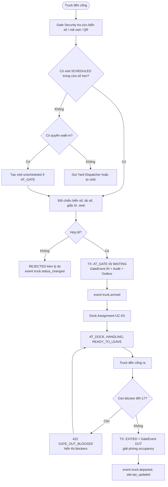

| Bước | Actor | Hệ thống kiểm tra | Transaction / Compensation | Event |
|---|---|---|---|---|
| Arrive + Verify | Gate Security | Visit thuộc site, đúng cửa sổ, BR-13, giấy tờ bắt buộc | TX1: visit + GateEvent + audit + outbox. Sai sót sau commit → Dispatcher `abort` (READY_TO_LEAVE với `exitReason=ABORTED`) | `truck.arrived` |
| Reject | Gate Security | Lý do bắt buộc | TX: visit REJECTED | `truck.status_changed` |
| Gate-out | Gate Security | BR-17 | TX: visit EXITED + release occupancy. Không có compensation (xe đã ra); sai sót → exception | `truck.departed` |

### 8.2. Warehouse Inbound

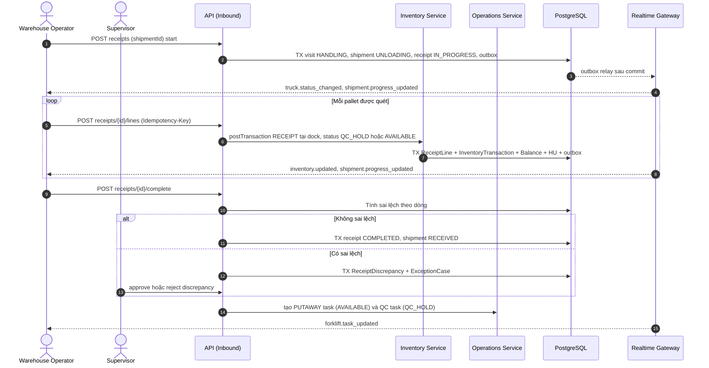

| Bước | Kiểm tra | Transaction | Ngoại lệ & compensate |
|---|---|---|---|
| Start receipt | Visit `AT_DOCK` tại dock inbound; shipment `ARRIVED` | TX visit + shipment + receipt | Bắt đầu nhầm → `cancel receipt` khi chưa có line |
| Scan line | SKU thuộc order, lot/serial hợp lệ, serial chưa tồn tại, HU chưa tồn tại | TX line + ledger RECEIPT + balance | Quét nhầm → `void line` tạo giao dịch `RECEIPT_REVERSAL` (không xóa line) |
| Complete | Mọi dòng có kết quả | TX receipt + shipment (+ discrepancy) | Nhận thiếu cần Supervisor đóng; nhận thừa vượt ngưỡng chờ duyệt |
| Generate tasks | HU status | TX tạo task | Task sai → cancel task |

### 8.3. Warehouse Outbound

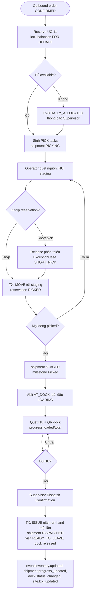

| Bước | Ghi giảm tồn? | Compensation |
|---|---|---|
| Reserve | Không (tăng `qtyReserved`) | `release reservation` |
| Pick | Không — `MOVE` sang staging (BR-23, DEC-08) | `return to stock` task: `MOVE` staging → storage, reservation về `ACTIVE` hoặc `RELEASED` |
| Load | Không — `MOVE` staging → dock | `unload HU`: `MOVE` dock → staging |
| Dispatch | **Có** — `ISSUE` (BR-22) | `ISSUE_REVERSAL` chỉ khi visit chưa EXITED, quyền Site Manager |

### 8.4. Vehicle Storage

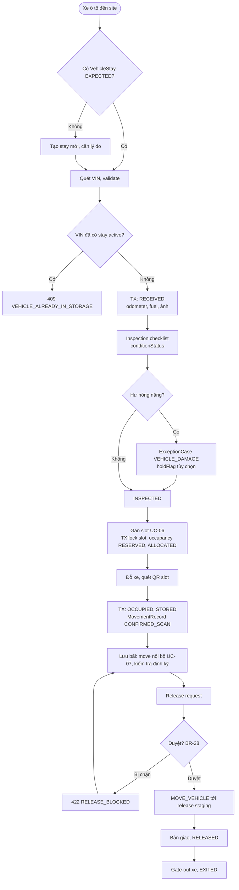

| Điểm kiểm soát | Transaction | Compensation | Event |
|---|---|---|---|
| Receive | TX stay + vehicle master + files | `cancel stay` (chỉ khi chưa STORED) | `vehicle.status_changed` |
| Allocate | TX occupancy RESERVED + stay | `release allocation` (về INSPECTED) | `slot.status_changed` |
| Store | TX occupancy OCCUPIED + movement | Move sang slot khác (không sửa movement cũ) | `vehicle.location_changed` |
| Release | TX request + approval | `cancel release` (về STORED) | `vehicle.status_changed` |
| Exit | TX stay EXITED + gate event | Không; sai sót → exception | `vehicle.status_changed` |

### 8.5. Internal Movement (pallet hoặc xe)

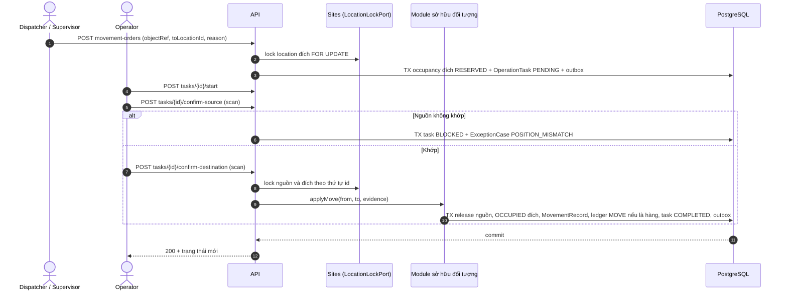

**Quy tắc chống deadlock:** khi cần lock nhiều location, luôn lock theo thứ tự `location.id` tăng dần. **Compensation:** hủy task trước khi `confirm-destination` → release reservation đích; sau khi hoàn tất chỉ có thể move ngược bằng lệnh mới.

### 8.6. Inventory Reconciliation

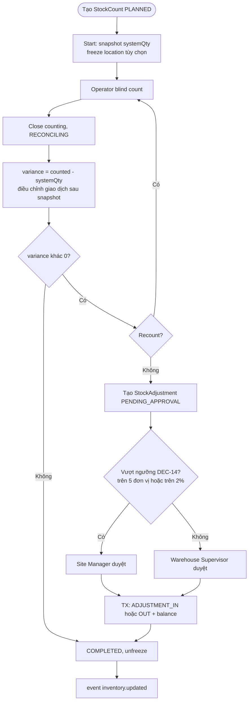

Ngoài kiểm kê, **job đối soát hằng đêm** (FR-06.06) so sánh `SUM(ledger)` với `InventoryBalance` cho từng khóa; lệch → `ExceptionCase(LEDGER_MISMATCH, CRITICAL)` và cảnh báo, **không** tự sửa.

### 8.7. Forklift Operations

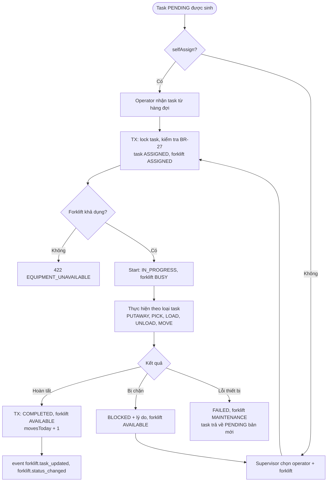

Pin < `lowBatteryPct` (mặc định 20%) → cảnh báo; forklift không nhận task mới cho đến khi `CHARGING → AVAILABLE` (BR-27).

### 8.8. Shipment Lifecycle

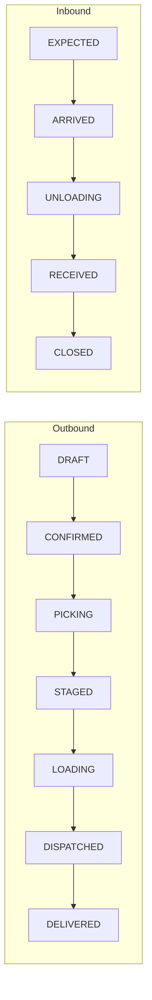

| Milestone hiển thị (video) | Outbound status | Nguồn dữ liệu |
|---|---|---|
| Order Confirmed | `CONFIRMED` | `ShipmentMilestone(CONFIRMED).occurredAt` |
| Picked | `STAGED` | Hoàn tất pick task cuối |
| Loading x/y | `LOADING` | `COUNT(ShipmentItem.loadedAt)` / `COUNT(ShipmentItem)` |
| In Transit | `DISPATCHED` | Dispatch confirmation |
| Delivered | `DELIVERED` | Xác nhận thủ công (GAP-18) |

| Milestone hiển thị (inbound) | Inbound status | Nguồn dữ liệu |
|---|---|---|
| Order Confirmed / In Transit | `EXPECTED` | Tạo shipment + ETA nhập tay |
| Arrived | `ARRIVED` | Visit gate-in (verify) |
| Unloading x/y | `UNLOADING` | Receipt lines / expected HU |
| Received | `RECEIVED` | Receipt completed |

### 8.9. Incident Handling

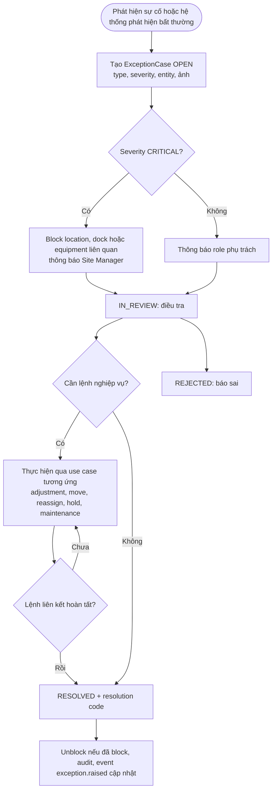

| Loại exception | Nguồn sinh | Người xử lý mặc định |
|---|---|---|
| `RECEIPT_DISCREPANCY` | UC-08 | Warehouse Supervisor |
| `SHORT_PICK` | UC-12 | Warehouse Supervisor |
| `POSITION_MISMATCH` | UC-07, UC-15 | Yard Dispatcher / Supervisor |
| `POSITION_CONFLICT` | UC-24 | Site Manager |
| `SLOT_CONFLICT` | UC-06 | Yard Dispatcher |
| `VEHICLE_DAMAGE` | UC-04 | Site Manager |
| `LEDGER_MISMATCH` | Job đối soát | Inventory Controller + Site Manager |
| `EMERGENCY_EXIT` | UC-02 | Site Manager |
| `INCIDENT` | Người dùng báo | Site Manager |

---

## 9. State Machines

Nguyên tắc chung:

- Mỗi aggregate có enum trạng thái riêng (BR-06). Transition được định nghĩa trong một bảng tĩnh ở domain layer (`allowedTransitions`); mọi chuyển trạng thái đi qua một hàm `transition(aggregate, to, ctx)` duy nhất, kiểm tra quyền và điều kiện.
- **Race condition:** cập nhật dùng `UPDATE … SET status = :to, version = version + 1 WHERE id = :id AND version = :expected AND status = :from`. Nếu 0 dòng → `409 CONCURRENT_MODIFICATION` hoặc `409 INVALID_STATE_TRANSITION` (đọc lại để phân biệt). Các ràng buộc liên-aggregate (occupancy, reserved) được chốt bằng constraint DB.
- Mọi transition ghi `AuditLog` và `OutboxEvent`; forbidden transition trả `409 INVALID_STATE_TRANSITION` với `details.from`, `details.to`.

### 9.1. Truck Visit

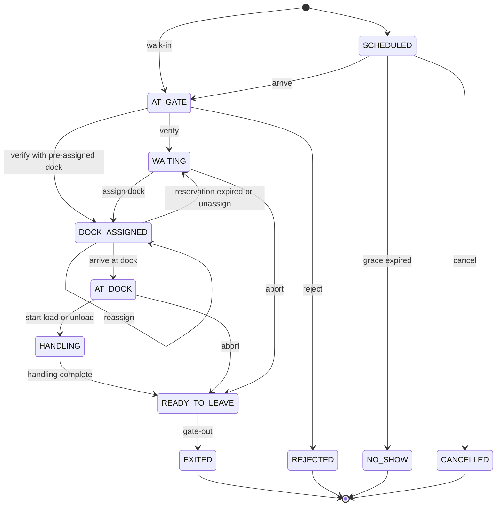

| Transition | Actor (permission) | Điều kiện | Event |
|---|---|---|---|
| SCHEDULED → AT_GATE | Gate Security (`yard.visit.gate_in`) | Trong cửa sổ hoặc có lý do trễ; BR-13 | `truck.arrived` |
| (new) → AT_GATE | Gate Security (`yard.visit.create_walkin`) | BR-13 | `truck.arrived` |
| AT_GATE → WAITING | Gate Security | Giấy tờ bắt buộc đủ, biển số khớp | `truck.status_changed` |
| AT_GATE → REJECTED | Gate Security (`yard.visit.reject`) | Lý do bắt buộc | `truck.status_changed` |
| WAITING → DOCK_ASSIGNED | Yard Dispatcher (`yard.dock.assign`) | Dock AVAILABLE, đúng hướng; occupancy tạo thành công | `truck.dock_assigned`, `dock.status_changed` |
| DOCK_ASSIGNED → AT_DOCK | Dispatcher / Operator (`yard.visit.update`) | Quét đúng dock (BR-15) | `truck.docked`, `dock.status_changed` |
| AT_DOCK → HANDLING | Operator (`inbound.receive` / `outbound.load`) | Có shipment gán visit | `truck.status_changed` |
| HANDLING → READY_TO_LEAVE | Hệ thống khi receipt completed (inbound) hoặc dispatch (outbound) | Không còn task mở | `truck.status_changed`, `dock.status_changed` |
| WAITING/AT_DOCK → READY_TO_LEAVE (abort) | Yard Dispatcher | Lý do; không có hàng đã nhận/loaded chưa xử lý | `truck.status_changed` |
| READY_TO_LEAVE → EXITED | Gate Security (`yard.visit.gate_out`) | BR-17 | `truck.departed` |
| SCHEDULED → NO_SHOW | Job hệ thống | `now > appointmentEnd + grace` `[APR]` | `truck.status_changed` |

**Forbidden (ví dụ):** `SCHEDULED → AT_DOCK` (bỏ qua gate), `WAITING → HANDLING`, `EXITED → *`, `HANDLING → EXITED` (phải qua READY_TO_LEAVE), `REJECTED → WAITING` (phải tạo visit mới).
**Race:** BR-13 bằng partial unique index `truck_visit(truck_id) WHERE status IN (active statuses)`; dock bằng occupancy index (BR-01).

### 9.2. Vehicle Storage Lifecycle (`VehicleStay`)

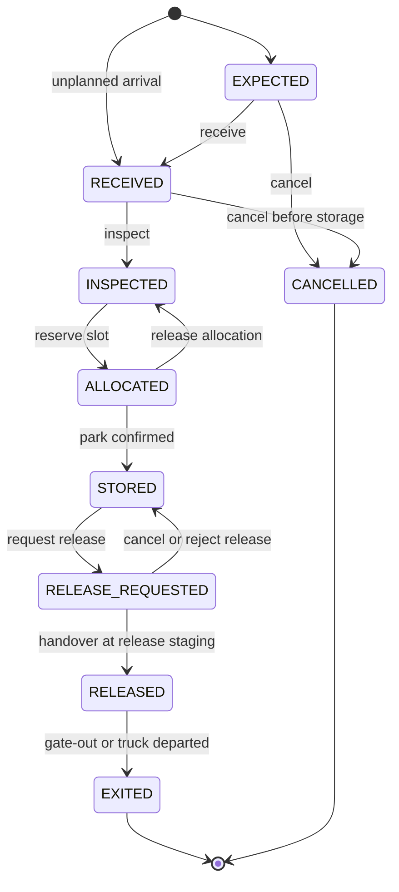

| Transition | Actor | Điều kiện | Event |
|---|---|---|---|
| EXPECTED → RECEIVED | Gate Security / Dispatcher (`vehicle.receive`) | VIN hợp lệ, BR-14 | `vehicle.status_changed` |
| RECEIVED → INSPECTED | Dispatcher (`vehicle.inspect`) | Checklist bắt buộc hoàn thành (mặc định DEC-20: ngoại thất, nội thất, chìa khóa, giấy tờ, ảnh 4 góc) | `vehicle.status_changed` |
| INSPECTED → ALLOCATED | Dispatcher (`vehicle.slot.assign`) | Occupancy RESERVED tạo thành công | `slot.status_changed` |
| ALLOCATED → STORED | Operator/Dispatcher (`vehicle.move`) | Quét QR slot đúng (hoặc manual + lý do) | `vehicle.location_changed`, `slot.status_changed` |
| STORED → RELEASE_REQUESTED | Dispatcher/Manager (`vehicle.release.request`) | — | `vehicle.status_changed` |
| RELEASE_REQUESTED → RELEASED | Hệ thống sau move tới release staging + bàn giao | Request APPROVED, BR-28 | `vehicle.status_changed` |
| RELEASED → EXITED | Gate Security (`vehicle.gate_out`) hoặc hệ thống khi truck chở xe gate-out | — | `vehicle.status_changed` |

**Trạng thái trực giao (không nằm trong lifecycle):** `conditionStatus` (`OK, MINOR_DAMAGE, MAJOR_DAMAGE, NEEDS_SERVICE`), `holdFlag` + `holdReason`, vị trí hiện tại (`LocationOccupancy`). Move nội bộ **không** đổi lifecycle (vẫn `STORED`).
**Forbidden:** `EXPECTED → STORED`, `INSPECTED → STORED` (phải ALLOCATED), `STORED → EXITED`, `RELEASED → STORED`, `* → RELEASED` khi `holdFlag=true`.
**Race:** BR-14 bằng partial unique index `vehicle_stay(vehicle_id) WHERE status NOT IN ('EXITED','CANCELLED')`.

### 9.3. Dock (trạng thái hiệu lực)

Trạng thái dock là **dẫn xuất** từ hai nguồn có ràng buộc DB: `Location.blockedAt` (OUT_OF_SERVICE) và `LocationOccupancy` active (RESERVED/OCCUPIED). Không có cột status độc lập để tránh lệch dữ liệu; API trả `effectiveStatus`.

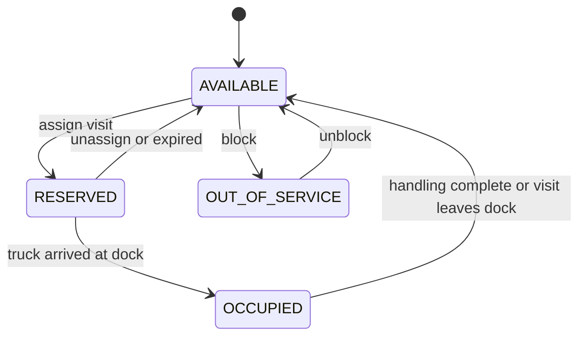

| Transition | Actor | Điều kiện | Event |
|---|---|---|---|
| AVAILABLE → RESERVED | Yard Dispatcher | Không blocked; không occupancy active | `dock.status_changed` |
| RESERVED → OCCUPIED | Operator/Dispatcher | Visit đúng dock | `dock.status_changed` |
| OCCUPIED → AVAILABLE | Hệ thống (dispatch/receipt complete/abort) | — | `dock.status_changed` |
| AVAILABLE → OUT_OF_SERVICE | Site Manager (`location.block`) | Không occupancy active (BR-16) | `dock.status_changed` |
| OUT_OF_SERVICE → AVAILABLE | Site Manager | — | `dock.status_changed` |

**Forbidden:** `OCCUPIED → OUT_OF_SERVICE` (phải giải phóng trước; khẩn cấp dùng incident + force), `OUT_OF_SERVICE → RESERVED`, `AVAILABLE → OCCUPIED` không qua RESERVED (trừ walk-in dock arrival: hệ thống tạo RESERVED rồi OCCUPIED trong cùng transaction).
**Race:** block và assign cùng lock row `Location` (`FOR UPDATE`) → tuần tự hóa.

### 9.4. Parking Slot (trạng thái hiệu lực)

Cùng cơ chế dock: `AVAILABLE`, `RESERVED`, `OCCUPIED`, `BLOCKED`.

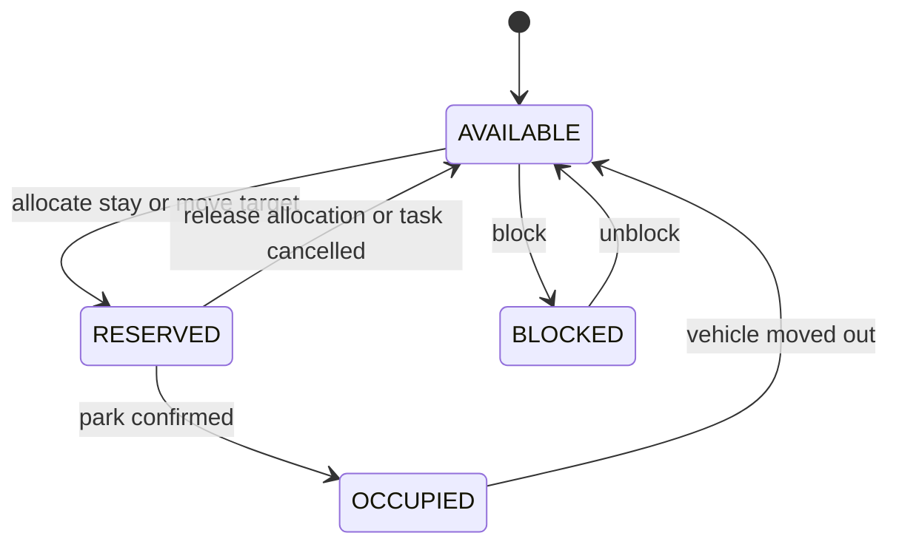

| Transition | Actor | Điều kiện | Event |
|---|---|---|---|
| AVAILABLE → RESERVED | Yard Dispatcher (`vehicle.slot.assign`) | Kích thước phù hợp, không blocked | `slot.status_changed` |
| RESERVED → OCCUPIED | Operator (`vehicle.move`) | Quét đúng slot | `slot.status_changed`, `vehicle.location_changed` |
| OCCUPIED → AVAILABLE | Hệ thống khi move/release hoàn tất | — | `slot.status_changed` |
| AVAILABLE ↔ BLOCKED | Site Manager (`location.block`) | Không occupancy | `slot.status_changed` |

**Forbidden:** `OCCUPIED → RESERVED` cho đối tượng khác; `BLOCKED → RESERVED`.
**Race:** BR-01 partial unique index + row lock.

### 9.5. Shipment

**Outbound:**

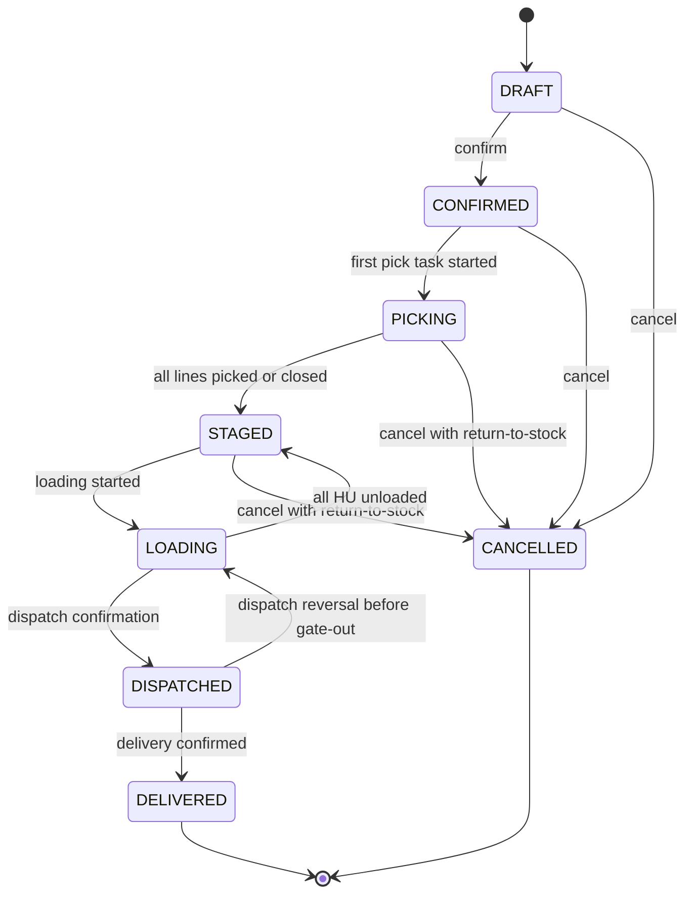

**Inbound:**

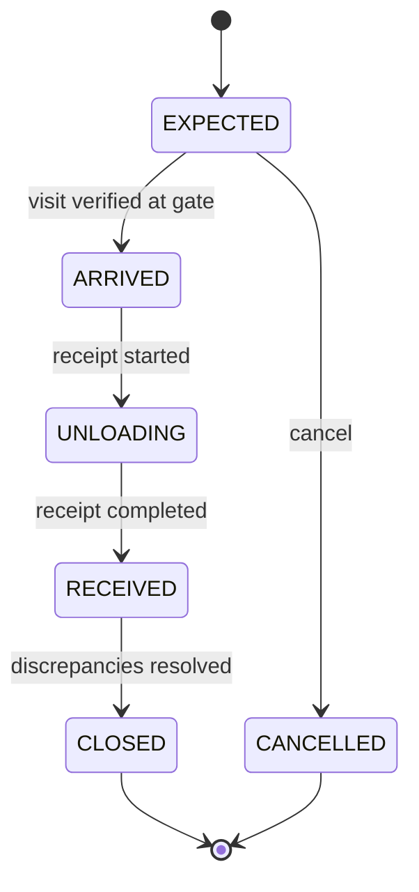

| Transition | Actor | Điều kiện | Event |
|---|---|---|---|
| DRAFT → CONFIRMED | Supervisor (`shipment.manage`) | Có ≥ 1 item hoặc order line | `shipment.progress_updated` |
| CONFIRMED → PICKING | Hệ thống (pick task đầu tiên start) | — | `shipment.progress_updated` |
| PICKING → STAGED | Hệ thống | Mọi dòng PICKED hoặc đóng short-pick | `shipment.progress_updated` |
| STAGED → LOADING | Operator (`outbound.load`) | Visit AT_DOCK gán shipment | `shipment.progress_updated` |
| LOADING → DISPATCHED | Supervisor (`outbound.dispatch`) | Mọi item LOADED (hoặc partial cho phép) | `shipment.progress_updated`, `inventory.updated` |
| DISPATCHED → LOADING | Site Manager (`outbound.dispatch.reverse`) | Visit chưa EXITED | `shipment.progress_updated`, `inventory.updated` |
| DISPATCHED → DELIVERED | Supervisor (`shipment.deliver`) | — | `shipment.progress_updated` |
| * → CANCELLED | Supervisor (`shipment.manage`) | Trước DISPATCHED; tạo task return-to-stock nếu đã pick | `shipment.progress_updated` |
| EXPECTED → ARRIVED | Hệ thống khi visit verify | Visit gán shipment | `shipment.progress_updated` |
| ARRIVED → UNLOADING → RECEIVED | Hệ thống theo receipt | — | `shipment.progress_updated` |
| RECEIVED → CLOSED | Supervisor | Mọi discrepancy RESOLVED | `shipment.progress_updated` |

**Forbidden:** `CONFIRMED → DISPATCHED`, `DISPATCHED → CANCELLED`, `DELIVERED → *`, `RECEIVED → UNLOADING`.
**Race:** optimistic version; dispatch idempotent (BR-20).

### 9.6. Inventory

Inventory có **hai trục trạng thái** (C-03): (a) `StockStatus` của balance; (b) lifecycle của `HandlingUnit`. Reservation là bản ghi riêng.

**(a) StockStatus (balance):**

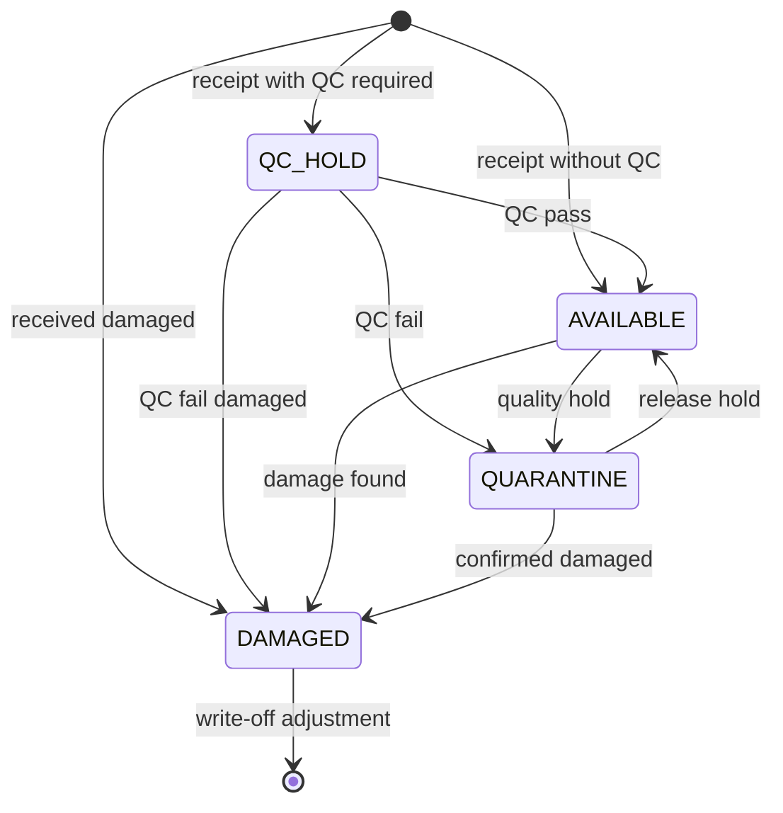

| Transition | Actor | Điều kiện | Event |
|---|---|---|---|
| QC_HOLD → AVAILABLE/QUARANTINE/DAMAGED | Supervisor (`inbound.qc`) | QC result | `inventory.updated` |
| AVAILABLE → QUARANTINE/DAMAGED | Supervisor/Controller (`inventory.status.change`) | Phần reserved phải được release trước (`422 STOCK_RESERVED`) | `inventory.updated` |
| QUARANTINE → AVAILABLE | Site Manager (`inventory.status.release`) | Lý do bắt buộc | `inventory.updated` |
| DAMAGED → (write-off) | Adjustment đã duyệt | UC-17 | `inventory.updated` |

**(b) HandlingUnit lifecycle:**

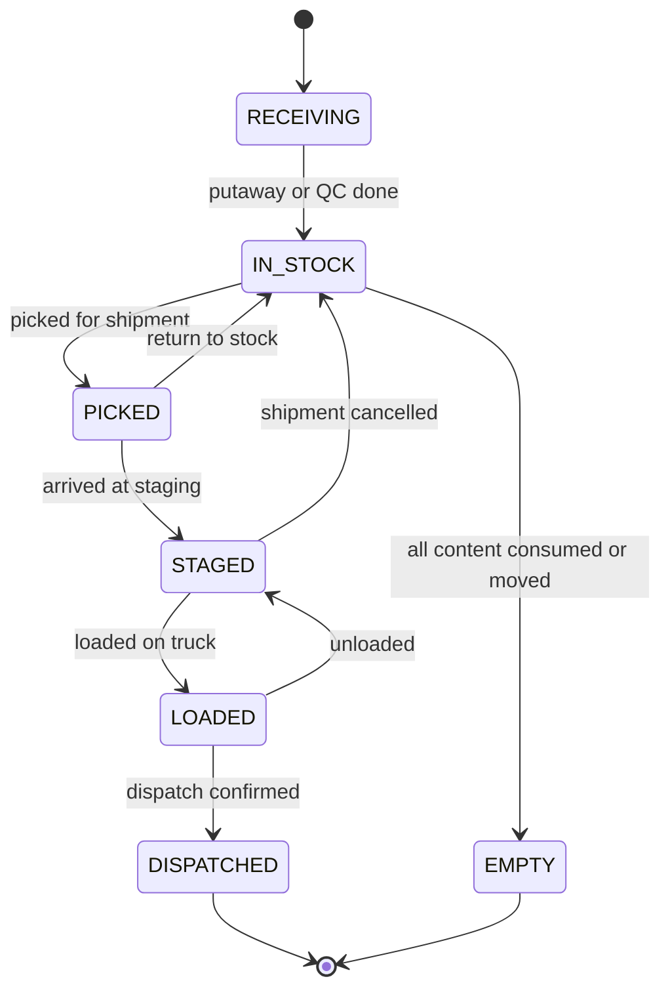

**Forbidden:** `IN_STOCK → LOADED` (bỏ qua pick/stage), `DISPATCHED → *` (trừ reversal: `DISPATCHED → LOADED` cùng shipment reversal), `RECEIVING → PICKED`.
**Race:** HU có `version`; balance dùng row lock + check constraint.

### 9.7. Forklift (Equipment)

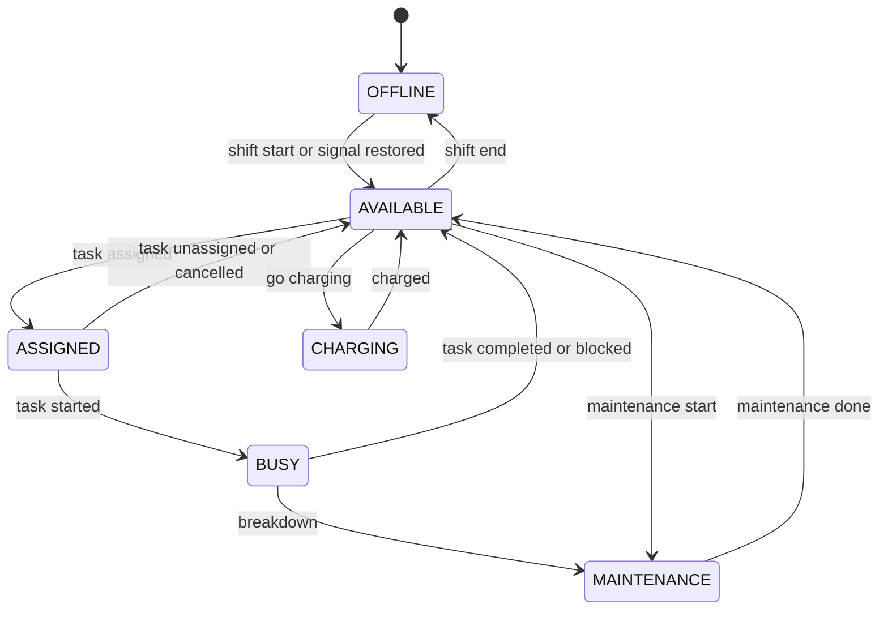

| Transition | Actor | Điều kiện | Event |
|---|---|---|---|
| AVAILABLE → ASSIGNED | Supervisor / self-assign (`task.assign`) | BR-27 | `forklift.status_changed` |
| ASSIGNED → BUSY | Operator (`task.execute`) | Task start | `forklift.status_changed`, `forklift.task_updated` |
| BUSY → AVAILABLE | Hệ thống (task completed/blocked) | — | `forklift.status_changed` |
| AVAILABLE ↔ CHARGING | Operator (`equipment.status.update`) hoặc telemetry | — | `forklift.status_changed` |
| * → MAINTENANCE | Supervisor (`equipment.manage`) | Task đang chạy → FAILED | `forklift.status_changed` |
| OFFLINE ↔ AVAILABLE | Operator đăng nhập ca / telemetry | `[APR]` | `forklift.status_changed` |

**Forbidden:** `CHARGING → BUSY`, `MAINTENANCE → ASSIGNED`, `OFFLINE → BUSY`.
**Race:** partial unique index `operation_task(equipment_id) WHERE status = 'IN_PROGRESS'`, tương tự `assignee_id`.
**Telemetry** (battery %, speed km/h — video: "Battery 75%", "Speed 5.3 km/h") là thuộc tính quan sát, nguồn `SENSOR_OBSERVED` hoặc `MANUAL`, kèm `telemetryAt`; không phải trạng thái nghiệp vụ.

### 9.8. Operation Task

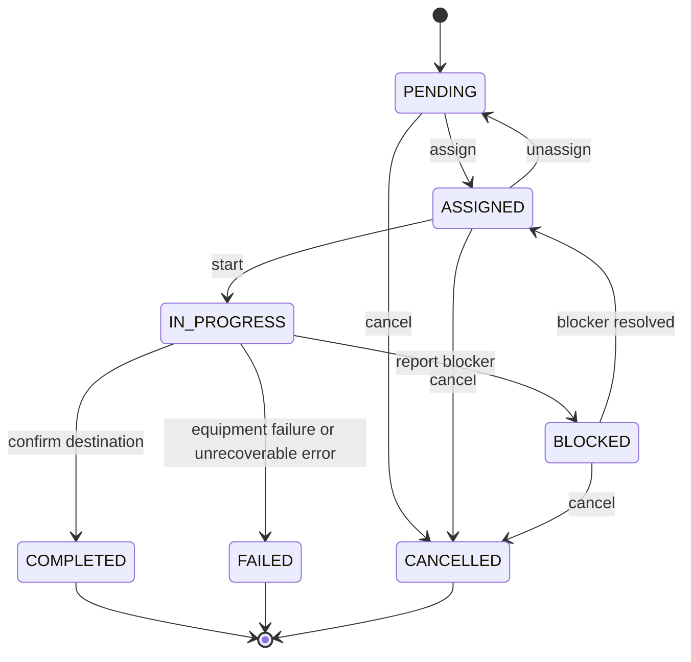

| Transition | Actor | Điều kiện | Event |
|---|---|---|---|
| PENDING → ASSIGNED | Supervisor / operator self-assign | Equipment & operator khả dụng | `task.status_changed` |
| ASSIGNED → IN_PROGRESS | Assignee (`task.execute`) | BR-27 (index) | `task.status_changed`, `forklift.task_updated` |
| IN_PROGRESS → COMPLETED | Assignee | Xác nhận đích hợp lệ (quét) | `task.status_changed` + event nghiệp vụ |
| IN_PROGRESS → BLOCKED | Assignee | Lý do | `task.status_changed` |
| IN_PROGRESS → FAILED | Assignee / Supervisor | Hệ thống tạo task thay thế PENDING | `task.status_changed` |
| * → CANCELLED | Supervisor (`task.cancel`) hoặc hệ thống (nguồn nghiệp vụ bị hủy) | Trước COMPLETED; release reservation đích | `task.status_changed` |

**Task types:** `PUTAWAY, PICK, LOAD, UNLOAD, MOVE_PALLET, MOVE_VEHICLE, QC, COUNT, RETURN_TO_STOCK`.
**Forbidden:** `PENDING → IN_PROGRESS` (phải assign), `COMPLETED → *`, `CANCELLED → *`.
**Race:** optimistic version + partial unique index cho equipment/assignee `IN_PROGRESS`.


---

## 10. RBAC Matrix

### 10.1. Mô hình

- **Role** gồm tập **permission** dạng `module.resource.action`. Role được gán cho user **theo site** (`UserSiteRole`). Riêng Admin có thể gán với `siteId = NULL` (toàn doanh nghiệp).
- Permission hiệu lực tại site S = hợp permission của mọi role user có tại S (và role toàn doanh nghiệp).
- Phân loại action: **V** View, **C** Create, **U** Update (sửa dữ liệu mô tả), **X** Confirm (xác nhận thao tác vật lý: quét, gate, dock, pick, load), **D** Cancel/Void, **A** Approve (phê duyệt), **J** Adjust (điều chỉnh dữ liệu số lượng/tồn).
- Vai trò lấy theo BRD mục 7 (9 role). **Không** có vai trò QC Inspector riêng (DEC-29); QC thuộc Warehouse Supervisor.

Ký hiệu role: **ADM** Admin, **SM** Site Manager, **YD** Yard Dispatcher, **GS** Gate Security, **WS** Warehouse Supervisor, **WO** Warehouse Operator, **FO** Forklift Operator, **IC** Inventory Controller, **VW** Viewer.

Ký hiệu ô: `●` có quyền tại site được gán; `○` có quyền với điều kiện (ghi chú); trống = không có quyền.

### 10.2. Ma trận module × action × role

| Module | Permission | Action | ADM | SM | YD | GS | WS | WO | FO | IC | VW |
|---|---|---|---|---|---|---|---|---|---|---|---|
| Identity | `identity.user.read` | V | ● | ● | | | | | | | |
| Identity | `identity.user.manage` | C/U/D | ● | | | | | | | | |
| Identity | `identity.role.manage` | C/U/A | ● | | | | | | | | |
| Sites | `site.read` | V | ● | ● | ● | ● | ● | ● | ● | ● | ● |
| Sites | `site.manage` | C/U | ● | | | | | | | | |
| Sites | `site.settings.manage` | U | ● | ● | | | | | | | |
| Sites | `location.manage` | C/U/D | ● | ● | | | | | | | |
| Sites | `location.block` | U | ● | ● | ○¹ | | ○¹ | | | | |
| Sites | `layout.manage` | C/U/A | ● | ● | | | | | | | |
| Master | `master.sku.manage` | C/U | ● | ● | | | ● | | | ● | |
| Master | `master.partner.manage` | C/U | ● | ● | ● | | ● | | | | |
| Yard | `yard.visit.read` | V | ● | ● | ● | ● | ● | ● | ● | | ● |
| Yard | `yard.appointment.manage` | C/U/D | ● | ● | ● | | ● | | | | |
| Yard | `yard.visit.gate_in` | X | | ● | ● | ● | | | | | |
| Yard | `yard.visit.create_walkin` | C | | ● | ● | ● | | | | | |
| Yard | `yard.visit.reject` | D | | ● | ● | ● | | | | | |
| Yard | `yard.dock.assign` | X | | ● | ● | | ○² | | | | |
| Yard | `yard.visit.update` | X | | ● | ● | | ● | ● | | | |
| Yard | `yard.visit.abort` | D | | ● | ● | | | | | | |
| Yard | `yard.visit.gate_out` | X | | ● | ● | ● | | | | | |
| Yard | `yard.visit.force_exit` | A | | ● | | | | | | | |
| Vehicle | `vehicle.read` | V | ● | ● | ● | ● | ● | ● | ● | ● | ● |
| Vehicle | `vehicle.receive` | C/X | | ● | ● | ● | | | | | |
| Vehicle | `vehicle.inspect` | X | | ● | ● | | | | | | |
| Vehicle | `vehicle.slot.assign` | X | | ● | ● | | | | | | |
| Vehicle | `vehicle.move` | X | | ● | ● | | | ● | | | |
| Vehicle | `vehicle.release.request` | C | | ● | ● | | | | | | |
| Vehicle | `vehicle.release.approve` | A | | ● | | | | | | | |
| Vehicle | `vehicle.hold.manage` | U/A | | ● | | | | | | | |
| Vehicle | `vehicle.gate_out` | X | | ● | ● | ● | | | | | |
| Inventory | `inventory.read` | V | ● | ● | ● | | ● | ● | ● | ● | ● |
| Inventory | `inventory.move` | C/X | | ● | | | ● | ● | ● | | |
| Inventory | `inventory.status.change` | U | | ● | | | ● | | | ● | |
| Inventory | `inventory.status.release` | A | | ● | | | | | | | |
| Inventory | `inventory.capacity.override` | A | | ● | | | ● | | | | |
| Inventory | `inventory.adjust.request` | J | | ● | | | ● | | | ● | |
| Inventory | `inventory.adjust.approve` | A | | ● | | | ○³ | | | | |
| Inventory | `inventory.reversal` | J/A | | ● | | | | | | | |
| Inventory | `inventory.count.manage` | C/U/D | | ● | | | ● | | | ● | |
| Inventory | `inventory.count.execute` | X | | | | | ● | ● | | ● | |
| Inbound | `inbound.order.manage` | C/U/D | | ● | | | ● | | | | |
| Inbound | `inbound.receive` | X | | ● | | | ● | ● | | | |
| Inbound | `inbound.qc` | X | | ● | | | ● | | | | |
| Inbound | `inbound.discrepancy.approve` | A | | ● | | | ● | | | | |
| Outbound | `outbound.order.manage` | C/U/D | | ● | | | ● | | | | |
| Outbound | `outbound.reserve` | X/D | | ● | | | ● | | | | |
| Outbound | `outbound.pick` | X | | ● | | | ● | ● | ● | | |
| Outbound | `outbound.load` | X | | ● | | | ● | ● | ● | | |
| Outbound | `outbound.dispatch` | X | | ● | | | ● | | | | |
| Outbound | `outbound.dispatch.reverse` | A/J | | ● | | | | | | | |
| Shipments | `shipment.read` | V | ● | ● | ● | ● | ● | ● | ● | ● | ● |
| Shipments | `shipment.manage` | C/U/D | | ● | ● | | ● | | | | |
| Shipments | `shipment.deliver` | X | | ● | | | ● | | | | |
| Equipment | `equipment.read` | V | ● | ● | ● | | ● | ● | ● | | ● |
| Equipment | `equipment.manage` | C/U | ● | ● | | | ● | | | | |
| Equipment | `equipment.status.update` | U | | ● | | | ● | | ● | | |
| Equipment | `device.manage` | C/U/D | ● | ● | | | | | | | |
| Operations | `task.read` | V | ● | ● | ● | | ● | ● | ● | ● | ● |
| Operations | `task.assign` | X | | ● | ● | | ● | | ○⁴ | | |
| Operations | `task.execute` | X | | | ● | | ● | ● | ● | ● | |
| Operations | `task.cancel` | D | | ● | ● | | ● | | | | |
| Operations | `exception.read` | V | ● | ● | ● | ● | ● | ● | ● | ● | ● |
| Operations | `exception.create` | C | | ● | ● | ● | ● | ● | ● | ● | |
| Operations | `exception.resolve` | A | | ● | ○⁵ | | ○⁵ | | | ○⁵ | |
| Dashboard | `dashboard.read` | V | ● | ● | ● | ● | ● | ● | ● | ● | ● |
| Audit | `audit.read` | V | ● | ● | | | | | | | |
| Reports | `report.export` | V | ● | ● | ● | | ● | | | ● | |
| Notifications | `notification.read` | V | ● | ● | ● | ● | ● | ● | ● | ● | ● |

Ghi chú:
1. YD block được parking slot / yard slot; WS block được storage location. Không block dock (chỉ SM).
2. WS gán dock khi site bật `warehouseCanAssignDock` (mặc định **tắt** — DEC-32).
3. WS duyệt adjustment trong ngưỡng (≤ 5 đơn vị **và** ≤ 2%); vượt ngưỡng chỉ SM (DEC-14).
4. FO chỉ self-assign (task của chính mình) khi site bật `selfAssign` (mặc định **tắt** — DEC-33).
5. Chỉ resolve exception thuộc loại được phân công (bảng mục 8.9).

Quyền `observation.ingest` không gán cho role người dùng; nó là quyền duy nhất của **Device** (xác thực bằng `X-Device-Key`, giới hạn trong site của thiết bị — mục 19.2).

Admin là quản trị hệ thống, **không** mặc định có quyền thao tác vận hành (tách biệt nhiệm vụ). Nếu Admin cần vận hành, phải được gán thêm role vận hành tại site.

### 10.3. Hành động nhạy cảm (BR-10, GAP-28)

| Hành động | Kiểm soát |
|---|---|
| Stock adjustment | Maker-checker; người duyệt ≠ người đề nghị; ngưỡng theo site |
| Đảo giao dịch tồn (`inventory.reversal`, `outbound.dispatch.reverse`) | Chỉ SM; lý do bắt buộc; audit severity HIGH |
| Release xe lưu bãi | Maker-checker (`request` ≠ `approve`) |
| Gỡ hold xe, release quarantine | Chỉ SM; lý do |
| Override capacity | SM/WS; lý do; audit |
| Force exit truck | Chỉ SM; tạo exception |
| Gán role Admin | Admin; không bắt buộc duyệt kép (DEC-34) — audit severity HIGH + notification cho mọi Admin |
| Publish layout 3D | SM/Admin; không ảnh hưởng dữ liệu nghiệp vụ (BR-37) |

### 10.4. Site scope

- **Guard thứ tự:** `JwtAuthGuard` → `SiteScopeGuard` (đọc `siteId` từ path `/sites/:siteId/...`, kiểm tra user có `UserSiteRole` active tại site) → `PermissionGuard` (permission yêu cầu của handler có trong tập hiệu lực tại site).
- **Tài nguyên theo ID** (ví dụ `GET /sites/:siteId/visits/:visitId`): repository luôn lọc `WHERE id = :visitId AND site_id = :siteId` → không tồn tại trong site = `404`.
- **Danh sách cross-site** (ví dụ tìm kiếm toàn cục): lọc `site_id = ANY(:allowedSiteIds)`.
- **Master data cấp doanh nghiệp** (`Sku`, `Partner`, `StoredVehicle` master): đọc được bởi mọi user đã đăng nhập có `site.read` ở ≥ 1 site; ghi theo permission master. Dữ liệu vị trí/lượt lưu của VIN vẫn lọc theo site.

---

## 11. KPI Definitions

Quy tắc chung:
- KPI tính **theo site** (filter `siteId` bắt buộc), "hôm nay" theo múi giờ site (BR-34).
- Mỗi KPI trả về `{ value, unit, asOf, period, delta, deltaPeriod }`; UI luôn hiển thị đơn vị (BR-31).
- **Refresh strategy:** KPI được tính bằng truy vấn trực tiếp trên bảng nghiệp vụ (có index phù hợp) và cache trong bộ nhớ API 15 giây theo `(siteId, kpi)`; khi có domain event liên quan, cache bị invalidate và server phát `site.kpi_updated` (debounce 2 giây/site). Không cần bảng tổng hợp cho MVP; nếu p95 vượt mục tiêu ở workload chuẩn mới thêm materialized view `[APR]`.

| # | KPI | Business definition | Công thức | Đơn vị | Source data | Filters | Refresh | Edge cases |
|---|---|---|---|---|---|---|---|---|
| K-01 | **Stock on hand** | Lượng hàng vật lý đang thuộc site, bất kể trạng thái chất lượng, chưa xuất. | (a) **pallets:** `COUNT(HandlingUnit WHERE siteId=S AND lifecycle IN (RECEIVING, IN_STOCK, PICKED, STAGED, LOADED))`; (b) **units theo SKU:** `SUM(InventoryBalance.qtyOnHand) GROUP BY skuId` (đơn vị cơ sở của SKU). | pallets (thanh KPI), base UoM (theo SKU) | `HandlingUnit`, `InventoryBalance` | site, zone, SKU, stockStatus | Event `inventory.updated`, `pallet.moved` → invalidate | Không cộng unit của các SKU khác nhau thành một số. Hàng lẻ không thuộc pallet không vào số pallets (hiển thị riêng "loose units" nếu > 0). Delta = so với 00:00 hôm nay. |
| K-02 | **Yard occupancy** | Tỷ lệ ô đỗ đang bị chiếm/giữ trong khu vực bãi. Tính **riêng** cho vehicle storage slots và truck yard slots. | `occupied_or_reserved_slots / active_slots_not_blocked × 100`; `active_slots_not_blocked = COUNT(Location type=PARKING_SLOT (hoặc YARD_SLOT), isActive, blockedAt IS NULL)` | % và `x / y slots` | `Location`, `LocationOccupancy` | site, zone, slot type | Event `slot.status_changed` | Slot blocked loại khỏi mẫu số và hiển thị số riêng. Mẫu số = 0 → hiển thị "N/A", không chia 0. Reserved tính là chiếm (tùy chọn hiển thị tách). |
| K-03 | **Trucks on site** | Số lượt xe tải đang ở trong site. | `COUNT(TruckVisit WHERE siteId=S AND status IN (AT_GATE, WAITING, DOCK_ASSIGNED, AT_DOCK, HANDLING, READY_TO_LEAVE))` | trucks | `TruckVisit` | site, direction | Event `truck.*` | Phụ chỉ số: `arriving` = SCHEDULED có ETA/hẹn trong 2 giờ tới (không cộng vào on site — BR-32); `docked` = AT_DOCK + HANDLING. Video "1 inbound" phải là `arriving`, hiển thị tách. |
| K-04 | **Dock utilization** | (a) **Tức thời:** tỷ lệ dock đang bận. (b) **Theo kỳ:** tỷ lệ thời gian dock bị chiếm trong giờ vận hành. | (a) `docks OCCUPIED / docks not OUT_OF_SERVICE`; (b) `SUM(occupied minutes trong kỳ) / (docks khả dụng × phút vận hành kỳ)` | % và `x / y docks` | `LocationOccupancy` (kind OCCUPIED, startedAt, releasedAt), `Location` | site, dock direction, kỳ | (a) event `dock.status_changed`; (b) query theo yêu cầu, cache 5 phút | Occupancy vắt qua ranh giới kỳ chỉ tính phần trong kỳ. Giờ vận hành site là cấu hình (`operatingHours`); nếu chưa cấu hình dùng 24h. Video "1/2 docked" ↔ (a). |
| K-05 | **On-time dispatch** (KPI chính, thay "On-time delivery" trên thanh KPI của video — DEC-12) | Tỷ lệ shipment outbound được xuất (dispatch) đúng giờ kế hoạch trong 30 ngày gần nhất. Dữ liệu hoàn toàn nằm trong site. | `COUNT(shipments DISPATCHED trong kỳ AND dispatchedAt <= plannedDispatchAt + toleranceMinutes) / COUNT(shipments DISPATCHED trong kỳ AND plannedDispatchAt IS NOT NULL)`; `toleranceMinutes` cấu hình site, mặc định 0 | % | `Shipment` (plannedDispatchAt, dispatchedAt) | site, kỳ (mặc định 30 ngày), customer | Cache 5 phút | Chỉ tính shipment có `plannedDispatchAt`; hiển thị số mẫu `n` và tỷ lệ shipment thiếu kế hoạch. Shipment hủy không tính. Dispatch bị đảo (reversal) tính theo lần dispatch cuối. |
| K-05b | **On-time delivery** (KPI phụ — DEC-12) | Tỷ lệ shipment outbound giao tới khách đúng hạn trong 30 ngày gần nhất. | `COUNT(DELIVERED trong kỳ AND deliveredAt <= promisedAt) / COUNT(DELIVERED trong kỳ AND promisedAt IS NOT NULL)` | % | `Shipment` (promisedAt, deliveredAt) | site, kỳ, customer | Cache 5 phút | Chỉ tính shipment đã có `deliveredAt` (xác nhận thủ công — DEC-11) và `promisedAt`; hiển thị số mẫu `n` vì độ tin cậy phụ thuộc quy trình nhập liệu. |
| K-06 | **Inbound today** | Số shipment inbound đã đến site hôm nay. | `COUNT(Shipment direction=INBOUND, arrivedAt ∈ today)`; phụ: `pallets received today = COUNT(DISTINCT ReceiptLine.handlingUnitId WHERE createdAt ∈ today AND not voided)` | shipments; pallets | `Shipment`, `ReceiptLine` | site, ngày | Event `shipment.progress_updated` | Shipment đến hôm qua, nhận hôm nay: tính vào pallets received today, không vào inbound shipments today. |
| K-07 | **Outbound today** | Số xe tải xuất hàng đã rời site hôm nay (video "Outbound today 21 trucks"). | `COUNT(TruckVisit direction=OUTBOUND, status=EXITED, exitedAt ∈ today)`; phụ: `shipments dispatched today` | trucks; shipments | `TruckVisit`, `Shipment` | site, ngày | Event `truck.departed` | Một truck chở nhiều shipment: trucks = 1, shipments = n. Visit abort không tính. |
| K-08 | **Put-away completed** | Số pallet đã put-away xong hôm nay (video "Put-aways today 35 pallets"). | `COUNT(OperationTask type=PUTAWAY, status=COMPLETED, completedAt ∈ today)` | pallets | `OperationTask` | site, ngày, operator | Event `task.status_changed` | Put-away hàng lẻ (không HU) tính theo task, hiển thị "tasks" nếu site có loose put-away. Task FAILED/CANCELLED không tính. |
| K-09 | **Forklift availability** | Tỷ lệ xe nâng có thể nhận việc hoặc đang làm việc trên tổng xe nâng hoạt động (video "Forklift fleet 2/4 working"). | `working = COUNT(status IN (ASSIGNED, BUSY))`; `available = COUNT(status = AVAILABLE)`; `fleet = COUNT(isActive AND status <> OFFLINE)`; `availability % = (working + available) / fleet` | forklifts và % | `Equipment` | site, loại | Event `forklift.status_changed` | MAINTENANCE và CHARGING là không khả dụng. Telemetry cũ > `staleMinutes` → hiển thị cảnh báo "dữ liệu cũ" nhưng không đổi trạng thái tự động. |
| K-10 | **Shipment progress** | Tiến độ của từng shipment. | Outbound loading: `loadedItems / totalItems`; picking: `pickedLines / totalLines`; inbound unloading: `receivedHU / expectedHU` (nếu không có expectedHU: `receivedQty / expectedQty` theo SKU) | items (HU) | `ShipmentItem`, `ReceiptLine`, `OutboundOrderLine` | shipment | Event `shipment.progress_updated` | Tiến độ không vượt 100% hiển thị (nhận thừa hiển thị `7/6` kèm cảnh báo). Shipment hủy: ẩn khỏi danh sách active. |

**Site fill (video "78% full")** — chỉ số phụ, **không** được hiển thị khi chưa chọn mẫu số. Đề xuất `[APR]`: `pallet positions occupied / pallet positions active` (đơn vị pallet positions) cho site kho; `slots occupied / slots active` cho site bãi xe; site `MIXED` hiển thị hai chỉ số riêng. Video "Stock on hand 3,310 / 4,200" tương ứng `pallets on hand / pallet capacity`.

---

## 12. Overall System Architecture

### 12.1. Context diagram

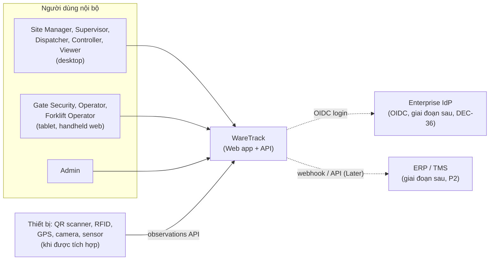

QR scanner trong MVP là **camera của thiết bị** hoặc **máy quét dạng bàn phím (HID)** gửi chuỗi vào ô input của web app; không cần tích hợp phần cứng riêng. Hiện chưa có thiết bị hiện trường (DEC-54): bản demo dùng **camera điện thoại/laptop qua trình duyệt** (Barcode Detection API, fallback thư viện ZXing) và **nhập tay**; ô input vẫn tương thích máy quét HID khi có. Chưa có cảm biến (DEC-55): mọi vị trí trong demo là `CONFIRMED_SCAN`/`CONFIRMED_MANUAL`, forklift dùng `INFERRED`.

### 12.2. Container diagram

```mermaid
flowchart TB
    subgraph Client["Browser"]
        WEB["SPA React 19 + Vite<br/>R3F 3D, TanStack Query, Zustand,<br/>Socket.IO client"]
    end
    subgraph Host["Linux host (Docker Compose)"]
        NGX["Nginx<br/>TLS, static SPA, reverse proxy,<br/>WebSocket upgrade, rate limit"]
        API["NestJS API (Node.js 24)<br/>REST /api/v1 + Swagger<br/>Socket.IO Gateway /ws<br/>Outbox relay, schedulers"]
        PG[("PostgreSQL<br/>dữ liệu nghiệp vụ, outbox, audit")]
        S3[("MinIO<br/>ảnh, giấy tờ, GLB")]
        RD[("Redis<br/>khi cần: BullMQ, Socket.IO adapter")]
    end
    OBS["OpenTelemetry Collector + Grafana<br/>(khi cần)"]
    WEB -- "HTTPS" --> NGX
    WEB -- "WSS" --> NGX
    WEB -- "presigned PUT/GET" --> NGX
    NGX -- "/api, /ws" --> API
    NGX -- "/files (presigned)" --> S3
    API -- "Prisma" --> PG
    API -- "S3 SDK" --> S3
    API -. "khi cần" .-> RD
    API -. "OTLP khi cần" .-> OBS
```

**Quyết định:** MVP chạy **một instance API** (đủ cho quy mô một doanh nghiệp, vài site). Redis **không** là dependency bắt buộc của MVP: outbox relay chạy in-process (poll + `LISTEN/NOTIFY`), scheduler dùng `@nestjs/schedule`. Redis được thêm khi (a) chạy ≥ 2 instance API (cần `@socket.io/redis-adapter`), hoặc (b) có job nền nặng (export lớn, import CSV, adapter cảm biến tần suất cao) cần BullMQ. (DEC-05)

> **Môi trường demo (DEC-52):** Đây là kiến trúc **đích** cho production (Docker + Nginx + Linux theo Stack v1.0). Giai đoạn demo, frontend deploy lên **Vercel**; nơi chạy backend xem mục 12.7.

### 12.7. Triển khai giai đoạn demo (DEC-52, DEC-58)

| Thành phần | Demo | Production (đích, chưa chọn nơi) |
|---|---|---|
| Web (`apps/web`) | **Vercel** — static build Vite, preview deployment cho mỗi PR, production từ `main`; biến `VITE_API_BASE_URL`, `VITE_WS_URL` đặt trong Vercel project | Nginx phục vụ static trên Linux (Docker) |
| API (`apps/api`) | **Render** (DEC-58) — web service chạy **Docker** từ `apps/api/Dockerfile` (build context = gốc repo), khai báo trong `render.yaml` (Blueprint). Process chạy liên tục nên Socket.IO, outbox relay và scheduler hoạt động bình thường (lý do không dùng Vercel Functions). Khởi động: `prisma migrate deploy` → seed demo nếu DB trống (`SEED_ON_EMPTY=true`) → `node dist/main.js`. Health check `/api/v1/health/ready` | Docker container sau Nginx |
| PostgreSQL | **Render PostgreSQL 16** (`waretrack-db` trong `render.yaml`), `DATABASE_URL` nối tự động vào API | PostgreSQL trên Linux, backup theo DEC-39 |
| File storage | Tắt upload ảnh trong demo (chưa dùng MinIO/S3) | MinIO |
| Dữ liệu | Seed data (DEC-51), reset được bằng lệnh seed | Dữ liệu thật |

**Biến môi trường API trên Render:** `DATABASE_URL` (từ database), `WEB_ORIGIN` (origin Vercel), `JWT_PRIVATE_KEY`/`JWT_PUBLIC_KEY` (ES256, sinh bằng `node apps/api/scripts/gen-jwt-keys.mjs`), `COOKIE_SAMESITE=none`, `COOKIE_SECURE=true`, `SEED_ON_EMPTY=true`. **Web trên Vercel:** Root Directory `apps/web` (cấu hình build ở `apps/web/vercel.json`), `VITE_API_BASE_URL=https://<api>.onrender.com/api/v1`, `VITE_WS_URL=https://<api>.onrender.com`.

**CI/CD:** `.github/workflows/api.yml` — typecheck, unit test, build, migrate trên PostgreSQL service, smoke test API thật (`pnpm test:smoke`), build Docker image; trên `main` gọi `RENDER_DEPLOY_HOOK_URL` (Render `autoDeploy: false`). `.github/workflows/web.yml` — typecheck, test, build, e2e Playwright (API + DB thật, dữ liệu seed); trên `main` deploy bằng Vercel CLI (`VERCEL_TOKEN`, `VERCEL_ORG_ID`, `VERCEL_PROJECT_ID`). Thiếu secret thì bước deploy chỉ cảnh báo và bỏ qua.

**Hạn chế gói miễn phí:** instance free của Render ngủ sau ~15 phút không có request (lần gọi đầu mất khoảng 1 phút; realtime ngắt trong lúc ngủ và client tự resync khi API dậy); Render Postgres free hết hạn sau 30 ngày. Chấp nhận cho demo; nâng plan hoặc chuyển hạ tầng khi dùng thật (Q-23).

Ràng buộc kiến trúc để chuyển nhà cung cấp dễ dàng: API đóng gói bằng **Dockerfile** ngay từ đầu (chạy giống nhau ở mọi nơi); mọi kết nối cấu hình qua biến môi trường; không dùng tính năng riêng của nhà cung cấp; web gọi API qua URL cấu hình (CORS + cookie `SameSite=None; Secure` khi web và API khác domain trong demo).

### 12.3. Module architecture

```mermaid
flowchart TB
    subgraph Platform["Platform / Shared Kernel"]
        PRISMA["PrismaService + TxContext"]
        OUTBOX["Outbox + EventBus"]
        IDEM["Idempotency"]
        FILES["Files (MinIO)"]
        CFG["Config, Logger, OTel"]
    end
    IAM["Identity & Access"]
    SITES["Sites & Layout"]
    YARD["Yard Management"]
    VEH["Vehicle Storage"]
    INV["Inventory"]
    INB["Inbound"]
    OUTB["Outbound"]
    SHP["Shipments"]
    EQP["Equipment"]
    OPS["Operations<br/>(tasks, movements, observations, exceptions)"]
    NOTI["Notifications"]
    AUD["Audit"]
    RT["Realtime"]
    DASH["Dashboard (read models, KPI)"]

    YARD --> SITES
    VEH --> SITES
    VEH --> YARD
    INV --> SITES
    INB --> INV
    INB --> SHP
    INB --> YARD
    INB --> OPS
    OUTB --> INV
    OUTB --> SHP
    OUTB --> YARD
    OUTB --> OPS
    OPS --> SITES
    OPS --> EQP
    SHP --> YARD
    DASH --> YARD
    DASH --> INV
    DASH --> SHP
    DASH --> EQP
    DASH --> VEH
    NOTI -. "subscribe events" .-> OUTBOX
    RT -. "subscribe events" .-> OUTBOX
    AUD -. "called in TX" .-> PRISMA
```

### 12.4. Dependency direction

Quy tắc phụ thuộc (kiểm tra bằng ESLint `import/no-restricted-paths` hoặc `dependency-cruiser` trong CI):

1. Mọi module nghiệp vụ được phụ thuộc `Platform`; `Platform` không phụ thuộc module nghiệp vụ.
2. Module chỉ gọi module khác qua **service interface công khai** (export từ `index.ts` của module: `XxxQueryPort`, `XxxCommandPort`); không import repository/Prisma model của module khác.
3. Hướng phụ thuộc **một chiều** theo sơ đồ 12.3 (process modules → core modules → Sites). Không có vòng.
4. Phản ứng ngược chiều (ví dụ Yard cần biết khi shipment dispatched để chuyển visit READY_TO_LEAVE) dùng **domain event in-process đồng bộ trong transaction** (`EventBus.publishInTx`) hoặc process module gọi cả hai service trong cùng transaction — ở đây Outbound gọi `YardCommandPort.markHandlingComplete(visitId, tx)`.
5. `Realtime`, `Notifications` chỉ tiêu thụ outbox event sau commit; không được gọi ngược vào domain để ghi.
6. `Dashboard` chỉ đọc qua query port; không ghi.

### 12.5. Data flow (lệnh ghi điển hình)

```mermaid
sequenceDiagram
    autonumber
    participant C as Client
    participant N as Nginx
    participant G as Guards (JWT, Site, Permission)
    participant I as IdempotencyInterceptor
    participant H as Controller + Zod pipe
    participant S as Application Service
    participant DB as PostgreSQL (1 transaction)
    participant R as Outbox Relay
    participant WS as Socket.IO Gateway
    C->>N: POST /api/v1/sites/WH-01/visits/123/arrive (Idempotency-Key)
    N->>G: forward
    G->>I: authorized
    I->>DB: tìm IdempotencyRecord(key, userId)
    alt Đã có kết quả
        I-->>C: trả response đã lưu
    else Chưa có
        I->>H: tiếp tục
        H->>S: command DTO đã validate
        S->>DB: BEGIN, lock, kiểm tra, ghi aggregate, ledger, audit, outbox, idempotency record, COMMIT
        S-->>C: 200 response
        DB-->>R: NOTIFY outbox
        R->>DB: đọc outbox chưa publish theo id
        R->>WS: emit tới room site:WH-01
        R->>DB: đánh dấu publishedAt
    end
```

### 12.6. Realtime event flow

```mermaid
flowchart LR
    TX["Transaction commit<br/>(aggregate + OutboxEvent)"] --> NOTIFY["pg NOTIFY outbox_new"]
    NOTIFY --> RELAY["Outbox Relay<br/>(single-flight, theo thứ tự id)"]
    POLL["Poll mỗi 1s (dự phòng)"] --> RELAY
    RELAY --> MAP["Map domain event sang realtime contract<br/>gắn siteSeq, eventId, version"]
    MAP --> ROOM["io.to(site:SITE_ID).emit"]
    MAP --> NOTI["Notifications handler"]
    MAP --> KPI["KPI cache invalidate<br/>debounce 2s, site.kpi_updated"]
    ROOM --> CLIENT["Client: dedupe eventId,<br/>kiểm tra siteSeq gap,<br/>update TanStack Query cache"]
    CLIENT -- "gap phát hiện" --> SNAP["GET snapshot hoặc events?afterSeq"]
```

---

## 13. Backend Module Architecture

### 13.1. Quy ước module NestJS

```text
apps/api/src/modules/<module>/
├── <module>.module.ts
├── index.ts                    # chỉ export Ports + DTO công khai + event types
├── api/                        # controllers, request/response DTO (Zod schemas)
├── application/                # use-case services (command handlers), query services
├── domain/                     # entities, value objects, state machine, domain errors, events
└── infrastructure/             # Prisma repositories, mappers
```

- **Transaction boundary:** application service mở transaction bằng `TxRunner.run(async (tx) => …)` (Prisma interactive transaction, isolation `READ COMMITTED`, timeout 10s). Port của module khác nhận `tx` để tham gia cùng transaction. Không lồng transaction.
- **Ownership:** chỉ module sở hữu được `INSERT/UPDATE` bảng của mình (kiểm tra bằng lint rule: Prisma delegate của bảng X chỉ được dùng trong `modules/<owner>/infrastructure`).

### 13.2. Đặc tả module

#### Identity & Access (`identity`)

| Mục | Nội dung |
|---|---|
| Responsibility | Xác thực, phát hành/thu hồi token, quản lý user, role, permission, gán role theo site, tính permission hiệu lực. |
| Entities owned | `User`, `Role`, `Permission`, `RolePermission`, `UserSiteRole`, `RefreshToken` |
| Use cases | UC-22; login/logout/refresh; đổi mật khẩu |
| Service interfaces | `AuthService.login/refresh/logout`; `AccessQueryPort.getEffectivePermissions(userId, siteId)`, `getAllowedSiteIds(userId)`; `UserQueryPort.getUserSummary(id)` |
| Dependencies | Platform; `SitesQueryPort` (validate siteId khi gán role) |
| Domain events | `identity.role_granted`, `identity.role_revoked`, `identity.user_disabled` (Realtime dùng để ngắt room) |
| Transaction boundaries | Gán/thu hồi role + tăng `permissionVersion` + audit trong 1 TX; refresh token rotation trong 1 TX (phát hiện reuse → thu hồi cả family) |

#### Sites & Layout (`sites`)

| Mục | Nội dung |
|---|---|
| Responsibility | Master data site/zone/location/dock, cấu hình site, block/unblock, freeze, layout 3D version & ánh xạ. Là **concurrency anchor** của location (row lock). |
| Entities owned | `Site`, `SiteSetting`, `Zone`, `Location`, `Dock`, `LayoutVersion`, `LayoutObject` |
| Use cases | FR-02.x; block/unblock; publish layout |
| Service interfaces | `SitesQueryPort.getSite`, `getLocation(siteId, id)`, `findLocationByQr`, `listLocations(filter)`; `LocationLockPort.lockForUpdate(tx, locationIds[])` (sắp xếp id tăng dần); `LocationFreezePort.freeze/unfreeze(tx, ids, countId)`; `LayoutQueryPort.getPublishedLayout(siteId)` |
| Dependencies | Platform; `OccupancyQueryPort` (Yard) để kiểm tra trước khi block/deactivate |
| Domain events | `location.blocked`, `location.unblocked`, `layout.published` |
| Transaction boundaries | Block: lock location → kiểm tra occupancy & balance = 0 → set blockedAt → audit → outbox |

#### Yard Management (`yard`)

| Mục | Nội dung |
|---|---|
| Responsibility | Truck, driver, truck visit (bao gồm lịch hẹn), gate event, dock assignment, **occupancy** của mọi location single-capacity (dock, parking slot, yard slot) và capacity reservation của storage location. |
| Entities owned | `Truck`, `Driver`, `TruckVisit`, `GateEvent`, `LocationOccupancy` |
| Use cases | UC-01, UC-02, UC-03 |
| Service interfaces | `YardCommandPort.markHandlingStarted(tx, visitId)`, `markHandlingComplete(tx, visitId)`; `OccupancyPort.reserve(tx, {locationId, occupant, singleOccupancy})`, `occupy(tx, occupancyId)`, `release(tx, occupancyId)`, `moveOccupant(tx, from, to)`; `OccupancyQueryPort.getActiveByLocation`, `getActiveByOccupant`; `VisitQueryPort` |
| Dependencies | Sites (`LocationLockPort`, `SitesQueryPort`) |
| Domain events | `truck.arrived`, `truck.dock_assigned`, `truck.docked`, `truck.status_changed`, `truck.departed`, `dock.status_changed`, `slot.status_changed` |
| Transaction boundaries | Mỗi transition visit = 1 TX; reassign dock = 1 TX (release + reserve) |

> **Tại sao occupancy thuộc Yard:** occupancy là trạng thái vận hành của bãi/dock, được nhiều module dùng. Đặt tại một module duy nhất đảm bảo BR-01/BR-12 được thực thi ở một chỗ; Vehicle Storage, Inventory, Operations gọi `OccupancyPort` thay vì ghi bảng.

#### Vehicle Storage (`vehicle-storage`)

| Mục | Nội dung |
|---|---|
| Responsibility | Hồ sơ xe ô tô theo VIN, lượt lưu, kiểm tra, hold, release request. |
| Entities owned | `StoredVehicle`, `VehicleStay`, `VehicleInspection`, `ReleaseRequest` |
| Use cases | UC-04, UC-05, UC-06, UC-07 (phần xe) |
| Service interfaces | `VehicleCommandPort.applyMove(tx, stayId, toLocationId, evidence)` (dùng bởi Operations khi task MOVE_VEHICLE hoàn tất và bởi PositionArbiter); `VehicleQueryPort.getStay`, `getHistoryByVin` |
| Dependencies | Sites, Yard (`OccupancyPort`), Operations (`TaskCommandPort.createTask`, `MovementPort.record`), Platform Files |
| Domain events | `vehicle.status_changed`, `vehicle.location_changed` |
| Transaction boundaries | Allocate = lock slot + reserve occupancy + stay transition; store = occupy + movement + stay transition |

#### Inventory (`inventory`)

| Mục | Nội dung |
|---|---|
| Responsibility | SKU, lot, serial, handling unit, balance, ledger, reservation, stock status, kiểm kê, điều chỉnh, đối soát. **Chủ sở hữu duy nhất** của số lượng tồn. |
| Entities owned | `Sku`, `Lot`, `SerialUnit`, `HandlingUnit`, `InventoryBalance`, `InventoryTransaction`, `Reservation`, `StockCount`, `StockCountLine`, `StockAdjustment` |
| Use cases | UC-11, UC-15, UC-16, UC-17; hỗ trợ UC-08..UC-14 |
| Service interfaces | `InventoryCommandPort.postTransaction(tx, InventoryTxCommand)` (RECEIPT, MOVE, STATUS_CHANGE, ISSUE, ADJUSTMENT_*, *_REVERSAL, SPLIT); `ReservationPort.reserve(tx, lines, strategy)`, `release`, `markPicked`, `consume`; `HandlingUnitPort.create`, `setLifecycle`; `InventoryQueryPort.getAvailable`, `listBalances`, `getHu` |
| Dependencies | Sites (`LocationLockPort`, freeze), Yard (`OccupancyPort` cho capacity reservation), Operations (`MovementPort`) |
| Domain events | `inventory.updated`, `pallet.moved` |
| Transaction boundaries | Mỗi `postTransaction` chạy trong TX của caller; tự lock balance `FOR UPDATE`; idempotency theo `idempotencyKey` (unique) |

#### Inbound (`inbound`)

| Mục | Nội dung |
|---|---|
| Responsibility | Inbound order, receipt, receipt line, discrepancy, QC. |
| Entities owned | `InboundOrder`, `InboundOrderLine`, `Receipt`, `ReceiptLine`, `ReceiptDiscrepancy`, `QcInspection` |
| Use cases | UC-08, UC-09, sinh task UC-10 |
| Service interfaces | `InboundQueryPort.getReceiptProgress(shipmentId)` |
| Dependencies | Inventory, Shipments, Yard, Operations |
| Domain events | `receipt.started`, `receipt.line_recorded`, `receipt.completed` (map thành `shipment.progress_updated`, `inventory.updated`) |
| Transaction boundaries | Scan line = 1 TX (line + inventory tx + shipment progress + outbox) |

#### Outbound (`outbound`)

| Mục | Nội dung |
|---|---|
| Responsibility | Outbound order, allocation, pick, staging, loading, dispatch. |
| Entities owned | `OutboundOrder`, `OutboundOrderLine` |
| Use cases | UC-11..UC-14 |
| Service interfaces | `OutboundQueryPort.getOrderProgress` |
| Dependencies | Inventory, Shipments, Yard, Operations |
| Domain events | `outbound.allocated`, `outbound.picked`, `outbound.dispatched` |
| Transaction boundaries | Dispatch = 1 TX: consume reservations (ISSUE) + HU DISPATCHED + shipment DISPATCHED + visit handling complete + release dock occupancy |

#### Shipments (`shipments`)

| Mục | Nội dung |
|---|---|
| Responsibility | Shipment 2 chiều, item, milestone, liên kết visit/order, delivered/POD. |
| Entities owned | `Shipment`, `ShipmentItem`, `ShipmentMilestone` |
| Use cases | UC-19; phần shipment của UC-08, UC-12..UC-14 |
| Service interfaces | `ShipmentCommandPort.transition(tx, id, to)`, `markItemLoaded(tx, itemId)`, `recordMilestone(tx, …)`; `ShipmentQueryPort.getTracking(id)` |
| Dependencies | Yard (`VisitQueryPort`) |
| Domain events | `shipment.progress_updated` |
| Transaction boundaries | Trong TX của Inbound/Outbound |

#### Equipment (`equipment`)

| Mục | Nội dung |
|---|---|
| Responsibility | Forklift và thiết bị vận hành; trạng thái, telemetry; device registry cho cảm biến. |
| Entities owned | `Equipment`, `Device` |
| Use cases | FR-15, FR-20.03; phần equipment của UC-18 |
| Service interfaces | `EquipmentCommandPort.setStatus(tx, id, to)`, `recordTelemetry`; `EquipmentQueryPort.listBySite`; `DeviceAuthPort.verifyKey` |
| Dependencies | Sites |
| Domain events | `forklift.status_changed` |
| Transaction boundaries | Đổi trạng thái theo task trong TX của Operations |

#### Operations (`operations`)

| Mục | Nội dung |
|---|---|
| Responsibility | Operation task (mọi loại), task event, movement history, raw observation + arbitration, exception case. |
| Entities owned | `OperationTask`, `TaskEvent`, `MovementRecord`, `LocationObservation`, `ExceptionCase`, `ExceptionAction` |
| Use cases | UC-18, UC-23, UC-24; khung thực thi UC-07, UC-10, UC-12, UC-15 |
| Service interfaces | `TaskCommandPort.createTask(tx, spec)`, `cancelBySource(tx, sourceRef)`; `MovementPort.record(tx, MovementRecordInput)`; `ExceptionPort.raise(tx, spec)`; `TaskCompletionHandler` registry: module nguồn đăng ký handler cho task type (PUTAWAY → Inventory, MOVE_VEHICLE → Vehicle Storage, LOAD → Outbound…) |
| Dependencies | Sites, Equipment; gọi handler đã đăng ký (inversion of control, không import ngược) |
| Domain events | `task.status_changed`, `forklift.task_updated`, `exception.raised`, `vehicle.location_changed`/`pallet.moved` (do handler phát) |
| Transaction boundaries | Complete task = 1 TX: task transition + handler nghiệp vụ + equipment status + outbox |

#### Notifications (`notifications`)

| Mục | Nội dung |
|---|---|
| Responsibility | Tạo notification in-app từ event theo rule; đánh dấu đã đọc; (Later) email. |
| Entities owned | `Notification` |
| Service interfaces | `NotificationQueryPort.listForUser`; handler outbox |
| Dependencies | Identity (recipients theo role/site), Platform Outbox |
| Domain events | `notification.created` (gửi riêng room `user:{id}`) |
| Transaction boundaries | Handler sau commit; ghi notification TX riêng, idempotent theo `(eventId, userId)` |

#### Audit (`audit`)

| Mục | Nội dung |
|---|---|
| Responsibility | Ghi audit log append-only trong TX của lệnh; truy vấn audit. |
| Entities owned | `AuditLog` |
| Service interfaces | `AuditPort.record(tx, entry)`; `AuditQueryPort.search` |
| Dependencies | Platform |
| Domain events | Không |
| Transaction boundaries | Luôn trong TX của lệnh nghiệp vụ (không ghi audit "sau") |

#### Realtime (`realtime`)

| Mục | Nội dung |
|---|---|
| Responsibility | Socket.IO gateway, xác thực handshake, quản lý room theo site/user, phát event contract, replay theo `afterSeq`. |
| Entities owned | Không (đọc `OutboxEvent`) |
| Service interfaces | `RealtimePublisher.publish(event)` (gọi bởi outbox relay) |
| Dependencies | Identity (`AccessQueryPort`), Platform Outbox |
| Domain events | Tiêu thụ tất cả |
| Transaction boundaries | Không ghi nghiệp vụ |

#### Dashboard (`dashboard`) — module đọc

| Mục | Nội dung |
|---|---|
| Responsibility | Snapshot site (cho 3D + bảng), KPI, tìm kiếm toàn cục. |
| Entities owned | Không |
| Service interfaces | `getSiteSnapshot(siteId)`, `getKpis(siteId)`, `search(q, allowedSites)` |
| Dependencies | Query ports của Yard, Vehicle Storage, Inventory, Shipments, Equipment, Operations, Sites |
| Transaction boundaries | Snapshot đọc trong 1 TX `REPEATABLE READ READ ONLY` để nhất quán, kèm `asOfSeq` = max outbox id đã commit tại thời điểm bắt đầu |

#### Platform / Shared Kernel (`platform`)

| Thành phần | Nội dung |
|---|---|
| `PrismaService`, `TxRunner` | Kết nối, interactive transaction, retry khi `serialization_failure`/`deadlock_detected` (tối đa 3 lần, backoff) |
| `OutboxModule` | `OutboxEvent` entity, `EventBus.publishInTx(tx, event)`, relay |
| `IdempotencyModule` | `IdempotencyRecord`, interceptor |
| `FilesModule` | `FileObject`, `Attachment`, presigned URL, quét MIME |
| `ConfigModule`, `LoggerModule`, `TelemetryModule` | Zod-validated env, pino logger, OTel (khi cần) |


---

## 14. Database ERD

### 14.1. Quy ước chung (PostgreSQL 16+ / Prisma)

| Chủ đề | Quy ước |
|---|---|
| Primary key | `id uuid` sinh bởi ứng dụng (UUIDv7, sắp xếp theo thời gian, Prisma `@default(uuid(7)) @db.Uuid`). Bảng append-only khối lượng lớn (`InventoryTransaction`, `AuditLog`, `OutboxEvent`, `LocationObservation`, `MovementRecord`) dùng `id bigint GENERATED ALWAYS AS IDENTITY` để index nhỏ và có thứ tự. |
| Mã nghiệp vụ | Cột `code` riêng, dễ đọc (`WH-01`, `FL-01`, `TRK-2051`, `PAL-1026`, `SHP-78442`), unique trong phạm vi phù hợp. Không dùng code làm FK. |
| Đặt tên | Prisma model PascalCase, field camelCase; DB table/column snake_case qua `@@map`/`@map`. |
| Thời gian | `timestamptz` (UTC). Ngày nghiệp vụ (HSD, NSX) dùng `date`. |
| Audit fields | Mọi bảng mutable: `createdAt`, `updatedAt`, `createdById uuid NULL`, `updatedById uuid NULL`. Bảng append-only: `createdAt`, `createdById`. |
| Concurrency | Aggregate root mutable có `version int NOT NULL DEFAULT 0`; update có điều kiện `version` (optimistic). Ràng buộc liên-aggregate dùng row lock + constraint. |
| Site scoping | Bảng nghiệp vụ có `siteId uuid NOT NULL` + FK `Site`. Index composite bắt đầu bằng `site_id` cho truy vấn danh sách. Bảng con (line, item) cũng lưu `siteId` (denormalized) để guard và index không cần join. |
| Soft-delete | Chỉ cho master data: `Site`, `Zone`, `Location`, `Dock`, `Sku`, `Partner`, `Truck`, `Driver`, `Equipment`, `Device`, `User` (dùng `status=DISABLED`). Cột `deletedAt timestamptz NULL`; unique index của code là partial `WHERE deleted_at IS NULL`. Dữ liệu giao dịch/lịch sử **không** soft-delete; dùng trạng thái `CANCELLED`/`VOIDED` + reversal. |
| Referential integrity | FK `ON DELETE RESTRICT` mặc định (không xóa cứng cha có con). `ON DELETE CASCADE` chỉ cho bảng thuần phụ thuộc không mang lịch sử (`RolePermission`, `LayoutObject` theo `LayoutVersion` DRAFT). |
| Enum | PostgreSQL enum qua Prisma `enum` cho trạng thái ổn định; danh mục có thể mở rộng bởi người dùng (reason code, checklist) dùng bảng/JSON config. |
| JSON | Chỉ cho dữ liệu không truy vấn quan hệ: `AuditLog.diff`, `OutboxEvent.payload`, `VehicleInspection.checklist`, `SiteSetting.value`, `Equipment.telemetry`. |
| Số lượng | `numeric(18,3)` cho quantity (hỗ trợ đơn vị kg/lít); SKU đếm cái có `uomDecimals=0` và validate ở tầng ứng dụng. |

### 14.2. ERD — Identity, Sites & Layout

```mermaid
erDiagram
    USER ||--o{ USER_SITE_ROLE : has
    ROLE ||--o{ USER_SITE_ROLE : granted_as
    SITE ||--o{ USER_SITE_ROLE : scopes
    ROLE ||--o{ ROLE_PERMISSION : includes
    PERMISSION ||--o{ ROLE_PERMISSION : included_in
    USER ||--o{ REFRESH_TOKEN : owns
    SITE ||--o{ SITE_SETTING : configures
    SITE ||--o{ ZONE : contains
    ZONE ||--o{ LOCATION : contains
    SITE ||--o{ LOCATION : scopes
    LOCATION ||--o| DOCK : extends
    SITE ||--o{ LAYOUT_VERSION : versions
    LAYOUT_VERSION ||--o{ LAYOUT_OBJECT : places
    LOCATION ||--o{ LAYOUT_OBJECT : mapped_by
    ZONE ||--o{ LAYOUT_OBJECT : mapped_by

    USER {
        uuid id PK
        string username UK
        string email UK
        string passwordHash
        string status
        int permissionVersion
        uuid lastSiteId FK
    }
    ROLE {
        uuid id PK
        string code UK
        string name
        boolean isSystem
    }
    PERMISSION {
        uuid id PK
        string code UK
        string module
    }
    ROLE_PERMISSION {
        uuid roleId PK
        uuid permissionId PK
    }
    USER_SITE_ROLE {
        uuid id PK
        uuid userId FK
        uuid roleId FK
        uuid siteId FK "NULL = enterprise-wide"
        timestamptz revokedAt
    }
    REFRESH_TOKEN {
        uuid id PK
        uuid userId FK
        string tokenHash UK
        uuid familyId
        timestamptz expiresAt
        timestamptz revokedAt
    }
    SITE {
        uuid id PK
        string code UK
        string name
        string siteType
        string timezone
        string operationalStatus
        timestamptz deletedAt
    }
    SITE_SETTING {
        uuid siteId PK
        string key PK
        json value
    }
    ZONE {
        uuid id PK
        uuid siteId FK
        string code
        string zoneType
    }
    LOCATION {
        uuid id PK
        uuid siteId FK
        uuid zoneId FK
        string code
        string qrValue UK
        string locationType
        decimal capacityUnits
        decimal maxWeightKg
        boolean singleOccupancy
        boolean isActive
        timestamptz blockedAt
        uuid frozenByCountId
        int version
    }
    DOCK {
        uuid locationId PK
        uuid siteId FK
        string direction
        string doorNumber
    }
    LAYOUT_VERSION {
        uuid id PK
        uuid siteId FK
        int versionNo
        string status
        uuid modelFileId FK
        timestamptz publishedAt
    }
    LAYOUT_OBJECT {
        uuid id PK
        uuid layoutVersionId FK
        string targetType
        uuid targetId
        decimal posX
        decimal posY
        decimal posZ
        decimal rotY
        string meshRef
    }
```

### 14.3. ERD — Yard & Vehicle Storage

```mermaid
erDiagram
    PARTNER ||--o{ TRUCK : operates
    PARTNER ||--o{ DRIVER : employs
    TRUCK ||--o{ TRUCK_VISIT : makes
    DRIVER ||--o{ TRUCK_VISIT : drives
    SITE ||--o{ TRUCK_VISIT : hosts
    LOCATION ||--o{ TRUCK_VISIT : assigned_dock
    TRUCK_VISIT ||--o{ GATE_EVENT : records
    VEHICLE_STAY ||--o{ GATE_EVENT : records
    LOCATION ||--o{ LOCATION_OCCUPANCY : occupied_by
    STORED_VEHICLE ||--o{ VEHICLE_STAY : stays
    PARTNER ||--o{ STORED_VEHICLE : owns
    VEHICLE_STAY ||--o{ VEHICLE_INSPECTION : inspected
    VEHICLE_STAY ||--o{ RELEASE_REQUEST : requested

    TRUCK {
        uuid id PK
        string code UK
        string plateNumber
        uuid carrierId FK
        string truckType
        timestamptz deletedAt
    }
    DRIVER {
        uuid id PK
        string fullName
        string licenseNumber
        string phone
        uuid carrierId FK
    }
    TRUCK_VISIT {
        uuid id PK
        uuid siteId FK
        string code UK
        uuid truckId FK
        uuid driverId FK
        string direction
        string status
        boolean unscheduled
        timestamptz appointmentStart
        timestamptz appointmentEnd
        timestamptz etaAt
        timestamptz arrivedAt
        timestamptz verifiedAt
        timestamptz dockedAt
        timestamptz exitedAt
        uuid dockLocationId FK
        string actualPlate
        string sealIn
        string sealOut
        string exitReason
        int version
    }
    GATE_EVENT {
        uuid id PK
        uuid siteId FK
        string eventType
        uuid truckVisitId FK
        uuid vehicleStayId FK
        uuid gateLocationId FK
        timestamptz occurredAt
        uuid actorId
    }
    LOCATION_OCCUPANCY {
        uuid id PK
        uuid siteId FK
        uuid locationId FK
        string occupantType
        uuid occupantId
        string kind
        boolean singleOccupancy
        decimal unitsUsed
        timestamptz startedAt
        timestamptz occupiedAt
        timestamptz expiresAt
        timestamptz releasedAt
        string positionSource
    }
    STORED_VEHICLE {
        uuid id PK
        string vin UK
        string make
        string model
        int modelYear
        string color
        string plateNumber
        uuid ownerPartnerId FK
    }
    VEHICLE_STAY {
        uuid id PK
        uuid siteId FK
        uuid vehicleId FK
        string status
        string conditionStatus
        boolean holdFlag
        string holdReason
        int odometerKm
        int fuelOrBatteryPct
        timestamptz receivedAt
        timestamptz storedAt
        timestamptz exitedAt
        int version
    }
    VEHICLE_INSPECTION {
        uuid id PK
        uuid siteId FK
        uuid vehicleStayId FK
        string inspectionType
        json checklist
        string resultCondition
        uuid inspectorId
        timestamptz inspectedAt
    }
    RELEASE_REQUEST {
        uuid id PK
        uuid siteId FK
        uuid vehicleStayId FK
        string status
        string reason
        string recipientName
        uuid requestedById
        uuid decidedById
        timestamptz decidedAt
    }
    PARTNER {
        uuid id PK
        string code UK
        string name
        string partnerTypes
    }
```

### 14.4. ERD — Inventory

```mermaid
erDiagram
    SKU ||--o{ LOT : batches
    SKU ||--o{ SERIAL_UNIT : serials
    SKU ||--o{ INVENTORY_BALANCE : stocked_as
    LOT ||--o{ INVENTORY_BALANCE : lot_of
    HANDLING_UNIT ||--o{ INVENTORY_BALANCE : contains
    LOCATION ||--o{ INVENTORY_BALANCE : holds
    LOCATION ||--o{ HANDLING_UNIT : current_location
    SITE ||--o{ INVENTORY_TRANSACTION : ledger
    SKU ||--o{ INVENTORY_TRANSACTION : affects
    INVENTORY_BALANCE ||--o{ RESERVATION : allocated
    SERIAL_UNIT }o--o| HANDLING_UNIT : packed_in
    STOCK_COUNT ||--o{ STOCK_COUNT_LINE : lines
    STOCK_COUNT_LINE ||--o{ STOCK_ADJUSTMENT : results_in

    SKU {
        uuid id PK
        string code UK
        string name
        string baseUom
        int uomDecimals
        boolean lotTracked
        boolean serialTracked
        boolean expiryTracked
        boolean qcRequired
        string allocationStrategy
        decimal unitWeightKg
    }
    LOT {
        uuid id PK
        uuid skuId FK
        string lotNumber
        date manufacturedOn
        date expiresOn
    }
    SERIAL_UNIT {
        uuid id PK
        uuid skuId FK
        string serialNumber
        uuid siteId FK
        uuid locationId FK
        uuid handlingUnitId FK
        string status
    }
    HANDLING_UNIT {
        uuid id PK
        uuid siteId FK
        string code UK
        string sscc UK
        string lifecycle
        uuid locationId FK
        string positionSource
        timestamptz positionConfirmedAt
        decimal grossWeightKg
        int version
    }
    INVENTORY_BALANCE {
        uuid id PK
        uuid siteId FK
        uuid locationId FK
        uuid skuId FK
        uuid lotId FK
        uuid handlingUnitId FK
        string stockStatus
        decimal qtyOnHand
        decimal qtyReserved
        timestamptz receivedAt
        int version
    }
    INVENTORY_TRANSACTION {
        bigint id PK
        uuid siteId FK
        string txType
        string idempotencyKey UK
        uuid skuId FK
        uuid lotId FK
        uuid handlingUnitId FK
        uuid serialUnitId FK
        uuid fromLocationId FK
        uuid toLocationId FK
        string fromStatus
        string toStatus
        decimal quantity
        string referenceType
        uuid referenceId
        bigint reversesTxId FK
        uuid actorId
        timestamptz occurredAt
    }
    RESERVATION {
        uuid id PK
        uuid siteId FK
        uuid balanceId FK
        uuid outboundOrderLineId FK
        uuid shipmentId FK
        decimal quantity
        string status
        int version
    }
    STOCK_COUNT {
        uuid id PK
        uuid siteId FK
        string code
        string status
        boolean blind
        boolean freeze
        json scope
    }
    STOCK_COUNT_LINE {
        uuid id PK
        uuid stockCountId FK
        uuid siteId FK
        uuid locationId FK
        uuid skuId FK
        uuid lotId FK
        uuid handlingUnitId FK
        decimal systemQty
        decimal countedQty
        int countRound
        uuid countedById
    }
    STOCK_ADJUSTMENT {
        uuid id PK
        uuid siteId FK
        uuid balanceId FK
        uuid stockCountLineId FK
        decimal qtyDelta
        string reasonCode
        string status
        uuid requestedById
        uuid approvedById
        bigint appliedTxId FK
    }
```

### 14.5. ERD — Inbound, Outbound, Shipments

```mermaid
erDiagram
    PARTNER ||--o{ INBOUND_ORDER : supplies
    INBOUND_ORDER ||--o{ INBOUND_ORDER_LINE : lines
    SHIPMENT ||--o{ RECEIPT : received_by
    INBOUND_ORDER ||--o{ RECEIPT : fulfilled_by
    RECEIPT ||--o{ RECEIPT_LINE : scans
    INBOUND_ORDER_LINE ||--o{ RECEIPT_LINE : matched
    RECEIPT ||--o{ RECEIPT_DISCREPANCY : raises
    RECEIPT ||--o{ QC_INSPECTION : checked
    PARTNER ||--o{ OUTBOUND_ORDER : orders
    OUTBOUND_ORDER ||--o{ OUTBOUND_ORDER_LINE : lines
    SHIPMENT ||--o{ SHIPMENT_ITEM : carries
    SHIPMENT ||--o{ SHIPMENT_MILESTONE : tracks
    TRUCK_VISIT ||--o{ SHIPMENT : serves
    OUTBOUND_ORDER }o--o| SHIPMENT : shipped_in
    HANDLING_UNIT ||--o{ SHIPMENT_ITEM : as_item
    VEHICLE_STAY ||--o{ SHIPMENT_ITEM : as_item

    INBOUND_ORDER {
        uuid id PK
        uuid siteId FK
        string code
        uuid supplierId FK
        string status
        date expectedOn
    }
    INBOUND_ORDER_LINE {
        uuid id PK
        uuid inboundOrderId FK
        uuid siteId FK
        uuid skuId FK
        string expectedLotNumber
        decimal expectedQty
        int expectedHuCount
        decimal receivedQty
    }
    RECEIPT {
        uuid id PK
        uuid siteId FK
        uuid inboundOrderId FK
        uuid shipmentId FK
        uuid dockLocationId FK
        string status
        timestamptz startedAt
        timestamptz completedAt
        int version
    }
    RECEIPT_LINE {
        uuid id PK
        uuid receiptId FK
        uuid siteId FK
        uuid inboundOrderLineId FK
        uuid skuId FK
        uuid lotId FK
        uuid handlingUnitId FK
        uuid serialUnitId FK
        decimal quantity
        string stockStatus
        string idempotencyKey UK
        boolean voided
        bigint inventoryTxId FK
    }
    RECEIPT_DISCREPANCY {
        uuid id PK
        uuid receiptId FK
        uuid siteId FK
        string discrepancyType
        decimal qtyDelta
        string status
        uuid exceptionCaseId FK
    }
    QC_INSPECTION {
        uuid id PK
        uuid siteId FK
        uuid receiptId FK
        uuid handlingUnitId FK
        string result
        decimal qtyPassed
        decimal qtyFailed
        string failStatus
        uuid inspectorId
    }
    OUTBOUND_ORDER {
        uuid id PK
        uuid siteId FK
        string code
        uuid customerId FK
        string status
        timestamptz requestedDeliveryAt
        uuid shipmentId FK
    }
    OUTBOUND_ORDER_LINE {
        uuid id PK
        uuid outboundOrderId FK
        uuid siteId FK
        uuid skuId FK
        uuid lotId FK
        decimal orderedQty
        decimal allocatedQty
        decimal pickedQty
        decimal shippedQty
        string status
    }
    SHIPMENT {
        uuid id PK
        uuid siteId FK
        string code UK
        string direction
        string status
        uuid carrierId FK
        uuid truckVisitId FK
        uuid stagingLocationId FK
        timestamptz plannedDispatchAt
        timestamptz promisedAt
        timestamptz etaAt
        timestamptz arrivedAt
        timestamptz dispatchedAt
        timestamptz deliveredAt
        string sealNumber
        int version
    }
    SHIPMENT_ITEM {
        uuid id PK
        uuid shipmentId FK
        uuid siteId FK
        string itemType
        uuid handlingUnitId FK
        uuid vehicleStayId FK
        timestamptz loadedAt
        timestamptz unloadedAt
    }
    SHIPMENT_MILESTONE {
        uuid id PK
        uuid shipmentId FK
        string milestone
        timestamptz occurredAt
        string source
        uuid actorId
    }
```

### 14.6. ERD — Equipment, Operations, Platform

```mermaid
erDiagram
    SITE ||--o{ EQUIPMENT : owns
    LOCATION ||--o{ EQUIPMENT : default_charger
    SITE ||--o{ DEVICE : registers
    EQUIPMENT ||--o{ OPERATION_TASK : performs
    USER ||--o{ OPERATION_TASK : assigned
    OPERATION_TASK ||--o{ TASK_EVENT : history
    LOCATION ||--o{ MOVEMENT_RECORD : from_or_to
    DEVICE ||--o{ LOCATION_OBSERVATION : emits
    EXCEPTION_CASE ||--o{ EXCEPTION_ACTION : resolved_by
    USER ||--o{ NOTIFICATION : receives
    FILE_OBJECT ||--o{ ATTACHMENT : linked_as

    EQUIPMENT {
        uuid id PK
        uuid siteId FK
        string code UK
        string equipmentType
        string model
        string status
        uuid chargerLocationId FK
        json telemetry
        timestamptz telemetryAt
        int version
    }
    DEVICE {
        uuid id PK
        uuid siteId FK
        string code UK
        string deviceType
        string apiKeyHash
        string status
    }
    OPERATION_TASK {
        uuid id PK
        uuid siteId FK
        string code
        string taskType
        string status
        int priority
        string subjectType
        uuid subjectId
        uuid fromLocationId FK
        uuid toLocationId FK
        uuid targetOccupancyId FK
        string sourceType
        uuid sourceId
        uuid assigneeId FK
        uuid equipmentId FK
        timestamptz startedAt
        timestamptz completedAt
        string blockReason
        int version
    }
    TASK_EVENT {
        uuid id PK
        uuid taskId FK
        string fromStatus
        string toStatus
        uuid actorId
        timestamptz occurredAt
    }
    MOVEMENT_RECORD {
        bigint id PK
        uuid siteId FK
        string subjectType
        uuid subjectId
        uuid fromLocationId FK
        uuid toLocationId FK
        string positionSource
        decimal confidence
        string reason
        uuid actorId
        uuid deviceId FK
        uuid taskId FK
        bigint observationId FK
        timestamptz occurredAt
        timestamptz recordedAt
    }
    LOCATION_OBSERVATION {
        bigint id PK
        uuid siteId FK
        uuid deviceId FK
        string externalId
        string subjectRef
        string locationRef
        decimal coordX
        decimal coordY
        decimal confidence
        json raw
        string resolution
        timestamptz observedAt
        timestamptz receivedAt
    }
    EXCEPTION_CASE {
        uuid id PK
        uuid siteId FK
        string code
        string caseType
        string severity
        string status
        string subjectType
        uuid subjectId
        uuid assigneeId
        string resolutionCode
        int version
    }
    EXCEPTION_ACTION {
        uuid id PK
        uuid exceptionCaseId FK
        string actionType
        string commandRefType
        uuid commandRefId
        string status
    }
    NOTIFICATION {
        uuid id PK
        uuid siteId FK
        uuid userId FK
        string eventId
        string category
        string title
        json data
        timestamptz readAt
    }
    AUDIT_LOG {
        bigint id PK
        uuid siteId FK
        uuid actorId
        string actorType
        string action
        string entityType
        string entityId
        json diff
        string reason
        string correlationId
        string ip
        timestamptz occurredAt
    }
    OUTBOX_EVENT {
        bigint id PK
        uuid eventId UK
        uuid siteId FK
        string eventType
        int eventVersion
        string aggregateType
        uuid aggregateId
        int aggregateVersion
        json payload
        bigint siteSeq
        timestamptz createdAt
        timestamptz publishedAt
    }
    SITE_EVENT_CURSOR {
        uuid siteId PK
        bigint lastSeq
    }
    IDEMPOTENCY_RECORD {
        uuid id PK
        string key
        uuid userId
        string method
        string path
        string requestHash
        int responseStatus
        json responseBody
        timestamptz expiresAt
    }
    FILE_OBJECT {
        uuid id PK
        uuid siteId FK
        string bucket
        string objectKey UK
        string mimeType
        bigint sizeBytes
        string sha256
        string status
    }
    ATTACHMENT {
        uuid id PK
        uuid fileId FK
        string entityType
        uuid entityId
        string purpose
    }
```

### 14.7. Danh sách đầy đủ entity (59)

| # | Entity | Module sở hữu | Site-scoped | Mutable / Append-only | Soft-delete |
|---|---|---|---|---|---|
| 1 | `User` | Identity | Không | Mutable | status |
| 2 | `Role` | Identity | Không | Mutable | Không |
| 3 | `Permission` | Identity | Không | Seed | Không |
| 4 | `RolePermission` | Identity | Không | Mutable | Không |
| 5 | `UserSiteRole` | Identity | Có (nullable cho enterprise) | Mutable (revokedAt) | revokedAt |
| 6 | `RefreshToken` | Identity | Không | Mutable | Không |
| 7 | `Site` | Sites | — | Mutable | Có |
| 8 | `SiteSetting` | Sites | Có | Mutable | Không |
| 9 | `Zone` | Sites | Có | Mutable | Có |
| 10 | `Location` | Sites | Có | Mutable | Có |
| 11 | `Dock` | Sites | Có | Mutable | Có (theo Location) |
| 12 | `LayoutVersion` | Sites | Có | Mutable (DRAFT) → immutable (PUBLISHED) | Không |
| 13 | `LayoutObject` | Sites | Có (qua version) | Như version | Không |
| 14 | `Partner` | Sites (master) | Không | Mutable | Có |
| 15 | `Truck` | Yard | Không | Mutable | Có |
| 16 | `Driver` | Yard | Không | Mutable | Có |
| 17 | `TruckVisit` | Yard | Có | Mutable (state) | Không |
| 18 | `GateEvent` | Yard | Có | Append-only | Không |
| 19 | `LocationOccupancy` | Yard | Có | Mutable (releasedAt), không xóa | Không |
| 20 | `StoredVehicle` | Vehicle Storage | Không | Mutable | Không |
| 21 | `VehicleStay` | Vehicle Storage | Có | Mutable (state) | Không |
| 22 | `VehicleInspection` | Vehicle Storage | Có | Append-only | Không |
| 23 | `ReleaseRequest` | Vehicle Storage | Có | Mutable (state) | Không |
| 24 | `Sku` | Inventory | Không | Mutable | Có |
| 25 | `Lot` | Inventory | Không | Mutable (dates) | Không |
| 26 | `SerialUnit` | Inventory | Có (vị trí hiện tại) | Mutable | Không |
| 27 | `HandlingUnit` | Inventory | Có | Mutable | Không |
| 28 | `InventoryBalance` | Inventory | Có | Projection mutable | Không |
| 29 | `InventoryTransaction` | Inventory | Có | Append-only | Không |
| 30 | `Reservation` | Inventory | Có | Mutable (state) | Không |
| 31 | `StockCount` | Inventory | Có | Mutable (state) | Không |
| 32 | `StockCountLine` | Inventory | Có | Mutable đến khi reconciled | Không |
| 33 | `StockAdjustment` | Inventory | Có | Mutable (state) | Không |
| 34 | `InboundOrder` | Inbound | Có | Mutable (state) | Không |
| 35 | `InboundOrderLine` | Inbound | Có | Mutable | Không |
| 36 | `Receipt` | Inbound | Có | Mutable (state) | Không |
| 37 | `ReceiptLine` | Inbound | Có | Append-only (`voided` flag) | Không |
| 38 | `ReceiptDiscrepancy` | Inbound | Có | Mutable (state) | Không |
| 39 | `QcInspection` | Inbound | Có | Append-only | Không |
| 40 | `OutboundOrder` | Outbound | Có | Mutable (state) | Không |
| 41 | `OutboundOrderLine` | Outbound | Có | Mutable | Không |
| 42 | `Shipment` | Shipments | Có | Mutable (state) | Không |
| 43 | `ShipmentItem` | Shipments | Có | Mutable | Không |
| 44 | `ShipmentMilestone` | Shipments | Có | Append-only | Không |
| 45 | `Equipment` | Equipment | Có | Mutable | Có |
| 46 | `Device` | Equipment | Có | Mutable | Có |
| 47 | `OperationTask` | Operations | Có | Mutable (state) | Không |
| 48 | `TaskEvent` | Operations | Có | Append-only | Không |
| 49 | `MovementRecord` | Operations | Có | Append-only | Không |
| 50 | `LocationObservation` | Operations | Có | Append-only | Không (retention) |
| 51 | `ExceptionCase` | Operations | Có | Mutable (state) | Không |
| 52 | `ExceptionAction` | Operations | Có | Mutable (state) | Không |
| 53 | `Notification` | Notifications | Có | Mutable (readAt) | Không (retention 90 ngày) |
| 54 | `AuditLog` | Audit | Có (nullable cho enterprise) | Append-only | Không |
| 55 | `OutboxEvent` | Platform | Có | Append-only (publishedAt, siteSeq set một lần) | Không (retention 7 ngày) |
| 56 | `SiteEventCursor` | Platform | Có | Mutable | Không |
| 57 | `IdempotencyRecord` | Platform | Không | Append-only | Không (TTL 24h) |
| 58 | `FileObject` | Platform | Có | Mutable (status) | Không |
| 59 | `Attachment` | Platform | Có (qua entity) | Append-only | Không |

### 14.8. Ràng buộc toàn vẹn quan trọng (SQL migration)

Prisma schema không biểu đạt được partial unique index, check constraint, exclusion constraint. Cách triển khai: tạo migration bằng `prisma migrate dev --create-only`, thêm SQL thủ công vào `migration.sql`, commit cùng schema. Index partial cũng khai báo trong comment schema để developer biết. Integration test (mục 24) kiểm tra từng ràng buộc tồn tại và có hiệu lực.

```sql
-- BR-01: một location single-capacity chỉ có một occupancy active (RESERVED hoặc OCCUPIED)
CREATE UNIQUE INDEX ux_occupancy_single_location_active
  ON location_occupancy (location_id)
  WHERE released_at IS NULL AND single_occupancy = true;

-- BR-12: một đối tượng vật lý chỉ có một vị trí active
CREATE UNIQUE INDEX ux_occupancy_occupant_active
  ON location_occupancy (occupant_type, occupant_id)
  WHERE released_at IS NULL AND kind = 'OCCUPIED';
-- Ghi chú: đối tượng có thể đồng thời có 1 OCCUPIED (nguồn) và 1 RESERVED (đích) khi đang move.
CREATE UNIQUE INDEX ux_occupancy_occupant_reserved
  ON location_occupancy (occupant_type, occupant_id)
  WHERE released_at IS NULL AND kind = 'RESERVED';

-- BR-13: một truck tối đa một visit active (không double check-in)
CREATE UNIQUE INDEX ux_truck_visit_active
  ON truck_visit (truck_id)
  WHERE status NOT IN ('EXITED','REJECTED','NO_SHOW','CANCELLED');

-- BR-14: một xe lưu bãi tối đa một stay active
CREATE UNIQUE INDEX ux_vehicle_stay_active
  ON vehicle_stay (vehicle_id)
  WHERE status NOT IN ('EXITED','CANCELLED');

-- BR-02: không âm, không reserve vượt on-hand
ALTER TABLE inventory_balance
  ADD CONSTRAINT ck_balance_non_negative CHECK (qty_on_hand >= 0 AND qty_reserved >= 0),
  ADD CONSTRAINT ck_balance_reserved_le_onhand CHECK (qty_reserved <= qty_on_hand),
  ADD CONSTRAINT ck_balance_reserved_only_available CHECK (stock_status = 'AVAILABLE' OR qty_reserved = 0);

-- Khóa duy nhất của balance (NULL-safe cho lot/HU): PostgreSQL 15+ NULLS NOT DISTINCT
CREATE UNIQUE INDEX ux_balance_key
  ON inventory_balance (site_id, location_id, sku_id, lot_id, handling_unit_id, stock_status)
  NULLS NOT DISTINCT;

-- BR-20: giao dịch tồn không trùng khi retry
CREATE UNIQUE INDEX ux_inventory_tx_idem ON inventory_transaction (idempotency_key);
ALTER TABLE inventory_transaction ADD CONSTRAINT ck_tx_qty_positive CHECK (quantity > 0);

-- Serial: tối đa một đơn vị theo (sku, serial)
CREATE UNIQUE INDEX ux_serial ON serial_unit (sku_id, serial_number);

-- BR-27: một forklift / một operator tối đa một task IN_PROGRESS
CREATE UNIQUE INDEX ux_task_equipment_in_progress
  ON operation_task (equipment_id) WHERE status = 'IN_PROGRESS' AND equipment_id IS NOT NULL;
CREATE UNIQUE INDEX ux_task_assignee_in_progress
  ON operation_task (assignee_id) WHERE status = 'IN_PROGRESS' AND assignee_id IS NOT NULL;

-- Mã nghiệp vụ duy nhất trong site, bỏ qua bản ghi soft-deleted
CREATE UNIQUE INDEX ux_location_code ON location (site_id, code) WHERE deleted_at IS NULL;
CREATE UNIQUE INDEX ux_zone_code ON zone (site_id, code) WHERE deleted_at IS NULL;
CREATE UNIQUE INDEX ux_equipment_code ON equipment (site_id, code) WHERE deleted_at IS NULL;

-- Một layout PUBLISHED mỗi site (BR-37)
CREATE UNIQUE INDEX ux_layout_published ON layout_version (site_id) WHERE status = 'PUBLISHED';

-- ShipmentItem: đúng một loại tham chiếu
ALTER TABLE shipment_item ADD CONSTRAINT ck_shipment_item_ref CHECK (
  (item_type = 'HANDLING_UNIT' AND handling_unit_id IS NOT NULL AND vehicle_stay_id IS NULL) OR
  (item_type = 'VEHICLE' AND vehicle_stay_id IS NOT NULL AND handling_unit_id IS NULL));
-- Một HU active chỉ thuộc một shipment chưa kết thúc: kiểm tra ở service + index
CREATE UNIQUE INDEX ux_shipment_item_hu ON shipment_item (handling_unit_id, shipment_id);

-- Maker-checker ở mức DB (phòng thủ chiều sâu)
ALTER TABLE stock_adjustment ADD CONSTRAINT ck_adjust_maker_checker
  CHECK (approved_by_id IS NULL OR approved_by_id <> requested_by_id);
ALTER TABLE release_request ADD CONSTRAINT ck_release_maker_checker
  CHECK (decided_by_id IS NULL OR decided_by_id <> requested_by_id);

-- Observation idempotent theo thiết bị
CREATE UNIQUE INDEX ux_observation_device_ext ON location_observation (device_id, external_id);

-- Idempotency theo user + key
CREATE UNIQUE INDEX ux_idempotency ON idempotency_record (user_id, key);

-- Outbox
CREATE UNIQUE INDEX ux_outbox_event_id ON outbox_event (event_id);
CREATE INDEX ix_outbox_unpublished ON outbox_event (id) WHERE published_at IS NULL;
CREATE UNIQUE INDEX ux_outbox_site_seq ON outbox_event (site_id, site_seq) WHERE site_seq IS NOT NULL;

-- Notify relay sau commit (trigger chạy trong TX, NOTIFY chỉ được gửi khi COMMIT)
CREATE FUNCTION notify_outbox() RETURNS trigger AS $$
BEGIN PERFORM pg_notify('outbox_new', ''); RETURN NULL; END $$ LANGUAGE plpgsql;
CREATE TRIGGER trg_outbox_notify AFTER INSERT ON outbox_event
  FOR EACH STATEMENT EXECUTE FUNCTION notify_outbox();

-- Audit append-only: app user chỉ INSERT/SELECT
REVOKE UPDATE, DELETE, TRUNCATE ON audit_log, inventory_transaction, movement_record, gate_event,
  shipment_milestone, task_event FROM waretrack_app;
```

**Vì sao không dùng exclusion constraint (`EXCLUDE USING gist`) cho occupancy:** BRD yêu cầu "tại cùng thời điểm" theo trạng thái hiện tại, không phải đặt chỗ theo khoảng thời gian tương lai. Partial unique index trên `released_at IS NULL` đủ và đơn giản hơn. Nếu sau này cần **đặt lịch dock theo khung giờ** (appointment slot booking), dùng `EXCLUDE USING gist (location_id WITH =, tstzrange(start_at, end_at) WITH &&)` với extension `btree_gist` trên bảng `dock_booking` riêng `[APR]`.

### 14.9. Index chính (ngoài unique)

| Bảng | Index | Phục vụ |
|---|---|---|
| `truck_visit` | `(site_id, status)`, `(site_id, appointment_start)` | Bảng Trucks, KPI K-03, NO_SHOW job |
| `location_occupancy` | `(site_id, location_id) WHERE released_at IS NULL`, `(occupant_type, occupant_id, started_at DESC)` | Trạng thái dock/slot, lịch sử |
| `location` | `(site_id, zone_id, location_type)`, `qr_value` unique | Bảng occupancy, quét QR |
| `inventory_balance` | `(site_id, sku_id, stock_status)`, `(site_id, location_id)`, `(handling_unit_id)` | Available, location view |
| `inventory_transaction` | `(site_id, occurred_at DESC)`, `(handling_unit_id, id)`, `(reference_type, reference_id)` | Ledger, lịch sử pallet |
| `handling_unit` | `(site_id, lifecycle)`, `(location_id)` | KPI K-01, scene |
| `vehicle_stay` | `(site_id, status)` | Bảng Vehicles |
| `shipment` | `(site_id, status)`, `(site_id, direction, arrived_at)`, `(truck_visit_id)` | Tracking, KPI |
| `operation_task` | `(site_id, status, priority DESC, created_at)`, `(site_id, task_type, completed_at)` | Hàng đợi task, KPI K-08 |
| `movement_record` | `(subject_type, subject_id, occurred_at DESC)`, `(site_id, occurred_at DESC)` | Lịch sử (AC-08) |
| `audit_log` | `(site_id, occurred_at DESC)`, `(entity_type, entity_id, occurred_at DESC)` | Tra cứu audit |
| `location_observation` | `(site_id, observed_at DESC)`, `(resolution) WHERE resolution = 'PENDING'` | Arbiter |
| `outbox_event` | `(site_id, site_seq)` | Replay `afterSeq` |

### 14.10. Prisma schema — trích đoạn các model then chốt

```prisma
enum LocationType { STORAGE PARKING_SLOT DOCK GATE_LANE STAGING QUARANTINE YARD_SLOT CHARGER }
enum OccupancyKind { RESERVED OCCUPIED }
enum OccupantType { TRUCK_VISIT VEHICLE_STAY HANDLING_UNIT EQUIPMENT }
enum PositionSource { CONFIRMED_MANUAL CONFIRMED_SCAN SENSOR_OBSERVED INFERRED }
enum TruckVisitStatus { SCHEDULED AT_GATE WAITING DOCK_ASSIGNED AT_DOCK HANDLING READY_TO_LEAVE EXITED REJECTED NO_SHOW CANCELLED }
enum VehicleStayStatus { EXPECTED RECEIVED INSPECTED ALLOCATED STORED RELEASE_REQUESTED RELEASED EXITED CANCELLED }
enum StockStatus { AVAILABLE QC_HOLD QUARANTINE DAMAGED }
enum InventoryTxType { RECEIPT RECEIPT_REVERSAL MOVE STATUS_CHANGE ISSUE ISSUE_REVERSAL ADJUSTMENT_IN ADJUSTMENT_OUT SPLIT MERGE }

model Location {
  id              String         @id @default(uuid(7)) @db.Uuid
  siteId          String         @map("site_id") @db.Uuid
  zoneId          String         @map("zone_id") @db.Uuid
  code            String
  qrValue         String         @unique @map("qr_value")
  locationType    LocationType   @map("location_type")
  capacityUnits   Decimal        @default(1) @map("capacity_units") @db.Decimal(10, 2)
  maxWeightKg     Decimal?       @map("max_weight_kg") @db.Decimal(10, 2)
  singleOccupancy Boolean        @default(true) @map("single_occupancy")
  isActive        Boolean        @default(true) @map("is_active")
  blockedAt       DateTime?      @map("blocked_at") @db.Timestamptz(6)
  blockedReason   String?        @map("blocked_reason")
  frozenByCountId String?        @map("frozen_by_count_id") @db.Uuid
  version         Int            @default(0)
  createdAt       DateTime       @default(now()) @map("created_at") @db.Timestamptz(6)
  updatedAt       DateTime       @updatedAt @map("updated_at") @db.Timestamptz(6)
  deletedAt       DateTime?      @map("deleted_at") @db.Timestamptz(6)
  site            Site           @relation(fields: [siteId], references: [id])
  zone            Zone           @relation(fields: [zoneId], references: [id])
  dock            Dock?
  occupancies     LocationOccupancy[]
  // partial unique (site_id, code) WHERE deleted_at IS NULL -> SQL migration 14.8
  @@index([siteId, zoneId, locationType])
  @@map("location")
}

model LocationOccupancy {
  id              String         @id @default(uuid(7)) @db.Uuid
  siteId          String         @map("site_id") @db.Uuid
  locationId      String         @map("location_id") @db.Uuid
  occupantType    OccupantType   @map("occupant_type")
  occupantId      String         @map("occupant_id") @db.Uuid
  kind            OccupancyKind
  singleOccupancy Boolean        @map("single_occupancy")
  unitsUsed       Decimal        @default(1) @map("units_used") @db.Decimal(10, 2)
  startedAt       DateTime       @default(now()) @map("started_at") @db.Timestamptz(6)
  occupiedAt      DateTime?      @map("occupied_at") @db.Timestamptz(6)
  expiresAt       DateTime?      @map("expires_at") @db.Timestamptz(6)
  releasedAt      DateTime?      @map("released_at") @db.Timestamptz(6)
  positionSource  PositionSource? @map("position_source")
  createdById     String?        @map("created_by_id") @db.Uuid
  location        Location       @relation(fields: [locationId], references: [id])
  // partial unique indexes BR-01, BR-12 -> SQL migration 14.8
  @@index([occupantType, occupantId, startedAt(sort: Desc)])
  @@map("location_occupancy")
}

model InventoryBalance {
  id             String      @id @default(uuid(7)) @db.Uuid
  siteId         String      @map("site_id") @db.Uuid
  locationId     String      @map("location_id") @db.Uuid
  skuId          String      @map("sku_id") @db.Uuid
  lotId          String?     @map("lot_id") @db.Uuid
  handlingUnitId String?     @map("handling_unit_id") @db.Uuid
  stockStatus    StockStatus @map("stock_status")
  qtyOnHand      Decimal     @default(0) @map("qty_on_hand") @db.Decimal(18, 3)
  qtyReserved    Decimal     @default(0) @map("qty_reserved") @db.Decimal(18, 3)
  receivedAt     DateTime    @map("received_at") @db.Timestamptz(6)
  version        Int         @default(0)
  updatedAt      DateTime    @updatedAt @map("updated_at") @db.Timestamptz(6)
  reservations   Reservation[]
  // CHECK constraints + unique NULLS NOT DISTINCT -> SQL migration 14.8
  @@index([siteId, skuId, stockStatus])
  @@index([siteId, locationId])
  @@map("inventory_balance")
}

model InventoryTransaction {
  id             BigInt          @id @default(autoincrement())
  siteId         String          @map("site_id") @db.Uuid
  txType         InventoryTxType @map("tx_type")
  idempotencyKey String          @unique @map("idempotency_key")
  skuId          String          @map("sku_id") @db.Uuid
  lotId          String?         @map("lot_id") @db.Uuid
  handlingUnitId String?         @map("handling_unit_id") @db.Uuid
  serialUnitId   String?         @map("serial_unit_id") @db.Uuid
  fromLocationId String?         @map("from_location_id") @db.Uuid
  toLocationId   String?         @map("to_location_id") @db.Uuid
  fromStatus     StockStatus?    @map("from_status")
  toStatus       StockStatus?    @map("to_status")
  quantity       Decimal         @db.Decimal(18, 3)
  referenceType  String          @map("reference_type")
  referenceId    String          @map("reference_id") @db.Uuid
  reversesTxId   BigInt?         @map("reverses_tx_id")
  actorId        String          @map("actor_id") @db.Uuid
  occurredAt     DateTime        @map("occurred_at") @db.Timestamptz(6)
  createdAt      DateTime        @default(now()) @map("created_at") @db.Timestamptz(6)
  @@index([siteId, occurredAt(sort: Desc)])
  @@index([referenceType, referenceId])
  @@map("inventory_transaction")
}

model OutboxEvent {
  id               BigInt    @id @default(autoincrement())
  eventId          String    @unique @map("event_id") @db.Uuid
  siteId           String    @map("site_id") @db.Uuid
  eventType        String    @map("event_type")
  eventVersion     Int       @map("event_version")
  aggregateType    String    @map("aggregate_type")
  aggregateId      String    @map("aggregate_id") @db.Uuid
  aggregateVersion Int       @map("aggregate_version")
  payload          Json
  correlationId    String?   @map("correlation_id")
  siteSeq          BigInt?   @map("site_seq")
  createdAt        DateTime  @default(now()) @map("created_at") @db.Timestamptz(6)
  publishedAt      DateTime? @map("published_at") @db.Timestamptz(6)
  @@map("outbox_event")
}
```

### 14.11. Concurrency control — tổng hợp

| Rủi ro | Cơ chế | Chốt chặn cuối ở DB |
|---|---|---|
| Hai người cấp cùng một ô đỗ/dock | `SELECT … FROM location WHERE id=$1 FOR UPDATE` rồi kiểm tra occupancy | `ux_occupancy_single_location_active` → map `23505` thành `409 LOCATION_OCCUPIED` |
| Một xe/HU ở hai vị trí | Move = release nguồn + occupy đích trong 1 TX | `ux_occupancy_occupant_active` |
| Xuất vượt tồn | `SELECT … FROM inventory_balance … FOR UPDATE` theo thứ tự id | `ck_balance_reserved_le_onhand`, `ck_balance_non_negative` → `422 INSUFFICIENT_AVAILABLE_STOCK` |
| Double check-in/out | Transition có điều kiện `status = :from AND version = :v` | `ux_truck_visit_active`, `ux_vehicle_stay_active` |
| Giao dịch tồn trùng khi retry | `Idempotency-Key` (HTTP) + `idempotencyKey` (ledger) suy diễn tất định: `{commandId}:{lineNo}` | `ux_inventory_tx_idem` |
| Lost update trên aggregate | Optimistic `version` | Điều kiện WHERE (0 dòng → 409) |
| Deadlock | Lock theo thứ tự id tăng dần; TX ngắn; retry tự động khi `40P01` | — |
| Task trùng trên forklift | Kiểm tra trong TX | `ux_task_equipment_in_progress` |

### 14.12. Tách dữ liệu thực tế và dữ liệu hiển thị 3D

| Lớp | Bảng | Ai ghi | Ý nghĩa |
|---|---|---|---|
| Vị trí nghiệp vụ xác nhận | `LocationOccupancy`, `HandlingUnit.locationId`, `MovementRecord` | Lệnh nghiệp vụ, arbiter | Nguồn sự thật cho "đối tượng ở đâu" |
| Quan sát thô | `LocationObservation`, `Equipment.telemetry` | Thiết bị | Chưa phải sự thật; dùng cho arbiter và hiển thị "estimated" |
| Ánh xạ hiển thị | `LayoutVersion`, `LayoutObject` | Admin/SM qua layout editor | Tọa độ 3D của location/zone; thay đổi không ảnh hưởng nghiệp vụ |
| Trạng thái animation | Không lưu DB | Frontend | Nội suy, hiệu ứng; không bao giờ gửi về backend (BR-30) |

Vị trí 3D của một đối tượng = `LayoutObject(location đang chứa đối tượng)` + offset hiển thị (slot index trong rack, stacking). Đối tượng không có location (ví dụ forklift không có cảm biến) hiển thị tại `chargerLocation` hoặc vị trí location của task đang chạy, gắn nhãn `INFERRED`.

---

## 15. Data Dictionary

Ký hiệu cột **Req**: `Y` NOT NULL, `N` nullable. Các cột audit chuẩn (`createdAt`, `updatedAt`, `createdById`, `updatedById`) và `version` không lặp lại trừ khi có ý nghĩa riêng.

### 15.1. `Site`

| Field | Type | Req | Description | Constraints | Relationships | Example |
|---|---|---|---|---|---|---|
| id | uuid | Y | Khóa chính | PK | — | `0192f0a1-…` |
| code | varchar(16) | Y | Mã site | Unique (partial, chưa xóa); regex `^[A-Z]{2,4}-\d{2,3}$` | — | `WH-01` |
| name | varchar(120) | Y | Tên hiển thị | — | — | `Riverside Hub` |
| siteType | enum | Y | `DISTRIBUTION_CENTER, CROSS_DOCK, COLD_STORE, AUTOMATED_DC, VEHICLE_YARD, MIXED` | — | — | `CROSS_DOCK` |
| addressLine | varchar(255) | N | Địa chỉ | — | — | `480 Northgate Blvd, Newark NJ` |
| timezone | varchar(64) | Y | IANA timezone (BR-34) | Hợp lệ theo IANA | — | `America/New_York` |
| operationalStatus | enum | Y | `OPERATIONAL, LIMITED, CLOSED` | — | — | `OPERATIONAL` |
| deletedAt | timestamptz | N | Soft-delete | Chỉ khi không còn dữ liệu active | — | `null` |

### 15.2. `Location`

| Field | Type | Req | Description | Constraints | Relationships | Example |
|---|---|---|---|---|---|---|
| id | uuid | Y | Khóa chính | PK | — | — |
| siteId | uuid | Y | Site | FK Site | Site 1-n | — |
| zoneId | uuid | Y | Zone chứa | FK Zone; zone cùng site | Zone 1-n | — |
| code | varchar(32) | Y | Mã trong site | Unique `(siteId, code)` chưa xóa | — | `R-A-03-2`, `P-A-012`, `BAY-1` |
| qrValue | varchar(64) | Y | Giá trị in trên QR | Unique toàn hệ thống; định dạng `WT:LOC:{siteCode}:{code}` | — | `WT:LOC:WH-01:BAY-1` |
| locationType | enum | Y | Loại (mục 5.2) | — | — | `DOCK` |
| capacityUnits | numeric(10,2) | Y | Sức chứa theo đơn vị của loại: pallet positions (STORAGE/STAGING), 1 (slot, dock) | > 0 | — | `2` |
| maxWeightKg | numeric(10,2) | N | Tải trọng tối đa | ≥ 0 | — | `2000` |
| singleOccupancy | boolean | Y | Ô đơn sức chứa (BR-01) | `true` bắt buộc cho DOCK, PARKING_SLOT, YARD_SLOT | — | `true` |
| lengthM / widthM / heightM | numeric(6,2) | N | Kích thước (kiểm tra xe vừa slot) | ≥ 0 | — | `5.5 / 2.5 / null` |
| isActive | boolean | Y | Đang sử dụng | Không tắt khi có occupancy/balance (BR-21) | — | `true` |
| blockedAt / blockedReason | timestamptz / text | N | Block (bảo trì, sự cố) | reason bắt buộc khi blockedAt có giá trị | — | `null` |
| frozenByCountId | uuid | N | Đang freeze bởi đợt kiểm kê | FK StockCount | — | `null` |

### 15.3. `TruckVisit`

| Field | Type | Req | Description | Constraints | Relationships | Example |
|---|---|---|---|---|---|---|
| id | uuid | Y | Khóa chính | PK | — | — |
| siteId | uuid | Y | Site | FK | Site | — |
| code | varchar(20) | Y | Mã lượt | Unique; `VIS-{yyMMdd}-{seq}` | — | `VIS-261010-0042` |
| truckId | uuid | Y | Xe tải | FK Truck; BR-13 | Truck 1-n | — |
| driverId | uuid | N | Tài xế | FK Driver | — | — |
| direction | enum | Y | `INBOUND, OUTBOUND, BOTH` | — | — | `OUTBOUND` |
| status | enum `TruckVisitStatus` | Y | Mục 9.1 | Transition hợp lệ | — | `AT_DOCK` |
| unscheduled | boolean | Y | Walk-in | — | — | `false` |
| appointmentStart / appointmentEnd | timestamptz | N | Cửa sổ hẹn | Bắt buộc khi `unscheduled=false`; end > start | — | `2026-10-10T13:00Z` |
| etaAt | timestamptz | N | ETA nhập tay (en route) | — | — | — |
| arrivedAt, verifiedAt, dockedAt, handlingStartedAt, readyAt, exitedAt | timestamptz | N | Mốc thời gian | Theo transition | — | — |
| dockLocationId | uuid | N | Dock đã gán | FK Location type DOCK, cùng site | Location | — |
| actualPlate | varchar(20) | N | Biển số ghi nhận tại gate | — | — | `ZBY-5648` |
| sealIn / sealOut | varchar(40) | N | Số seal | — | — | `SL-998812` |
| exitReason | enum | N | `COMPLETED, ABORTED, REJECTED_GOODS, EMERGENCY` | — | — | `COMPLETED` |
| rejectReason | text | N | Lý do từ chối | Bắt buộc khi REJECTED | — | — |

### 15.4. `LocationOccupancy`

| Field | Type | Req | Description | Constraints | Relationships | Example |
|---|---|---|---|---|---|---|
| id | uuid | Y | Khóa chính | PK | — | — |
| siteId | uuid | Y | Site | = location.siteId | — | — |
| locationId | uuid | Y | Location bị chiếm/giữ | FK | Location 1-n | — |
| occupantType | enum | Y | `TRUCK_VISIT, VEHICLE_STAY, HANDLING_UNIT, EQUIPMENT` | — | Polymorphic | `VEHICLE_STAY` |
| occupantId | uuid | Y | ID đối tượng | Toàn vẹn kiểm tra ở service (polymorphic, không FK) | — | — |
| kind | enum | Y | `RESERVED, OCCUPIED` | — | — | `OCCUPIED` |
| singleOccupancy | boolean | Y | Sao chép từ location tại thời điểm tạo để partial index hoạt động | — | — | `true` |
| unitsUsed | numeric(10,2) | Y | Số đơn vị capacity sử dụng (multi-capacity) | > 0 | — | `1` |
| startedAt | timestamptz | Y | Thời điểm giữ/chiếm | — | — | — |
| occupiedAt | timestamptz | N | Thời điểm chuyển OCCUPIED | — | — | — |
| expiresAt | timestamptz | N | Hết hạn giữ chỗ | Chỉ cho RESERVED | — | — |
| releasedAt | timestamptz | N | Giải phóng; NULL = active | — | — | `null` |
| positionSource | enum | N | Nguồn xác nhận khi OCCUPIED | Bắt buộc khi kind=OCCUPIED | — | `CONFIRMED_SCAN` |

### 15.5. `StoredVehicle` và `VehicleStay`

| Entity.Field | Type | Req | Description | Constraints | Example |
|---|---|---|---|---|---|
| StoredVehicle.vin | char(17) | Y | VIN | Unique; regex `^[A-HJ-NPR-Z0-9]{17}$` | `1HGCM82633A004352` |
| StoredVehicle.make / model / modelYear / color | varchar / int | N | Mô tả xe | modelYear 1950–(năm hiện tại + 2) | `Toyota / Camry / 2026 / White` |
| StoredVehicle.plateNumber | varchar(20) | N | Biển số (nếu có) | — | `null` |
| StoredVehicle.ownerPartnerId | uuid | N | Chủ sở hữu/khách hàng | FK Partner | — |
| VehicleStay.siteId | uuid | Y | Site lưu | FK | — |
| VehicleStay.vehicleId | uuid | Y | Xe | FK StoredVehicle; BR-14 | — |
| VehicleStay.status | enum | Y | Mục 9.2 | — | `STORED` |
| VehicleStay.conditionStatus | enum | Y | `OK, MINOR_DAMAGE, MAJOR_DAMAGE, NEEDS_SERVICE` | Default `OK` | `MINOR_DAMAGE` |
| VehicleStay.holdFlag / holdReason | boolean / text | Y / N | Hold chặn release | reason bắt buộc khi hold | `true / "Thiếu giấy đăng ký"` |
| VehicleStay.odometerKm | int | N | Số km khi nhận | ≥ 0 | `12` |
| VehicleStay.fuelOrBatteryPct | smallint | N | % nhiên liệu/pin | 0–100 | `80` |
| VehicleStay.keyTag | varchar(20) | N | Mã thẻ chìa khóa | — | `K-0412` |
| VehicleStay.receivedAt / storedAt / releasedAt / exitedAt | timestamptz | N | Mốc | Theo transition | — |

### 15.6. `Sku`, `Lot`, `SerialUnit`

| Entity.Field | Type | Req | Description | Constraints | Example |
|---|---|---|---|---|---|
| Sku.code | varchar(40) | Y | Mã SKU | Unique (chưa xóa) | `SKU-LED-6060` |
| Sku.name | varchar(200) | Y | Tên | — | `LED Panel 60×60` |
| Sku.baseUom | varchar(10) | Y | Đơn vị cơ sở | — | `EA` |
| Sku.uomDecimals | smallint | Y | Số chữ số thập phân cho phép | 0–3 | `0` |
| Sku.lotTracked / serialTracked / expiryTracked / qcRequired | boolean | Y | Cờ quản lý (D-03) | `expiryTracked ⇒ lotTracked` | `true/false/false/true` |
| Sku.allocationStrategy | enum | Y | `FIFO, FEFO` | FEFO yêu cầu expiryTracked | `FIFO` |
| Sku.unitWeightKg | numeric(10,3) | N | Khối lượng đơn vị | ≥ 0 | `4.2` |
| Sku.lowStockThreshold | — | — | Theo site: lưu `SiteSetting` key `lowStock:{skuId}` | — | — |
| Lot.lotNumber | varchar(40) | Y | Số lô | Unique `(skuId, lotNumber)` | `L2026-09-A` |
| Lot.manufacturedOn / expiresOn | date | N | NSX/HSD | `expiresOn` bắt buộc nếu SKU expiryTracked | `2026-09-01 / 2027-09-01` |
| SerialUnit.serialNumber | varchar(60) | Y | Số serial | Unique `(skuId, serialNumber)` | `SN-88A1-0042` |
| SerialUnit.status | enum | Y | `IN_STOCK, PICKED, SHIPPED, QUARANTINE, SCRAPPED` | — | `IN_STOCK` |
| SerialUnit.locationId / handlingUnitId | uuid | N | Vị trí hiện tại | Cập nhật cùng giao dịch | — |

### 15.7. `HandlingUnit`

| Field | Type | Req | Description | Constraints | Example |
|---|---|---|---|---|---|
| code | varchar(20) | Y | Mã pallet | Unique; `PAL-{seq}` | `PAL-1026` |
| sscc | char(18) | N | SSCC GS1 | Unique khi có | `003456789012345675` |
| siteId | uuid | Y | Site hiện tại | FK | — |
| lifecycle | enum | Y | Mục 9.6(b) | — | `IN_STOCK` |
| locationId | uuid | N | Location hiện tại | FK; NULL chỉ khi `DISPATCHED`/`EMPTY` | — |
| positionSource / positionConfirmedAt | enum / timestamptz | N | Bằng chứng vị trí (FR-14.02) | Bắt buộc khi locationId có giá trị | `CONFIRMED_SCAN` |
| grossWeightKg | numeric(10,2) | N | Khối lượng | ≥ 0 | `640` |
| mixedContent | boolean | Y | Pallet nhiều SKU/lô | Chỉ được `true` khi site bật `mixedPalletAllowed` (mặc định tắt — DEC-10); khi `false`: mọi balance của HU cùng một `(skuId, lotId)` | `false` |

### 15.8. `InventoryBalance`

| Field | Type | Req | Description | Constraints | Example |
|---|---|---|---|---|---|
| siteId, locationId, skuId | uuid | Y | Khóa tồn | Unique key (14.8) | — |
| lotId | uuid | N | Lô | Bắt buộc nếu SKU lotTracked | — |
| handlingUnitId | uuid | N | Pallet chứa | NULL = hàng lẻ (loose) | — |
| stockStatus | enum | Y | `AVAILABLE, QC_HOLD, QUARANTINE, DAMAGED` | — | `AVAILABLE` |
| qtyOnHand | numeric(18,3) | Y | Số lượng vật lý | ≥ 0 | `48` |
| qtyReserved | numeric(18,3) | Y | Đã phân bổ | `≤ qtyOnHand`; 0 nếu không AVAILABLE | `12` |
| receivedAt | timestamptz | Y | Thời điểm nhận sớm nhất (FIFO) | — | — |
| *available (tính)* | — | — | `qtyOnHand − qtyReserved` khi AVAILABLE, ngược lại 0 | Không lưu | `36` |

Balance có `qtyOnHand = 0` và `qtyReserved = 0` được giữ lại (không xóa) trong 7 ngày rồi dọn bằng job (không phải dữ liệu lịch sử — lịch sử nằm ở ledger).

### 15.9. `InventoryTransaction`

| Field | Type | Req | Description | Constraints | Example |
|---|---|---|---|---|---|
| id | bigint | Y | Thứ tự ledger | Identity | `120443` |
| txType | enum | Y | Loại giao dịch | — | `MOVE` |
| idempotencyKey | varchar(120) | Y | Chống trùng (BR-20) | Unique | `cmd_0192f…:1` |
| skuId, lotId, handlingUnitId, serialUnitId | uuid | Y/N | Đối tượng | Theo cờ SKU | — |
| fromLocationId / toLocationId | uuid | N | Nguồn/đích | RECEIPT: chỉ to; ISSUE: chỉ from; MOVE: cả hai, khác nhau | — |
| fromStatus / toStatus | enum | N | Cho STATUS_CHANGE | Khác nhau | `QC_HOLD → AVAILABLE` |
| quantity | numeric(18,3) | Y | Luôn dương; chiều theo txType | > 0 | `24` |
| referenceType / referenceId | varchar / uuid | Y | Nghiệp vụ gốc | `RECEIPT_LINE, PICK_TASK, SHIPMENT, STOCK_ADJUSTMENT, QC_INSPECTION, MOVE_TASK` | — |
| reversesTxId | bigint | N | Giao dịch bị đảo | FK self; chỉ cho *_REVERSAL | — |
| actorId | uuid | Y | Người/thiết bị | — | — |
| occurredAt | timestamptz | Y | Thời điểm nghiệp vụ | ≤ now + 5 phút | — |

### 15.10. `Reservation`

| Field | Type | Req | Description | Constraints | Example |
|---|---|---|---|---|---|
| balanceId | uuid | Y | Balance được phân bổ | FK; balance AVAILABLE | — |
| outboundOrderLineId | uuid | Y | Dòng order | FK | — |
| shipmentId | uuid | N | Shipment | FK | — |
| quantity | numeric(18,3) | Y | Lượng phân bổ | > 0 | `12` |
| status | enum | Y | `ACTIVE, PICKED, CONSUMED, RELEASED` | — | `ACTIVE` |

Khi pick: reservation chuyển `PICKED` và được **re-point** sang balance tại staging (trong cùng TX của giao dịch MOVE) để `qtyReserved` luôn nằm trên balance chứa hàng thật.

### 15.11. `Shipment`, `ShipmentItem`, `ShipmentMilestone`

| Entity.Field | Type | Req | Description | Constraints | Example |
|---|---|---|---|---|---|
| Shipment.code | varchar(20) | Y | Số shipment | Unique | `SHP-78442` |
| Shipment.direction | enum | Y | `INBOUND, OUTBOUND` | — | `OUTBOUND` |
| Shipment.status | enum | Y | Mục 9.5 (tập con theo direction) | Check: status thuộc tập của direction | `LOADING` |
| Shipment.truckVisitId | uuid | N | Visit phục vụ | FK; visit cùng site | — |
| Shipment.stagingLocationId | uuid | N | Staging | FK Location type STAGING | — |
| Shipment.destinationText | varchar(255) | N | Điểm đến (không có TMS) | — | `Philadelphia, PA` |
| Shipment.plannedDispatchAt / promisedAt / etaAt | timestamptz | N | Kế hoạch | — | — |
| Shipment.arrivedAt / dispatchedAt / deliveredAt | timestamptz | N | Thực tế | — | — |
| ShipmentItem.itemType | enum | Y | `HANDLING_UNIT, VEHICLE` | Check 14.8 | `HANDLING_UNIT` |
| ShipmentItem.loadedAt / unloadedAt | timestamptz | N | Tiến độ | — | — |
| ShipmentMilestone.milestone | enum | Y | `CONFIRMED, PICKING_STARTED, PICKED, LOADING_STARTED, DISPATCHED, DELIVERED, EXPECTED, ARRIVED, UNLOADING_STARTED, RECEIVED, CLOSED, CANCELLED` | — | `DISPATCHED` |
| ShipmentMilestone.source | enum | Y | `SYSTEM, MANUAL` | — | `SYSTEM` |

### 15.12. `Equipment`

| Field | Type | Req | Description | Constraints | Example |
|---|---|---|---|---|---|
| code | varchar(16) | Y | Mã | Unique trong site | `FL-01` |
| equipmentType | enum | Y | `FORKLIFT, REACH_TRUCK, PALLET_JACK, TUG` | — | `FORKLIFT` |
| model | varchar(60) | N | Model | — | `Toyota 8FBE18` |
| status | enum | Y | Mục 9.7 | — | `BUSY` |
| chargerLocationId | uuid | N | Charger mặc định | FK Location type CHARGER | `C1` |
| telemetry | jsonb | N | `{ batteryPct, speedKmh, x, y }` | Schema Zod | `{"batteryPct":75,"speedKmh":5.3}` |
| telemetryAt / telemetrySource | timestamptz / enum | N | Độ tươi và nguồn | — | `SENSOR_OBSERVED` |
| currentOperatorId | uuid | N | Operator đang đăng nhập vào xe | FK User | — |

### 15.13. `OperationTask`

| Field | Type | Req | Description | Constraints | Example |
|---|---|---|---|---|---|
| code | varchar(20) | Y | Mã task | Unique trong site | `TSK-004512` |
| taskType | enum | Y | Mục 9.8 | — | `LOAD` |
| status | enum | Y | Mục 9.8 | — | `IN_PROGRESS` |
| priority | smallint | Y | 1 (cao) – 5 | — | `2` |
| subjectType / subjectId | enum / uuid | Y | Đối tượng (HU, VehicleStay) | — | `HANDLING_UNIT` |
| fromLocationId / toLocationId | uuid | N | Nguồn/đích dự kiến | FK | — |
| targetOccupancyId | uuid | N | Reservation đích | FK LocationOccupancy | — |
| sourceType / sourceId | enum / uuid | Y | Nghiệp vụ sinh task | `RECEIPT, RESERVATION, SHIPMENT, MOVE_ORDER, RELEASE_REQUEST, STOCK_COUNT` | — |
| assigneeId / equipmentId | uuid | N | Người/xe | BR-27 | — |
| startedAt / completedAt | timestamptz | N | Mốc | — | — |
| blockReason / failReason | text | N | Lý do | Bắt buộc theo trạng thái | — |

### 15.14. `MovementRecord`

| Field | Type | Req | Description | Constraints | Example |
|---|---|---|---|---|---|
| subjectType / subjectId | enum / uuid | Y | Đối tượng di chuyển | — | `VEHICLE_STAY` |
| fromLocationId | uuid | N | Nguồn (NULL khi vào site lần đầu) | FK | — |
| toLocationId | uuid | N | Đích (NULL khi rời site) | FK | — |
| positionSource | enum | Y | Nguồn bằng chứng (D-02) | — | `CONFIRMED_SCAN` |
| confidence | numeric(3,2) | N | 0–1 cho sensor | — | `0.95` |
| reason | varchar(200) | Y | Lý do (BR-04) | — | `Putaway` |
| actorId / deviceId | uuid | N | Ai/thiết bị nào | Ít nhất một | — |
| taskId / observationId | uuid / bigint | N | Liên kết | — | — |
| occurredAt / recordedAt | timestamptz | Y | Thời điểm vật lý / thời điểm ghi | — | — |

### 15.15. `LocationObservation`

| Field | Type | Req | Description | Constraints | Example |
|---|---|---|---|---|---|
| deviceId | uuid | Y | Thiết bị | FK Device | — |
| externalId | varchar(80) | Y | ID do thiết bị sinh | Unique `(deviceId, externalId)` | `rfid-77-000912` |
| subjectRef | varchar(80) | Y | Định danh thô | — | `EPC:3034F87…`, `PLATE:ZBY-5648` |
| locationRef | varchar(80) | N | Location thô | — | `READER:DOCK-2` |
| coordX / coordY | numeric(10,3) | N | Tọa độ site-local (m) | — | `42.5 / 18.2` |
| confidence | numeric(3,2) | Y | 0–1 | — | `0.92` |
| resolution | enum | Y | `PENDING, CONFIRMED, CONFLICT, IGNORED, UNRESOLVED` | — | `CONFIRMED` |
| observedAt / receivedAt | timestamptz | Y | — | BR-35 | — |

### 15.16. `ExceptionCase`

| Field | Type | Req | Description | Constraints | Example |
|---|---|---|---|---|---|
| code | varchar(20) | Y | Mã | Unique trong site | `EXC-000231` |
| caseType | enum | Y | Bảng mục 8.9 | — | `SHORT_PICK` |
| severity | enum | Y | `LOW, MEDIUM, HIGH, CRITICAL` | — | `MEDIUM` |
| status | enum | Y | `OPEN, IN_REVIEW, RESOLVED, REJECTED` | — | `OPEN` |
| subjectType / subjectId | enum / uuid | N | Đối tượng liên quan | — | — |
| assigneeId | uuid | N | Người xử lý | — | — |
| resolutionCode / resolutionNote | varchar / text | N | Kết luận | Bắt buộc khi RESOLVED | `ADJUSTED` |

### 15.17. `AuditLog`

| Field | Type | Req | Description | Constraints | Example |
|---|---|---|---|---|---|
| id | bigint | Y | Thứ tự | Identity | — |
| siteId | uuid | N | Site (NULL cho hành động cấp doanh nghiệp) | — | — |
| actorType / actorId | enum / uuid | Y | `USER, DEVICE, SYSTEM` | — | `USER` |
| action | varchar(60) | Y | Mã hành động (cột "Audit events" mục 7) | — | `DOCK_ASSIGNED` |
| entityType / entityId | varchar | Y | Đối tượng | — | `TruckVisit` |
| diff | jsonb | N | `{ before: {...}, after: {...} }` chỉ các field đổi; không chứa secret | — | — |
| reason | text | N | Lý do (bắt buộc cho hành động nhạy cảm) | — | — |
| correlationId | varchar(64) | Y | Trace/request ID | — | `req_01J…` |
| ip / userAgent | varchar | N | Nguồn | — | — |
| occurredAt | timestamptz | Y | — | — | — |

### 15.18. `OutboxEvent` và `IdempotencyRecord`

| Entity.Field | Type | Req | Description | Constraints | Example |
|---|---|---|---|---|---|
| OutboxEvent.eventId | uuid | Y | ID duy nhất của event (client dedupe) | Unique | — |
| OutboxEvent.eventType / eventVersion | varchar / int | Y | Ví dụ `truck.docked` v1 | — | `truck.docked`, `1` |
| OutboxEvent.aggregateType / aggregateId / aggregateVersion | — | Y | Thứ tự theo aggregate | — | `TruckVisit`, `…`, `7` |
| OutboxEvent.payload | jsonb | Y | Payload theo contract mục 17 | ≤ 16 KB | — |
| OutboxEvent.siteSeq | bigint | N | Số thứ tự liên tục theo site, gán khi publish | Unique `(siteId, siteSeq)` | `10452` |
| OutboxEvent.publishedAt | timestamptz | N | NULL = chưa phát | — | — |
| IdempotencyRecord.key | varchar(100) | Y | Header `Idempotency-Key` | Unique `(userId, key)` | UUID |
| IdempotencyRecord.requestHash | char(64) | Y | SHA-256 của method+path+body | Khác hash cùng key → `422 IDEMPOTENCY_KEY_REUSED` | — |
| IdempotencyRecord.responseStatus / responseBody | int / jsonb | Y | Response đã trả | — | — |
| IdempotencyRecord.expiresAt | timestamptz | Y | TTL 24h | — | — |

### 15.19. Các entity còn lại (tóm tắt trường chính)

| Entity | Trường chính (kiểu, ràng buộc) |
|---|---|
| `User` | `username` (unique), `email` (unique, citext), `fullName`, `passwordHash` (argon2id), `status` (`ACTIVE, DISABLED, LOCKED`), `failedLoginCount`, `lockedUntil`, `permissionVersion` (int), `lastSiteId` |
| `Role` / `Permission` / `RolePermission` | `code` unique; `isSystem` (role hệ thống không xóa); bảng nối PK kép |
| `UserSiteRole` | `userId`, `roleId`, `siteId` (NULL = enterprise), `grantedById`, `revokedAt`; unique `(userId, roleId, siteId) WHERE revoked_at IS NULL` |
| `RefreshToken` | `tokenHash` (SHA-256, unique), `familyId`, `expiresAt` (7 ngày), `revokedAt`, `replacedById`, `userAgent`, `ip` |
| `SiteSetting` | PK `(siteId, key)`; `value` jsonb validate bằng Zod theo key. Giá trị mặc định đã chốt: `noShowGraceMinutes=60` (DEC-24), `dockReservationTtlMinutes=30` (DEC-28), `overReceiptTolerancePct=0` (DEC-15), `lowBatteryPct=20` (DEC-50), `adjustApprovalThreshold={maxUnits:5,maxPct:2}` (DEC-14), `mixedPalletAllowed=false` (DEC-10), `allowPartialDispatch=false` (DEC-18), `warehouseCanAssignDock=false` (DEC-32), `selfAssign=false` (DEC-33), `onTimeDispatchToleranceMinutes=0` (DEC-12), `gateDocumentChecklist`, `vehicleInspectionChecklist` (DEC-20); khác: `operatingHours`, `manualPrecedenceWindowMinutes`, `observationConfidenceThreshold` |
| `Zone` | `siteId`, `code`, `name`, `zoneType`, `deletedAt` |
| `Dock` | PK = `locationId`; `direction` (`INBOUND, OUTBOUND, BOTH`), `doorNumber`, `maxTruckLengthM` |
| `LayoutVersion` | `siteId`, `versionNo` (unique theo site), `status` (`DRAFT, PUBLISHED, ARCHIVED`), `modelFileId` (GLB), `unitsPerMeter`, `originNote`, `publishedAt`, `publishedById` |
| `LayoutObject` | `layoutVersionId`, `targetType` (`ZONE, LOCATION, BUILDING, DECOR`), `targetId` (NULL cho DECOR), `posX/Y/Z`, `rotY`, `sizeX/Y/Z`, `meshRef` (tên node trong GLB), `labelAnchorY`; unique `(layoutVersionId, targetType, targetId)` |
| `Partner` | `code` unique, `name`, `partnerTypes` (mảng enum `SUPPLIER, CUSTOMER, CARRIER, VEHICLE_OWNER`), `contact` jsonb |
| `Truck` | `code` unique (`TRK-2051`), `plateNumber` (unique khi chưa xóa), `carrierId`, `truckType` (`BOX, REEFER, FLATBED, CAR_CARRIER, CONTAINER`) |
| `Driver` | `fullName`, `licenseNumber`, `phone`, `carrierId` |
| `GateEvent` | `eventType` (`IN_ARRIVAL, IN_VERIFIED, OUT, VEHICLE_IN, VEHICLE_OUT, REJECTED`), `truckVisitId` hoặc `vehicleStayId` (check đúng một), `gateLocationId`, `plateRead`, `photoFileIds` |
| `VehicleInspection` | `inspectionType` (`RECEIVING, PERIODIC, RELEASE`), `checklist` jsonb (mục, kết quả, ghi chú), `resultCondition`, `inspectorId`, `inspectedAt` |
| `ReleaseRequest` | `status` (`PENDING, APPROVED, REJECTED, CANCELLED, COMPLETED`), `reason`, `recipientName`, `recipientIdNumber`, `plannedAt`, `requestedById`, `decidedById`, `decisionNote` |
| `StockCount` / `StockCountLine` | `status` (`PLANNED, IN_PROGRESS, RECONCILING, COMPLETED, CANCELLED`), `blind`, `freeze`, `scope` jsonb; line: `systemQty`, `countedQty`, `countRound`, `variance` (tính) |
| `StockAdjustment` | `qtyDelta` (≠ 0), `reasonCode` (`COUNT_VARIANCE, DAMAGE, LOSS, FOUND, DATA_CORRECTION`), `status` (`PENDING_APPROVAL, APPLIED, REJECTED`), `appliedTxId` |
| `InboundOrder` / `InboundOrderLine` | `status` (`DRAFT, CONFIRMED, RECEIVING, RECEIVED, CLOSED, CANCELLED`), line: `expectedQty`, `expectedHuCount`, `receivedQty` |
| `Receipt` / `ReceiptLine` | receipt `status` (`IN_PROGRESS, PARTIALLY_RECEIVED, COMPLETED, CANCELLED`); line `idempotencyKey` unique, `voided`, `voidReason`, `inventoryTxId` |
| `ReceiptDiscrepancy` | `discrepancyType` (`SHORT, OVER, DAMAGED, UNEXPECTED_SKU, LOT_MISMATCH, SERIAL_DUPLICATE`), `status` (`OPEN, PENDING_APPROVAL, APPROVED, REJECTED`), `exceptionCaseId` |
| `QcInspection` | `result` (`PASS, FAIL, PARTIAL`), `qtyPassed`, `qtyFailed`, `failStatus` (`QUARANTINE, DAMAGED`), `serialIdsFailed` |
| `OutboundOrder` / `OutboundOrderLine` | order `status` (`DRAFT, CONFIRMED, ALLOCATING, PICKING, SHIPPED, PARTIALLY_SHIPPED, CANCELLED`); line `orderedQty`, `allocatedQty`, `pickedQty`, `shippedQty`, `status` |
| `Device` | `code`, `deviceType` (`RFID_READER, GPS_TRACKER, CAMERA, SENSOR, SCANNER`), `apiKeyHash`, `apiKeyPrefix`, `status` (`ACTIVE, DISABLED`), `lastSeenAt` |
| `TaskEvent` | `taskId`, `fromStatus`, `toStatus`, `actorId`, `note`, `occurredAt` |
| `ExceptionAction` | `actionType`, `commandRefType`/`commandRefId` (ví dụ `STOCK_ADJUSTMENT`), `status` (`PENDING, DONE, CANCELLED`) |
| `Notification` | `userId`, `siteId`, `eventId` (unique với userId), `category`, `severity`, `title`, `body`, `link`, `readAt` |
| `SiteEventCursor` | PK `siteId`, `lastSeq` bigint — chỉ outbox relay ghi |
| `FileObject` | `bucket`, `objectKey` unique, `mimeType` (allow-list), `sizeBytes` (≤ giới hạn), `sha256`, `status` (`PENDING_UPLOAD, AVAILABLE, REJECTED`), `uploadedById` |
| `Attachment` | `fileId`, `entityType`, `entityId`, `purpose` (`PHOTO, DOCUMENT, POD, LAYOUT_MODEL`) |


---

## 16. API Contracts

### 16.1. Quy ước chung

| Chủ đề | Quy ước |
|---|---|
| Base URL | `/api/v1`. Trong bảng dưới, **`S`** = `/sites/{siteId}` (siteId là uuid). Endpoint không có `S` là cấp doanh nghiệp. |
| Format | JSON UTF-8; tên field camelCase; thời gian ISO-8601 UTC (`2026-10-10T09:40:00Z`); số lượng là **string decimal** (`"24.000"`) để không mất chính xác. |
| Authentication | `Authorization: Bearer <accessToken>` cho mọi endpoint trừ `auth/login`, `auth/refresh`, `health/*`. Endpoint device (`/observations`) dùng `X-Device-Key`. |
| Authorization | Cột **Permission** = permission bắt buộc tại site (`S`) hoặc toàn doanh nghiệp. Guard thứ tự ở mục 10.4. |
| Validation | Zod schema chung trong `packages/shared-schemas` (FE + BE dùng chung); `ZodValidationPipe` ở BE; lỗi → `400 VALIDATION_ERROR` với `errors[]`. |
| Idempotency | Cột **Idem**: `R` = bắt buộc header `Idempotency-Key` (UUID, client sinh mỗi *ý định* thao tác, giữ nguyên khi retry); thiếu → `428 IDEMPOTENCY_KEY_REQUIRED`. `—` = không cần (GET, hoặc PUT/PATCH tự nhiên idempotent có `expectedVersion`). Cùng key + body khác → `422 IDEMPOTENCY_KEY_REUSED`. Lưu 24h. |
| Concurrency | Lệnh trên aggregate nhận `expectedVersion` trong body (hoặc header `If-Match: "v7"`); lệch → `409 CONCURRENT_MODIFICATION`. Response luôn trả `version` mới. |
| Phân trang | Cursor: `?limit=50&cursor=<opaque>`; response `{ items, nextCursor }`. `limit` ≤ 200. |
| Lọc/sắp xếp | `?status=AT_DOCK,HANDLING&from=…&to=…&sort=-createdAt`. Chỉ field có index được phép sort. |
| Correlation | Header `X-Request-Id` (client có thể gửi; server sinh nếu thiếu); trả lại trong response và `correlationId` của lỗi/audit. |
| OpenAPI | Sinh từ Zod schema bằng **nestjs-zod** (DEC-04), phục vụ tại `/api/docs` (chỉ môi trường non-prod hoặc sau auth Admin ở prod). |

### 16.2. Mô hình lỗi — phân biệt HTTP error và business error

Mọi lỗi theo RFC 9457 (`application/problem+json`), luôn có `code` ổn định để client xử lý:

```json
{
  "type": "https://docs.waretrack.local/errors/LOCATION_OCCUPIED",
  "title": "Location is already occupied or reserved",
  "status": 409,
  "code": "LOCATION_OCCUPIED",
  "detail": "Dock BAY-2 is reserved by visit VIS-261010-0041.",
  "instance": "/api/v1/sites/0192.../visits/0192.../assign-dock",
  "correlationId": "req_01JA9Q6X1T",
  "details": { "locationId": "0192...", "occupantType": "TRUCK_VISIT", "occupantCode": "VIS-261010-0041" }
}
```

| Lớp | HTTP status | Ý nghĩa | Ví dụ `code` |
|---|---|---|---|
| **Protocol/HTTP error** | 400 | Request sai cú pháp/schema | `VALIDATION_ERROR`, `MALFORMED_JSON` |
| | 401 | Chưa xác thực / token hết hạn | `UNAUTHENTICATED`, `TOKEN_EXPIRED`, `INVALID_CREDENTIALS` |
| | 403 | Đã xác thực, không đủ quyền | `FORBIDDEN`, `PERMISSION_VERSION_STALE`, `ACCOUNT_LOCKED` |
| | 404 | Không tồn tại **hoặc** ngoài site được phép (BR-33) | `NOT_FOUND` |
| | 413 / 415 | Payload/upload quá lớn / sai loại | `PAYLOAD_TOO_LARGE`, `UNSUPPORTED_MEDIA_TYPE` |
| | 428 | Thiếu Idempotency-Key | `IDEMPOTENCY_KEY_REQUIRED` |
| | 429 | Rate limit | `RATE_LIMITED` |
| | 500 / 503 | Lỗi hệ thống / bảo trì | `INTERNAL_ERROR`, `SERVICE_UNAVAILABLE` |
| **Business error — conflict** | 409 | Xung đột trạng thái/đồng thời/duy nhất: request hợp lệ nhưng trạng thái hiện tại không cho phép; client nên **tải lại** rồi quyết định | `CONCURRENT_MODIFICATION`, `INVALID_STATE_TRANSITION`, `LOCATION_OCCUPIED`, `OCCUPANT_ALREADY_PLACED`, `VISIT_ALREADY_ACTIVE`, `VEHICLE_ALREADY_IN_STORAGE`, `SERIAL_DUPLICATE`, `EQUIPMENT_BUSY`, `OPERATOR_BUSY`, `USER_ALREADY_EXISTS`, `CODE_ALREADY_EXISTS` |
| **Business error — rule violation** | 422 | Vi phạm quy tắc nghiệp vụ; client hiển thị lý do, thường cần hành động nghiệp vụ khác | `GATE_OUT_BLOCKED`, `RELEASE_BLOCKED`, `LOCATION_BLOCKED`, `LOCATION_FROZEN`, `LOCATION_CAPACITY_EXCEEDED`, `DOCK_MISMATCH`, `HU_MISMATCH`, `PICK_MISMATCH`, `HU_NOT_IN_SHIPMENT`, `SKU_NOT_IN_ORDER`, `SERIAL_NOT_AT_LOCATION`, `INSUFFICIENT_AVAILABLE_STOCK`, `STOCK_RESERVED`, `NEGATIVE_STOCK`, `ADJUSTMENT_CONFLICTS_RESERVATION`, `SHIPMENT_NOT_FULLY_LOADED`, `EQUIPMENT_UNAVAILABLE`, `RESOLUTION_ACTIONS_PENDING`, `LAST_ADMIN_PROTECTED`, `IDEMPOTENCY_KEY_REUSED`, `LOCATION_NOT_EMPTY`, `VIN_CHECK_DIGIT_CONFIRM_REQUIRED` |
| **Business error — authorization rule** | 403 | Quy tắc phân tách nhiệm vụ | `MAKER_CHECKER_VIOLATION` |

Ánh xạ lỗi DB: `23505` unique violation → 409 với code theo tên index (bảng ánh xạ `ux_occupancy_single_location_active → LOCATION_OCCUPIED`, `ux_truck_visit_active → VISIT_ALREADY_ACTIVE`…); `23514` check violation → 422 (`ck_balance_reserved_le_onhand → INSUFFICIENT_AVAILABLE_STOCK`); `40001/40P01` → retry nội bộ, hết lượt → `409 CONCURRENT_MODIFICATION`.

Lỗi "blocked" có danh sách nguyên nhân để UI hiển thị:

```json
{
  "status": 422,
  "code": "GATE_OUT_BLOCKED",
  "title": "Truck cannot leave yet",
  "details": {
    "blockers": [
      { "code": "SHIPMENT_NOT_DISPATCHED", "message": "SHP-78442 is LOADING (2/6)", "refType": "Shipment", "refId": "0192..." },
      { "code": "OPEN_TASKS", "message": "1 LOAD task in progress", "refType": "OperationTask", "refId": "0192..." }
    ]
  }
}
```

### 16.3. DTO dùng chung

```ts
// packages/shared-schemas (Zod) — trích
const Uuid = z.string().uuid();
const Qty = z.string().regex(/^\d{1,15}(\.\d{1,3})?$/);           // decimal string
const IsoDateTime = z.string().datetime({ offset: true });
const PositionSource = z.enum(['CONFIRMED_MANUAL','CONFIRMED_SCAN','SENSOR_OBSERVED','INFERRED']);

const ScanEvidence = z.object({
  method: z.enum(['QR','BARCODE','RFID','MANUAL']),
  value: z.string().min(1).max(128),          // chuỗi quét được, ví dụ "WT:LOC:WH-01:BAY-1"
  scannedAt: IsoDateTime,
  deviceInfo: z.string().max(120).optional(),
});

const LocationRef = z.object({ id: Uuid, code: z.string(), type: z.string(), zoneCode: z.string() });

const PositionDto = z.object({
  location: LocationRef.nullable(),
  source: PositionSource,
  confirmedAt: IsoDateTime,
});

const Page = <T extends z.ZodTypeAny>(item: T) => z.object({ items: z.array(item), nextCursor: z.string().nullable() });
```

### 16.4. Endpoint catalog

Cột: **Idem** theo 16.1. Mọi endpoint có `S` đều áp dụng site scope; "Errors" chỉ liệt kê lỗi đặc thù ngoài 400/401/403/404 chung.

#### 16.4.1. Auth (7)

| # | Method | Path | Mô tả | Permission | Request → Response DTO | Validation / Business constraints | Errors | Idem |
|---|---|---|---|---|---|---|---|---|
| 1 | POST | `/auth/login` | Đăng nhập | Public | `LoginRequest{username,password}` → `LoginResponse{accessToken,expiresIn,user,sites[]}` + cookie `wt_refresh` | Rate limit 5/phút/IP+username; khóa sau 5 lần sai (FR-01.05) | `INVALID_CREDENTIALS` 401, `ACCOUNT_LOCKED` 403 | — |
| 2 | POST | `/auth/refresh` | Xoay refresh token | Cookie | — → `RefreshResponse{accessToken,expiresIn}` | Token reuse → thu hồi cả family | `TOKEN_EXPIRED` 401 | — |
| 3 | POST | `/auth/logout` | Thu hồi refresh hiện tại | Đã đăng nhập | — → 204 | — | — | — |
| 4 | POST | `/auth/logout-all` | Thu hồi mọi phiên | Đã đăng nhập | — → 204 | Ngắt socket của user | — | — |
| 5 | GET | `/auth/me` | Hồ sơ + site + permission hiệu lực | Đã đăng nhập | — → `MeResponse{user, sites:[{id,code,name,roles[],permissions[]}], permissionVersion}` | — | — | — |
| 6 | POST | `/auth/change-password` | Đổi mật khẩu | Đã đăng nhập | `{currentPassword,newPassword}` → 204 | Độ dài ≥ 12; không kiểm tra lịch sử mật khẩu (DEC-37); thu hồi phiên khác | `INVALID_CREDENTIALS` 401 | — |
| 7 | GET | `/auth/oidc/callback` | Callback OIDC (Later — DEC-36; IdP: Q-22) | Public | `code,state` → redirect + cookie | PKCE, state, nonce | `OIDC_FAILED` 401 | — |

#### 16.4.2. Users & Roles (10)

| # | Method | Path | Mô tả | Permission | Request → Response | Validation / constraints | Errors | Idem |
|---|---|---|---|---|---|---|---|---|
| 8 | GET | `/users` | Danh sách user | `identity.user.read` | filter `q,status,siteId` → `Page<UserSummary>` | SM chỉ thấy user có role tại site của mình | — | — |
| 9 | POST | `/users` | Tạo user | `identity.user.manage` | `CreateUserRequest{username,email,fullName,tempPassword?}` → `UserDetail` | email hợp lệ; username `^[a-z0-9._-]{3,40}$` | `USER_ALREADY_EXISTS` 409 | R |
| 10 | GET | `/users/{userId}` | Chi tiết | `identity.user.read` | → `UserDetail{…, siteRoles[]}` | — | — | — |
| 11 | PATCH | `/users/{userId}` | Sửa thông tin | `identity.user.manage` | `{fullName?,email?,expectedVersion}` → `UserDetail` | — | `CONCURRENT_MODIFICATION` | — |
| 12 | POST | `/users/{userId}/disable` | Vô hiệu hóa | `identity.user.manage` | `{reason}` → `UserDetail` | Không disable Admin cuối | `LAST_ADMIN_PROTECTED` 422 | R |
| 13 | POST | `/users/{userId}/reset-password` | Đặt lại mật khẩu | `identity.user.manage` | → `{tempPassword}` hoặc 204 (invite email Later) | Bắt đổi mật khẩu lần đầu | — | R |
| 14 | POST | `/users/{userId}/site-roles` | Gán role tại site | `identity.role.manage` | `{siteId\|null, roleCode}` → `UserSiteRoleDto` | Role tồn tại; site tồn tại; tăng permissionVersion | `CODE_ALREADY_EXISTS` 409 (đã gán) | R |
| 15 | DELETE | `/users/{userId}/site-roles/{assignmentId}` | Thu hồi role | `identity.role.manage` | `{reason}` → 204 | Ngắt room site trong ≤ 5s | `LAST_ADMIN_PROTECTED` 422 | R |
| 16 | GET | `/roles` | Danh sách role + permission | `identity.user.read` | → `RoleDto[]` | — | — | — |
| 17 | GET | `/permissions` | Danh mục permission | `identity.user.read` | → `PermissionDto[]` | — | — | — |

#### 16.4.3. Sites (6)

| # | Method | Path | Mô tả | Permission | Request → Response | Validation / constraints | Errors | Idem |
|---|---|---|---|---|---|---|---|---|
| 18 | GET | `/sites` | Site user được phép (site switcher) | Đã đăng nhập | → `SiteSummary[]{id,code,name,siteType,fillSummary}` | Chỉ site có UserSiteRole | — | — |
| 19 | POST | `/sites` | Tạo site | `site.manage` | `CreateSiteRequest{code,name,siteType,timezone,address}` → `SiteDetail` | code regex; timezone IANA | `CODE_ALREADY_EXISTS` 409 | R |
| 20 | GET | `S` | Chi tiết site | `site.read` | → `SiteDetail` | — | — | — |
| 21 | PATCH | `S` | Sửa site | `site.manage` | `{name?,operationalStatus?,address?,expectedVersion}` → `SiteDetail` | — | `CONCURRENT_MODIFICATION` | — |
| 22 | GET | `S/settings` | Cấu hình site | `site.read` | → `Record<key, value>` | — | — | — |
| 23 | PUT | `S/settings/{key}` | Đặt cấu hình | `site.settings.manage` | `{value}` → `{key,value}` | Zod theo key (mục 15.19) | `VALIDATION_ERROR` | — |

#### 16.4.4. Zones (4)

| # | Method | Path | Mô tả | Permission | Request → Response | Validation / constraints | Errors | Idem |
|---|---|---|---|---|---|---|---|---|
| 24 | GET | `S/zones` | Danh sách zone | `site.read` | → `ZoneDto[]` | — | — | — |
| 25 | POST | `S/zones` | Tạo zone | `location.manage` | `{code,name,zoneType}` → `ZoneDto` | code unique trong site | `CODE_ALREADY_EXISTS` 409 | R |
| 26 | PATCH | `S/zones/{zoneId}` | Sửa zone | `location.manage` | `{name?,expectedVersion}` → `ZoneDto` | — | — | — |
| 27 | DELETE | `S/zones/{zoneId}` | Soft-delete zone | `location.manage` | → 204 | Không còn location active | `LOCATION_NOT_EMPTY` 422 | R |

#### 16.4.5. Locations (10)

| # | Method | Path | Mô tả | Permission | Request → Response | Validation / constraints | Errors | Idem |
|---|---|---|---|---|---|---|---|---|
| 28 | GET | `S/locations` | Danh sách + `effectiveStatus` | `site.read` | filter `zoneId,type,status,q` → `Page<LocationDto>` | — | — | — |
| 29 | POST | `S/locations` | Tạo location | `location.manage` | `CreateLocationRequest{zoneId,code,locationType,capacityUnits,maxWeightKg?,dimensions?}` → `LocationDto` | `singleOccupancy` tự đặt `true` cho DOCK/PARKING_SLOT/YARD_SLOT; `qrValue` sinh tự động | `CODE_ALREADY_EXISTS` 409 | R |
| 30 | POST | `S/locations/import` | Import CSV (S) | `location.manage` | multipart CSV → `ImportResult{created,errors[]}` | ≤ 5.000 dòng; all-or-nothing | `VALIDATION_ERROR` | R |
| 31 | GET | `S/locations/{locationId}` | Chi tiết + occupant hiện tại | `site.read` | → `LocationDetail{…, occupancy?, balances?}` | — | — | — |
| 32 | PATCH | `S/locations/{locationId}` | Sửa | `location.manage` | `{capacityUnits?,maxWeightKg?,dimensions?,expectedVersion}` → `LocationDto` | Giảm capacity không thấp hơn đang dùng | `LOCATION_CAPACITY_EXCEEDED` 422 | — |
| 33 | DELETE | `S/locations/{locationId}` | Deactivate (soft) | `location.manage` | → 204 | BR-21 | `LOCATION_NOT_EMPTY` 422 | R |
| 34 | POST | `S/locations/{locationId}/block` | Block | `location.block` | `{reason}` → `LocationDto` | Không có occupancy active (BR-16) | `LOCATION_NOT_EMPTY` 422 | R |
| 35 | POST | `S/locations/{locationId}/unblock` | Unblock | `location.block` | `{reason?}` → `LocationDto` | — | `INVALID_STATE_TRANSITION` 409 | R |
| 36 | GET | `S/locations/resolve` | Tra cứu theo QR quét | `site.read` | `?qr=WT:LOC:WH-01:BAY-1` → `LocationDto` | QR thuộc site hiện tại | `NOT_FOUND` | — |
| 37 | GET | `S/locations/{locationId}/history` | Lịch sử occupancy/movement | `site.read` | `?from&to` → `Page<LocationHistoryEntry>` | — | — | — |

#### 16.4.6. Docks (3)

| # | Method | Path | Mô tả | Permission | Request → Response | Validation / constraints | Errors | Idem |
|---|---|---|---|---|---|---|---|---|
| 38 | GET | `S/docks` | Bảng Docks (video tab "Docks 4/6") | `yard.visit.read` | → `DockBoardRow[]{dock, effectiveStatus, visit?, shipment?, progress?}` | — | — | — |
| 39 | GET | `S/docks/{locationId}` | Chi tiết dock | `yard.visit.read` | → `DockDetail` | — | — | — |
| 40 | PATCH | `S/docks/{locationId}` | Sửa thuộc tính dock | `location.manage` | `{direction?,doorNumber?,maxTruckLengthM?,expectedVersion}` → `DockDetail` | Không đổi direction khi đang OCCUPIED | `INVALID_STATE_TRANSITION` 409 | — |

#### 16.4.7. Layout 3D (5)

| # | Method | Path | Mô tả | Permission | Request → Response | Validation / constraints | Errors | Idem |
|---|---|---|---|---|---|---|---|---|
| 41 | GET | `S/layouts` | Danh sách version | `layout.manage` | → `LayoutVersionSummary[]` | — | — | — |
| 42 | POST | `S/layouts` | Tạo DRAFT (có thể copy từ published) | `layout.manage` | `{modelFileId?, copyFromVersionId?}` → `LayoutVersionDetail` | File GLB AVAILABLE | — | R |
| 43 | PUT | `S/layouts/{versionId}/objects` | Ghi đè danh sách object (bulk) | `layout.manage` | `{objects: LayoutObjectInput[], expectedVersion}` → `LayoutVersionDetail` | Chỉ DRAFT; targetId thuộc site; ≤ 20.000 object | `INVALID_STATE_TRANSITION` 409 | — |
| 44 | POST | `S/layouts/{versionId}/publish` | Publish | `layout.manage` | → `LayoutVersionDetail` | Version cũ → ARCHIVED; phát `layout.published` | `INVALID_STATE_TRANSITION` 409 | R |
| 45 | GET | `S/layout` | Layout published (cho scene) | `dashboard.read` | → `PublishedLayout{versionId, modelUrl, objects[], bounds}` | ETag theo versionId (cache client) | `NOT_FOUND` (chưa có) | — |

#### 16.4.8. Master data: Partners, Trucks, Drivers (8)

| # | Method | Path | Mô tả | Permission | Request → Response | Validation / constraints | Errors | Idem |
|---|---|---|---|---|---|---|---|---|
| 46 | GET | `/partners` | Danh sách | `site.read` (ở ≥1 site) | `?type&q` → `Page<PartnerDto>` | — | — | — |
| 47 | POST | `/partners` | Tạo | `master.partner.manage` | `{code,name,partnerTypes[],contact?}` → `PartnerDto` | — | `CODE_ALREADY_EXISTS` 409 | R |
| 48 | PATCH | `/partners/{partnerId}` | Sửa | `master.partner.manage` | `{…,expectedVersion}` → `PartnerDto` | — | — | — |
| 49 | GET | `/trucks` | Danh sách / tìm biển số | `yard.visit.read` | `?plate&carrierId` → `Page<TruckDto>` | — | — | — |
| 50 | POST | `/trucks` | Tạo truck | `yard.visit.create_walkin` hoặc `master.partner.manage` | `{code?,plateNumber,carrierId,truckType}` → `TruckDto` | plate unique (chưa xóa) | `CODE_ALREADY_EXISTS` 409 | R |
| 51 | PATCH | `/trucks/{truckId}` | Sửa | `master.partner.manage` | `{…,expectedVersion}` → `TruckDto` | — | — | — |
| 52 | GET | `/drivers` | Danh sách | `yard.visit.read` | `?q&carrierId` → `Page<DriverDto>` | — | — | — |
| 53 | POST | `/drivers` | Tạo | `yard.visit.gate_in` hoặc `master.partner.manage` | `{fullName,licenseNumber?,phone?,carrierId?}` → `DriverDto` | — | — | R |

#### 16.4.9. Truck Visits & Appointments (5)

| # | Method | Path | Mô tả | Permission | Request → Response | Validation / constraints | Errors | Idem |
|---|---|---|---|---|---|---|---|---|
| 54 | GET | `S/visits` | Bảng Trucks (video tab "Trucks 4") | `yard.visit.read` | `?status&direction&from&to` → `Page<VisitRow>` | — | — | — |
| 55 | POST | `S/visits` | Tạo lịch hẹn (SCHEDULED) | `yard.appointment.manage` | `CreateVisitRequest{truckId,driverId?,direction,appointmentStart,appointmentEnd,shipmentIds?,etaAt?}` → `VisitDetail` | end > start; shipment cùng site; BR-13 không áp dụng cho SCHEDULED trùng khung giờ khác ngày | `VISIT_ALREADY_ACTIVE` 409 (nếu trùng khung giờ) | R |
| 56 | GET | `S/visits/{visitId}` | Chi tiết (inspector truck) | `yard.visit.read` | → `VisitDetail{…, dock?, shipments[], progress, timeline[]}` | — | — | — |
| 57 | PATCH | `S/visits/{visitId}` | Sửa lịch hẹn | `yard.appointment.manage` | `{appointmentStart?,appointmentEnd?,driverId?,etaAt?,expectedVersion}` → `VisitDetail` | Chỉ khi SCHEDULED (etaAt sửa được đến AT_GATE) | `INVALID_STATE_TRANSITION` 409 | — |
| 58 | POST | `S/visits/{visitId}/cancel` | Hủy lịch hẹn | `yard.appointment.manage` | `{reason,expectedVersion}` → `VisitDetail` | Chỉ SCHEDULED; giải phóng pre-assigned dock | `INVALID_STATE_TRANSITION` 409 | R |

#### 16.4.10. Gates (7)

| # | Method | Path | Mô tả | Permission | Request → Response | Validation / constraints | Errors | Idem |
|---|---|---|---|---|---|---|---|---|
| 59 | GET | `S/gate/lookup` | Tra cứu tại cổng | `yard.visit.gate_in` | `?plate\|code\|qr\|vin` → `GateLookupResult{visits[], vehicleStays[]}` | — | — | — |
| 60 | POST | `S/visits/{visitId}/arrive` | Ghi nhận đến cổng | `yard.visit.gate_in` | `ArriveRequest{actualPlate,driverId?,sealIn?,photoFileIds?,lateReason?,expectedVersion}` → `VisitDetail` | SCHEDULED; cửa sổ hẹn hoặc lateReason | `INVALID_STATE_TRANSITION` 409, `VISIT_ALREADY_ACTIVE` 409 | R |
| 61 | POST | `S/visits/{visitId}/verify` | Xác minh, cho vào | `yard.visit.gate_in` | `VerifyRequest{documentChecks[],expectedVersion}` → `VisitDetail` | AT_GATE; checklist bắt buộc đủ; biển số khớp truck hoặc có duyệt | `GATE_VERIFICATION_FAILED` 422 | R |
| 62 | POST | `S/visits/{visitId}/reject` | Từ chối | `yard.visit.reject` | `{reason,expectedVersion}` → `VisitDetail` | AT_GATE | `INVALID_STATE_TRANSITION` 409 | R |
| 63 | POST | `S/visits/walk-in` | Walk-in (AT_GATE) | `yard.visit.create_walkin` | `WalkInRequest{truckId\|newTruck, driverId\|newDriver, direction, actualPlate, reason}` → `VisitDetail` | BR-13 | `VISIT_ALREADY_ACTIVE` 409 | R |
| 64 | POST | `S/visits/{visitId}/gate-out` | Cho ra | `yard.visit.gate_out` | `{sealOut?,photoFileIds?,expectedVersion}` → `VisitDetail` | READY_TO_LEAVE; BR-17 | `GATE_OUT_BLOCKED` 422, `INVALID_STATE_TRANSITION` 409 | R |
| 65 | POST | `S/visits/{visitId}/force-exit` | Ra khẩn cấp | `yard.visit.force_exit` | `{reason}` → `VisitDetail` | Tạo exception EMERGENCY_EXIT; giải phóng occupancy | — | R |

#### 16.4.11. Dock operations (4)

| # | Method | Path | Mô tả | Permission | Request → Response | Validation / constraints | Errors | Idem |
|---|---|---|---|---|---|---|---|---|
| 66 | POST | `S/visits/{visitId}/assign-dock` | Gán/đổi dock | `yard.dock.assign` | `AssignDockRequest{dockLocationId,expectedVersion}` → `VisitDetail` | WAITING/SCHEDULED/DOCK_ASSIGNED; dock AVAILABLE, đúng direction | `LOCATION_OCCUPIED` 409, `LOCATION_BLOCKED` 422, `DOCK_DIRECTION_MISMATCH` 422 | R |
| 67 | POST | `S/visits/{visitId}/unassign-dock` | Bỏ gán | `yard.dock.assign` | `{reason?,expectedVersion}` → `VisitDetail` | DOCK_ASSIGNED | `INVALID_STATE_TRANSITION` 409 | R |
| 68 | POST | `S/visits/{visitId}/arrive-at-dock` | Xác nhận cập dock | `yard.visit.update` | `{scan: ScanEvidence,expectedVersion}` → `VisitDetail` | Scan khớp dock đã gán (BR-15) | `DOCK_MISMATCH` 422 | R |
| 69 | POST | `S/visits/{visitId}/abort` | Hủy phục vụ, chuẩn bị rời | `yard.visit.abort` | `{reason,expectedVersion}` → `VisitDetail` | WAITING/AT_DOCK; không có hàng đã nhận/loaded chưa xử lý | `ABORT_NOT_ALLOWED` 422 | R |

#### 16.4.12. Vehicles — Vehicle Storage (20)

| # | Method | Path | Mô tả | Permission | Request → Response | Validation / constraints | Errors | Idem |
|---|---|---|---|---|---|---|---|---|
| 70 | GET | `/vehicles` | Tìm xe theo VIN/biển số (master) | `vehicle.read` | `?vin&plate` → `Page<StoredVehicleDto>` | Stay chỉ hiển thị nếu thuộc site được phép | — | — |
| 71 | GET | `/vehicles/{vin}/history` | Lịch sử theo VIN | `vehicle.read` | → `VehicleHistory{vehicle, stays[], movements[], inspections[], exceptions[]}` | Lọc theo site được phép | — | — |
| 72 | GET | `S/vehicle-stays` | Bảng Vehicles | `vehicle.read` | `?status&zoneId&condition&hold` → `Page<VehicleStayRow>` | — | — | — |
| 73 | POST | `S/vehicle-stays` | Tạo stay EXPECTED | `vehicle.receive` | `CreateStayRequest{vin,vehicle?{make,model,modelYear,color,plate},ownerPartnerId?,expectedAt?,shipmentId?}` → `VehicleStayDetail` | VIN regex; BR-14 | `VEHICLE_ALREADY_IN_STORAGE` 409, `VIN_CHECK_DIGIT_CONFIRM_REQUIRED` 422 | R |
| 74 | GET | `S/vehicle-stays/{stayId}` | Chi tiết (inspector xe) | `vehicle.read` | → `VehicleStayDetail{…, position: PositionDto, inspections[], attachments[]}` | — | — | — |
| 75 | POST | `S/vehicle-stays/{stayId}/receive` | Nhận xe | `vehicle.receive` | `ReceiveVehicleRequest{scan,odometerKm?,fuelOrBatteryPct?,keyTag?,photoFileIds?,expectedVersion}` → `VehicleStayDetail` | EXPECTED; VIN quét khớp | `VIN_MISMATCH` 422 | R |
| 76 | POST | `S/vehicle-stays/{stayId}/inspections` | Ghi kiểm tra | `vehicle.inspect` | `InspectionRequest{inspectionType,checklist[],resultCondition,photoFileIds?,setHold?{reason}}` → `VehicleInspectionDto` | RECEIVED (RECEIVING) hoặc STORED (PERIODIC); checklist đủ mục bắt buộc | `INVALID_STATE_TRANSITION` 409 | R |
| 77 | POST | `S/vehicle-stays/{stayId}/allocate-slot` | Giữ slot | `vehicle.slot.assign` | `{slotLocationId,expectedVersion}` → `VehicleStayDetail` | INSPECTED; slot PARKING_SLOT, AVAILABLE, vừa kích thước | `LOCATION_OCCUPIED` 409, `LOCATION_BLOCKED` 422, `SLOT_TOO_SMALL` 422 | R |
| 78 | POST | `S/vehicle-stays/{stayId}/release-allocation` | Bỏ giữ slot | `vehicle.slot.assign` | `{reason?,expectedVersion}` → `VehicleStayDetail` | ALLOCATED | `INVALID_STATE_TRANSITION` 409 | R |
| 79 | POST | `S/vehicle-stays/{stayId}/confirm-parked` | Xác nhận đỗ | `vehicle.move` | `{scan?: ScanEvidence, manualReason?, actualSlotLocationId?, expectedVersion}` → `VehicleStayDetail` | ALLOCATED; scan khớp slot hoặc actualSlot AVAILABLE (UC-06 A1) | `SLOT_MISMATCH` 422, `LOCATION_OCCUPIED` 409 | R |
| 80 | POST | `S/vehicle-stays/{stayId}/move` | Tạo lệnh di chuyển xe | `vehicle.move` | `{toLocationId,reason,priority?}` → `OperationTaskDto` | STORED/RELEASE_REQUESTED; đích AVAILABLE | `LOCATION_OCCUPIED` 409 | R |
| 81 | POST | `S/vehicle-stays/{stayId}/hold` | Đặt hold | `vehicle.hold.manage` | `{reason,expectedVersion}` → `VehicleStayDetail` | Không EXITED | — | R |
| 82 | POST | `S/vehicle-stays/{stayId}/release-hold` | Gỡ hold | `vehicle.hold.manage` | `{reason,expectedVersion}` → `VehicleStayDetail` | holdFlag = true | `INVALID_STATE_TRANSITION` 409 | R |
| 83 | POST | `S/vehicle-stays/{stayId}/release-requests` | Yêu cầu xuất xe | `vehicle.release.request` | `{reason,recipientName,recipientIdNumber?,plannedAt?}` → `ReleaseRequestDto` | STORED | `INVALID_STATE_TRANSITION` 409 | R |
| 84 | POST | `S/release-requests/{requestId}/approve` | Duyệt | `vehicle.release.approve` | `{note?,expectedVersion}` → `ReleaseRequestDto` (+ task move) | BR-28; approver ≠ requester | `RELEASE_BLOCKED` 422, `MAKER_CHECKER_VIOLATION` 403 | R |
| 85 | POST | `S/release-requests/{requestId}/reject` | Từ chối | `vehicle.release.approve` | `{reason,expectedVersion}` → `ReleaseRequestDto` | PENDING | — | R |
| 86 | POST | `S/release-requests/{requestId}/cancel` | Hủy yêu cầu | `vehicle.release.request` | `{reason,expectedVersion}` → `ReleaseRequestDto` | PENDING/APPROVED chưa bàn giao; hủy task move chưa start | — | R |
| 87 | POST | `S/vehicle-stays/{stayId}/handover` | Bàn giao tại release staging | `vehicle.move` | `{signatureFileId?,photoFileIds?,expectedVersion}` → `VehicleStayDetail` | RELEASE_REQUESTED, request APPROVED, xe ở release staging | `RELEASE_BLOCKED` 422 | R |
| 88 | POST | `S/vehicle-stays/{stayId}/gate-out` | Xe ra cổng | `vehicle.gate_out` | `{photoFileIds?,expectedVersion}` → `VehicleStayDetail` | RELEASED | `INVALID_STATE_TRANSITION` 409 | R |
| 89 | POST | `S/vehicle-stays/{stayId}/cancel` | Hủy stay | `vehicle.receive` | `{reason,expectedVersion}` → `VehicleStayDetail` | EXPECTED/RECEIVED | `INVALID_STATE_TRANSITION` 409 | R |

#### 16.4.13. Inventory (21)

| # | Method | Path | Mô tả | Permission | Request → Response | Validation / constraints | Errors | Idem |
|---|---|---|---|---|---|---|---|---|
| 90 | GET | `/skus` | Danh sách SKU | `inventory.read` (≥1 site) | `?q` → `Page<SkuDto>` | — | — | — |
| 91 | POST | `/skus` | Tạo SKU | `master.sku.manage` | `CreateSkuRequest{code,name,baseUom,uomDecimals,lotTracked,serialTracked,expiryTracked,qcRequired,allocationStrategy,unitWeightKg?}` → `SkuDto` | `expiryTracked ⇒ lotTracked`; FEFO ⇒ expiryTracked | `CODE_ALREADY_EXISTS` 409 | R |
| 92 | GET | `/skus/{skuId}` | Chi tiết | `inventory.read` | → `SkuDto` | — | — | — |
| 93 | PATCH | `/skus/{skuId}` | Sửa | `master.sku.manage` | `{name?,unitWeightKg?,qcRequired?,…,expectedVersion}` → `SkuDto` | Không đổi cờ tracked khi đã có tồn | `SKU_HAS_STOCK` 422 | — |
| 94 | GET | `S/inventory/balances` | Tồn chi tiết | `inventory.read` | `?skuId&locationId&zoneId&lotId&huId&status` → `Page<BalanceDto>` | — | — | — |
| 95 | GET | `S/inventory/availability` | Available theo SKU | `inventory.read` | `?skuIds=` → `AvailabilityDto[]{skuId,onHand,reserved,available,byStatus{}}` | — | — | — |
| 96 | GET | `S/inventory/transactions` | Ledger | `inventory.read` | `?skuId&huId&type&from&to` → `Page<InventoryTxDto>` | — | — | — |
| 97 | POST | `S/inventory/transactions/{txId}/reverse` | Đảo giao dịch | `inventory.reversal` | `{reason}` → `InventoryTxDto` (giao dịch bù) | Chỉ loại có reversal; không đảo hai lần; không làm âm tồn | `NEGATIVE_STOCK` 422, `ALREADY_REVERSED` 409 | R |
| 98 | POST | `S/inventory/status-changes` | Đổi stock status | `inventory.status.change` (release quarantine: `inventory.status.release`) | `{balanceId,qty,toStatus,reason,toLocationId?}` → `BalanceDto[]` | Phần reserved phải release trước | `STOCK_RESERVED` 422 | R |
| 99 | GET | `S/inventory/adjustments` | Danh sách adjustment | `inventory.read` | `?status` → `Page<AdjustmentDto>` | — | — | — |
| 100 | POST | `S/inventory/adjustments` | Đề nghị điều chỉnh | `inventory.adjust.request` | `{balanceId\|{locationId,skuId,lotId?,huId?,stockStatus}, qtyDelta, reasonCode, note, attachmentIds?}` → `AdjustmentDto` | qtyDelta ≠ 0 | — | R |
| 101 | POST | `S/inventory/adjustments/{adjId}/approve` | Duyệt & áp dụng | `inventory.adjust.approve` | `{expectedVersion}` → `AdjustmentDto` | Ngưỡng; maker-checker | `MAKER_CHECKER_VIOLATION` 403, `ADJUSTMENT_CONFLICTS_RESERVATION` 422, `NEGATIVE_STOCK` 422 | R |
| 102 | POST | `S/inventory/adjustments/{adjId}/reject` | Từ chối | `inventory.adjust.approve` | `{reason,expectedVersion}` → `AdjustmentDto` | PENDING_APPROVAL | — | R |
| 103 | GET | `S/stock-counts` | Danh sách đợt | `inventory.read` | → `Page<StockCountDto>` | — | — | — |
| 104 | POST | `S/stock-counts` | Tạo đợt | `inventory.count.manage` | `{scope{zoneIds?,locationIds?,skuIds?},blind,freeze,plannedAt?}` → `StockCountDto` | Phạm vi không rỗng | — | R |
| 105 | GET | `S/stock-counts/{countId}` | Chi tiết + lines | `inventory.read` hoặc `inventory.count.execute` | → `StockCountDetail` (ẩn `systemQty` nếu blind và user không có `count.manage`) | — | — | — |
| 106 | POST | `S/stock-counts/{countId}/start` | Bắt đầu, snapshot, freeze | `inventory.count.manage` | → `StockCountDetail` | PLANNED; location không đang bị freeze bởi đợt khác | `LOCATION_FROZEN` 422 | R |
| 107 | PUT | `S/stock-counts/{countId}/lines/{lineId}` | Ghi số đếm | `inventory.count.execute` | `{countedQty, scan?, serials?}` → `StockCountLineDto` | IN_PROGRESS; lần ghi sau tăng countRound | `INVALID_STATE_TRANSITION` 409 | — |
| 108 | POST | `S/stock-counts/{countId}/close` | Kết thúc đếm, đối chiếu | `inventory.count.manage` | → `StockCountDetail{variances[]}` | IN_PROGRESS | — | R |
| 109 | POST | `S/stock-counts/{countId}/complete` | Hoàn tất (tạo adjustment cho dòng chênh) | `inventory.count.manage` | `{createAdjustments: boolean}` → `StockCountDetail` | RECONCILING | — | R |
| 110 | POST | `S/stock-counts/{countId}/cancel` | Hủy | `inventory.count.manage` | `{reason}` → `StockCountDetail` | Chưa COMPLETED; unfreeze | — | R |

#### 16.4.14. Pallets — Handling Units (6)

| # | Method | Path | Mô tả | Permission | Request → Response | Validation / constraints | Errors | Idem |
|---|---|---|---|---|---|---|---|---|
| 111 | GET | `S/pallets` | Danh sách HU | `inventory.read` | `?lifecycle&locationId&skuId&q` → `Page<HandlingUnitRow>` | — | — | — |
| 112 | GET | `S/pallets/{huId}` | Chi tiết (inspector pallet) | `inventory.read` | → `HandlingUnitDetail{code, contents[], position: PositionDto, shipment?, lifecycle}` | — | — | — |
| 113 | POST | `S/pallets` | Tạo HU trống + nhãn | `inbound.receive` hoặc `outbound.pick` | `{sscc?, labelFormat?}` → `HandlingUnitDetail` + URL nhãn | SSCC check digit | `CODE_ALREADY_EXISTS` 409 | R |
| 114 | GET | `S/pallets/{huId}/history` | Lịch sử HU | `inventory.read` | → `Page<HuHistoryEntry>` (ledger + movement) | — | — | — |
| 115 | POST | `S/pallets/{huId}/move` | Lệnh điều chuyển HU | `inventory.move` | `{toLocationId,reason,priority?, executeImmediately?: {scanSource, scanDestination}}` → `OperationTaskDto` hoặc `HandlingUnitDetail` | Capacity/weight (BR-19); không freeze; không LOADED | `LOCATION_CAPACITY_EXCEEDED` 422, `LOCATION_FROZEN` 422 | R |
| 116 | POST | `S/pallets/{huId}/split` | Tách pallet | `inventory.move` | `{lines:[{balanceId,qty}], newHuCode?}` → `HandlingUnitDetail[]` | qty ≤ on-hand − (reserved nếu không chuyển reservation) | `INSUFFICIENT_AVAILABLE_STOCK` 422 | R |

#### 16.4.15. Inbound (14)

| # | Method | Path | Mô tả | Permission | Request → Response | Validation / constraints | Errors | Idem |
|---|---|---|---|---|---|---|---|---|
| 117 | GET | `S/inbound-orders` | Danh sách | `inventory.read` | `?status&supplierId&from&to` → `Page<InboundOrderRow>` | — | — | — |
| 118 | POST | `S/inbound-orders` | Tạo | `inbound.order.manage` | `{code?,supplierId,expectedOn,lines:[{skuId,expectedQty,expectedHuCount?,expectedLotNumber?}]}` → `InboundOrderDetail` | ≥ 1 dòng; qty > 0 theo uomDecimals | — | R |
| 119 | GET | `S/inbound-orders/{orderId}` | Chi tiết | `inventory.read` | → `InboundOrderDetail` | — | — | — |
| 120 | PATCH | `S/inbound-orders/{orderId}` | Sửa (DRAFT) | `inbound.order.manage` | `{…,expectedVersion}` → `InboundOrderDetail` | DRAFT | `INVALID_STATE_TRANSITION` 409 | — |
| 121 | POST | `S/inbound-orders/{orderId}/confirm` | Xác nhận | `inbound.order.manage` | `{expectedVersion}` → `InboundOrderDetail` | DRAFT | — | R |
| 122 | POST | `S/inbound-orders/{orderId}/cancel` | Hủy | `inbound.order.manage` | `{reason,expectedVersion}` → `InboundOrderDetail` | Chưa có receipt line | `INVALID_STATE_TRANSITION` 409 | R |
| 123 | POST | `S/receipts` | Bắt đầu nhận hàng | `inbound.receive` | `StartReceiptRequest{shipmentId,inboundOrderId,dockLocationId}` → `ReceiptDetail` | Visit AT_DOCK tại dock; shipment ARRIVED | `INVALID_STATE_TRANSITION` 409, `DOCK_MISMATCH` 422 | R |
| 124 | GET | `S/receipts/{receiptId}` | Chi tiết + tiến độ | `inventory.read` | → `ReceiptDetail{lines[],progress,discrepancies[]}` | — | — | — |
| 125 | POST | `S/receipts/{receiptId}/lines` | Ghi một lần quét | `inbound.receive` | `ReceiptLineRequest` (16.5.4) → `ReceiptLineResult{line, progress}` | Mục UC-08 | `SKU_NOT_IN_ORDER` 422, `SERIAL_DUPLICATE` 409, `LOT_REQUIRED` 400, `EXPIRED_LOT` 422 | R |
| 126 | POST | `S/receipts/{receiptId}/lines/{lineId}/void` | Hủy dòng quét nhầm | `inbound.receive` | `{reason}` → `ReceiptLineResult` | Receipt IN_PROGRESS; HU chưa put-away | `INVALID_STATE_TRANSITION` 409 | R |
| 127 | POST | `S/receipts/{receiptId}/complete` | Hoàn tất | `inbound.receive` | `{closeShort?: {reason}}` → `ReceiptDetail` | Nhận thiếu cần `inbound.discrepancy.approve` để đóng | `DISCREPANCY_APPROVAL_REQUIRED` 422 | R |
| 128 | POST | `S/receipts/{receiptId}/discrepancies/{discId}/approve` | Duyệt sai lệch | `inbound.discrepancy.approve` | `{note?}` → `DiscrepancyDto` | PENDING_APPROVAL | — | R |
| 129 | POST | `S/receipts/{receiptId}/discrepancies/{discId}/reject` | Từ chối sai lệch | `inbound.discrepancy.approve` | `{reason}` → `DiscrepancyDto` | Từ chối nhận thừa → hàng chuyển quarantine chờ trả | — | R |
| 130 | POST | `S/qc-inspections` | Ghi kết quả QC | `inbound.qc` | `QcRequest{handlingUnitId\|balanceId, result, qtyPassed?, qtyFailed?, failStatus?, serialIdsFailed?, note?, photoFileIds?}` → `QcInspectionDto` | Balance QC_HOLD; passed + failed = qty | `INVALID_STATE_TRANSITION` 409 | R |

#### 16.4.16. Outbound (13)

| # | Method | Path | Mô tả | Permission | Request → Response | Validation / constraints | Errors | Idem |
|---|---|---|---|---|---|---|---|---|
| 131 | GET | `S/outbound-orders` | Danh sách | `inventory.read` | `?status&customerId` → `Page<OutboundOrderRow>` | — | — | — |
| 132 | POST | `S/outbound-orders` | Tạo | `outbound.order.manage` | `{code?,customerId,requestedDeliveryAt?,lines:[{skuId,orderedQty,lotId?}]}` → `OutboundOrderDetail` | — | — | R |
| 133 | GET | `S/outbound-orders/{orderId}` | Chi tiết | `inventory.read` | → `OutboundOrderDetail` | — | — | — |
| 134 | PATCH | `S/outbound-orders/{orderId}` | Sửa (DRAFT) | `outbound.order.manage` | `{…,expectedVersion}` → `OutboundOrderDetail` | DRAFT | — | — |
| 135 | POST | `S/outbound-orders/{orderId}/confirm` | Xác nhận | `outbound.order.manage` | `{autoAllocate?: boolean, expectedVersion}` → `OutboundOrderDetail` | DRAFT | — | R |
| 136 | POST | `S/outbound-orders/{orderId}/cancel` | Hủy | `outbound.order.manage` | `{reason,expectedVersion}` → `OutboundOrderDetail` | Trước SHIPPED; release reservation; return-to-stock task | `INVALID_STATE_TRANSITION` 409 | R |
| 137 | POST | `S/outbound-orders/{orderId}/allocate` | Reserve (UC-11) | `outbound.reserve` | `AllocateRequest{allOrNothing?, lineIds?, manual?:[{lineId,balanceId,qty}]}` → `AllocationResult` | BR-02, BR-18, BR-25 | `INSUFFICIENT_AVAILABLE_STOCK` 422 | R |
| 138 | POST | `S/outbound-orders/{orderId}/release-allocation` | Hủy reserve | `outbound.reserve` | `{lineIds?,reason}` → `AllocationResult` | Chỉ reservation ACTIVE | — | R |
| 139 | POST | `S/shipments/{shipmentId}/loading/start` | Bắt đầu loading | `outbound.load` | `{expectedVersion}` → `ShipmentDetail` | Shipment STAGED; visit AT_DOCK | `INVALID_STATE_TRANSITION` 409 | R |
| 140 | POST | `S/shipments/{shipmentId}/load-scans` | Quét HU lên xe | `outbound.load` | `{huScan: ScanEvidence, dockScan: ScanEvidence}` → `LoadProgress{loaded,total,item}` | HU thuộc shipment; dock của visit; idempotent theo HU | `HU_NOT_IN_SHIPMENT` 422, `DOCK_MISMATCH` 422 | R |
| 141 | POST | `S/shipments/{shipmentId}/unload-scans` | Dỡ HU xếp nhầm | `outbound.load` | `{huScan, reason}` → `LoadProgress` | HU LOADED cùng shipment | — | R |
| 142 | POST | `S/shipments/{shipmentId}/dispatch` | Xác nhận xuất (UC-14) | `outbound.dispatch` | `DispatchRequest{sealNumber?, allowPartial?, expectedVersion}` → `DispatchResult` (16.5.6) | BR-22 | `SHIPMENT_NOT_FULLY_LOADED` 422 | R |
| 143 | POST | `S/shipments/{shipmentId}/dispatch-reversal` | Đảo xuất | `outbound.dispatch.reverse` | `{reason,expectedVersion}` → `ShipmentDetail` | DISPATCHED; visit chưa EXITED | `INVALID_STATE_TRANSITION` 409 | R |

#### 16.4.17. Shipments (10)

| # | Method | Path | Mô tả | Permission | Request → Response | Validation / constraints | Errors | Idem |
|---|---|---|---|---|---|---|---|---|
| 144 | GET | `S/shipments` | Danh sách | `shipment.read` | `?direction&status&from&to&q` → `Page<ShipmentRow>` | — | — | — |
| 145 | POST | `S/shipments` | Tạo (DRAFT/EXPECTED) | `shipment.manage` | `CreateShipmentRequest{direction,carrierId?,orderIds?,stagingLocationId?,plannedDispatchAt?,promisedAt?,etaAt?,destinationText?}` → `ShipmentDetail` | order cùng site, chưa gán shipment khác | — | R |
| 146 | GET | `S/shipments/{shipmentId}` | Chi tiết | `shipment.read` | → `ShipmentDetail` | — | — | — |
| 147 | PATCH | `S/shipments/{shipmentId}` | Sửa kế hoạch | `shipment.manage` | `{truckVisitId?,etaAt?,promisedAt?,stagingLocationId?,expectedVersion}` → `ShipmentDetail` | Gán visit: cùng site, direction tương thích | `INVALID_STATE_TRANSITION` 409 | — |
| 148 | POST | `S/shipments/{shipmentId}/confirm` | Xác nhận | `shipment.manage` | `{expectedVersion}` → `ShipmentDetail` | DRAFT; ≥ 1 item/order | — | R |
| 149 | POST | `S/shipments/{shipmentId}/cancel` | Hủy | `shipment.manage` | `{reason,expectedVersion}` → `ShipmentDetail` | Trước DISPATCHED/RECEIVED | `INVALID_STATE_TRANSITION` 409 | R |
| 150 | POST | `S/shipments/{shipmentId}/items` | Thêm item (HU / VehicleStay) | `shipment.manage` | `{handlingUnitIds?,vehicleStayIds?}` → `ShipmentDetail` | Trước LOADING; HU không thuộc shipment active khác | `HU_ALREADY_IN_SHIPMENT` 409 | R |
| 151 | DELETE | `S/shipments/{shipmentId}/items/{itemId}` | Bỏ item | `shipment.manage` | → `ShipmentDetail` | Item chưa loaded | `INVALID_STATE_TRANSITION` 409 | R |
| 152 | POST | `S/shipments/{shipmentId}/deliver` | Xác nhận đã giao | `shipment.deliver` | `{deliveredAt, podFileId?, note?, expectedVersion}` → `ShipmentDetail` | DISPATCHED; deliveredAt ≥ dispatchedAt, ≤ now | `INVALID_STATE_TRANSITION` 409 | R |
| 153 | GET | `S/shipments/{shipmentId}/tracking` | Stepper (UC-19) | `shipment.read` | → `ShipmentTracking` (16.5.7) | — | — | — |

#### 16.4.18. Forklifts & Devices — Equipment (10)

| # | Method | Path | Mô tả | Permission | Request → Response | Validation / constraints | Errors | Idem |
|---|---|---|---|---|---|---|---|---|
| 154 | GET | `S/equipment` | Bảng Forklifts (video tab "Forklifts 2/5") | `equipment.read` | `?type&status` → `EquipmentRow[]{code,status,currentTask?,operator?,batteryPct?,telemetryAt}` | — | — | — |
| 155 | POST | `S/equipment` | Tạo | `equipment.manage` | `{code,equipmentType,model?,chargerLocationId?}` → `EquipmentDetail` | code unique trong site | `CODE_ALREADY_EXISTS` 409 | R |
| 156 | GET | `S/equipment/{equipmentId}` | Chi tiết (inspector forklift) | `equipment.read` | → `EquipmentDetail{…, movesToday, currentTask?, telemetry}` | — | — | — |
| 157 | PATCH | `S/equipment/{equipmentId}` | Sửa | `equipment.manage` | `{model?,chargerLocationId?,expectedVersion}` → `EquipmentDetail` | — | — | — |
| 158 | POST | `S/equipment/{equipmentId}/status` | Đổi trạng thái (charging/maintenance/available/offline) | `equipment.status.update` (MAINTENANCE: `equipment.manage`) | `{toStatus,reason?,expectedVersion}` → `EquipmentDetail` | State machine 9.7 | `INVALID_STATE_TRANSITION` 409, `EQUIPMENT_BUSY` 409 | R |
| 159 | POST | `S/equipment/{equipmentId}/telemetry` | Nhập telemetry thủ công | `equipment.status.update` | `{batteryPct?,observedAt}` → `EquipmentDetail` | 0–100 | — | R |
| 160 | GET | `S/devices` | Danh sách thiết bị cảm biến | `device.manage` | → `DeviceDto[]` | — | — | — |
| 161 | POST | `S/devices` | Đăng ký thiết bị | `device.manage` | `{code,deviceType}` → `DeviceDto + apiKey (chỉ trả 1 lần)` | — | `CODE_ALREADY_EXISTS` 409 | R |
| 162 | POST | `S/devices/{deviceId}/rotate-key` | Xoay API key | `device.manage` | → `{apiKey}` | Key cũ hết hiệu lực sau 10 phút | — | R |
| 163 | POST | `S/devices/{deviceId}/disable` | Vô hiệu | `device.manage` | `{reason}` → `DeviceDto` | — | — | R |

#### 16.4.19. Operations — Tasks, Exceptions, Observations, Movements, Files (25)

| # | Method | Path | Mô tả | Permission | Request → Response | Validation / constraints | Errors | Idem |
|---|---|---|---|---|---|---|---|---|
| 164 | GET | `S/tasks` | Hàng đợi task | `task.read` | `?status&type&assigneeId=me&equipmentId` → `Page<TaskRow>` | — | — | — |
| 165 | GET | `S/tasks/{taskId}` | Chi tiết | `task.read` | → `OperationTaskDetail` | — | — | — |
| 166 | POST | `S/tasks/{taskId}/assign` | Giao | `task.assign` | `{assigneeId,equipmentId?,expectedVersion}` → `OperationTaskDetail` | Assignee có role phù hợp tại site; equipment AVAILABLE | `EQUIPMENT_UNAVAILABLE` 422, `INVALID_STATE_TRANSITION` 409 | R |
| 167 | POST | `S/tasks/{taskId}/unassign` | Bỏ giao | `task.assign` | `{expectedVersion}` → `OperationTaskDetail` | ASSIGNED | — | R |
| 168 | POST | `S/tasks/{taskId}/start` | Bắt đầu | `task.execute` | `{expectedVersion}` → `OperationTaskDetail` | Assignee = user; BR-27 | `EQUIPMENT_BUSY` 409, `OPERATOR_BUSY` 409 | R |
| 169 | POST | `S/tasks/{taskId}/confirm-source` | Xác nhận nguồn (quét) | `task.execute` | `{locationScan, subjectScan, qty?, lotId?, serials?}` → `OperationTaskDetail` | Khớp vị trí hệ thống; mismatch → BLOCKED + exception | `HU_MISMATCH` 422, `PICK_MISMATCH` 422 | R |
| 170 | POST | `S/tasks/{taskId}/confirm-destination` | Xác nhận đích, hoàn tất | `task.execute` | `{locationScan, overrideReason?}` → `TaskCompletionResult{task, effects[]}` | Handler theo task type (PUTAWAY/PICK/MOVE/LOAD…) | `LOCATION_CAPACITY_EXCEEDED` 422, `DOCK_MISMATCH` 422, `LOCATION_FROZEN` 422 | R |
| 171 | POST | `S/tasks/{taskId}/short-pick` | Báo thiếu khi pick | `outbound.pick` | `{pickedQty, reason}` → `TaskCompletionResult` | Task PICK IN_PROGRESS | — | R |
| 172 | POST | `S/tasks/{taskId}/block` | Báo bị chặn | `task.execute` | `{reason}` → `OperationTaskDetail` | IN_PROGRESS | — | R |
| 173 | POST | `S/tasks/{taskId}/unblock` | Gỡ chặn | `task.assign` | `{note?}` → `OperationTaskDetail` | BLOCKED → ASSIGNED | — | R |
| 174 | POST | `S/tasks/{taskId}/fail` | Đánh dấu thất bại | `task.execute` | `{reason, equipmentFault?: boolean}` → `OperationTaskDetail` | Tạo task thay thế PENDING; equipmentFault → MAINTENANCE | — | R |
| 175 | POST | `S/tasks/{taskId}/cancel` | Hủy | `task.cancel` | `{reason}` → `OperationTaskDetail` | Trước COMPLETED; release reservation đích | — | R |
| 176 | GET | `S/exceptions` | Danh sách exception | `exception.read` | `?status&type&severity` → `Page<ExceptionRow>` | — | — | — |
| 177 | POST | `S/exceptions` | Báo sự cố | `exception.create` | `{caseType,severity,subjectType?,subjectId?,description,photoFileIds?,blockSubject?}` → `ExceptionDetail` | blockSubject cần quyền block tương ứng | — | R |
| 178 | GET | `S/exceptions/{caseId}` | Chi tiết | `exception.read` | → `ExceptionDetail{actions[], timeline[]}` | — | — | — |
| 179 | POST | `S/exceptions/{caseId}/assign` | Nhận/giao xử lý | `exception.resolve` | `{assigneeId?,expectedVersion}` → `ExceptionDetail` | OPEN → IN_REVIEW | — | R |
| 180 | POST | `S/exceptions/{caseId}/actions` | Liên kết lệnh xử lý | `exception.resolve` | `{actionType, commandRefType, commandRefId}` → `ExceptionDetail` | Lệnh tham chiếu cùng site | — | R |
| 181 | POST | `S/exceptions/{caseId}/resolve` | Đóng | `exception.resolve` | `{resolutionCode, note, expectedVersion}` → `ExceptionDetail` | Mọi action DONE | `RESOLUTION_ACTIONS_PENDING` 422 | R |
| 182 | POST | `S/exceptions/{caseId}/reject` | Bác bỏ | `exception.resolve` | `{reason, expectedVersion}` → `ExceptionDetail` | — | — | R |
| 183 | POST | `/observations` | Ingest observation (device) | `X-Device-Key` (`observation.ingest`) | `ObservationBatch{observations: ObservationInput[≤500]}` → `207 {results:[{externalId, status, error?}]}` | BR-35; device thuộc site | `RATE_LIMITED` 429 | Theo `(deviceId, externalId)` |
| 184 | GET | `S/observations` | Tra cứu raw observation | `device.manage` | `?resolution&deviceId&from&to` → `Page<ObservationDto>` | — | — | — |
| 185 | GET | `S/movements` | Lịch sử di chuyển | `task.read` | `?subjectType&subjectId&from&to` → `Page<MovementDto>` | — | — | — |
| 186 | POST | `S/files/presign-upload` | Xin URL upload | Đã đăng nhập + quyền ghi entity đích | `{fileName,mimeType,sizeBytes,purpose}` → `{fileId, uploadUrl, headers, expiresAt}` | Allow-list MIME; size theo purpose (ảnh ≤ 10 MB, GLB ≤ 50 MB, PDF ≤ 20 MB) | `UNSUPPORTED_MEDIA_TYPE` 415, `PAYLOAD_TOO_LARGE` 413 | R |
| 187 | POST | `S/files/{fileId}/complete` | Xác nhận upload xong | Người upload | `{sha256}` → `FileDto` | Server HEAD object, kiểm tra size/MIME magic bytes | `FILE_VALIDATION_FAILED` 422 | R |
| 188 | GET | `S/files/{fileId}/download-url` | URL tải (presigned 5 phút) | Quyền đọc entity gắn file | → `{url, expiresAt}` | — | — | — |

#### 16.4.20. Dashboard & Notifications (7)

| # | Method | Path | Mô tả | Permission | Request → Response | Validation / constraints | Errors | Idem |
|---|---|---|---|---|---|---|---|---|
| 189 | GET | `S/snapshot` | Snapshot toàn site cho scene + bảng | `dashboard.read` | → `SiteSnapshot` (16.5.8) | REPEATABLE READ; `asOfSeq` | — | — |
| 190 | GET | `S/kpis` | KPI (mục 11) | `dashboard.read` | `?set=header\|site-inspector\|all` → `KpiDto[]` | — | — | — |
| 191 | GET | `/search` | Tìm kiếm toàn cục | Đã đăng nhập | `?q&types=site,truck,forklift,pallet,shipment,vehicle&limit=20` → `SearchResult[]{type,id,code,label,siteId}` | q ≥ 2 ký tự; chỉ site được phép | — | — |
| 192 | GET | `S/events` | Replay event realtime | `dashboard.read` | `?afterSeq=10440&limit=500` → `{events[], latestSeq, truncated}` | Retention 24h; quá xa → `truncated=true` (client tải snapshot) | — | — |
| 193 | GET | `/notifications` | Thông báo của tôi | `notification.read` | `?unread&siteId` → `Page<NotificationDto>` | — | — | — |
| 194 | POST | `/notifications/{notificationId}/read` | Đánh dấu đã đọc | `notification.read` | → 204 | Chỉ của chính user | — | — |
| 195 | POST | `/notifications/read-all` | Đọc tất cả | `notification.read` | `{siteId?}` → 204 | — | — | — |

#### 16.4.21. Audit & Reports (4)

| # | Method | Path | Mô tả | Permission | Request → Response | Validation / constraints | Errors | Idem |
|---|---|---|---|---|---|---|---|---|
| 196 | GET | `/audit-logs` | Tra cứu audit | `audit.read` | `?siteId&entityType&entityId&actorId&action&from&to` → `Page<AuditLogDto>` | siteId ∈ site được phép (Admin: tất cả); khoảng thời gian ≤ 93 ngày/lần | — | — |
| 197 | GET | `/audit-logs/{auditId}` | Chi tiết (diff) | `audit.read` | → `AuditLogDetail` | — | — | — |
| 198 | POST | `S/exports` | Tạo export CSV | `report.export` | `{dataset: 'BALANCES'\|'LEDGER'\|'MOVEMENTS'\|'VISITS'\|'SHIPMENTS'\|'AUDIT', filters}` → `202 ExportJobDto` | ≤ 100k dòng chạy đồng bộ trong job in-process; lớn hơn cần BullMQ (khi cần) | `EXPORT_TOO_LARGE` 422 | R |
| 199 | GET | `S/exports/{exportId}` | Trạng thái + URL tải | `report.export` | → `ExportJobDto{status, fileUrl?}` | — | — | — |

#### 16.4.22. Health (2)

| # | Method | Path | Mô tả | Permission | Response |
|---|---|---|---|---|---|
| 200 | GET | `/health/live` | Process sống | Public (chỉ nội bộ qua Nginx) | `200 {status:"ok"}` |
| 201 | GET | `/health/ready` | DB, MinIO (và Redis nếu bật) sẵn sàng | Public nội bộ | `200` / `503` + chi tiết |

### 16.5. Ví dụ JSON cho endpoint quan trọng

#### 16.5.1. Login

```http
POST /api/v1/auth/login
Content-Type: application/json

{ "username": "alex.chen", "password": "••••••••••••" }
```

```json
{
  "accessToken": "eyJhbGciOiJFUzI1NiIsInR5cCI6IkpXVCJ9…",
  "expiresIn": 900,
  "user": { "id": "0192f0a1-6c1e-7a10-9d2a-3f1b2c4d5e60", "fullName": "Alex Chen", "username": "alex.chen" },
  "sites": [
    { "id": "0192f0a1-0001-7000-8000-000000000001", "code": "WH-01", "name": "Riverside Hub", "roles": ["SITE_MANAGER"] },
    { "id": "0192f0a1-0001-7000-8000-000000000004", "code": "WH-04", "name": "Southfield Cross-Dock", "roles": ["VIEWER"] }
  ]
}
```

#### 16.5.2. Gate-in (arrive)

```http
POST /api/v1/sites/0192f0a1-0001-7000-8000-000000000001/visits/0192f0b2-8a11-7c44-b1d2-0a9e8f7c6b5a/arrive
Idempotency-Key: 6f2b1c1e-2f6a-4d57-9a9f-8f2f9b0c1a77
Content-Type: application/json

{ "actualPlate": "ZBY-5648", "driverId": "0192f0b2-1111-7000-8000-00000000d001", "sealIn": "SL-998812", "photoFileIds": [], "expectedVersion": 0 }
```

```json
{
  "id": "0192f0b2-8a11-7c44-b1d2-0a9e8f7c6b5a",
  "code": "VIS-261010-0042",
  "status": "AT_GATE",
  "version": 1,
  "truck": { "id": "0192…", "code": "TRK-2205", "plateNumber": "ZBY-5648", "carrier": "WareTrack Freight" },
  "direction": "INBOUND",
  "appointment": { "start": "2026-10-10T13:30:00Z", "end": "2026-10-10T14:30:00Z" },
  "arrivedAt": "2026-10-10T13:41:12Z",
  "dock": null,
  "shipments": [ { "id": "0192…", "code": "SHP-78450", "status": "EXPECTED" } ]
}
```

#### 16.5.3. Assign dock — xung đột

```http
POST /api/v1/sites/{siteId}/visits/{visitId}/assign-dock
Idempotency-Key: 0b8d…

{ "dockLocationId": "0192f0a3-dock-7000-8000-0000000000b2", "expectedVersion": 2 }
```

Thành công `200` → `VisitDetail` với `status: "DOCK_ASSIGNED"`, `dock: { "code": "BAY-2", "effectiveStatus": "RESERVED" }`. Thất bại khi người khác vừa gán:

```json
{ "status": 409, "code": "LOCATION_OCCUPIED", "title": "Location is already occupied or reserved",
  "details": { "locationCode": "BAY-2", "occupantType": "TRUCK_VISIT", "occupantCode": "VIS-261010-0041" } }
```

#### 16.5.4. Receipt line scan

```http
POST /api/v1/sites/{siteId}/receipts/{receiptId}/lines
Idempotency-Key: 9a5e…   (client sinh cho mỗi lần quét; retry giữ nguyên)

{
  "huScan": { "method": "BARCODE", "value": "PAL-1026", "scannedAt": "2026-10-10T13:52:40Z" },
  "skuId": "0192…sku-helmet",
  "lotNumber": "L2026-09-A",
  "expiresOn": null,
  "quantity": "48",
  "serials": [],
  "condition": "GOOD"
}
```

```json
{
  "line": { "id": "0192…", "handlingUnit": { "id": "0192…", "code": "PAL-1026" }, "sku": { "code": "SKU-HELMET", "name": "Safety Helmet" },
            "quantity": "48.000", "stockStatus": "QC_HOLD", "location": { "code": "BAY-1", "type": "DOCK" } },
  "progress": { "receivedHu": 3, "expectedHu": 6, "receivedQty": { "SKU-HELMET": "144.000" } }
}
```

#### 16.5.5. Allocate

```json
// POST /api/v1/sites/{siteId}/outbound-orders/{orderId}/allocate   { "allOrNothing": false }
{
  "orderId": "0192…",
  "status": "PARTIALLY_ALLOCATED",
  "lines": [
    { "lineId": "0192…", "sku": "SKU-LED-6060", "ordered": "120.000", "allocated": "120.000",
      "reservations": [ { "id": "0192…", "balanceId": "0192…", "lot": "L2026-08-C", "location": "R-A-03-2", "qty": "96.000" },
                        { "id": "0192…", "balanceId": "0192…", "lot": "L2026-09-A", "location": "R-A-04-1", "qty": "24.000" } ] },
    { "lineId": "0192…", "sku": "SKU-GLOVE-NIT", "ordered": "50.000", "allocated": "30.000", "shortage": "20.000", "reservations": [ … ] }
  ],
  "tasksCreated": 3
}
```

#### 16.5.6. Dispatch

```json
// POST /api/v1/sites/{siteId}/shipments/{shipmentId}/dispatch   Idempotency-Key: 1c7e…
// { "sealNumber": "SL-100233", "allowPartial": false, "expectedVersion": 11 }
{
  "shipment": { "id": "0192…", "code": "SHP-78442", "status": "DISPATCHED", "dispatchedAt": "2026-10-10T14:25:03Z", "version": 12 },
  "issued": [ { "sku": "SKU-LED-6060", "lot": "L2026-08-C", "qty": "96.000", "inventoryTxId": 120871 },
              { "sku": "SKU-LED-6060", "lot": "L2026-09-A", "qty": "24.000", "inventoryTxId": 120872 } ],
  "visit": { "code": "VIS-261010-0039", "status": "READY_TO_LEAVE" },
  "dock": { "code": "BAY-1", "effectiveStatus": "AVAILABLE" }
}
```

#### 16.5.7. Shipment tracking

```json
{
  "shipment": { "code": "SHP-78442", "direction": "OUTBOUND", "status": "LOADING", "destination": "Philadelphia, PA" },
  "truck": { "code": "TRK-2051", "carrier": "WareTrack" },
  "dock": { "code": "BAY-1" },
  "steps": [
    { "key": "CONFIRMED",  "label": "Order Confirmed", "state": "DONE",    "at": "2026-10-10T06:49:00Z" },
    { "key": "PICKED",     "label": "Picked",          "state": "DONE",    "at": "2026-10-10T08:20:00Z" },
    { "key": "LOADING",    "label": "Loading",         "state": "CURRENT", "progress": { "done": 2, "total": 6 }, "at": "2026-10-10T09:53:00Z" },
    { "key": "IN_TRANSIT", "label": "In Transit",      "state": "PENDING", "eta": "2026-10-10T10:13:00Z", "etaSource": "MANUAL" },
    { "key": "DELIVERED",  "label": "Delivered",       "state": "PENDING", "eta": "2026-10-10T10:33:00Z", "etaSource": "MANUAL" }
  ],
  "asOf": "2026-10-10T09:55:10Z"
}
```

#### 16.5.8. Site snapshot (rút gọn)

```json
{
  "site": { "id": "0192…", "code": "WH-01", "name": "Riverside Hub", "timezone": "America/New_York" },
  "asOfSeq": 10452,
  "asOf": "2026-10-10T13:40:00Z",
  "layoutVersionId": "0192…",
  "kpis": [ { "key": "STOCK_ON_HAND_PALLETS", "value": 1412, "unit": "pallets", "delta": 15, "deltaPeriod": "today" } ],
  "docks": [ { "locationId": "0192…", "code": "BAY-1", "effectiveStatus": "OCCUPIED", "visitId": "0192…", "version": 14 } ],
  "trucks": [ { "visitId": "0192…", "code": "TRK-2051", "status": "HANDLING", "dockLocationId": "0192…",
                "position": { "locationId": "0192…", "source": "CONFIRMED_SCAN", "confirmedAt": "2026-10-10T13:12:00Z" }, "version": 9 } ],
  "forklifts": [ { "id": "0192…", "code": "FL-01", "status": "BUSY", "taskSummary": "Loading TRK-2051 at Bay 1",
                   "position": { "locationId": "0192…", "source": "INFERRED", "confirmedAt": "2026-10-10T13:38:00Z" },
                   "telemetry": { "batteryPct": 75, "at": "2026-10-10T13:39:30Z" }, "version": 31 } ],
  "pallets": [ { "id": "0192…", "code": "PAL-1026", "label": "Safety Helmet", "lifecycle": "STAGED",
                 "position": { "locationId": "0192…", "source": "CONFIRMED_SCAN", "confirmedAt": "2026-10-10T12:58:00Z" }, "version": 6 } ],
  "vehicles": [ { "stayId": "0192…", "vin": "1HGCM82633A004352", "status": "STORED", "condition": "OK", "hold": false,
                  "position": { "locationId": "0192…", "source": "CONFIRMED_SCAN", "confirmedAt": "2026-10-09T16:20:00Z" }, "version": 4 } ],
  "slots": [ { "locationId": "0192…", "code": "P-A-012", "effectiveStatus": "OCCUPIED" } ],
  "activeShipments": [ { "id": "0192…", "code": "SHP-78442", "status": "LOADING", "progress": { "done": 2, "total": 6 } } ]
}
```

Snapshot giới hạn đối tượng **đang ở site** và active; pallet `IN_STOCK` trong rack được trả dạng tổng hợp theo location (`rackFill: [{locationId, pallets: 2, capacity: 2}]`) nếu số HU > `snapshotPalletDetailLimit` (mặc định 2.000) để giữ payload nhỏ.


---

## 17. Realtime Event Contracts

### 17.1. Kiến trúc kết nối

| Chủ đề | Thiết kế |
|---|---|
| Transport | Socket.IO v4 qua Nginx (`/ws`, upgrade WebSocket; fallback long-polling được phép). Namespace `/rt`. |
| Authentication | Client kết nối với `io('/rt', { path: '/ws', auth: { token: accessToken } })`. Middleware gateway xác thực JWT (chữ ký, `exp`, `pv` = `User.permissionVersion`). Sai → `connect_error` với `data.code = UNAUTHENTICATED`. |
| Hết hạn token | Server đặt timer theo `exp`; khi hết hạn emit `session:expired` rồi `disconnect`. Client refresh token (REST) rồi reconnect với token mới (Socket.IO tự reconnect, `auth` là callback trả token mới nhất). |
| Rooms | `site:{siteId}` cho event nghiệp vụ; `user:{userId}` cho notification và lệnh điều khiển phiên. Client **không** tự join room — chỉ qua message `site:join`. |
| Subscribe site | `socket.emit('site:join', { siteId }, ack)`. Server kiểm tra `dashboard.read` tại site (AccessQueryPort). Ack: `{ ok: true, latestSeq }` hoặc `{ ok: false, code: 'FORBIDDEN' }`. Một socket chỉ ở **một** room site tại một thời điểm (join site mới tự leave site cũ) — tránh lẫn dữ liệu khi chuyển site. |
| Thu hồi quyền | Khi nhận `identity.role_revoked` / `identity.user_disabled`, gateway tính lại quyền của các socket của user; socket không còn quyền rời room và nhận `site:revoked { siteId }`; user disabled bị `disconnect`. Mục tiêu ≤ 5 giây (UC-22-AC2). |
| Hướng dữ liệu | **Server → client** cho event nghiệp vụ. Client → server chỉ gồm `site:join`, `site:leave`, `ping`. Không có lệnh nghiệp vụ qua socket (mọi ghi đi qua REST để có idempotency, validation, audit thống nhất). |

### 17.2. Envelope chung (event version 1)

```json
{
  "eventId": "0192f1c3-77aa-7b10-9c21-5d7e8f9a0b1c",
  "type": "truck.docked",
  "v": 1,
  "siteId": "0192f0a1-0001-7000-8000-000000000001",
  "siteSeq": 10453,
  "occurredAt": "2026-10-10T13:58:21.412Z",
  "publishedAt": "2026-10-10T13:58:21.530Z",
  "aggregate": { "type": "TruckVisit", "id": "0192f0b2-8a11-7c44-b1d2-0a9e8f7c6b5a", "version": 6 },
  "correlationId": "req_01JA9Q6X1T",
  "data": { }
}
```

| Field | Ý nghĩa |
|---|---|
| `eventId` | UUID duy nhất; client dedupe (LRU 5.000 eventId gần nhất). |
| `type` + `v` | Tên event và phiên bản schema payload. |
| `siteSeq` | Số thứ tự **liên tục** theo site do outbox relay gán khi publish; phát hiện mất event. |
| `aggregate.version` | Version của aggregate sau thay đổi; client bỏ qua event có version ≤ version đang có trong cache (chống sai thứ tự và trùng lặp). |
| `occurredAt` | Thời điểm commit nghiệp vụ; `publishedAt` thời điểm phát — chênh lệch dùng đo độ trễ (NFR-02). |
| `data` | Payload theo contract dưới; chứa **trạng thái sau thay đổi** đủ để patch cache (state-carrying), không chỉ "có gì đó đổi". |

### 17.3. Versioning

- Thay đổi **tương thích** (thêm field optional): giữ `v`, client bỏ qua field lạ.
- Thay đổi **phá vỡ** (đổi nghĩa, xóa field): tăng `v`; server phát song song `v` cũ và mới trong 1 release (theo capability client gửi lúc handshake `auth.eventVersions: { "truck.docked": [1,2] }`), sau đó bỏ `v` cũ.
- Schema payload định nghĩa bằng Zod trong `packages/shared-schemas/realtime`, dùng chung FE/BE; contract test đảm bảo payload phát ra khớp schema.

### 17.4. Catalog event (room `site:{siteId}`)

| # | Event | Trigger (nguồn nghiệp vụ) | Aggregate | `data` (v1) | Client cập nhật |
|---|---|---|---|---|---|
| 1 | `truck.arrived` | UC-01 arrive/walk-in | TruckVisit | `{ visitId, visitCode, truckCode, plate, carrier, direction, status, arrivedAt, unscheduled }` | Thêm vào `trucks`; KPI on site (qua `site.kpi_updated`) |
| 2 | `truck.dock_assigned` | UC-03 assign/reassign | TruckVisit | `{ visitId, status, dockLocationId, dockCode, previousDockLocationId? }` | Patch truck; scene hiển thị đường tới dock |
| 3 | `truck.docked` | UC-03 arrive-at-dock | TruckVisit | `{ visitId, status: "AT_DOCK", dockLocationId, dockedAt, position: PositionDto }` | Patch truck + vị trí; animation tới dock |
| 4 | `truck.status_changed` | Mọi transition khác của visit (verify, reject, handling, ready, abort, no-show, cancel) | TruckVisit | `{ visitId, fromStatus, status, reason? }` | Patch truck |
| 5 | `truck.departed` | UC-02 gate-out, force-exit | TruckVisit | `{ visitId, status: "EXITED", exitedAt, exitReason }` | Animation rời site rồi xóa khỏi `trucks`; xóa selection nếu đang chọn |
| 6 | `dock.status_changed` | Occupancy/block của DOCK thay đổi | Location | `{ locationId, code, effectiveStatus, visitId?, locationVersion }` | Patch `docks`, bảng Docks |
| 7 | `slot.status_changed` | Occupancy/block của PARKING_SLOT/YARD_SLOT | Location | `{ locationId, code, effectiveStatus, occupantType?, occupantId? }` | Patch `slots` |
| 8 | `vehicle.status_changed` | Transition VehicleStay, hold, condition | VehicleStay | `{ stayId, vin, fromStatus, status, conditionStatus, holdFlag }` | Patch `vehicles` |
| 9 | `vehicle.location_changed` | Store/move/release xe (UC-06, UC-07, UC-24) | VehicleStay | `{ stayId, vin, fromLocationId?, toLocationId?, position: PositionDto, movementId }` | Patch vị trí; animation |
| 10 | `inventory.updated` | Mọi giao dịch ledger | Sku@Site (aggregate logic) | `{ changes: [{ skuId, skuCode, locationId, lotId?, huId?, stockStatus, qtyOnHand, qtyReserved, balanceVersion }], txIds: [..] }` (gộp theo transaction) | Patch balances/availability đang xem; invalidate query tồn chi tiết |
| 11 | `pallet.moved` | Giao dịch MOVE có HU, put-away, pick, load | HandlingUnit | `{ huId, huCode, fromLocationId?, toLocationId?, lifecycle, position: PositionDto, label }` | Patch `pallets`; animation (forklift chở pallet nếu task liên quan) |
| 12 | `shipment.progress_updated` | Transition shipment, milestone, load/receipt progress | Shipment | `{ shipmentId, code, direction, status, step, progress: { done, total }, milestones: [{ key, at }], etaAt? }` | Patch stepper, inspector truck, bảng Docks |
| 13 | `forklift.status_changed` | Transition Equipment, telemetry quan trọng (pin vượt ngưỡng) | Equipment | `{ equipmentId, code, fromStatus, status, batteryPct?, telemetryAt? }` | Patch `forklifts` |
| 14 | `forklift.task_updated` | Task gắn equipment đổi trạng thái | OperationTask | `{ equipmentId, code, taskId, taskType, taskStatus, summary, fromLocationId?, toLocationId?, subject? }` | Label "FL-01 Loading truck"; animation route |
| 15 | `task.status_changed` | Mọi transition task | OperationTask | `{ taskId, code, taskType, fromStatus, status, assigneeId?, equipmentId? }` | Hàng đợi task, KPI put-away |
| 16 | `exception.raised` | Tạo/đổi trạng thái exception | ExceptionCase | `{ caseId, code, caseType, severity, status, subjectType?, subjectId? }` | Badge cảnh báo; marker trên object |
| 17 | `site.kpi_updated` | Debounce 2s sau event ảnh hưởng KPI | Site | `{ kpis: KpiDto[], asOf }` | Thay thế KPI cache |
| 18 | `layout.published` | Publish layout version | LayoutVersion | `{ layoutVersionId, versionNo }` | Hiển thị "Layout mới — tải lại scene" (không tự reload khi user đang thao tác) |

**Room `user:{userId}`:** `notification.created { notificationId, category, severity, title, link }`, `site:revoked { siteId }`, `session:expired {}`. Không mang `siteSeq`.

**Event nội bộ không phát ra client:** `identity.*`, `receipt.*`, `outbound.*` (chỉ dùng cho handler nội bộ; client nhận dạng đã chuyển đổi ở bảng trên).

### 17.5. Phát event sau commit (transactional outbox)

```mermaid
sequenceDiagram
    autonumber
    participant SVC as Application Service
    participant DB as PostgreSQL
    participant REL as Outbox Relay (leader)
    participant GW as Socket.IO Gateway
    participant CL as Client
    SVC->>DB: BEGIN
    SVC->>DB: UPDATE aggregate, INSERT ledger, audit
    SVC->>DB: INSERT outbox_event (siteSeq NULL)
    SVC->>DB: COMMIT (trigger NOTIFY chỉ giao khi commit)
    DB-->>REL: NOTIFY outbox_new
    REL->>DB: BEGIN, SELECT outbox WHERE published_at IS NULL AND site_seq IS NULL ORDER BY id LIMIT 200 FOR UPDATE SKIP LOCKED
    REL->>DB: UPDATE site_event_cursor SET last_seq = last_seq + n RETURNING, gán site_seq cho từng event
    REL->>DB: COMMIT
    REL->>GW: emit theo thứ tự site_seq tới room site
    GW-->>CL: event
    REL->>DB: UPDATE outbox SET published_at = now()
```

- **Không bao giờ** emit trong transaction nghiệp vụ hoặc trước commit (BR-29). Nếu transaction rollback, outbox row không tồn tại → không có event.
- **Leader election:** relay giữ `pg_try_advisory_lock(<const>)`; chỉ một instance relay (sẵn sàng cho nhiều instance API sau này).
- **At-least-once:** relay crash sau khi gán `siteSeq` nhưng trước `published_at` → khởi động lại phát lại các row `site_seq IS NOT NULL AND published_at IS NULL` theo thứ tự `site_seq` (cùng `eventId`, cùng `siteSeq`) → client dedupe.
- **Thứ tự:** trong một site, client nhận event theo `siteSeq` tăng dần (một kết nối TCP, relay phát tuần tự). Giữa hai aggregate khác nhau, thứ tự `siteSeq` có thể khác thứ tự commit vài mili-giây; điều này an toàn vì mỗi event mang trạng thái của aggregate kèm `aggregate.version`.
- **Fallback:** relay poll mỗi 1 giây phòng khi mất NOTIFY. Độ trễ mục tiêu commit → emit p95 < 500 ms.
- **Retention:** outbox giữ 7 ngày (replay chỉ hỗ trợ 24h), job dọn hằng đêm.

### 17.6. Đồng bộ snapshot, reconnect, duplicate, sai thứ tự

```mermaid
stateDiagram-v2
    [*] --> Connecting
    Connecting --> Joining: connected
    Joining --> Syncing: join ack ok
    Syncing --> Live: snapshot loaded and buffer applied
    Live --> Live: event seq = lastSeq + 1
    Live --> Recovering: gap detected
    Recovering --> Live: replay applied
    Recovering --> Syncing: replay truncated
    Live --> Reconnecting: disconnected
    Reconnecting --> Joining: reconnected
    Reconnecting --> Stale: offline over 10s
    Stale --> Joining: reconnected
```

Thuật toán client (`RealtimeSync` cho site hiện hành):

1. **Join:** sau `connect`, emit `site:join`; bắt đầu **buffer** event nhận được.
2. **Sync:** gọi `GET S/snapshot` → `asOfSeq`. Ghi snapshot vào TanStack Query cache. Áp dụng event trong buffer có `siteSeq > asOfSeq` theo thứ tự; bỏ phần còn lại. `lastSeq = max(asOfSeq, seq đã áp dụng)`. Trạng thái **Live**.
3. **Live:** event mới:
   - `eventId` đã thấy → bỏ.
   - `siteId` ≠ site hiện hành → bỏ (bảo vệ khi chuyển site, UC-21-AC1).
   - `siteSeq ≤ lastSeq` → bỏ (trùng).
   - `siteSeq = lastSeq + 1` → áp dụng, `lastSeq++`.
   - `siteSeq > lastSeq + 1` → **gap**: buffer event, gọi `GET S/events?afterSeq=lastSeq`; nếu `truncated` → quay lại bước 2.
   - Áp dụng = với mỗi entity trong `data`, chỉ patch nếu `aggregate.version` > version trong cache.
4. **Reconnect:** Socket.IO tự reconnect (backoff 0.5s → 10s, jitter). Sau reconnect → bước 1 nhưng thử `GET S/events?afterSeq=lastSeq` trước; chỉ tải snapshot nếu truncated hoặc quá 24h.
5. **Stale:** mất kết nối > 10s → header hiển thị "Stale since 09:52" (thay "Live 09:52"); dữ liệu vẫn hiển thị nhưng đánh dấu; nút thao tác ghi vẫn hoạt động qua REST (REST trả lỗi rõ nếu mạng mất). Mọi KPI hiển thị `asOf`.
6. **Refresh trang:** luôn đi bước 1–2; trạng thái tái dựng hoàn toàn từ backend (AC-06).

### 17.7. Client cache invalidation (TanStack Query)

| Query key | Nguồn | Cập nhật bởi event |
|---|---|---|
| `['site', siteId, 'snapshot']` | `GET S/snapshot` | Patch tại chỗ bởi mọi event (theo entity + version) |
| `['site', siteId, 'kpis']` | `GET S/kpis` | Thay bằng `site.kpi_updated.data.kpis` |
| `['site', siteId, 'visit', visitId]` | `GET S/visits/{id}` | `truck.*` cùng visitId: patch field trạng thái; invalidate nếu event v lạ |
| `['site', siteId, 'shipment', id, 'tracking']` | `GET …/tracking` | Patch từ `shipment.progress_updated` |
| `['site', siteId, 'pallet', huId]` | `GET S/pallets/{id}` | `pallet.moved` patch position; `inventory.updated` có huId → invalidate (contents) |
| `['site', siteId, 'balances', filter]` | danh sách tồn | `inventory.updated` → invalidate có debounce 1s (danh sách lọc khó patch chính xác) |
| `['site', siteId, 'tasks', filter]` | hàng đợi | `task.status_changed` → patch nếu có trong trang, else invalidate debounce |

Quy tắc: **patch** khi event mang đủ trạng thái và có version; **invalidate** (refetch) khi là danh sách lọc/phân trang hoặc payload không đủ. Mutation REST thành công cũng ghi kết quả trả về vào cache (cùng version) → khi event tương ứng đến, bị bỏ vì version không lớn hơn.

---

## 18. 3D Integration Architecture

### 18.1. Site layout model

- Mỗi site có một **GLB tĩnh** (building, tường, đường, cây, rack, cửa dock — modelled trong Blender) + danh sách `LayoutObject` ánh xạ **business target** (zone, location) tới transform trong scene.
- Đối tượng động (truck, forklift, pallet, xe ô tô) là **asset dùng chung** (GLB thư viện: `truck_box.glb`, `truck_reefer.glb`, `forklift.glb`, `pallet.glb`, `car_sedan.glb`, `car_suv.glb`), không nằm trong GLB site.
- **Nguồn model (DEC-56):** không có bản vẽ/mặt bằng site thật; đội phát triển tự thiết kế layout hư cấu cho 5 site demo (theo phong cách video: low-poly, isometric, tông xanh/trắng). Giai đoạn đầu dựng bằng **geometry thủ tục trong code** (box, extrude, instanced) — không phụ thuộc Blender; asset có chi tiết hơn (truck, forklift, car) làm bằng Blender low-poly sau, giữ cùng quy ước dưới đây để thay thế không đổi code.
- Quy ước Blender → GLB: mỗi dock/slot/rack position trong file site có node tên `LOC:{locationCode}` để layout editor tự gợi ý ánh xạ (`meshRef`). Export glTF 2.0 (+Y up), nén `gltf-transform` (meshopt + KTX2), mục tiêu ≤ 15 MB/site.
- Layout version **DRAFT → PUBLISHED → ARCHIVED** (BR-37). Publish không đổi dữ liệu nghiệp vụ. Location không có `LayoutObject` vẫn tồn tại nghiệp vụ; scene hiển thị đối tượng trong đó ở "unplaced tray" của zone (GAP-23).

### 18.2. Coordinate system

| Thuộc tính | Quy ước |
|---|---|
| Hệ | Site-local, mét, right-handed, **Y-up** (chuẩn three.js/glTF). |
| Gốc | Góc tây-nam của ranh giới site (định nghĩa trong layout, `originNote`). |
| Trục | +X = đông, −Z = bắc, +Y = lên. Mặt sàn tại Y = 0. |
| Rotation | `rotY` (độ, quanh trục Y, 0 = hướng −Z/bắc). Đối tượng mặt đất chỉ cần rotY. |
| Cảm biến | Tọa độ thiết bị (GPS lat/lng hoặc tọa độ RTLS) quy đổi về site-local bằng phép biến đổi affine cấu hình theo site (`SiteSetting.geoTransform`, 3 điểm tham chiếu) trong `PositionArbiter`, không ở frontend. |
| Camera | Isometric-style: `OrthographicCamera`, azimuth 45°, polar ~55° (nhìn xuống ~35°), zoom giới hạn; xoay theo bước 90° (nút rotate), pan giới hạn trong bounds site. |

### 18.3. Entity-to-3D mapping

| Business entity | Object 3D | Vị trí hiển thị (từ Business State) | Ghi chú |
|---|---|---|---|
| Zone | Vùng sàn tô màu + nhãn | `LayoutObject(ZONE)` | Layer bật/tắt |
| Location STORAGE | Ô rack (instanced) | `LayoutObject(LOCATION)` | Màu theo fill (`pallets/capacity`) |
| Location DOCK | Cửa dock + vạch | `LayoutObject` | Màu theo `effectiveStatus` |
| Location PARKING_SLOT / YARD_SLOT | Vạch ô đỗ (instanced) | `LayoutObject` | Màu theo `effectiveStatus` |
| TruckVisit | Truck model theo `truckType` + logo carrier (decal) | AT_DOCK/HANDLING: anchor dock + offset chiều dài xe; WAITING: yard slot nếu có occupancy, ngược lại "waiting lane" của site; AT_GATE: gate lane; READY_TO_LEAVE: dock hiện tại → animation ra cổng khi EXITED | SCHEDULED không hiển thị trong site (chỉ ở bảng "arriving") |
| HandlingUnit | Pallet + hộp (instanced, màu theo nhóm SKU/stock status) | Anchor location + slot index (stacking theo thứ tự `code`) | QC_HOLD/QUARANTINE có viền màu cảnh báo |
| VehicleStay | Car model (instanced theo body type) | Anchor parking slot | holdFlag → icon khóa |
| Equipment (forklift) | Forklift model | SENSOR_OBSERVED fresh → tọa độ telemetry; ngược lại location của task đang chạy (INFERRED); idle → charger location (INFERRED) | Nhãn `FL-01 Loading truck` từ `forklift.task_updated` |
| ExceptionCase (open) | Marker pin đỏ/cam trên subject | Theo subject | Video "pin" markers |
| Shipment | Không có mesh riêng; highlight HU + truck liên quan khi chọn | — | Stepper ở panel 2D |

Mỗi mesh/instance mang `userData = { objectType, businessId, siteId }`; instanced mesh giữ mảng `instanceId → businessId`.

### 18.4. Ba lớp state — tách biệt bắt buộc

```mermaid
flowchart LR
    subgraph BS["1. Business State (TanStack Query)"]
        Q1["snapshot, entity queries<br/>nguồn: REST + Socket.IO"]
    end
    subgraph VS["2. Visualization State (Zustand)"]
        Z1["currentSiteId, selection, hover,<br/>camera target, layers, 2D hoặc 3D, quality"]
    end
    subgraph AS["3. Animation State (refs trong R3F)"]
        A1["displayed transform, target transform,<br/>tween progress, path"]
    end
    Q1 -- "selector: target pose theo location" --> A1
    Z1 -- "selection, camera" --> A1
    Q1 -- "đọc cho inspector, labels" --> UI["Inspector, Tables, Labels"]
    Z1 --> UI
    A1 -. "KHÔNG ghi ngược" .-> Q1
    UI -- "REST mutation" --> API["Backend"]
    API -- "events" --> Q1
```

| Lớp | Lưu ở đâu | Ai ghi | Ví dụ | Quy tắc |
|---|---|---|---|---|
| Business State | TanStack Query cache | Chỉ REST response và realtime event | `visit.status = AT_DOCK`, `dockCode = BAY-1`, `position.source = CONFIRMED_SCAN` | Là sự thật duy nhất ở client; inspector, bảng, KPI, label trạng thái đọc từ đây |
| Visualization State | Zustand store `useSceneStore` | UI interaction | `selection = {objectType:'TRUCK', businessId}`, `cameraMode='fly-to'`, `layers.vehicles=true` | Không chứa dữ liệu nghiệp vụ (chỉ ID); reset khi chuyển site |
| Animation State | `useRef` trong component R3F, cập nhật trong `useFrame` | Frame loop | `currentPos=(12.1,0,-40.3)`, `t=0.42` | Không phải React state (tránh re-render 60fps); không gửi backend; không được dùng làm điều kiện nghiệp vụ |

**Quy tắc cứng (BR-30):** không có code path nào từ Animation State gọi API hoặc ghi Query cache. Kiểm tra bằng lint rule: module `scene/animation/*` không được import `api/*` hay `queryClient`.

### 18.5. Phối hợp React Three Fiber, Zustand, TanStack Query, Socket.IO

```text
<QueryClientProvider>
  <RealtimeProvider siteId>          // Socket.IO: join, buffer, gap detection, patch Query cache
    <SiteShell>                      // top bar: search, site switcher, Live indicator, notifications
      <KpiBar/>                      // useQuery(['site',id,'kpis'])
      <SceneViewport>                // <Canvas frameloop="demand"> (ẩn nếu mode=2D)
        <SiteScene key={siteId}>     // remount khi đổi site
          <StaticLayout/>            // useGLTF(layout.modelUrl) + LayoutObject overlays
          <DockLayer/> <SlotLayer/>  // instanced, màu từ snapshot
          <PalletLayer/>             // InstancedMesh, target pose từ selector
          <TruckLayer/> <ForkliftLayer/> <VehicleLayer/>
          <Labels/> <ExceptionMarkers/> <SelectionBracket/>
          <CameraRig/>               // đọc Zustand camera target, drei CameraControls
        </SiteScene>
      </SceneViewport>
      <Inspector/>                   // đọc selection (Zustand) + entity query (TanStack)
      <ShipmentTracker/> <OpsTable tabs="Docks|Forklifts|Trucks|Vehicles|Tasks"/>
    </SiteShell>
  </RealtimeProvider>
</QueryClientProvider>
```

- Layer component dùng `useQuery` với `select` (ví dụ `select: s => s.trucks`) và `structuralSharing` để chỉ re-render khi phần liên quan đổi.
- Khi Business State đổi vị trí, layer cập nhật **target pose**; `useFrame` nội suy displayed → target và gọi `invalidate()` cho tới khi tới đích (frameloop demand).
- Inspector và bảng 2D **không** phụ thuộc Canvas → chế độ 2D hoạt động đầy đủ (AC-10, FR-12.07).

### 18.6. Object selection & camera focus

1. `onPointerDown` trên mesh/instance → `stopPropagation` → đọc `userData`/`instanceId` → `selectObject({objectType, businessId})`.
2. Click dòng bảng 2D / kết quả search → cùng action `selectObject` (AC-05).
3. `CameraRig` lấy displayed position của object (từ registry `objectId → Object3D ref`) → `cameraControls.setLookAt(..., true)` (fly-to 600 ms, ease-in-out). Object không có vị trí → không bay, inspector hiển thị "Chưa có vị trí trên layout".
4. `SelectionBracket` bám theo displayed transform mỗi frame (UC-20 E2).
5. Object bị xóa khỏi Business State (EXITED, DISPATCHED…) → sau khi animation rời đi kết thúc, selection tự clear; inspector hiển thị trạng thái cuối trong 5s rồi đóng.
6. Nút camera: zoom +/−, rotate 90°, reset (về góc mặc định), home (fit bounds site) — như video.

### 18.7. Site switching

1. `setSite(newId)` (Zustand) → clear selection, hover, camera target.
2. `RealtimeProvider` emit `site:join(newId)` (server auto-leave site cũ); buffer event mới; event `siteId` cũ bị bỏ.
3. `queryClient.cancelQueries(['site', oldId])`; giữ cache site cũ 5 phút (`gcTime`) để quay lại nhanh nhưng **không** hiển thị.
4. `<SiteScene key={siteId}>` remount; `useGLTF.clear(oldModelUrl)` và dispose geometry/texture site cũ để tránh rò rỉ GPU memory.
5. Preload GLB site khi hover trong site switcher (`useGLTF.preload`).
6. URL `/sites/WH-04/overview?select=truck:TRK-2205` cho deep-link; selection chỉ áp dụng sau khi snapshot site mới đã tải.

### 18.8. Labels

- Nội dung label lấy từ Business State (mã + trạng thái ngắn: `FL-10 · Unloading truck`, `PAL-1026 · Safety Helmet`, `TRK-2205 · Unloading`).
- Mật độ: luôn hiển thị label của object được chọn/hover và object có exception; ngoài ra tối đa N label (mặc định 40) gần tâm camera; ẩn khi zoom xa. Dùng `drei <Html>` cho label có badge (giới hạn số lượng) và `<Text>` (SDF) cho nhãn tĩnh zone/dock.
- Label hiển thị chỉ báo độ tin cậy (mục 18.10).

### 18.9. Animation interpolation

| Tình huống | Hành vi |
|---|---|
| Vị trí nghiệp vụ đổi (event) | Target = anchor location mới; displayed tween theo đường thẳng (MVP) hoặc theo **lane graph** của site (polyline trong layout — Should, DEC-48), thời lượng = khoảng cách / tốc độ hiển thị (truck 6 m/s, forklift 3 m/s, giới hạn 0.4–4 s). |
| Event mới đến khi đang tween | Retarget từ displayed hiện tại (không nhảy về điểm cũ). |
| Tab ẩn / FPS thấp / quá 4 s | Snap tới target. |
| Truck EXITED | Tween tới gate rồi ra ngoài bounds, sau đó remove. |
| Animation chưa xong nhưng nghiệp vụ đổi trạng thái | Inspector/bảng/label hiển thị ngay trạng thái mới (Business State); mesh tiếp tục tween tới target mới. Không bao giờ chờ animation để cập nhật trạng thái. |
| Forklift chở pallet | Khi `forklift.task_updated` IN_PROGRESS với subject HU, pallet được "gắn" vào forklift **chỉ ở lớp hiển thị**; khi `pallet.moved` đến, pallet về anchor location mới theo Business State. |
| Hiệu ứng trang trí (cửa dock mở, đèn nháy) | Dẫn xuất từ trạng thái (`AT_DOCK` → cửa mở), không có logic riêng. |

### 18.10. Data confidence & freshness

| Nguồn vị trí | Hiển thị 3D | Inspector |
|---|---|---|
| `CONFIRMED_SCAN` | Bình thường | "Quét QR · 13:12 (28 phút trước) · bởi Sam Haddad" |
| `CONFIRMED_MANUAL` | Bình thường | "Xác nhận thủ công · lý do …" |
| `SENSOR_OBSERVED` | Bình thường + icon cảm biến nhỏ | "RFID DOCK-2 · độ tin cậy 0.92 · 13:40" |
| `INFERRED` | Mờ 60% + viền nét đứt | "Ước lượng (theo task đang chạy) — chưa xác nhận" |
| Bất kỳ, quá `staleMinutes` (cấu hình theo loại: forklift telemetry 2 phút) | Xám + icon đồng hồ | "Dữ liệu cũ từ 13:02" |
| Có `POSITION_CONFLICT` mở | Marker cảnh báo | Hiển thị cả vị trí xác nhận và vị trí cảm biến báo |

### 18.11. Scene performance optimization

| Kỹ thuật | Áp dụng |
|---|---|
| InstancedMesh | Pallet, hộp, ô đỗ, ô rack, xe ô tô cùng model. Mục tiêu: 1 draw call / loại. |
| Static geometry merge | GLB site đã merge theo material trong Blender; baked AO/lightmap thay shadow realtime. |
| Nén asset | meshopt + KTX2 (`gltf-transform`), Draco cho mesh lớn; texture ≤ 2K. |
| `frameloop="demand"` | Chỉ render khi có thay đổi/animation/camera di chuyển; tiết kiệm CPU/GPU trên máy vận hành. |
| Adaptive quality | `drei <PerformanceMonitor>` + `<AdaptiveDpr>`: hạ DPR, tắt hiệu ứng khi FPS < 30 trong 3 s; dưới 20 FPS kéo dài 10 s → gợi ý chế độ 2D. |
| LOD | `drei <Detailed>` cho truck/forklift/car (3 mức). |
| Raycast | `three-mesh-bvh` cho mesh tĩnh; instanced raycast qua `instanceId`. |
| Label budget | ≤ 40 `<Html>`; còn lại SDF text hoặc ẩn. |
| Snapshot tổng hợp | Rack fill dạng aggregate khi > 2.000 HU (16.5.8). |
| Ngân sách | Draw calls < 300; triangles < 1,5M; GPU memory < 512 MB; scene ready < 3 s sau snapshot trên máy chuẩn (NFR-04). |
| Dọn dẹp | Dispose khi đổi site; không giữ hai site trong GPU. |

---

## 19. Security Architecture

### 19.1. Authentication

| Thành phần | Thiết kế |
|---|---|
| Mật khẩu | argon2id (memory 64 MB, t=3, p=1); chính sách độ dài ≥ 12; khóa 15 phút sau 5 lần sai (FR-01.05). |
| Access token | JWT ES256, TTL 15 phút, claims `sub`, `pv` (permissionVersion), `sid` (session family), `iat`, `exp`, `kid`. **Không** chứa danh sách permission (tránh token phình và stale); permission tra theo `(sub, siteId, pv)` có cache 60s. Lưu **trong bộ nhớ** SPA (không localStorage). |
| Refresh token | Opaque random 256-bit, lưu hash SHA-256 trong `RefreshToken`; cookie `wt_refresh` `HttpOnly; Secure; SameSite=Strict; Path=/api/v1/auth`; TTL 7 ngày; **rotation** mỗi lần dùng; dùng lại token đã xoay → thu hồi cả family (phát hiện đánh cắp). |
| CSRF | API dùng `Authorization` header → không bị CSRF. Endpoint refresh dùng cookie → `SameSite=Strict` + kiểm tra header `Origin` thuộc allow-list. |
| Key management | Cặp khóa ES256 mount từ Docker secret; hỗ trợ 2 khóa đồng thời (`kid`) để xoay không gián đoạn. |
| OIDC (Later — DEC-36; IdP: Q-22) | `openid-client`, Authorization Code + PKCE + state + nonce; IdP chỉ dùng để xác thực; WareTrack vẫn phát JWT riêng; ánh xạ group IdP → role/site qua bảng cấu hình; user được JIT-provision ở trạng thái chưa có role cho đến khi Admin gán (hoặc theo mapping). |

### 19.2. Authorization — RBAC + site permissions + guards

- `JwtAuthGuard` (global, trừ `@Public()`): xác thực chữ ký, `exp`; so `pv` với `User.permissionVersion` (cache 30s; thay đổi role phát event xóa cache) → lệch: `403 PERMISSION_VERSION_STALE` để client refresh token.
- `SiteScopeGuard`: route có `:siteId` → user phải có role active tại site.
- `PermissionGuard`: decorator `@RequirePermission('yard.dock.assign')`; kiểm tra trong tập permission hiệu lực tại site.
- **Resource-level check** trong application service: tài nguyên phải thuộc `siteId` của route (repository luôn lọc `site_id`), chặn IDOR (BR-33).
- **Maker-checker** trong domain service (không chỉ guard) + check constraint DB (14.8).
- Device API: `DeviceKeyGuard` (prefix + hash so sánh constant-time), quyền duy nhất `observation.ingest` cho site của device.

### 19.3. WebSocket permissions

- Xác thực ở handshake (17.1); không chấp nhận token qua query string (tránh lộ trong log).
- Mỗi `site:join` kiểm tra quyền **tại thời điểm join**; quyền thay đổi sau đó được áp dụng qua event `identity.role_revoked` (17.1).
- Giới hạn: tối đa 5 socket/user, 1 room site/socket, message rate client → server 10/s; payload client ≤ 1 KB.
- Event chỉ chứa dữ liệu mà role `Viewer` của site được phép xem (snapshot-level). Dữ liệu nhạy cảm hơn (giấy tờ, ảnh, thông tin cá nhân tài xế) **không** gửi qua socket; client lấy qua REST có kiểm quyền.

### 19.4. Audit logging

- Ghi trong cùng transaction với lệnh (FR-14.01); actor (user/device/system), site, action, entity, diff (chỉ field thay đổi, loại bỏ secret/hash), lý do, correlationId, IP, user-agent.
- Sự kiện bảo mật cũng audit: login thành công/thất bại, khóa tài khoản, refresh reuse, đổi mật khẩu, gán/thu hồi role, xoay key thiết bị, truy cập audit log.
- Bảo vệ: app DB user chỉ `INSERT, SELECT` (14.8); backup audit theo lịch riêng; retention audit **2 năm** `[APR]` (DEC-40).

### 19.5. Rate limiting

| Lớp | Giới hạn đề xuất |
|---|---|
| Nginx `/api/v1/auth/login` | 5 request/phút/IP, burst 5 |
| Nginx `/api/` | 20 r/s/IP, burst 40 (thiết bị cầm tay sau NAT: cấu hình theo subnet nội bộ) |
| NestJS `@nestjs/throttler` theo user | 10 r/s cho lệnh ghi; endpoint nặng (`/snapshot`, `/exports`, `/search`) 1–2 r/s |
| Device ingest | 20 batch/s/device, ≤ 500 observation/batch |
| Socket | 10 msg/s/socket, 5 socket/user |

### 19.6. Input validation

- Zod `.strict()` cho mọi DTO (field lạ → 400, chống mass assignment); giới hạn độ dài chuỗi, mảng, số.
- Body JSON ≤ 1 MB (upload file đi thẳng MinIO qua presigned).
- Truy vấn chỉ qua Prisma API hoặc `$queryRaw` tagged template (tham số hóa); cấm `$queryRawUnsafe` bằng lint.
- Giá trị quét (QR/barcode) coi là dữ liệu không tin cậy: parse theo định dạng, tra cứu bằng tham số.
- Output: React escape mặc định; cấm `dangerouslySetInnerHTML` (lint). Header Nginx: CSP (`default-src 'self'`; `img-src 'self' blob: data:` + domain MinIO presigned; `connect-src 'self' wss:`), `X-Content-Type-Options`, `Referrer-Policy`, HSTS.

### 19.7. Secrets management

- Không commit secret (đã có `.gitignore` cho `.env*`); `.env.example` chỉ chứa placeholder.
- Production: Docker secrets / file mount (`/run/secrets/*`) cho `DATABASE_URL`, khóa JWT, MinIO keys, OIDC client secret. ConfigModule validate env bằng Zod khi khởi động (thiếu → fail fast).
- CI: GitHub Actions `secrets` theo environment (`be-production`, `ui-production`), environment protection rule (reviewer).
- DB: user `waretrack_app` (DML, không DDL) và `waretrack_migrator` (DDL, chỉ dùng khi deploy migration).
- Log: pino `redact` cho `authorization`, `cookie`, `password`, `token`, `apiKey`.
- Xoay vòng: JWT key 6 tháng, device key theo yêu cầu, DB password 12 tháng `[APR]`.

### 19.8. File upload security

1. Client xin `presign-upload` với `mimeType`, `sizeBytes`, `purpose` → server kiểm tra allow-list (`image/jpeg`, `image/png`, `image/webp`, `application/pdf`, `model/gltf-binary`) và giới hạn kích thước theo purpose.
2. Server trả **presigned POST** (policy có `content-length-range`, `Content-Type` cố định, key `uploads/{siteId}/{yyyy}/{mm}/{uuid}`) — tên file gốc không dùng làm key.
3. Sau upload, client gọi `complete`; server `HEAD`/đọc vài KB đầu để kiểm tra magic bytes, kích thước, SHA-256; GLB chạy `gltf-validator`; ảnh: loại bỏ metadata EXIF vị trí GPS (DEC-43). Sai → `REJECTED` và xóa object.
4. Bucket private; tải xuống qua presigned GET 5 phút sau khi kiểm quyền đọc entity gắn file; `Content-Disposition: attachment` cho PDF.
5. Quét virus (ClamAV) — **không làm trong MVP**, bổ sung khi cần (DEC-41).

### 19.9. Transport & hạ tầng

- TLS 1.2+ tại Nginx, HSTS; HTTP → HTTPS redirect. Mạng Docker nội bộ: PostgreSQL, MinIO, Redis không expose ra ngoài.
- Container chạy non-root, filesystem read-only khi có thể; image base `node:24-alpine` pin digest; `npm audit`/Dependabot trong CI.

---

## 20. Non-functional Requirements

> **Lưu ý (v1.1):** Các mục tiêu sau **đã được chốt** ngày 10/10/2026: NFR-05 (khả dụng 99,5% giờ vận hành), NFR-09 (RPO ≤ 15 phút, RTO ≤ 4 giờ, diễn tập restore hằng quý) — DEC-39; NFR-12 (retention) — DEC-40; NFR-14 (i18n) — DEC-47. Các chỉ số hiệu năng còn lại (NFR-01, 02, 04, 07) là **mục tiêu thiết kế/kiểm thử** dựa trên workload chuẩn giả định ở 20.1 (giai đoạn demo không có số liệu thật — DEC-51) và sẽ được hiệu chỉnh khi có dữ liệu vận hành thật. BRD mục 10 đặt một số mục tiêu ban đầu (p95 < 500 ms, realtime 1–3 s, 30–60 FPS) — được giữ nguyên và chi tiết hóa.

### 20.1. Workload chuẩn đề xuất (để đo NFR)

| Tham số | Giá trị giả định |
|---|---|
| Số site | 5 (theo video) — thiết kế đến 20 |
| User đồng thời | 150 tổng, 40/site cao điểm |
| Pallet (HU) active/site | 5.000 (thiết kế đến 20.000) |
| Xe lưu bãi/site | 1.000 |
| Truck visit/ngày/site | 150 |
| Giao dịch ledger/ngày toàn hệ thống | 50.000 |
| Event realtime/site cao điểm | 20 event/s |
| Observation cảm biến (khi có) | 50/s/site |

### 20.2. Bảng NFR

| ID | Nhóm | Yêu cầu / mục tiêu | Cách đo | Nguồn |
|---|---|---|---|---|
| NFR-01 | Performance | API đọc phổ biến p95 < 300 ms, lệnh ghi p95 < 500 ms dưới workload chuẩn; `/snapshot` p95 < 1,5 s cho site 5.000 HU | k6 test với dữ liệu seed workload chuẩn | BRD (p95 < 500 ms) + đề xuất |
| NFR-02 | Realtime latency | Commit → client nhận event p95 < 1 s, p99 < 3 s trong mạng ổn định | Đo `publishedAt − occurredAt` + client receive timestamp | BRD (1–3 s) |
| NFR-03 | Reliability | Không mất event đã commit (outbox at-least-once); không giao dịch trùng khi retry; job đối soát ledger ↔ balance hằng đêm có 0 chênh lệch | Test chaos (kill relay), test retry, báo cáo đối soát | BRD (toàn vẹn) |
| NFR-04 | 3D performance | ≥ 30 FPS (mục tiêu 60) trên máy chuẩn (GPU tích hợp đời 2023+, 1080p) với 5.000 HU, 50 truck/forklift; scene ready < 3 s sau snapshot | Playwright + `stats.js`/`PerformanceMonitor` log | BRD (30–60 FPS) |
| NFR-05 | Availability | Mục tiêu 99,5%/tháng trong giờ vận hành; bảo trì có báo trước; UI 2D dùng được khi 3D lỗi; hiển thị stale rõ ràng khi mất realtime | Uptime monitor `/health/ready` | BRD + DEC-39 |
| NFR-06 | Security | Tuân thủ mục 19; không lỗ hổng High/Critical (OWASP ASVS L2 làm checklist) trước go-live | Pentest nội bộ, `npm audit`, ZAP baseline | BRD |
| NFR-07 | Scalability | Một instance API phục vụ workload chuẩn; mở rộng ngang bằng thêm instance + Redis adapter + relay leader mà không đổi code nghiệp vụ | Load test 2× workload | Đề xuất |
| NFR-08 | Observability | Log JSON có `correlationId`; metric HTTP (RED), DB pool, outbox lag, socket connections; trace OTel (khi cần); dashboard Grafana (khi cần). MVP tối thiểu: log + `/metrics` Prometheus format | Kiểm tra trong staging | BRD (logs, metrics, trace) |
| NFR-09 | Backup/Restore | Backup PostgreSQL: full hằng ngày + WAL archiving (PITR); MinIO: versioning + sao chép hằng ngày; **RPO ≤ 15 phút, RTO ≤ 4 giờ (đã chốt — DEC-39)**; diễn tập restore hằng quý | Biên bản diễn tập | BRD + DEC-39 |
| NFR-10 | Accessibility | UI 2D đạt WCAG 2.1 AA cho luồng chính (gate, receiving, picking, inspector); thao tác bàn phím đầy đủ; màu trạng thái luôn kèm icon/chữ (không chỉ dựa màu); scene 3D có tương đương 2D (bảng) | axe-core trong Playwright | Đề xuất |
| NFR-11 | Usability (thiết bị hiện trường) | Màn hình gate/scan dùng được trên tablet 10" và handheld 6" (responsive), mục tiêu chạm ≥ 44 px, quét liên tục không cần chuột; demo quét bằng camera trình duyệt + nhập tay (DEC-54) | Test trên điện thoại/tablet phổ thông (chưa có thiết bị hiện trường) | DEC-54 |
| NFR-12 | Data retention | Ledger (`InventoryTransaction`) và movement: **giữ vĩnh viễn**; audit log: **2 năm**; ảnh/giấy tờ xe lưu bãi: **2 năm sau khi stay EXITED**; observation raw: **90 ngày**; outbox 7 ngày; notification 90 ngày; idempotency 24h. Không xóa qua ứng dụng; dọn bằng job theo chính sách | Job dọn dữ liệu | DEC-40 |
| NFR-13 | Time | Server đồng bộ NTP; mọi timestamp UTC; hiển thị theo timezone site | Kiểm tra cấu hình | Đề xuất |
| NFR-14 | Internationalization | i18n ngay từ đầu: **tiếng Việt mặc định**, tiếng Anh thứ hai (i18n key, không hard-code chuỗi); định dạng số/ngày theo locale; thuật ngữ/mã nghiệp vụ (SKU, VIN, mã trạng thái) không dịch | Review + lint chuỗi hard-code | `[APR]` DEC-47 |
| NFR-15 | Maintainability | Kiểm tra dependency direction trong CI; coverage domain/application ≥ 80% dòng; OpenAPI sinh tự động không lệch code | CI gates | Đề xuất |


---

## 21. Project Structure

### 21.1. Hiện trạng repository

Repository `WareTrack` (GitHub) hiện có:

```text
WareTrack/
├── .github/workflows/ui.yml    # build/deploy UI, path filter ui/**
├── .github/workflows/be.yml    # build/deploy BE, path filter be/**
├── ui/                         # chưa có code (README, .env.example, .gitignore)
├── be/                         # chưa có code (README, .env.example, .gitignore)
└── docs/                       # BRD, Stack, tài liệu này
```

Brief đề xuất cấu trúc `apps/web`, `apps/api`, `packages/*`, `infrastructure/`. Vì `ui/` và `be/` **chưa có code**, chi phí đổi tên hiện gần như bằng 0 (đổi 2 thư mục + path filter của 2 workflow). **Đã chốt Option A (DEC-01)**; việc đổi tên thư mục và cập nhật workflow thực hiện ở Phase 0.

### 21.2. Cấu trúc đã chốt (Option A — DEC-01, DEC-02, DEC-03)

```text
WareTrack/
├── apps/
│   ├── web/                          # (đổi từ ui/) React 19 + Vite + R3F
│   │   ├── src/
│   │   │   ├── app/                  # router, providers (Query, Realtime, Auth)
│   │   │   ├── features/             # yard/, vehicles/, inventory/, inbound/, outbound/, shipments/,
│   │   │   │                         # equipment/, tasks/, exceptions/, admin/, dashboard/
│   │   │   ├── scene/                # R3F: SiteScene, layers/, camera/, labels/, animation/ (không import api/)
│   │   │   ├── realtime/             # Socket.IO client, RealtimeSync, cache patchers
│   │   │   ├── stores/               # Zustand (visualization state)
│   │   │   ├── api/                  # REST client sinh từ OpenAPI hoặc viết tay theo shared-schemas
│   │   │   └── components/ui/        # shadcn/ui
│   │   ├── public/models/            # asset 3D dùng chung (truck, forklift, pallet, car)
│   │   └── e2e/                      # Playwright
│   └── api/                          # (đổi từ be/) NestJS
│       ├── src/
│       │   ├── platform/             # prisma, tx, outbox, idempotency, files, config, telemetry
│       │   ├── modules/              # identity, sites, yard, vehicle-storage, inventory, inbound,
│       │   │                         # outbound, shipments, equipment, operations, notifications,
│       │   │                         # audit, realtime, dashboard
│       │   └── main.ts
│       ├── prisma/
│       │   ├── schema.prisma
│       │   ├── migrations/           # SQL bổ sung partial index/check (14.8)
│       │   └── seed/                 # roles, permissions, site mẫu WH-01..WH-05
│       └── test/                     # integration (Testcontainers), e2e API (Supertest)
├── packages/
│   └── shared-schemas/               # Zod: DTO REST, realtime event payload, enums, error codes
│                                     # types suy ra bằng z.infer -> không cần package shared-types riêng
├── infrastructure/
│   ├── docker/                       # Dockerfile.api, Dockerfile.web (nginx), compose.dev.yml, compose.prod.yml
│   ├── nginx/                        # nginx.conf (TLS, /api, /ws, SPA fallback, rate limit, CSP)
│   └── scripts/                      # backup/restore, migrate, seed
├── docs/
├── .github/workflows/                # web.yml, api.yml (đổi tên + path filter mới)
├── package.json                      # private, scripts gốc
├── pnpm-workspace.yaml
└── pnpm-lock.yaml
```

**Option B** (giữ `ui/`, `be/`) — **không chọn** (DEC-01).

### 21.3. pnpm workspaces vs Turborepo

| Tiêu chí | pnpm workspaces | + Turborepo |
|---|---|---|
| Chia sẻ `shared-schemas` giữa FE/BE | Có (`workspace:*`) | Có |
| Chạy lệnh theo package | `pnpm --filter api test` | `turbo run test --filter=api` |
| Cache build/test | Không | Có (local + remote cache) |
| Chi phí | Thấp, một file `pnpm-workspace.yaml` | Thêm `turbo.json`, học pipeline, cấu hình remote cache |
| Lợi ích ở quy mô 2 app + 1 package | Đủ | Thấp — build < vài phút |

**Đã chốt (DEC-02):** dùng **pnpm workspaces**, **chưa** dùng Turborepo. Xem xét lại khi CI > ~10 phút hoặc có ≥ 4 package. Lý do chọn pnpm thay npm workspaces: lockfile và `node_modules` nghiêm ngặt (phát hiện dependency không khai báo), `pnpm deploy --filter api` tạo thư mục production gọn cho Docker image.

**Ảnh hưởng tới CI hiện có** (thực hiện ở Phase 0, không thuộc task này): workflow chuyển sang `pnpm install --frozen-lockfile` ở gốc; path filter thêm `packages/shared-schemas/**` và `pnpm-lock.yaml` cho cả hai workflow (thay đổi schema dùng chung phải build/test cả FE và BE); Docker build context là gốc repo.

---

## 22. MVP Scope

**Định nghĩa MVP:** một site thật có thể vận hành hằng ngày các luồng gate → dock → nhập/xuất pallet và lưu bãi xe ô tô với QR/nhập tay, có dashboard 2D đầy đủ và 3D phản ánh dữ liệu thực, đa site và phân quyền theo site.

| Nhóm | Must-have (MVP) | Should-have (ngay sau MVP) | Later | Không thuộc MVP (out of scope) |
|---|---|---|---|---|
| Identity | Local login, JWT + refresh rotation, RBAC theo site, quản lý user/role, khóa tài khoản 5 lần sai/15 phút | — | OIDC (DEC-36; IdP: Q-22) | SSO đa tenant; maker-checker khi gán Admin (DEC-34: không bắt buộc) |
| Sites & Layout | Site/zone/location/dock CRUD, block/unblock, QR value, layout version + publish | Import CSV, in nhãn QR | Layout editor kéo-thả đầy đủ trong web (MVP: nhập object qua JSON/bulk + gợi ý từ node `LOC:`) | — |
| Yard | Appointment (visit SCHEDULED), gate-in/verify/reject/walk-in với checklist giấy tờ mặc định (DEC-20), dock assign/reassign, arrive-at-dock, gate-out với blockers | NO_SHOW tự động sau 60 phút (DEC-24), dock reservation TTL 30 phút (DEC-28), gợi ý dock | Đặt lịch dock theo khung giờ (booking) | Tối ưu tuyến, điều độ liên tỉnh (BRD) |
| Vehicle Storage | Stay lifecycle đầy đủ, inspection checklist + ảnh, allocate/park/move, hold, release request + approve, gate-out | Kiểm tra định kỳ theo lịch, gợi ý slot | — | — |
| Inventory | SKU/lot/serial/HU, ledger + balance, reservation FIFO + FEFO theo SKU (DEC-09), pallet 1 SKU + 1 lô (DEC-10), move, status change, adjustment maker-checker theo ngưỡng (DEC-14), reversal | Stocktaking đầy đủ (blind count + freeze tùy chọn — DEC-16), đối soát hằng đêm có UI, pallet trộn (bật theo site) | Inter-site transfer (DEC-21) | Kế toán giá vốn |
| Inbound | Order, receipt scan, discrepancy, QC, put-away task | Over-receipt tolerance cấu hình UI | — | — |
| Outbound | Order, allocate, pick (full/partial), short-pick, staging, loading, dispatch, cancel/return-to-stock | Dispatch reversal UI, partial dispatch | Wave picking | — |
| Shipments | Shipment 2 chiều, items, milestones, tracking stepper | Delivered + POD | — | Theo dõi GPS ngoài site |
| Equipment & Tasks | Forklift master, trạng thái, task assign/start/complete/block/cancel | Telemetry thủ công/pin, self-assign | Auto-dispatch | Điều khiển xe tự hành (BRD) |
| Operations | Movement history, exception case | — | Observation ingestion API + arbiter (FR-20.01) và adapter RFID/GPS/camera (FR-20.02) — chưa có cảm biến (DEC-55) | — |
| Dashboard | KPI K-01, **K-02 (DEC-44)**, K-03, K-04a, K-07, K-08, K-09, K-10; site fill % (DEC-13); bảng Docks/Forklifts/Trucks/Vehicles/Tasks; search; UI vi/en (DEC-47) | K-04b, K-05 (on-time dispatch + on-time delivery — DEC-12), K-06 đầy đủ; notifications in-app + danh sách cảnh báo (DEC-50) | Báo cáo định kỳ, email | BI/Data warehouse |
| Realtime | Outbox, Socket.IO gateway, site rooms, siteSeq, replay, snapshot sync, Live/Stale | — | Redis adapter (khi cần multi-instance) | — |
| 3D | Scene isometric theo layout, layer dock/slot/pallet/truck/forklift/xe, selection + inspector, fly-to, site switch, labels, confidence styling, 2D fallback | Lane graph cho animation, LOD | Heatmap, replay lịch sử theo thời gian | Digital twin vật lý |
| Ops & Security | Demo: web trên Vercel + API container trên Render (DEC-52, DEC-58); Dockerfile API, audit, rate limit, health/metrics. Production (Docker Compose + Nginx + TLS, backup PG) khi chọn được hạ tầng | OTel + Grafana (khi cần) | ClamAV (DEC-41: khi cần) | Ghi offline (DEC-42) |
| Integration | — | Export CSV | Webhook outbox, ERP/TMS (FR-21) | Phụ thuộc bắt buộc ERP/TMS (D-05) |

---

## 23. Implementation Roadmap

Kích thước tương đối: **S** ≈ 1–2 tuần, **M** ≈ 2–4 tuần, **L** ≈ 4–6 tuần cho 2–3 developer (ước lượng định hướng, cần hiệu chỉnh sau Phase 0). Phase 7 (Realtime client) và Phase 8 (3D) có thể chạy song song với Phase 3–6 sau khi Phase 2 có dữ liệu thật.

| Phase | Objective | Scope | Dependencies | Deliverables | Acceptance criteria | Risks | Size |
|---|---|---|---|---|---|---|---|
| **0. Foundation** | Nền tảng kỹ thuật dùng chung | Đổi `ui/` → `apps/web`, `be/` → `apps/api` (DEC-01), pnpm workspace (DEC-02), NestJS skeleton + Platform (Prisma, TxRunner, Outbox + relay in-process (DEC-05), Idempotency, Audit, error model, nestjs-zod pipe + OpenAPI (DEC-04), UUIDv7 + mã nghiệp vụ (DEC-07)), Vite + Tailwind + shadcn + i18n vi/en (DEC-47) skeleton, `shared-schemas` (DEC-03), Docker Compose dev (PG, MinIO; không Redis), CI lint/test/build cập nhật path filter, Testcontainers | Không (mọi quyết định đã chốt) | Repo chạy `pnpm dev`; một endpoint mẫu ghi DB + audit + outbox; event tới client test | Lệnh mẫu retry cùng key không tạo bản ghi trùng; event chỉ phát sau commit (test rollback không phát); CI xanh | Over-engineering platform; nestjs-zod không phủ hết trường hợp Swagger (dự phòng: zod-to-openapi) | M |
| **1. Identity & Sites** | Đăng nhập, phân quyền, master data site | Identity module, guards, UC-22; Sites module (site/zone/location/dock, block, QR), SiteSetting, Partner/Truck/Driver master; seed role/permission; layout version API | 0 | Màn hình login, admin user/role, cấu hình site/location | AC-01; UC-22-AC1/AC2; không truy cập được dữ liệu site khác (404) | Ma trận quyền thay đổi nhiều — giữ permission là dữ liệu seed có version | M |
| **2. Yard Management** | Vận hành gate & dock | TruckVisit state machine, gate-in/out, walk-in, dock assignment, LocationOccupancy + constraints, bảng Docks/Trucks 2D | 1 | UC-01, UC-02, UC-03 chạy end-to-end trên UI 2D | UC-01/02/03 AC; AC-02 cho dock (concurrency test); AC-09 | Race condition occupancy; UX gate trên tablet | M |
| **3. Inventory** | Lõi tồn kho đúng tuyệt đối | SKU/lot/serial/HU, ledger + balance, postTransaction, reservation, move, status change, adjustment, reversal, đối soát | 1 (Location); DEC-09, DEC-10, DEC-14 (đã chốt) | API + UI tra cứu tồn, ledger, adjustment | Test property-based: tổng ledger = balance; không âm; reserve đồng thời không vượt; idempotency ledger | Mô hình lot/HU khó sửa sau — đã chốt pallet 1 SKU + 1 lô mặc định (DEC-10), giữ đường mở cho pallet trộn | L |
| **4. Inbound / Outbound** | Luồng nhập & xuất | Inbound order, receipt scan, discrepancy, QC, put-away; Operations task core; outbound order, allocate, pick, staging, loading, dispatch; Shipments module | 2, 3; DEC-08, DEC-15, DEC-18 (đã chốt) | UC-08..UC-14 end-to-end | AC-03, AC-04; UC-14-AC1 (ISSUE đúng 1 lần); gate-out bị chặn khi chưa dispatch | Scan UX bằng camera trình duyệt (chưa có thiết bị hiện trường — DEC-54) | L |
| **5. Vehicle Storage** | Lưu bãi xe ô tô | StoredVehicle/VehicleStay, inspection + ảnh (MinIO), allocate/park/move, hold, release maker-checker, gate-out xe | 2 (occupancy), 4 (task core) | UC-04..UC-07 | AC-02 (slot), AC-08 (lịch sử VIN), AC-09 (release blockers) | Checklist inspection khác nhau theo khách hàng → cấu hình | M |
| **6. Shipment & Equipment** | Hoàn thiện shipment & xe nâng | Tracking stepper, delivered/POD, Equipment state machine, task assign/self-assign, telemetry thủ công, exception handling UI, notifications | 4, 5 | UC-18, UC-19, UC-23 | UC-18-AC1/AC2; BR-27 constraint; exception không tự sửa dữ liệu | Dữ liệu `plannedDispatchAt` phải được nhập đầy đủ để KPI on-time dispatch có ý nghĩa (DEC-12) | M |
| **7. Realtime** | Đồng bộ client tin cậy | Gateway auth, site rooms, event catalog 18 event, siteSeq, replay API, RealtimeSync client, cache patchers, Live/Stale UI, revoke handling | 0 (outbox), 2+ (event nguồn) | Dashboard 2D cập nhật realtime | AC-06, AC-07; test mất kết nối, trùng, sai thứ tự (24.2) | Lệch giữa patch cache và refetch — contract test | M |
| **8. 3D Visualization** | Scene phản ánh dữ liệu thực | Asset pipeline Blender → GLB, layout mapping, SiteScene + layers instanced, selection/inspector, camera, site switch, labels, confidence, animation, performance | 1 (layout), 7, dữ liệu từ 2–6 | Dashboard 3D như video + vehicle storage layer | AC-05, AC-10; UC-20, UC-21 AC; NFR-04 FPS | Hiệu năng trên máy vận hành; tọa độ layout lệch thực tế (R-02) | L |
| **9. Testing & Deployment** | Sẵn sàng vận hành | E2E Playwright luồng chính, performance test workload chuẩn (seed), security checklist, CI/CD deploy demo (web → Vercel, API → Render — DEC-58), Dockerfile prod; khi có hạ tầng production: Nginx TLS, compose prod, backup/restore diễn tập, runbook | Tất cả | Bản demo chạy công khai + tài liệu vận hành | NFR-01..NFR-04 đạt trên môi trường demo; NFR-05, NFR-09 kiểm chứng khi có production | Hạn chế gói miễn phí (sleep khi idle, giới hạn kết nối) ảnh hưởng realtime | M |

```mermaid
flowchart LR
    P0["P0 Foundation"] --> P1["P1 Identity & Sites"]
    P1 --> P2["P2 Yard"]
    P1 --> P3["P3 Inventory"]
    P2 --> P4["P4 Inbound/Outbound"]
    P3 --> P4
    P2 --> P5["P5 Vehicle Storage"]
    P4 --> P5
    P4 --> P6["P6 Shipment & Equipment"]
    P5 --> P6
    P0 --> P7["P7 Realtime"]
    P2 --> P7
    P1 --> P8["P8 3D"]
    P7 --> P8
    P6 --> P9["P9 Testing & Deployment"]
    P8 --> P9
```

---

## 24. Testing Strategy

### 24.1. Tầng kiểm thử

| Loại | Công cụ | Phạm vi | Môi trường | Gate CI |
|---|---|---|---|---|
| Unit tests | Jest (BE), Vitest (FE, shared-schemas) | State machine transition table, domain rules (BR), KPI formula, allocation strategy, cache patchers, realtime sequencing logic | In-memory | Bắt buộc; coverage domain/application ≥ 80% |
| Integration tests | Jest + Testcontainers PostgreSQL (+ MinIO) | Repository, TxRunner, constraint 14.8, outbox, idempotency interceptor, module ports | Container PG thật (không mock DB cho logic toàn vẹn) | Bắt buộc |
| API contract tests | Jest + Supertest; schema từ `shared-schemas` | Mọi endpoint: status code, response khớp Zod schema, error `code`; OpenAPI sinh ra không đổi ngoài ý muốn (snapshot diff) | App NestJS + PG container | Bắt buộc |
| Database transaction tests | Jest + Testcontainers | Rollback toàn phần, không outbox khi rollback, reversal, đối soát ledger = balance | PG container | Bắt buộc |
| Concurrency tests | Jest + `Promise.all` nhiều kết nối thật / nhiều worker | Các kịch bản 24.2 | PG container, pool ≥ 10 | Bắt buộc |
| WebSocket tests | Jest + `socket.io-client` | Auth handshake, join/leave, quyền, revoke, thứ tự `siteSeq`, at-least-once khi kill relay | App + PG | Bắt buộc |
| E2E tests | Playwright | Luồng UC chính trên UI 2D + 3D, nhiều vai trò, nhiều tab (2 user) | Docker Compose test stack | Bắt buộc cho luồng P0 trước merge vào main |
| 3D interaction tests | Playwright (Chromium WebGL/SwiftShader) + `@react-three/test-renderer` (Vitest) | Selection, fly-to, inspector, site switch, label, confidence styling; scene graph đúng số instance | Test build có hook `window.__WT_TEST__` trả tọa độ màn hình của object theo businessId | Bắt buộc (smoke), mở rộng nightly |
| Performance tests | k6 — công cụ chỉ dùng cho test, ngoài stack (DEC-06) — (API, Socket.IO), Playwright + PerformanceMonitor log (FPS) | Workload chuẩn 20.1; NFR-01, 02, 04 | Staging gần prod | Nightly / trước release |
| Security tests | `npm audit`, OWASP ZAP baseline, test IDOR tự động | NFR-06 | Staging | Trước release |

### 24.2. Kịch bản trọng điểm (bắt buộc tự động hóa)

| ID | Kịch bản | Thiết lập | Kỳ vọng | Tầng |
|---|---|---|---|---|
| CT-01 | **Hai nhân viên cùng cấp một ô đỗ** | Slot P-A-012 AVAILABLE; 2 stay INSPECTED; gửi đồng thời 2 `allocate-slot` (2 kết nối, 50 lần lặp) | Mỗi lần: đúng 1 `200`, 1 `409 LOCATION_OCCUPIED`; DB có 1 occupancy active; không deadlock treo | Concurrency + API |
| CT-02 | Hai dispatcher cùng gán một dock | Tương tự CT-01 cho `assign-dock` | Như CT-01 | Concurrency |
| CT-03 | **Hai request cùng xuất một lượng tồn** | Balance available 10; 2 order reserve 8 đồng thời; và 2 dispatch đồng thời cùng shipment | Reserve: tổng ≤ 10; dispatch: một `ISSUE` duy nhất, request kia trả kết quả idempotent hoặc `409`; `qty_on_hand ≥ 0` | Concurrency + DB |
| CT-04 | Adjustment âm song song với reserve | on-hand 10; reserve 8 và adjustment −5 đồng thời | Không vi phạm `qty_reserved ≤ qty_on_hand`; một bên bị từ chối | Concurrency |
| CT-05 | **Check-in bị retry** | Gửi `arrive` 3 lần cùng `Idempotency-Key` (tuần tự và đồng thời) | 1 GateEvent, 1 outbox event, cùng response; cùng key + body khác → `422 IDEMPOTENCY_KEY_REUSED` | API + DB |
| CT-06 | Double check-in khác key | Hai walk-in cho cùng truck với key khác nhau đồng thời | 1 thành công, 1 `409 VISIT_ALREADY_ACTIVE` (partial unique) | Concurrency |
| CT-07 | Receipt scan retry | Cùng scan 2 lần | 1 ReceiptLine, 1 giao dịch ledger | API |
| CT-08 | **Mất kết nối WebSocket** | Client Live; ngắt mạng 30 s; trong lúc đó 20 event; khôi phục | Client hiển thị Stale sau 10 s; reconnect → replay `afterSeq` → state bằng snapshot mới (so sánh deep-equal) | WebSocket + E2E |
| CT-09 | Mất kết nối lâu hơn retention / truncated | Replay trả `truncated=true` | Client tải snapshot, không áp dụng event cũ | WebSocket |
| CT-10 | **Event gửi trùng** | Kill relay sau khi gán siteSeq, trước published_at; restart | Client nhận event lặp cùng eventId/siteSeq; UI không đổi lần hai; KPI không cộng hai lần | WebSocket + unit (RealtimeSync) |
| CT-11 | **Event đến sai thứ tự** | Unit: đưa vào RealtimeSync chuỗi seq 5, 7, 6 và event có `aggregate.version` thấp hơn cache | Seq 7 được buffer cho tới khi có 6 (hoặc replay); event version cũ bị bỏ | Unit |
| CT-12 | Event tới trong lúc đang tải snapshot | Buffer event seq ≤ asOfSeq và > asOfSeq | Chỉ áp dụng > asOfSeq; không mất, không lặp | Unit + WebSocket |
| CT-13 | **Chuyển site khi đang chọn đối tượng 3D** | Chọn TRK-2205 ở WH-04; chuyển WH-02; phát event WH-04 trễ | Selection cleared; không request tới WH-04; event WH-04 bị bỏ; scene WH-02 đúng snapshot; không rò GPU memory sau 20 lần chuyển (đo `renderer.info.memory`) | E2E 3D |
| CT-14 | **Animation chưa kết thúc nhưng nghiệp vụ đã đổi trạng thái** | Truck đang tween tới BAY-1; event `truck.status_changed` HANDLING rồi `truck.dock_assigned` BAY-2 (reassign) | Inspector hiển thị ngay trạng thái mới; mesh retarget từ vị trí hiện tại tới BAY-2, không nhảy; không có request API nào phát sinh từ animation | E2E 3D + unit |
| CT-15 | Rollback không phát event | Ép lỗi sau khi ghi outbox trong TX | Không có outbox row, client không nhận event | DB transaction |
| CT-16 | IDOR theo site | User WH-01 gọi mọi endpoint `GET/POST` với ID thuộc WH-02 (sinh tự động từ OpenAPI) | Toàn bộ `404` hoặc `403`, không lộ dữ liệu | API/security |
| CT-17 | Thu hồi quyền khi đang online | Revoke role WH-01 của user đang join room | Rời room ≤ 5 s; REST tiếp theo `403 PERMISSION_VERSION_STALE` | WebSocket |
| CT-18 | Forklift hai task | Start hai task cùng forklift đồng thời | 1 thành công, 1 `409 EQUIPMENT_BUSY` | Concurrency |
| CT-19 | Đối soát ledger | Chạy 10.000 giao dịch ngẫu nhiên (property-based, fast-check) gồm reversal | `SUM(ledger)` = balance mọi khóa; không balance âm | DB/property |
| CT-20 | Gate-out blockers | Visit có shipment LOADING | `422 GATE_OUT_BLOCKED` với blocker đúng; sau dispatch thì thành công | API/E2E |

### 24.3. Dữ liệu test & môi trường

- Dự án ở giai đoạn demo, không có số liệu thật (DEC-51): seed data là nguồn dữ liệu cho cả demo và test; workload chuẩn 20.1 dùng cho performance test.
- Seed chuẩn: 5 site như video (WH-01 Riverside Hub, WH-02 Northgate DC, WH-03 Eastport Cold Chain, WH-04 Southfield Cross-Dock, WH-05 Westgate Robotics Hub) + 1 site `VEHICLE_YARD` để kiểm thử vehicle storage; generator workload chuẩn cho performance.
- Mỗi integration test chạy trong schema/DB riêng (template database) để song song hóa.
- Không mock PostgreSQL cho logic toàn vẹn (constraint là một phần thiết kế).

---

## 25. Risks & Mitigations

| ID | Rủi ro (BRD mục 12 + bổ sung) | Xác suất | Ảnh hưởng | Giảm thiểu | Chủ sở hữu |
|---|---|---|---|---|---|
| R-01 | Tín hiệu cảm biến sai/thiếu | Cao (khi tích hợp) | Cao | Raw observation + arbiter (BR-08/09); manual precedence window; hiển thị confidence; MVP không phụ thuộc cảm biến | Tech Lead |
| R-02 | Tọa độ 3D không khớp layout thực | Trung bình | Trung bình | Layout version + node `LOC:` trong Blender; khảo sát site có kích thước; review layout với Site Manager trước publish; vị trí nghiệp vụ không phụ thuộc tọa độ | BA + 3D artist |
| R-03 | Thao tác đồng thời gây trùng/ghi đè | Cao | Cao | Constraint DB + row lock + optimistic version + idempotency; test CT-01..CT-07 bắt buộc | Backend Lead |
| R-04 | VIN/serial nhập sai | Trung bình | Trung bình | Regex + check digit cảnh báo; ưu tiên quét; unique constraint; exception khi không khớp | BA |
| R-05 | Quá nhiều object 3D ảnh hưởng FPS | Trung bình | Trung bình | Instancing, aggregate rack fill, adaptive quality, label budget, 2D fallback | Frontend Lead |
| R-06 | Xung đột realtime event và snapshot | Trung bình | Cao | `siteSeq` + `asOfSeq` + aggregate version; contract test; CT-08..CT-12 | Tech Lead |
| R-07 | ~~Q-01 (thời điểm giảm tồn) chốt muộn~~ — **Đã đóng**: chốt ISSUE tại Dispatch (DEC-08) | — | — | Mô hình reservation PICKED/CONSUMED vẫn giữ để đổi điểm ISSUE mà không đổi schema nếu nghiệp vụ thay đổi | PO |
| R-08 | Phạm vi phình (scope creep) do video "consumer-like" | Cao | Trung bình | MVP table mục 22; mọi thêm mới qua change request (BRD mục 13) | PO |
| R-09 | Mất mạng tại hiện trường | Trung bình | Cao | Stale indicator, REST lỗi rõ ràng, quét lại an toàn nhờ idempotency; MVP không ghi offline, offline queue là Later (DEC-42) | Tech Lead |
| R-10 | Một instance API là single point of failure | Trung bình | Trung bình | Docker restart policy, health check, backup; thiết kế sẵn sàng scale-out (Redis adapter, relay leader) | DevOps |
| R-11 | Thiếu kỹ năng 3D (Blender, tối ưu GLB) | Trung bình | Trung bình | Asset thư viện đơn giản low-poly; pipeline `gltf-transform` tự động; giai đoạn đầu dùng hình khối cơ bản | Frontend Lead |
| R-12 | KPI hiểu sai do trộn đơn vị | Trung bình | Trung bình | Định nghĩa mục 11, hiển thị đơn vị bắt buộc, review với nghiệp vụ | BA |
| R-13 | Dữ liệu cá nhân (tài xế, người nhận xe) | Thấp | Trung bình | Tối thiểu hóa trường, không gửi qua socket, quyền đọc theo role, retention (DEC-40), xóa GPS trong EXIF ảnh (DEC-43) | Security |

---

## 26. Open Questions / Pending Decisions

### 26.1. Câu hỏi đã chốt (10/10/2026)

| ID | Câu hỏi | Quyết định | DEC |
|---|---|---|---|
| Q-01 | Thời điểm ghi giảm on-hand khi outbound | Chỉ tại Dispatch Confirmation (`ISSUE`); pick = `MOVE` sang staging | DEC-08 |
| Q-02 | Số liệu thực tế | Dự án đang ở giai đoạn demo, không có số liệu thật → dùng seed data; workload chuẩn 20.1 cho performance test | DEC-51 |
| Q-03 | FIFO hay FEFO | Theo SKU: FIFO mặc định, FEFO cho SKU có HSD | DEC-09 |
| Q-04 | Pallet trộn SKU/lô | Mặc định 1 pallet = 1 SKU + 1 lô; site có thể bật pallet trộn | DEC-10 |
| Q-05 | Vai trò QC Inspector | Không tạo riêng; Warehouse Supervisor làm QC | DEC-29 |
| Q-06 | Ngưỡng duyệt adjustment | ≤ 5 đơn vị **và** ≤ 2% → WS; vượt → SM; cấu hình theo site | DEC-14 |
| Q-07 | Shipment 2 chiều, Delivered thủ công | Chấp nhận; POD tùy chọn | DEC-11 |
| Q-08 | Local hay IdP | Local account; OIDC để sau. Hiện không có IdP doanh nghiệp | DEC-36, DEC-53 |
| Q-09 | Offline | Không ghi offline trong MVP | DEC-42 |
| Q-10 | RPO/RTO/availability | RPO ≤ 15 phút, RTO ≤ 4 giờ, 99,5% giờ vận hành | DEC-39 |
| Q-11 | Định nghĩa on-time | On-time dispatch là KPI chính; on-time delivery là KPI phụ | DEC-12 |
| Q-12 | Cấu trúc repo | Option A: `apps/web`, `apps/api`, `packages/shared-schemas`, `infrastructure/` | DEC-01 |
| Q-13 | Retention | Audit 2 năm; ledger vĩnh viễn; ảnh xe 2 năm sau EXITED; observation 90 ngày | DEC-40 |
| Q-14 | Quét virus | Không trong MVP, bổ sung khi cần | DEC-41 |
| Q-15 | Cảm biến ưu tiên | Chưa có hạ tầng cảm biến; ingestion API chuyển Later | DEC-55 |
| Q-16 | Tài xế có tài khoản | Không trong MVP | DEC-30 |
| Q-17 | Chuẩn nhãn pallet | Nội bộ `PAL-xxxx`; SSCC tùy chọn | DEC-23 |
| Q-18 | Thiết bị hiện trường | Chưa có thiết bị; demo dùng camera trình duyệt + nhập tay, tương thích HID | DEC-54 |
| Q-19 | REJECTED, NO_SHOW, grace time | Chấp nhận; grace 60 phút | DEC-24 |
| Q-20 | Site fill % | Pallet positions cho kho; slots cho bãi xe; site MIXED hiển thị 2 chỉ số | DEC-13 |
| Q-21 | Nơi chạy API + PostgreSQL cho demo | Render: web service Docker + Render PostgreSQL | DEC-58 |

### 26.2. Câu hỏi còn mở

| ID | Câu hỏi | Đề xuất | Ảnh hưởng nếu chưa chốt | Cần chốt trước |
|---|---|---|---|---|
| Q-22 | IdP doanh nghiệp cho OIDC | Hiện không có (DEC-53); mở lại khi có nhu cầu SSO | Không | Khi cần SSO |
| Q-23 | Nơi deploy production lâu dài (on-prem/VPS/cloud, domain, TLS, người vận hành) | Giữ kiến trúc đích Docker + Nginx + Linux; quyết định khi rời giai đoạn demo | Chưa áp dụng được NFR-05, NFR-09 thực tế | Trước go-live thật |
| Q-24 | Checklist thực tế (giấy tờ gate-in, kiểm tra xe, lý do điều chỉnh) | Dùng mặc định DEC-20 và danh mục lý do mặc định (DEC-57) cho đến khi có quy trình thật | Không (đã có mặc định cấu hình được) | Trước UAT thật |

---

## 27. Requirement Traceability Matrix

Cột API dùng số thứ tự endpoint ở mục 16.4; cột Test dùng mã UC-AC (mục 7) và CT (mục 24.2).

### 27.1. Quyết định nghiệp vụ

| Source | Requirement | Detailed FR / BR | Use cases | Entities chính | API (#) | Realtime | Test |
|---|---|---|---|---|---|---|---|
| D-01 | Phạm vi: hàng hóa, xe lưu bãi, xe tải, dock/gate/slot/staging, xe nâng, shipment | FR-02..FR-15, BR-11 | UC-01..UC-24 | `StoredVehicle`, `VehicleStay`, `Truck`, `TruckVisit`, `HandlingUnit`, `Equipment`, `Shipment` | 54–89, 111–163 | Toàn bộ catalog | UC-04-AC1, UC-01-AC1 |
| D-02 | Xác nhận vị trí kết hợp scan/nhập liệu + cảm biến; animation ≠ thực tế | FR-12.06, FR-14.02, FR-20, BR-08, BR-09, BR-30 | UC-06, UC-07, UC-10, UC-24 | `MovementRecord`, `LocationObservation`, `LocationOccupancy.positionSource` | 68, 79, 169, 170, 183 | `vehicle.location_changed`, `pallet.moved` | UC-24-AC1, CT-14 |
| D-03 | SKU, quantity, pallet, lot, serial, VIN | FR-06, BR-03, BR-24, BR-25 | UC-08..UC-17, UC-04 | `Sku`, `Lot`, `SerialUnit`, `HandlingUnit`, `InventoryBalance`, `StoredVehicle` | 90–116, 125 | `inventory.updated` | CT-19, UC-08-AC2 |
| D-04 | Multi-site, RBAC theo site, không multi-tenant | FR-01.03, BR-10, BR-33, mục 10 | UC-21, UC-22 | `Site`, `UserSiteRole` | 5, 14, 15, 18 | `site:join` auth | AC-01, CT-16, CT-17, UC-21-AC2 |
| D-05 | Vận hành độc lập, mở rộng tích hợp sau | FR-21, mục 12.1 | — | `OutboxEvent` | `/api/v1` versioning | Outbox | Không có dependency ngoài trong CI compose |

### 27.2. Functional requirements (BRD FR-01…FR-21)

| BRD | Requirement | Detailed FR | Use cases | Entities | API (#) | Realtime | Test |
|---|---|---|---|---|---|---|---|
| FR-01 | Đăng nhập, phân quyền hành động & site | FR-01.01–07 | UC-22 | `User`, `Role`, `Permission`, `UserSiteRole`, `RefreshToken` | 1–17 | `site:revoked`, `session:expired` | UC-22-AC1/2, CT-16, CT-17 |
| FR-02 | Site, zone, dock, slot, location | FR-02.01–08 | UC-03, UC-06 | `Site`, `Zone`, `Location`, `Dock`, `LayoutVersion`, `LayoutObject` | 18–45 | `dock.status_changed`, `slot.status_changed`, `layout.published` | UC-03-AC1 |
| FR-03 | Hồ sơ xe lưu bãi & lịch sử VIN | FR-03.01–06 | UC-04, UC-05, UC-07 | `StoredVehicle`, `VehicleStay`, `VehicleInspection` | 70–89 | `vehicle.*` | UC-04-AC1/2, UC-05-AC3 |
| FR-04 | Gate-in/out, lượt vào bãi, lịch hẹn | FR-04.01–07 | UC-01, UC-02 | `TruckVisit`, `GateEvent` | 54–65 | `truck.arrived`, `truck.departed` | UC-01-AC1..4, UC-02-AC1..3, CT-05, CT-06, CT-20 |
| FR-05 | Phân ô/dock, kiểm soát chiếm dụng | FR-05.01–06 | UC-03, UC-06 | `LocationOccupancy` | 66–69, 77–79 | `dock.status_changed`, `slot.status_changed` | CT-01, CT-02 |
| FR-06 | SKU, lô, serial, pallet, ledger | FR-06.01–08 | UC-11, UC-15, UC-17 | `Sku`, `Lot`, `SerialUnit`, `HandlingUnit`, `InventoryBalance`, `InventoryTransaction`, `Reservation` | 90–98, 111–116 | `inventory.updated`, `pallet.moved` | CT-03, CT-19 |
| FR-07 | Nhập kho, QC, put-away | FR-07.01–07 | UC-08, UC-09, UC-10 | `InboundOrder`, `Receipt`, `ReceiptLine`, `ReceiptDiscrepancy`, `QcInspection` | 117–130, 169–170 | `shipment.progress_updated`, `inventory.updated` | UC-08-AC1..4, UC-09-AC1, UC-10-AC1/2, CT-07 |
| FR-08 | Xuất kho, picking, staging, loading | FR-08.01–08 | UC-11..UC-14 | `OutboundOrder`, `Reservation`, `Shipment`, `ShipmentItem` | 131–143, 169–171 | `shipment.progress_updated`, `inventory.updated` | UC-11-AC1, UC-12-AC1/2, UC-13-AC1/2, UC-14-AC1/2, CT-03 |
| FR-09 | Lệnh điều chuyển xe & hàng | FR-09.01–04 | UC-07, UC-15 | `OperationTask`, `MovementRecord`, `LocationOccupancy` | 80, 115, 164–175 | `vehicle.location_changed`, `pallet.moved` | UC-07-AC1..3, UC-15-AC1/2 |
| FR-10 | Shipment & trạng thái giao nhận | FR-10.01–05 | UC-19 | `Shipment`, `ShipmentItem`, `ShipmentMilestone` | 144–153 | `shipment.progress_updated` | UC-19-AC1/2 |
| FR-11 | Dashboard KPI & bảng 2D | FR-11.01–05, mục 11 | UC-20 | (read models) | 38, 54, 154, 189–191 | `site.kpi_updated` | AC-10, K-01..K-10 unit tests |
| FR-12 | Scene 3D, chọn đối tượng, inspector, site switch | FR-12.01–07, mục 18 | UC-20, UC-21 | `LayoutVersion`, `LayoutObject` | 45, 189 | Tất cả (patch scene) | UC-20-AC1/2, UC-21-AC1, CT-13, CT-14 |
| FR-13 | Realtime, mất kết nối, làm mới snapshot | FR-13.01–04, mục 17 | UC-21 | `OutboxEvent`, `SiteEventCursor` | 189, 192 | Catalog 17.4 | AC-06, AC-07, CT-08..CT-12, CT-15 |
| FR-14 | Audit & nguồn bằng chứng vị trí | FR-14.01–04 | Tất cả UC ghi | `AuditLog`, `MovementRecord` | 37, 71, 114, 185, 196–197 | — | AC-08, UC-07-AC3 |
| FR-15 | Xe nâng, người vận hành, tác vụ | FR-15.01–05 | UC-18 | `Equipment`, `OperationTask`, `TaskEvent` | 154–159, 164–175 | `forklift.*`, `task.status_changed` | UC-18-AC1/2, CT-18 |
| FR-16 | Kiểm kê/điều chỉnh có phê duyệt | FR-16.01–04 | UC-16, UC-17 | `StockCount`, `StockCountLine`, `StockAdjustment` | 99–110 | `inventory.updated` | UC-16-AC1/2, UC-17-AC1/2, CT-04 |
| FR-17 | Bảo dưỡng, sự cố, kiểm tra xe | FR-17.01–03 | UC-23, UC-04 | `ExceptionCase`, `VehicleInspection`, `Equipment` | 76, 158, 176–182 | `exception.raised` | UC-23-AC1/2 |
| FR-18 | Thông báo & cảnh báo | FR-18.01–03 | UC-23 | `Notification` | 193–195 | `notification.created` | UC-23-AC2 |
| FR-19 | Báo cáo, xuất dữ liệu | FR-19.01–02 | — | (export job) | 198–199 | — | Contract test export |
| FR-20 | Adapter GPS/RFID/CCTV/QR | FR-20.01–03 | UC-24 | `Device`, `LocationObservation` | 160–163, 183–184 | `vehicle.location_changed`, `exception.raised` | UC-24-AC1/2 |
| FR-21 | Tích hợp ERP/TMS | FR-21.01–02 | — | `OutboxEvent` | (Later) | — | — |

### 27.3. Business rules BRD (BR-01…BR-10)

| BRD | Cơ chế chính | Entities / constraint | Test |
|---|---|---|---|
| BR-01 | Partial unique occupancy + row lock | `ux_occupancy_single_location_active` | CT-01, CT-02 |
| BR-02 | Row lock + check constraint | `ck_balance_reserved_le_onhand`, `ck_balance_non_negative` | CT-03, CT-04 |
| BR-03 | Unique VIN/serial/lot/SKU | `StoredVehicle.vin`, `ux_serial`, `Lot(skuId,lotNumber)` | UC-04-AC1, UC-08 E2 |
| BR-04 | `MovementRecord` NOT NULL | `MovementRecord` | UC-07-AC3 |
| BR-05 | Idempotency + TX + version | `IdempotencyRecord`, `version` | CT-05, CT-07 |
| BR-06 | State machine độc lập | Mục 9 | Unit tests transition tables |
| BR-07 | Append-only + reversal | REVOKE UPDATE/DELETE; `*_REVERSAL` | CT-19, UC-14 E3 |
| BR-08 | Raw observation + arbiter | `LocationObservation` | UC-24-AC2 |
| BR-09 | Conflict → exception | `ExceptionCase(POSITION_CONFLICT)` | UC-24-AC1 |
| BR-10 | Site guard + maker-checker | `UserSiteRole`, check constraints maker-checker | CT-16, UC-05-AC2, UC-17 E2 |

### 27.4. Acceptance criteria BRD (AC-01…AC-10)

| BRD AC | Đặc tả chi tiết | Test |
|---|---|---|
| AC-01 | BR-33, mục 10.4, UC-21-AC2 | CT-16, UC-01-AC4 |
| AC-02 | BR-01, UC-03-AC1, UC-06-AC1 | CT-01, CT-02 |
| AC-03 | UC-08 A1 | UC-08-AC1 |
| AC-04 | UC-08 E5, UC-23 | UC-08-AC3, UC-23-AC1 |
| AC-05 | UC-20, mục 18.6 | UC-20-AC1 |
| AC-06 | Mục 17.6, 17.7 | UC-13-AC1, UC-19-AC1, CT-08 |
| AC-07 | Mục 17.6 (Socket.IO thay SignalR — C-05) | CT-08, CT-09 |
| AC-08 | FR-03.04, FR-14.03 | UC-05-AC3, UC-07-AC3 |
| AC-09 | BR-17, BR-28 | UC-02-AC1, UC-05-AC1, CT-20 |
| AC-10 | FR-11.04, FR-12.07, mục 18.5 | E2E chạy luồng chính ở chế độ 2D |


---

## 28. Decision Log

**Ngày phê duyệt:** 10/10/2026 · **Người phê duyệt:** Chủ dự án (Product Owner) · **Phạm vi:** toàn bộ 50 đề xuất (DEC-01…DEC-50) được chốt theo phương án đề xuất; DEC-51…DEC-57 ghi nhận thông tin bổ sung do chủ dự án cung cấp cùng ngày; DEC-58 chốt nơi chạy API demo (đóng Q-21).

BRD v1.0 **không** bị sửa: các quyết định dưới đây là chi tiết hóa trong phạm vi baseline (BRD mục 12 nêu đây là thông số xác định ở solution design). Thay đổi về sau theo quy trình change request (BRD mục 13) và ghi thêm dòng vào bảng này.

### 28.1. Kỹ thuật & repository

| DEC | Quyết định | Áp dụng tại |
|---|---|---|
| DEC-01 | Cấu trúc repo Option A: `apps/web` (đổi từ `ui/`), `apps/api` (đổi từ `be/`), `packages/shared-schemas`, `infrastructure/`, `docs/`. Đổi tên thực hiện ở Phase 0 | 21.1, 21.2, Phase 0 |
| DEC-02 | pnpm workspaces; **không** dùng Turborepo (xem lại khi CI > ~10 phút hoặc ≥ 4 package) | 21.3 |
| DEC-03 | Một package `shared-schemas` (không tách `shared-types`); type suy ra bằng `z.infer` | 21.2 |
| DEC-04 | Validation backend bằng Zod dùng chung với frontend qua **nestjs-zod**; OpenAPI sinh từ Zod (dự phòng: zod-to-openapi) | 16.1, Phase 0 |
| DEC-05 | MVP **không** dùng Redis/BullMQ; một instance API; outbox relay và scheduler chạy in-process. Thêm Redis khi ≥ 2 instance hoặc có job nặng | 12.2 |
| DEC-06 | k6 cho performance test (công cụ test, ngoài stack runtime) | 24.1 |
| DEC-07 | ID nội bộ UUIDv7 (bảng append-only dùng bigint identity); mã hiển thị: `WH-01`, `PAL-1026`, `TRK-2051`, `FL-01`, `SHP-78442`, `VIS-261010-0042`, `TSK-…`, `EXC-…` | 14.1 |

### 28.2. Nghiệp vụ lõi

| DEC | Quyết định | Áp dụng tại |
|---|---|---|
| DEC-08 | Ghi giảm on-hand **chỉ** tại Dispatch Confirmation (`ISSUE`); pick = `MOVE` sang staging + reservation `PICKED`; loading = `MOVE` staging → dock | C-04, BR-22, BR-23, UC-12, UC-14, 8.3 |
| DEC-09 | Allocation theo SKU: FIFO mặc định, FEFO cho SKU `expiryTracked` | GAP-15, UC-11 |
| DEC-10 | Mặc định 1 pallet = 1 SKU + 1 lô (`mixedPalletAllowed=false`); site có thể bật pallet trộn | GAP-11, 15.7 |
| DEC-11 | Shipment 2 chiều INBOUND/OUTBOUND; Delivered xác nhận thủ công, POD tùy chọn | C-07, GAP-18, FR-10, 9.5 |
| DEC-12 | KPI chính **On-time dispatch** (`dispatchedAt ≤ plannedDispatchAt + tolerance`, tolerance mặc định 0); On-time delivery là KPI phụ (K-05b) | K-05, K-05b |
| DEC-13 | Site fill % = pallet positions đã dùng / tổng (kho); slots đã dùng / tổng (bãi xe); site MIXED hiển thị 2 chỉ số | Mục 11 |
| DEC-14 | Ngưỡng duyệt adjustment: \|delta\| ≤ 5 đơn vị cơ sở **và** ≤ 2% → Warehouse Supervisor; vượt → Site Manager; cấu hình theo site | GAP-21, UC-17, 8.6, 10.2 |
| DEC-15 | Dung sai nhận thừa mặc định 0% (mọi lần nhận thừa cần Supervisor duyệt); site có thể nới | BR-36, UC-08 |
| DEC-16 | Kiểm kê mặc định blind count; freeze location tùy chọn theo đợt | GAP-22, UC-16 |
| DEC-17 | QC sampling (áp dụng kết quả mẫu cho cả lô) → Later; MVP QC từng HU | UC-09 |
| DEC-18 | Partial dispatch mặc định **tắt** (`allowPartialDispatch=false`) | UC-14 |
| DEC-19 | Release xe lưu bãi: maker-checker; **chỉ Site Manager** duyệt | UC-05, 10.2 |
| DEC-20 | Checklist mặc định (cấu hình theo site). **Gate-in:** biển số khớp, giấy tờ tài xế, lệnh vận chuyển. **Kiểm tra xe lưu bãi:** ngoại thất, nội thất, chìa khóa, giấy tờ xe, ảnh 4 góc | UC-01, UC-04, 9.2, 15.19 |
| DEC-21 | Inter-site transfer → Later | FR-09.04 |
| DEC-22 | VIN sai check digit: chỉ cảnh báo, cho lưu kèm lý do | FR-03.06 |
| DEC-23 | Nhãn pallet: mã nội bộ `PAL-xxxx`; SSCC GS1 tùy chọn | FR-06.04 |

### 28.3. Trạng thái (state machine)

| DEC | Quyết định | Áp dụng tại |
|---|---|---|
| DEC-24 | Truck Visit 11 trạng thái (có `REJECTED`, `NO_SHOW`); NO_SHOW tự động sau giờ hẹn **60 phút** | C-01, GAP-06, 9.1 |
| DEC-25 | Vehicle Stay theo BRD 4.4; `conditionStatus` và `holdFlag` là trường riêng | C-02, 9.2 |
| DEC-26 | StockStatus: `AVAILABLE, QC_HOLD, QUARANTINE, DAMAGED`; reservation là bản ghi riêng | C-03, 9.6 |
| DEC-27 | Forklift: `OFFLINE, AVAILABLE, ASSIGNED, BUSY, CHARGING, MAINTENANCE`; OFFLINE ↔ AVAILABLE khi operator vào/ra ca | C-06, 9.7 |
| DEC-28 | Dock pre-assign hết hạn sau **30 phút** kể từ giờ hẹn nếu xe chưa cập dock (Should) | FR-05.04 |

### 28.4. Vai trò & quyền

| DEC | Quyết định | Áp dụng tại |
|---|---|---|
| DEC-29 | Không có vai trò QC Inspector riêng; QC thuộc Warehouse Supervisor | 10.1, UC-09 |
| DEC-30 | Tài xế không có tài khoản trong MVP | C-08 |
| DEC-31 | Admin không có quyền vận hành mặc định | 10.2 |
| DEC-32 | Warehouse Supervisor gán dock: mặc định tắt (`warehouseCanAssignDock=false`) | 10.2 ghi chú 2 |
| DEC-33 | Forklift Operator self-assign: mặc định tắt (`selfAssign=false`) | UC-18, 10.2 ghi chú 4 |
| DEC-34 | Gán role Admin không bắt buộc duyệt kép; audit severity HIGH + notification cho mọi Admin | UC-22, 10.3 |
| DEC-35 | Ma trận RBAC theo mục 10.2 | 10.2 |

### 28.5. Bảo mật & vận hành

| DEC | Quyết định | Áp dụng tại |
|---|---|---|
| DEC-36 | Đăng nhập local account trước; OIDC là Later | GAP-26, FR-01.06, 19.1 |
| DEC-37 | Mật khẩu ≥ 12 ký tự; khóa 15 phút sau 5 lần sai; **không** kiểm tra lịch sử mật khẩu | FR-01.05, API #6 |
| DEC-38 | Access token 15 phút; refresh token 7 ngày, xoay vòng | 19.1 |
| DEC-39 | RPO ≤ 15 phút, RTO ≤ 4 giờ, khả dụng 99,5% giờ vận hành; diễn tập restore hằng quý (áp dụng khi có production — Q-23) | NFR-05, NFR-09 |
| DEC-40 | Retention: audit 2 năm; ledger + movement vĩnh viễn; ảnh/giấy tờ xe 2 năm sau stay EXITED; observation raw 90 ngày | NFR-12, 19.4 |
| DEC-41 | Không quét virus file upload trong MVP | 19.8 |
| DEC-42 | Không ghi offline trong MVP; hiển thị Stale rõ ràng | GAP-34, 17.6 |
| DEC-43 | Xóa GPS trong EXIF ảnh upload | 19.8 |

### 28.6. Dashboard, 3D, UI & phạm vi

| DEC | Quyết định | Áp dụng tại |
|---|---|---|
| DEC-44 | KPI MVP: K-01, **K-02 (Yard occupancy)**, K-03, K-04a, K-07, K-08, K-09, K-10 | Mục 22 |
| DEC-45 | Đối tượng chưa có tọa độ: hiển thị ở bảng 2D và "unplaced tray" của zone trong 3D | GAP-23, 18.1 |
| DEC-46 | Layout MVP: gợi ý từ node `LOC:` + chỉnh bằng JSON; editor kéo-thả là Later | 18.1, mục 22 |
| DEC-47 | i18n từ đầu: tiếng Việt mặc định, tiếng Anh thứ hai | NFR-14 |
| DEC-48 | Animation MVP đi đường thẳng; lane graph là Should | 18.9 |
| DEC-49 | Bảng phạm vi Must/Should/Later ở mục 22 (cập nhật theo DEC-44, DEC-55) | Mục 22 |
| DEC-50 | Danh sách cảnh báo: low stock (ngưỡng SKU/site), dock overdue, appointment trễ, observation conflict, pin forklift < 20%, vượt capacity, exception quá SLA | FR-18.02 |

### 28.7. Thông tin bổ sung từ chủ dự án (10/10/2026)

| DEC | Thông tin / quyết định | Hệ quả thiết kế |
|---|---|---|
| DEC-51 | Dự án ở giai đoạn **demo/ý tưởng**, chưa có số liệu thật | Dùng seed data (5 site theo video + 1 vehicle yard) cho demo và test; NFR hiệu năng đo trên workload giả định 20.1 |
| DEC-52 | Deploy demo đơn giản trước: **web lên Vercel**; sẽ chuyển nơi khác sau | 12.7: web → Vercel; API cần nền tảng chạy process lâu dài (Q-21); kiến trúc đích Docker + Nginx + Linux giữ nguyên; API có Dockerfile từ đầu để dễ chuyển |
| DEC-53 | Không có IdP doanh nghiệp | OIDC giữ ở Later, không làm trong MVP (Q-22 mở lại khi cần) |
| DEC-54 | Chưa có thiết bị hiện trường | Quét bằng camera trình duyệt (Barcode Detection API / ZXing) + nhập tay; input tương thích máy quét HID; UI responsive |
| DEC-55 | Chưa có hạ tầng cảm biến | FR-20.01, FR-20.03 (ingestion API, device registry) chuyển **Later**; giữ `positionSource` và bảng `LocationObservation`/`Device` trong schema để tích hợp sau không đổi cấu trúc |
| DEC-56 | Không có bản vẽ site; đội phát triển tự thiết kế 3D | Layout hư cấu cho site demo; giai đoạn đầu geometry thủ tục trong code, asset Blender low-poly sau (18.1) |
| DEC-57 | Chưa có checklist thực tế | Dùng mặc định DEC-20; lý do điều chỉnh tồn mặc định: `COUNT_VARIANCE, DAMAGE, LOSS, FOUND, DATA_CORRECTION` (cấu hình được) |
| DEC-58 | API chạy trên **Render** (đóng Q-21) | 12.7: API = Render web service (Docker, `render.yaml`), PostgreSQL = Render PostgreSQL 16; cookie refresh `SameSite=None; Secure` vì web (vercel.app) và API (onrender.com) khác site; deploy qua deploy hook sau khi CI xanh |

### 28.8. Ghi chú triển khai (chi tiết hóa, không đổi phạm vi)

Các điểm dưới đây là lựa chọn của đội phát triển khi hiện thực Phase 0–9, nằm trong phạm vi baseline; ghi lại để review và có thể đổi lại khi cần.

| # | Nội dung | Thiết kế gốc | Lý do |
|---|---|---|---|
| IMP-01 | Xe nâng vào `MAINTENANCE` khi đang có task: task `ASSIGNED` về `PENDING` (bỏ người + xe nâng), task `IN_PROGRESS` → `BLOCKED` để giao lại | 9.7: task đang chạy → `FAILED` + tạo task thay thế | Giữ nguyên lịch sử một task, giao lại được ngay; không sinh task trùng nguồn |
| IMP-02 | QC đầu vào dùng hàng đợi tồn `QC_HOLD` (PASS/FAIL theo pallet) thay vì task `QC` | FR inbound: task QC | Đơn giản cho demo; trạng thái tồn vẫn chặn xuất đúng BR |
| IMP-03 | Duyệt xuất xe lưu bãi tự hủy lệnh di chuyển nội bộ còn chờ; nếu xe **đang** được di chuyển (task `IN_PROGRESS`) thì chặn `RELEASE_BLOCKED` | UC-05 không nêu | Mỗi xe chỉ có một chỗ đích được giữ (BR-01, `ux_occupancy_occupant_reserved`) |
| IMP-04 | Thông báo idempotent theo `(eventId:category, userId)`; rule MVP: exception mới (người có `exception.resolve`), xe nâng bảo trì / pin < 20% (`equipment.manage`), yêu cầu xuất xe (`vehicle.release.approve`), xe tải tới cổng (`yard.dock.assign`) | FR-18.02 đầy đủ | Các cảnh báo còn lại (low stock, dock overdue, appointment trễ, capacity, exception quá SLA) để Should |
| IMP-05 | KPI bãi lưu xe: `VEHICLES_STORED`, `VEHICLE_RELEASES` (kèm `YARD_OCCUPANCY`) thay cho ô pallet/dock trên dashboard của site `VEHICLE_YARD` | Mục 11 | Không trộn đơn vị (BR-31) |
| IMP-06 | Upload ảnh/giấy tờ (MinIO) chưa bật trong demo | FR có ảnh kiểm tra xe, ảnh exception | DEC-51 demo; bật khi có storage (12.7) |

---

*Hết tài liệu.*
